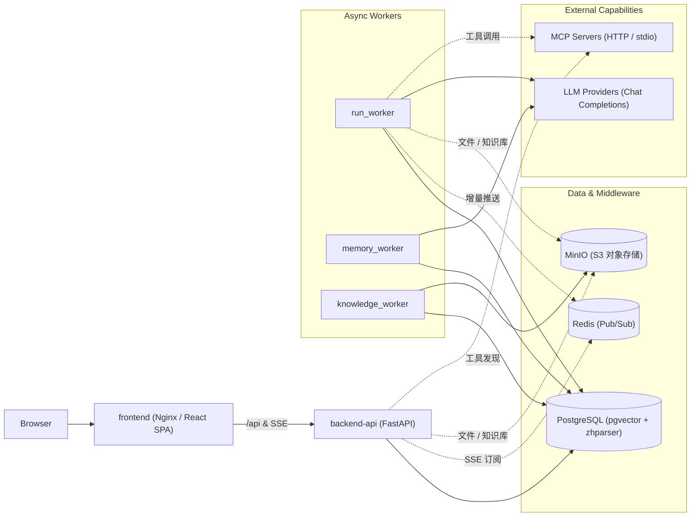

# Athena v2

面向多用户的通用智能助手，采用 **SPA 前端 + 模块化单体 API + 独立异步 Worker** 架构，以 PostgreSQL 为核心状态与检索底座，按需扩展 Redis、MinIO 及外部模型/工具能力。

## 系统架构



> 实线为核心依赖，虚线为可选或按配置启用的扩展路径。

### 运行时组件

| 组件 | 形态 / 角色 | 必选性 | 核心职责 |
| --- | --- | --- | --- |
| `frontend` | Nginx + React SPA（开发期 Vite） | 必选 | 托管前端页面，同源反代 `/api` 与 SSE 流 |
| `backend-api` | FastAPI 模块化单体 | 必选 | 提供认证、业务 CRUD、Run 调度、SSE 推送与管理接口 |
| `run_worker` | 异步 Worker（`python -m run_worker`） | 必选 | 消费 Run 队列，驱动 LLM 推理与 MCP/Skill/Subagent 工具执行 |
| `memory_worker` | 异步 Worker（`python -m memory_worker`） | 可选 | 消费终态 Run，执行长期记忆提取、合并决策与周期归档 |
| `knowledge_worker` | 异步 Worker（`python -m knowledge_worker`） | 可选 | 消费文档解析任务，执行多格式/OCR 提取、分块与向量入库 |
| `PostgreSQL` | 数据库（`pgvector` + `zhparser`） | 必选 | 持久化业务状态、异步任务队列、向量与中文全文检索索引 |
| `Redis` | Pub/Sub 事件通道 | 可选 | 转发 Run 实时增量至 SSE；不可用时自动降级为数据库对账 |
| `MinIO` | 私有 S3 对象存储 | 按需 | 以独立私有桶分别存储知识库原件与 Skills/会话文件 |

### 代码分层

- **后端（模块化单体 + DDD 分层）**：`api`（HTTP/SSE 入口）→ `app`（用例编排）→ `domain`（领域实体与端口）← `adapter`（ORM 仓储与外部适配）/ `infrastructure`（数据库、安全与基础驱动），由 `bootstrap` 组合根统一装配，辅以 `cli` 与 `common`。
- **前端（React + TypeScript + Vite）**：按 `frontend/src/features/` 业务域组织，通过同源 Cookie 与 API 通信；开发期由 Vite 代理 `/api`，生产期由 Nginx 托管静态资源并反代 `/api` 与 SSE。

## 快速启动

- **环境要求**：Python `3.12+`（见 [`pyproject.toml`](pyproject.toml)；知识库 OCR 暂不支持 Python 3.14）、Node.js `20+`（见 [`frontend/README.md`](frontend/README.md)）、Docker。

### Docker 一键启动本地测试栈

`docker/test.env` 与 `secrets/` 专用于 Docker 测试栈，与宿主机 `.env` 职责分离，不要互相复制；默认访问 `http://localhost:8080`。

```sh
[ -f docker/test.env ] || cp docker/test.env.example docker/test.env
scripts/bootstrap-test-secrets.py --fresh  # 仅全新环境；已有旧数据或旧配置去掉 --fresh
scripts/test-docker.sh                     # 默认 up：拉起依赖、构建镜像、迁移并启动全栈
scripts/test-docker.sh up --build-base     # 强制重建后端基础依赖镜像并启动
scripts/test-docker.sh status              # 查看业务与基础设施容器状态
scripts/test-docker.sh logs                # 实时跟踪业务容器日志
scripts/test-docker.sh down --all          # 停止业务与基础设施容器（保留 data/ 数据）
```

### 宿主机本地开发

以下命令在仓库根目录执行，完整环境变量及可选功能开关见 [`.env.example`](.env.example)。

```sh
# 1. 安装依赖并初始化 .env（知识库额外安装 '.[dev,knowledge]'）
python3 -m venv .venv && .venv/bin/python -m pip install -e '.[dev]'
npm --prefix frontend install && cp .env.example .env && chmod 600 .env
# 生成 32B Base64 密钥填入 ATHENA_MCP_SECRET_KEY，并配置 ATHENA_DATABASE_URL
python3 -c 'import base64,secrets; print(base64.b64encode(secrets.token_bytes(32)).decode())'

# 2. 加载 .env 并迁移数据库（清空重建开发库：先执行 downgrade base 再 upgrade head）
set -a && source .env && set +a
.venv/bin/alembic -c backend/alembic.ini upgrade head

# 3. 分别在独立终端启动 API（:8000，含 /health、/docs）、前端（:5173，代理 /api）及所需 Worker
.venv/bin/python -m uvicorn main:create_app --factory
cd frontend && npm run dev
.venv/bin/python -m run_worker
.venv/bin/python -m memory_worker     # 可选
.venv/bin/python -m knowledge_worker  # 可选（需安装 '.[dev,knowledge]'）
```

### 生产部署与管理员初始化

参考 [`compose.yml`](compose.yml) 与 [`.env.example`](.env.example) 准备 `.env.prod`（`chmod 600 .env.prod`）；HTTPS 生产环境须设置 `ATHENA_COOKIE_SECURE=true` 与规范公网 `ATHENA_PUBLIC_ORIGIN`。

```sh
docker build -f docker/Dockerfile.backend-base -t athena-backend-base:latest .  # 如需知识库加 --build-arg INSTALL_KNOWLEDGE=true
docker compose --env-file .env.prod run --rm backend-migration
docker compose --env-file .env.prod up -d  # 如需启动知识库 Worker，在 up 前加 --profile knowledge

# 提升已有注册账号为首个管理员（在已加载 ATHENA_DATABASE_URL 的仓库根目录执行）
.venv/bin/python -m cli.promote_admin --email <email>
```

## 开发检查

```sh
# 后端单元测试与静态检查
.venv/bin/python -m pytest
.venv/bin/python -m ruff check . && .venv/bin/python -m ruff format --check .
.venv/bin/python -m mypy

# 后端集成测试（需先初始化测试栈凭据；PostgreSQL 测试使用独立临时 schema，不影响业务数据）
docker compose --env-file docker/test.env -f compose.test.yml up -d  # 或先运行 scripts/test-docker.sh
source scripts/load-test-env.sh && .venv/bin/python -m pytest -m integration backend/tests/integration

# 前端类型检查、单元测试与构建
cd frontend && npm run typecheck && npm run test && npm run build
```

## 目录结构与文档

```text
backend/src/          后端源码（domain / app / adapter / api / infrastructure / bootstrap / cli / common）
backend/migrations/   Alembic 数据库迁移脚本
backend/tests/        后端单元测试与集成测试
frontend/             React + TypeScript + Vite 前端应用
mcp_servers/          随镜像部署的本地 stdio MCP Server 源码
docker/               Dockerfile、Nginx 网关配置与测试环境模板
scripts/              Docker 测试栈启停与本地凭据初始化脚本
docs/                 架构、功能设计与运行维护文档
compose.yml           生产环境 Docker Compose 编排配置
compose.test.yml      本地测试依赖（PostgreSQL、Redis、MinIO）编排配置
.env.example          全量环境变量配置模板
```

| 文档 | 说明 |
| --- | --- |
| [`.env.example`](.env.example) | 全量环境变量说明与生产安全自检清单 |
| [`docs/architecture.md`](docs/architecture.md) | 架构起点与模块边界 |
| [`frontend/README.md`](frontend/README.md) | 前端架构、路由、认证边界与开发说明 |
| [`mcp_servers/README.md`](mcp_servers/README.md) | 本地 stdio MCP Server 约定与镜像构建 |
| [`docs/knowledge-base-operations.md`](docs/knowledge-base-operations.md) | 知识库运行环境、MinIO 与 OCR 运维 |
| [`docs/skills-files-operations.md`](docs/skills-files-operations.md) | Skills 与会话文件运行手册及离线维护 |
| [`docs/run-design.md`](docs/run-design.md) | Run 执行模型与状态机设计 |
| [`docs/tools-mcp-design.md`](docs/tools-mcp-design.md) | 全局 MCP 与工具管理设计 |
| [`docs/memory-lifecycle-design.md`](docs/memory-lifecycle-design.md) | 长期记忆提取、检索与生命周期设计 |
