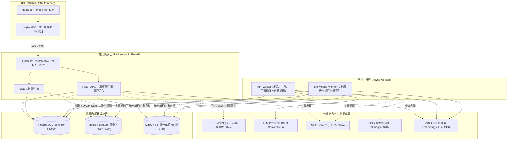

# Athena v2 — 面向企业内部使用的智能工作台

<p align="center">
  🏛️ <strong>Athena v2</strong> 🏛️
</p>

<p align="center">
  <strong>基于模块化单体与异步 Worker 架构的企业内部 AI 智能工作台</strong>
</p>

<p align="center">
  <a href="#-快速开始">快速开始</a> •
  <a href="#-功能概览">功能概览</a> •
  <a href="#-技术架构">技术架构</a> •
  <a href="#-配置与运维速查">配置与运维</a> •
  <a href="#-api-与项目文档">API 与文档</a> •
  <a href="#-生产部署">生产部署</a>
</p>

---

## 📖 项目简介

Athena v2 是一个面向企业内部使用的智能工作台，采用 **SPA 前端 + 模块化单体 API + 独立异步 Worker** 架构，以 PostgreSQL（`pgvector` HNSW）作为核心状态持久化与混合检索底座，搭配统一单桶对象存储（MinIO/S3）、无状态远程 Embedding 服务与可选 Redis 实时事件通道，支撑多部门协同办公、资产隔离与安全可控的 Agent 执行。

### 核心设计理念

- **企业身份与组织驱动**：关闭开放自助注册，原生支持**飞书 SSO 与通讯录组织树同步**（离职即刻吊销历史 Cookie 会话），并内置**非生产本地 Mock 多角色组织模式**（生产环境启动期硬阻断）
- **统一三层权限引擎**：公司级（`company`）、部门级（`department` + `resource_visibility_grants` 精准授权）、个人级（`personal`）统一贯通知识库、Skills、MCP 与 Subagent，员工调岗后无需重新登录即可实时生效
- **日常办公无项目对话与场景化模型**：无需强制建项目即可随时发起对话，默认检索公司公共库与本部门知识库，按场景化模型目录（`GET /api/v1/models`）透明选择模型并异步生成 ≤20 字会话标题
- **轻量工作偏好与显式记忆**：下线重型自动记忆提取与后台归档 Worker，改由个人工作背景指令 + 最多 50 条显式备忘记忆（手动管理与对话中免审批 `save_user_memory` 工具）提供可控、透明的个性化上下文
- **业务化审批与保密运维**：支持模型与 MCP 凭据局部保密更新、MCP 启停与独立重发现（无损保留工具 ID 与审批配置）、批量审批配置及面向业务人员的中文待审批卡片投影
- **计算与存储轻量化**：无状态远程 OpenAI 兼容 Embedding 替代本地重量级模型权重，统一单桶 `ATHENA_STORAGE_*` 按业务前缀隔离知识库原件、Skills 与会话附件

---

## ✨ 功能概览

### 🔐 企业身份、组织架构与三层权限
- **多模式安全认证**：支持**飞书原生 OAuth SSO**（Redis 原子一次性 `state` 防重放）、**本地应急超级管理员登录**及**非生产 Mock 多角色快捷登录**；同源 HttpOnly Cookie 会话支持服务端即时撤销
- **组织树与分权管理**：支持 `super_admin`（超级管理员）、`dept_admin`（部门管理员，按 `dept_admin_scopes` 管辖指定部门及子树）与 `member`（普通员工）三级角色，离职同步或后台停用同事务吊销全部活跃会话
- **四条业务线统一隔离**：知识库、Skills、MCP Server、Subagent 共享 `AccessPolicyService` 实时权限引擎，跨部门越权遵循安全 403/404 边界，调岗后原 Cookie 与在途 Run 立即撤权

### 💬 日常对话工作台与 Agent 编排
- **无项目知识库解耦**：会话不再强依赖项目绑定，未指定范围时默认按企业权限检索公司与本部门知识库，亦支持显式指定 `knowledge_base_ids` 或传 `[]` 关闭检索
- **场景化模型目录与快照固化**：管理员可配置 `visible_to_users`、`scenario_label`、`scenario_description` 与 `supports_vision`；普通用户通过 `GET /api/v1/models` 获取脱敏目录，Run 创建时固化不含凭据的 `model_snapshot_json`
- **异步 Run 与自动标题**：支持流式 SSE 回答、并行工具批次、停止取消、补充输入与失败重试；主 Run 完成后后台异步生成 ≤20 字中文会话标题，并严格保护用户手工标题不被覆盖
- **项目增强与会话松绑**：项目支持简介、背景指令与默认技能列表，支持 `detach_sessions=true` 温和解绑后删除；会话支持按标题关键词检索（`GET /api/v1/sessions?q=`）与首条消息前灵活归属调整

### 🧠 轻量个人偏好与显式记忆
- **个人工作偏好（`/api/v1/me/preferences`）**：维护个人工作背景指令（`custom_instructions`）与显式记忆总开关（`memory_enabled`），主 Run 自动注入安全提示词上下文
- **显式备忘记忆（`/api/v1/me/memories`）**：支持手动增删改查（上限 50 条）以及对话中调用免审批内置工具 `save_user_memory` 落库（`source="chat_explicit"`）

### 🔧 MCP 保密运维、Skills 与业务化审批
- **MCP 运维增强**：支持 `PATCH` 保密局部更新（`secrets_upsert` / `secrets_remove` 保留未提及原密文）、独立启停开关（停用后工具即刻下线）、独立重发现（`POST /rediscover` 按 `remote_name` 增量对齐并无损保留工具 ID、审批策略与中文展示配置）及软删重名复用
- **业务化待审批卡片**：支持为 MCP 工具配置 `display_name`、`approval_summary_template` 与 `parameter_labels`，以及原子批量切换审批开关（`PATCH /api/v1/admin/tools/batch-approval`）；命中审批时 Run 详情直接投影可读中文标题、安全渲染摘要与优先中文标签的 `formatted_arguments`
- **Skills 与 Subagent**：支持公司/部门级脚本技能包、个人 Markdown Skills 与会话附件/产物隔离存储；支持自定义 Subagent 及其部门可见范围与工具白名单

---

## 🏗️ 技术架构

### 整体架构设计



> 实线为核心依赖路径，虚线为可选或按配置启用的扩展路径；API 与各 Worker 通过 PostgreSQL 队列解耦，生产环境强制启用 Redis 驱动分布式登录限流与飞书 OAuth 一次性 `state` 防重放。

### 后端代码分层

后端采用模块化单体与 DDD 分层架构：`api`（HTTP/SSE 路由、DTO 与前置鉴权/上传准入中间件）→ `app`（应用服务、三层权限策略与 Worker 消费逻辑）→ `domain`（纯领域实体、值对象、异常与仓储端口）← `adapter`（SQLAlchemy ORM 仓储与外部适配）/ `infrastructure`（数据库、AES-GCM 凭据加密、飞书客户端、MCP 传输与解析/远程 Embedding 驱动），由 `bootstrap` 组合根按进程统一装配，辅以 `cli`（运维 CLI）与 `common`（共享基础工具）。

### 技术栈

| 层级 | 技术选型 | 职责 |
| --- | --- | --- |
| **前端界面** | React 18 + TypeScript + Vite + React Router + TanStack Query | 多用户企业工作台 SPA、SSE 实时渲染与状态缓存 |
| **网关与托管** | Nginx（生产）/ Vite Proxy（开发） | 静态资源托管、同源 `/api` 与 SSE 反向代理 |
| **后端 API** | Python 3.12+ + FastAPI + Uvicorn + Pydantic | REST API、SSE 推送、同源 Cookie 鉴权、三层权限引擎与上传准入 |
| **持久化与检索** | PostgreSQL + SQLAlchemy (asyncio) + Alembic + `pgvector` (HNSW) | 业务状态、组织树物化路径、行锁并发队列、向量与全文混合检索 |
| **缓存与事件通道** | Redis (`redis-py`) | Run SSE 增量 Pub/Sub、分布式认证限流与飞书 OAuth 一次性 `state`（生产必选） |
| **统一对象存储** | MinIO / S3 (`ATHENA_STORAGE_*`, 单桶前缀隔离) | 单私有桶按 `knowledge/`、`session-files/`、`skills/` 等前缀隔离原件与附件 |
| **模型与工具生态** | OpenAI SDK + MCP SDK + 无状态远程 OpenAI 兼容 Embedding + `tiktoken` | 外部模型调用、HTTP/stdio MCP 工具、无状态远程向量化与 Token 计数 |
| **文档解析与可选 OCR** | `pypdfium2` + `python-docx` / `openpyxl` / `python-pptx` + `Pillow` + `jieba`（核心内置）；PaddleOCR（可选 `knowledge` 依赖） | PDF / Office / 图片多格式文本提取与可选扫描件本地 OCR |
| **容器与 CI** | Docker Compose + GitHub Actions (`pytest` / `ruff` / `mypy` / `eslint` / `vitest` / `playwright`) | 本地测试栈、生产容器编排与自动化质量门禁 |

---

## 📁 项目结构

```text
Athena_v2/
├── .github/workflows/          # GitHub Actions CI 工作流 (ci.yml)
├── backend/
│   ├── alembic.ini             # Alembic 迁移配置
│   ├── migrations/             # PostgreSQL 数据库迁移脚本（当前唯一 head: 20261209_0042）
│   ├── src/                    # 后端源码（模块化单体）
│   │   ├── api/                # HTTP/SSE 路由、DTO、转换器与前置鉴权/上传中间件
│   │   ├── app/                # 应用服务（auth/org/access/preference/run/llm/tool/skill/knowledge/subagent）
│   │   ├── domain/             # 纯领域实体、值对象、异常与仓储端口
│   │   ├── adapter/            # SQLAlchemy 仓储与 LLM / Redis / MinIO 适配
│   │   ├── infrastructure/     # 数据库连接、加密安全、飞书客户端、MCP 与解析/远程 Embedding 驱动
│   │   ├── bootstrap/          # API 与各 Worker 进程的依赖装配组合根与生产安全护栏
│   │   ├── cli/                # 运维 CLI（应急超管初始化、飞书同步、提权、文件离线维护）
│   │   ├── common/             # 共享基础工具（ID、时间等）
│   │   ├── main.py             # FastAPI 应用入口
│   │   ├── run_worker.py       # Run 异步执行 Worker 入口
│   │   └── knowledge_worker.py # 知识库解析与索引 Worker 入口
│   └── tests/                  # 单元测试、端到端验收测试与 PostgreSQL / Redis / MinIO 集成测试
├── frontend/
│   ├── src/                    # React SPA 源码
│   └── e2e/                    # Playwright 浏览器 E2E 测试
├── mcp_servers/                # 本地测试/演示用 stdio MCP Server 源码（通过 docker/compose.test-mcp.override.yml 在测试栈只读挂载）
├── docker/                     # Dockerfile、Nginx 网关配置、依赖镜像与测试模板
├── scripts/                    # Docker 测试栈启停、凭据初始化与环境加载脚本
├── docs/                       # 架构、第一期企业后端 API 契约与运维文档
├── compose.yml                 # 生产环境 Docker Compose 编排配置
├── compose.test.yml            # 本地测试依赖（PostgreSQL、Redis、MinIO）编排配置
├── pyproject.toml              # Python 依赖、打包元数据与 Ruff / Mypy / Pytest 配置
└── .env.example                # 全量环境变量模板与生产上线安全自检清单
```

---

## 🚀 快速开始

### 环境要求

- **Python**: `>= 3.12`（见 [`pyproject.toml`](pyproject.toml)；如需启用知识库 OCR，请勿使用 Python 3.14）
- **Node.js**: `>= 20` 与 npm（见 [`frontend/README.md`](frontend/README.md)）
- **Docker**: Docker Desktop 或 Docker Engine（用于本地测试容器栈或容器部署）

### 方式一：Docker 一键启动本地测试栈

`docker/test.env` 与 `secrets/` 专用于 Docker 测试栈，与宿主机 `.env` 职责分离，不要互相复制。知识库与文件能力已默认无条件装配，启动前请在 `docker/test.env` 中填写容器可访问的 `ATHENA_EMBEDDING_BASE_URL`（如宿主机 Ollama/vLLM `http://host.docker.internal:11434/v1` 或外部 OpenAI 兼容服务地址）。`docker/test.env.example` 默认开启非生产 `ATHENA_AUTH_MOCK_ENABLED=true`，启动后默认拉起 `frontend`、`backend-api`、`backend-worker` 与 `backend-knowledge-worker`，访问 `http://localhost:8080` 即可使用预置的 6 个企业多角色 Mock 账号一键登录体验。

```bash
# 1. 初始化本地测试配置与凭据
[ -f docker/test.env ] || cp docker/test.env.example docker/test.env
scripts/bootstrap-test-secrets.py --fresh  # 仅全新环境；已有旧数据或旧配置去掉 --fresh

# 2. scripts/test-docker.sh 常用命令
scripts/test-docker.sh                     # 默认 up：拉起依赖、构建镜像、迁移并启动全栈
scripts/test-docker.sh up --build-base     # 强制重建后端基础依赖镜像并启动
scripts/test-docker.sh status              # 查看业务与基础设施容器状态
scripts/test-docker.sh logs                # 实时跟踪业务容器日志
scripts/test-docker.sh down --all          # 停止业务与基础设施容器（保留 data/ 持久化数据）
```

### 方式二：宿主机本地开发

以下命令在仓库根目录执行。

#### 1. 安装依赖并初始化 `.env`

```bash
python3 -m venv .venv
.venv/bin/python -m pip install -e '.[dev]'       # 如需启用重量级本地 OCR 改为 '.[dev,knowledge]'
npm --prefix frontend install
cp .env.example .env && chmod 600 .env

# 生成 32 字节 Base64 主密钥填入 .env 的 ATHENA_MCP_SECRET_KEY，
# 并填写 ATHENA_DATABASE_URL、统一对象存储 ATHENA_STORAGE_* 与远程 ATHENA_EMBEDDING_BASE_URL
python3 -c 'import base64,secrets; print(base64.b64encode(secrets.token_bytes(32)).decode())'
```

#### 2. 加载 `.env`、执行数据库迁移并准备登录账号

```bash
set -a && source .env && set +a
.venv/bin/alembic -c backend/alembic.ini upgrade head

# 方案 A（推荐本地多部门联调）：在 .env 中设置 ATHENA_AUTH_MOCK_ENABLED=true，API 启动时自动幂等预置 5 部门与 6 角色账号
# 方案 B（本地应急超管账号）：已关闭开放注册，通过运维 CLI 创建或重置本地 super_admin
printf '%s\n' '<至少12位强密码>' | .venv/bin/python -m cli.bootstrap_super_admin \
  --email admin@example.com --password-stdin --display-name "系统超管"
```

#### 3. 启动后端 API、前端与后台 Worker

后端与 Worker 进程不会自动读取 `.env`，新开终端需先执行 `set -a && source .env && set +a`：

```bash
# 后端 API（终端 1）
.venv/bin/python -m uvicorn main:create_app --factory

# 前端开发服务器（终端 2）
cd frontend && npm run dev

# 后台 Worker（另开终端启动）
.venv/bin/python -m run_worker         # 对话 Run、工具执行、子智能体与自动标题
.venv/bin/python -m knowledge_worker   # 知识库文档解析与远程向量索引
```

- **前端界面**：`http://localhost:5173`（Vite 开发服务器自动代理 `/api` 到 `127.0.0.1:8000`，保持同源 Cookie 校验）
- **后端 API / 存活探针 / OpenAPI 文档**：`http://127.0.0.1:8000` / `/health` / `/docs`

---

## ⚙️ 配置与运维速查

### 核心环境变量概览

复制 [`.env.example`](.env.example) 为 `.env` 按需配置。模型配置、供应商 API Key、MCP 凭据与压缩策略均由超管在后台动态管理，并由 `ATHENA_MCP_SECRET_KEY` 以 AES-GCM 加密落库，无需在环境变量中明文存放模型密钥。

| 分类 | 核心变量 | 说明 |
| --- | --- | --- |
| **数据库与加密** | `ATHENA_DATABASE_URL`, `ATHENA_MCP_SECRET_KEY` | PostgreSQL 16+（含 `pgvector`）与 32 字节 Base64 主密钥 |
| **环境与安全护栏** | `ATHENA_ENV`, `ATHENA_COOKIE_SECURE`, `ATHENA_PUBLIC_ORIGIN`, `ATHENA_REDIS_URL` | `ATHENA_ENV=production` 时**强制要求**配置 `ATHENA_REDIS_URL` 且**严禁**开启 `ATHENA_AUTH_MOCK_ENABLED=true` |
| **飞书原生 SSO** | `ATHENA_FEISHU_ENABLED`, `ATHENA_FEISHU_APP_ID`, `ATHENA_FEISHU_APP_SECRET`, `ATHENA_FEISHU_REDIRECT_URI`, `ATHENA_FEISHU_BASE_URL` | 生产开启时强制依赖 Redis（一次性 `state` 防重放）且接口与回调地址须为 HTTPS |
| **非生产 Mock** | `ATHENA_AUTH_MOCK_ENABLED` | 仅限开发/测试联调；开启后启动自动幂等预置多部门组织树与 6 个典型角色测试账号 |
| **统一对象存储（必填）** | `ATHENA_STORAGE_ENDPOINT`, `ATHENA_STORAGE_ACCESS_KEY`, `ATHENA_STORAGE_SECRET_KEY`, `ATHENA_STORAGE_BUCKET`, `ATHENA_STORAGE_SECURE` | 单私有桶统一承载知识库原件（`knowledge/`）与 Skills/会话文件（`skills/`、`session-files/`），启动期前置校验 |
| **知识库与远程 Embedding（必填）** | `ATHENA_EMBEDDING_BASE_URL`, `ATHENA_EMBEDDING_API_KEY`, `ATHENA_EMBEDDING_MODEL`, `ATHENA_EMBEDDING_DIMENSIONS`, `ATHENA_EMBEDDING_SEND_DIMENSIONS`, `ATHENA_KNOWLEDGE_SEMANTIC_MIN_SCORE` | 无状态远程 OpenAI 兼容向量服务（默认 1024 维 `BAAI/bge-m3`），不加载本地模型权重 |
| **技能运行时** | `ATHENA_SKILL_TEMP_ROOT`, `ATHENA_SKILL_PYTHON_EXECUTABLE` | 复用统一 `ATHENA_STORAGE_*` 单桶，配置技能脚本运行解释器与临时目录 |

> 完整环境变量清单、Worker 并发/租约调优参数及生产上线前 10 项安全自检清单见 [`.env.example`](.env.example)。

### 运维 CLI 速查

以下命令均需先加载环境变量（`set -a && source .env && set +a`）并在仓库根目录执行：

```bash
# 1. 幂等创建或重置本地应急 super_admin 账号（重置密码时自动撤销其全部历史会话）
printf '%s\n' '<至少12位强密码>' | .venv/bin/python -m cli.bootstrap_super_admin \
  --email admin@example.com --password-stdin --display-name "系统超管"

# 2. 手动或定时任务触发飞书通讯录全量原子同步（更新部门物化 path、在职员工，并自动停用离职员工且吊销其全部会话）
.venv/bin/python -m cli.sync_feishu_org

# 3. 将已有且活跃的账号提升为 super_admin
.venv/bin/python -m cli.promote_admin --email user@example.com

# 4. Skills / 会话文件孤儿对象离线维护
.venv/bin/python -m cli.file_maintenance
```

### 生产环境安全护栏（`ATHENA_ENV=production`）

当 `ATHENA_ENV=production` 时，API 进程在分配任何连接池前强制执行以下启动期门禁，违反任一项将立即抛出 `RuntimeError` 拒绝启动：
1. **严禁开启本地 Mock 登录**：`ATHENA_AUTH_MOCK_ENABLED=true` 立即抛出 `auth_mock_forbidden_in_production`；
2. **强制启用分布式 Redis**：缺失 `ATHENA_REDIS_URL` 拒绝启动（防止误用单进程内存认证限流）；
3. **飞书 SSO 强安全约束**：开启 `ATHENA_FEISHU_ENABLED=true` 时强制要求 Redis 驱动一次性 `state` 原子防重放，且 `ATHENA_FEISHU_BASE_URL` 与 `ATHENA_FEISHU_REDIRECT_URI` 必须使用 `https://`。

---

## 🧪 测试与质量门禁

### 后端静态检查、迁移核验与全量测试

```bash
# 1. Ruff 代码风格与语法检查
.venv/bin/python -m ruff check backend/src backend/tests

# 2. Mypy 严格类型检查
.venv/bin/python -m mypy --strict backend/src

# 3. 核验 Alembic 单一迁移 head（20261209_0042）
.venv/bin/alembic -c backend/alembic.ini heads

# 4. 运行第一期端到端验收测试剧本
.venv/bin/python -m pytest -v backend/tests/test_phase1_e2e_acceptance.py

# 5. 运行后端全量单元测试
.venv/bin/python -m pytest -q
```

### 后端集成测试（真实 PostgreSQL / Redis / MinIO）

```bash
docker compose --env-file docker/test.env -f compose.test.yml up -d
source scripts/load-test-env.sh
.venv/bin/python -m pytest -m integration backend/tests/integration
```

### 前端检查与构建

```bash
cd frontend
npm run typecheck
npm run lint
npm run test
npm run build
```

---

## 📚 API 与项目文档

### 二期前端交接与核心 API 契约

- **权威接口契约文档**：[`docs/phase1-enterprise-backend-api-contract.md`](docs/phase1-enterprise-backend-api-contract.md)（完整整理第一期全部新增与变更接口的请求/响应字段、权限角色矩阵、403/404 约定、错误码及旧版差异）
- **交互式 OpenAPI 文档**：启动后端后访问 `http://127.0.0.1:8000/docs`

主要模块路由前缀速查：

| 模块 | 路由前缀 / 端点 | 说明 |
| --- | --- | --- |
| **健康检查** | `GET /health` | 进程存活探针 |
| **企业认证与 Mock** | `/api/v1/auth/*` | 能力声明、本地登录、飞书 SSO（`feishu/authorize`、`feishu/callback`）、登出、`/me` 组织投影、改密、非生产 `/mock/*`（开放注册已下线） |
| **组织通讯录管理** | `/api/v1/admin/org/*` | 部门树查询、企业用户分页筛选、任命 `dept_admin` 与管辖范围、停用吊销会话、手动触发飞书同步（超管） |
| **项目与会话** | `/api/v1/projects`, `/api/v1/sessions` | 项目简介/背景指令/默认技能、`detach_sessions=true` 温和删项、无项目会话、按标题检索（`?q=`）、消息历史 |
| **场景化模型目录** | `GET /api/v1/models` | 普通用户可见、已启用且脱敏的场景化可对话模型列表 |
| **Run 与 SSE** | `/api/v1/sessions/{session_id}/runs` | 提交（支持 `knowledge_base_ids` 与 `model_profile_id`）、取消、重试、补充输入、业务化待审批卡片、工具审批与 SSE |
| **个人偏好与显式记忆** | `/api/v1/me/preferences`, `/api/v1/me/memories` | 个人工作背景指令、显式记忆开关与最多 50 条备忘记忆 CRUD（旧自动记忆接口已下线） |
| **文件与技能** | `/api/v1/sessions/{session_id}/files`, `/api/v1/skills`, `/api/v1/me/skills` | 会话文件、当前用户可见技能目录与个人 Markdown Skills |
| **知识库与检索** | `/api/v1/knowledge-bases`, `/api/v1/projects/{project_id}/knowledge-bases` | 三层可见性知识库、文档版本、混合检索与项目关联 |
| **安全工具目录** | `/api/v1/tools` | 已认证用户按部门权限可见的安全工具目录 |
| **模型与提示词运维** | `/api/v1/admin/llm/*`, `/api/v1/admin/system-prompts` | 模型创建/局部保密编辑（`PATCH`）/强引用保护软删（`DELETE`）、默认指向、压缩策略与系统提示词（超管） |
| **MCP / 工具 / 技能 / 子智能体运维** | `/api/v1/admin/mcp/servers`, `/api/v1/admin/tools`, `/api/v1/admin/skills`, `/api/v1/admin/subagents` | MCP 保密 `PATCH`/启停/独立重发现/软删、工具中文审批映射与批量审批、三层分权技能包、Subagent 编排 |

### 核心文档

| 文档 | 说明 |
| --- | --- |
| [`docs/phase1-enterprise-backend-api-contract.md`](docs/phase1-enterprise-backend-api-contract.md) | **第一期企业级后端重构 API 契约与二期前端交接文档** |
| [`.env.example`](.env.example) | 全量环境变量说明与生产上线前安全自检清单 |
| [`docs/architecture.md`](docs/architecture.md) | 架构起点与模块边界 |
| [`frontend/README.md`](frontend/README.md) | 前端架构、路由、认证边界与开发说明 |
| [`mcp_servers/README.md`](mcp_servers/README.md) | 本地 stdio MCP Server 约定与测试栈只读挂载说明 |
| [`docs/knowledge-base-operations.md`](docs/knowledge-base-operations.md) | 知识库运行环境、对象存储与 OCR 运维手册 |
| [`docs/skills-files-operations.md`](docs/skills-files-operations.md) | Skills 与会话文件运行手册及离线维护 |
| [`docs/run-design.md`](docs/run-design.md) | Run 执行模型与状态机设计 |
| [`docs/tools-mcp-design.md`](docs/tools-mcp-design.md) | 全局 MCP 与工具管理设计 |

---

## 📦 生产部署

参考 [`compose.yml`](compose.yml) 与 [`.env.example`](.env.example)，复制 `.env.example` 为 `.env.prod`（`chmod 600 .env.prod`）并填写外部 PostgreSQL、Redis、统一单桶对象存储（`ATHENA_STORAGE_*`）、远程 OpenAI 兼容 Embedding 服务（`ATHENA_EMBEDDING_BASE_URL`）及强随机主密钥。生产环境务必设置 `ATHENA_ENV=production`、`ATHENA_COOKIE_SECURE=true`、`ATHENA_AUTH_MOCK_ENABLED=false` 并配置规范公网 `ATHENA_PUBLIC_ORIGIN`。

```bash
# 1. 预构建后端基础依赖镜像（如需启用重量级本地扫描件/图片 OCR，加 --build-arg INSTALL_KNOWLEDGE=true）
docker build -f docker/Dockerfile.backend-base -t athena-backend-base:latest .

# 2. 执行数据库迁移
docker compose --env-file .env.prod run --rm backend-migration

# 3. 启动生产全栈服务（默认一并启动 frontend、backend-api、backend-worker 与 backend-knowledge-worker）
docker compose --env-file .env.prod up -d

# 4. 初始化本地应急 super_admin 账号（开放自助注册已下线）
printf '%s\n' '<至少12位强密码>' | docker compose --env-file .env.prod run --rm -T backend-api \
  python -m cli.bootstrap_super_admin --email admin@example.com --password-stdin --display-name "系统超管"

# 5. 若启用飞书原生 SSO，执行首次通讯录组织树同步
docker compose --env-file .env.prod run --rm backend-api python -m cli.sync_feishu_org
```
