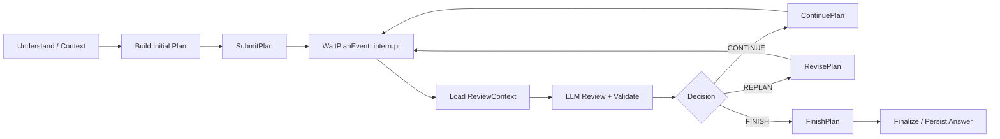

# Athena Agent 架构 v1.1 具体实施方案

方案编写日期：2026-10-21。实施状态更新至 2026-10-22：P1–P4 核心代码持续落地，当前推进 P6 可靠性验收；以第 16 节记录的证据和未完成项为准。

设计依据：用户提供的 `/Users/udouble/Downloads/Athena_Multi_Agent_Architecture_v1.1.md`，全文 770 行、含取消控制通道和验收要求。实现基线：本日当前工作区，包含未提交的目录迁移和代码修改；不以旧目录或历史方案代替当前源码。

## 1. 实施结论与范围

采用 **Root Graph + 确定性 DAG Orchestrator + 独立 Worker Graph**。这是调度职责、持久化模型和恢复协议的整体替换。保留现有上下文、记忆、文件、知识库、Provider、工具适配器和 SSE 基础设施，围绕新的执行链重新接线。

- Root 负责目标理解、初始规划、每轮 Review、Replan、最终回答。
- Orchestrator 独占 Plan/Version/Round/Task/Execution 状态写入权，不依赖 LLM。
- Worker 只接收任务和所需上游结果，运行自己的模型与工具循环。
- Approval Manager 只决定具体工具操作是否获准；通过 Worker Resume Job 恢复对应执行。
- Run Controller 负责用户请求生命周期和独立停止通道；取消不调用 Root Review。

先保持模块化单体部署：API、Orchestrator 消费者、Worker Dispatcher、Root Resume Dispatcher 可以在同一进程中运行，但通过持久化协议交互。独立运行不要求第一步拆成多个服务；双进程并发测试用于验证协议没有依赖内存状态。

本方案沿用已有分层：`domain` 保存纯业务类型和不变量，`application` 保存用例及当前 LangGraph 图，`infrastructure` 保存 PostgreSQL/工具等适配器，`workers` 保存后台消费者，`bootstrap` 只装配。当前 LangGraph 正从 `infrastructure/orchestration` 移入 `application/orchestration/langgraph`，不在本次计划中反向迁回。

新文档覆盖旧版中不一致的契约：Plan 需要 `WAITING_REVIEW/CANCELLING`；完成屏障从整个 Plan 改为当前 Round；新增自动故障修复 reconciler；审批恢复不走 Root `run.resume`。不保留两套活跃调度语义。

## 2. 当前实现与目标差距

以下是静态代码证据，不代表已验证生产行为。

| 位置 | 当前行为 | v1.1 改造 |
|---|---|---|
| `application/orchestration/root_workflow.py:437` | 启动 Scheduler，每 50ms 查询 Plan，最多等待 120 秒 | 提交命令后进入真正的 `interrupt()`；移除计划完成轮询 |
| `application/orchestration/scheduler.py:42,62` | 内存 `asyncio.Task` 执行 Worker；终态后再次计算 ready 并补派 | 固定 Round 成员，持久化 Job；只在 Root 允许后创建下一轮 |
| 同文件 `:146` | Scheduler 可调用结果 Synthesizer，结果保存在内存 | 删除调度层的模型汇总职责，由 Root Review/Finalize 接管 |
| `infrastructure/persistence/postgres/repositories/orchestration_repository.py:68,101` | 根据整个 DAG 领取任务，全部 Task 终态即结束 Plan | 增加 Round 屏障、版本条件和事件事务；Plan 由 FinishPlan 结束 |
| `domain/orchestration/entities.py` | 无 Round、PlanVersion、独立 execution ID/lease；Task 成功为 `done` | 补齐业务实体、身份和状态机；新协议统一成功值 |
| `application/orchestration/langgraph/graphs/root.py:215`、`graphs/worker.py:59` | 恢复传普通 state dict，通过路由重新进入 | 恢复使用同 thread 的 `Command(resume=...)`，核对实际 pending interrupt |
| `application/orchestration/worker_workflow.py` | 有工具批次路由骨架，审批只是状态返回 | 拆 Prepare/Policy/Approval/Execute/Observe 节点，审批使用持久化中断 |
| `application/orchestration/langgraph/runtime/root_agent.py:167` | 生产 Worker Agent 单次调用模型并返回 `done` | 真正的 Agent Loop、工具绑定、预算、结构化成功/失败和证据 |
| `bootstrap/postgres.py:344` | Worker 仅注入模型执行函数，未接完整工具/审批链 | 显式注入工具策略、执行网关、审批校验、租约、取消令牌 |
| `application/approval/service.py:98`、`bootstrap/postgres.py:135` | 决定落库后直接回调，回调执行 Root `RUN_RESUME` | 决定和 ResumeWorker Job 同事务；HTTP 快速返回，后台只恢复该 Worker |
| `application/runs/execution_service.py:47` | 取消 Root 后直接把 Run 置 cancelled；等待命令映射在内存 | 先原子 CANCELLING，再协调 Worker、审批、恢复 Job，收敛后终结 |
| `application/orchestration/langgraph/runtime/worker_executor.py:79` | Worker cancel 当前返回 0 | 持久取消控制 + 本地调用登记 + 协作取消 + fencing |
| `infrastructure/persistence/postgres/models/runtime_models.py` | 有 Run/Plan/Task/Command/Event/Approval；缺少 Round/Version/Execution/可靠投递模型 | 复用主表，新增版本、轮次、执行和队列表；展示事件不当作调度队列 |
| `infrastructure/persistence/postgres/unit_of_work/postgres.py` | 有 UoW 外壳，但仓储通常各开事务 | 增加用例范围共享 session 的事务端口，支撑跨仓储原子写入 |
| `frontend/src/types/index.ts`、`types/events.ts` | Plan 状态未覆盖 Review/取消中，缺少 Round/Version 协议 | 同步类型、投影、审批卡片、停止状态和历史读取 |

现有 `test_multi_worker_e2e.py` 位于 unit 目录、使用替身仓储；不能把名称中的 E2E 当成真实 Provider/PostgreSQL/浏览器验收。

## 3. 编码前固定的实施口径

以下是对文档未完全展开部分的建议默认值，应与实现一并固化到契约测试。

1. **冻结全部 ready，不按并发上限截断 Round。** 例如 10 个 ready、并发上限 3，10 个都是本轮成员，最多 3 个同时运行。完成一个可领取本轮剩余成员，禁止把刚变成 ready 的下游任务补进本轮。
2. **Task 与 Execution 分离。** 某 attempt 失败但仍允许重试时，只终结 attempt，Task 保持非终态，不增加 Round 终态计数。退避时间、次数和原因落库；重试留在原 Round。
3. **依赖失败交给 Review。** 当前 Round 结束后把失败依赖及不可运行的下游列入 ReviewContext，不沿用当前 DAG 的自动级联取消来替 Root 决策。Continue 返回 `BLOCKED_DEPENDENCIES`，Root 必须修订或结束。
4. **版本是不可变快照，执行事实不是快照副本。** 同一个成功 Task 可被多个版本引用；修改目标、输入、依赖或权限必须创建新 Task ID，不覆盖已完成结果。
5. **FINISH 可以提前结束。** 未执行的剩余 Task 记为 `CANCELLED(reason=plan_finished)`，不抹掉成功或失败事实；成功/失败由 Root 对照目标明确判断。
6. **第一版不引入无限期通用 BLOCKED。** 非审批缺输入先作为结构化 `FAILED(code=needs_input)` 进入轮次 Review，由 Root 澄清、修订或结束。未来可另加带期限和恢复契约的阻塞状态。
7. **普通对话和澄清可直接回答。** 需要实际执行工具的工作进入 Plan；单任务也生成一节点 DAG，避免继续维护 Root 执行工具的第二条路径。这是建议的产品范围口径。
8. **审批过期按拒绝处理。** EXPIRED 决定与恢复 Job 同事务，Worker 收到 ToolDenied 后可尝试替代方案；Task 总时限和模型预算仍生效，绝不自动批准。
9. **业务成功状态统一为 `completed`。** 领域枚举名可用 COMPLETED；迁移把旧 Task `done` 映射为 completed、`timed_out` 映射 failed 并保留错误码。历史展示通过只读映射处理。
10. **有限规划预算。** 限制总轮次、重规划次数、Root/Worker 模型 turn、任务数和执行时限，全部来自 Settings。无意义重复 Review、非法模型输出要有有界修复和明确失败路径。

建议状态集合：Plan=`created/running/waiting_review/cancelling/completed/failed/cancelled`；Round=`running/completed/cancelled`；Task=`pending/running/waiting_approval/cancelling/completed/failed/cancelled`。待退避重试用 Task pending + Execution/Job 的 available_at 表达；Execution 单独记录 queued/running/interrupted/completed/failed/cancel_requested/cancelled。Run 在轮次和审批等待时保持 running，额外增加 cancelling，不把 Graph 的 suspended 当成 Run 终态。

## 4. 目标模块与接口

建议在现有目录内扩展，以下新文件为拟新增位置。

```text
backend/src/
  domain/orchestration/
    entities.py                # Plan / Round / Task / Execution / Version
    commands.py                # Submit/Continue/Revise/Finish/Cancel
    events.py                  # RoundCompleted / WorkerEvent 等
    review.py                  # ReviewContext / ReviewDecision
    dag.py, validation.py      # 纯校验和 ready 集合计算
    ports.py                   # 事务、仓储、执行、结果引用端口
  application/orchestration/
    command_handler.py         # 确定性编排命令入口
    round_service.py           # 冻结成员、推进轮次、结束屏障
    task_event_handler.py      # 校验 Worker 事件并推进事实
    review_context_service.py  # 按 round_id 构造一致审查输入
    root_workflow.py           # 规划、审查、提交决策、最终回答
    worker_workflow.py         # Worker 模型/工具循环用例
    langgraph/graphs/          # Root / Worker 图与 interrupt 节点
    langgraph/runtime/         # 调用、pending interrupt 读取、恢复适配
  application/approval/
    service.py                 # 原子决定和恢复作业，不直接调用图
    interrupt_collector.py     # checkpoint 确认后登记审批
  application/tools/
    approval_policy.py         # 工具/参数/资源/用户的确定性策略
    execution_gateway.py       # 权限、审批、取消、幂等统一门禁
  application/runs/
    cancellation_service.py    # 独立停止控制入口
    finalization_service.py    # 最终消息、Run 终态和后处理幂等收敛
  infrastructure/persistence/postgres/
    models/orchestration_models.py
    repositories/              # 状态、命令回执、Job、Outbox/Inbox
    unit_of_work/              # 用例共享事务实现
  workers/
    worker_dispatcher.py
    root_resume_dispatcher.py
    outbox_dispatcher.py
    orchestration_reconciler.py
```

逻辑契约：

- `handle_command(command) -> CommandReceipt`：按业务幂等键返回固定回执；校验状态、版本、review_round_id。
- `apply_worker_event(event) -> EventReceipt`：事件去重、执行栅栏验证、attempt/Task 更新、轮次屏障和 Outbox 同事务。
- `load_review_context(round_id) -> ReviewContext`：读取该轮版本和结果，不漂移到后续版本。
- `claim_job(worker_id) -> JobLease`：SKIP LOCKED 领取、短事务更新租约和 token，事务外调用图。
- `resume_root(job)`、`resume_worker(job)`：核对 thread/checkpoint/interrupt 和取消状态，恢复调用串行。
- `cancel_run(run_id, actor, idempotency_key) -> CancelReceipt`：直接落停止状态；后台控制通知可异步。

跨边界模型显式定义 schema_version；领域保持 dataclass/enum，不依赖 SQLAlchemy/Pydantic/LangGraph。HTTP DTO 和模型输出在入口校验；JSONB 在仓储边界编码，不使用任意 dict 贯穿所有层。

## 5. PostgreSQL 数据模型与迁移

物理表优先复用 `agent_*` 和 `approvals`，不用为了对齐文档示例而整体改名。

| 表 | 具体增量与约束 |
|---|---|
| `agent_runs` | 增 cancellation_epoch、控制/终结元数据；状态加入 cancelling；记录 Root wait 的 round/version/interrupt/checkpoint 身份 |
| `agent_plans` | 增 current_version、active_round_id、cancellation_epoch；加入 waiting_review/cancelling；沿用一 Run 一 Plan |
| `plan_versions` | PK(plan_id, version)，不可变 dag_json、目标/约束引用、修订原因、review_round_id、创建命令 |
| `agent_tasks` | 保留逻辑 Task、当前状态、active_execution_id、result_ref；增加定义哈希，旧 execution_generation 仅作 attempt 序号 |
| `plan_version_tasks` | PK(plan_id, version, task_id)，版本成员、定义和依赖引用；FK 指向不可变 Task 定义；不复制执行结果 |
| `plan_rounds` | round_id、plan_id、version、round_no、status、expected_count、terminal_count；UNIQUE(plan_id, round_no) |
| `round_tasks` | PK(round_id, task_id)，冻结成员；每 Task 至多一个实际执行 Round，重试仍在同轮；不可向已启动 Round 增成员 |
| `task_executions` | execution_id、task_id、round_id、attempt、worker_thread_id、state、lease_owner/until、fencing_token、checkpoint_ref；UNIQUE(task_id, attempt) 和 worker_thread_id |
| `approvals` | 增 execution_id、worker_thread_id、interrupt_id、operation_key、args_hash、expires_at、decided_by；UNIQUE(worker_thread_id, interrupt_id)；完整决定状态 |
| `orchestration_commands` | 命令信封、业务幂等键、payload_hash、固定回执；UNIQUE(调用主体或命令作用域, idempotency_key) |
| `worker_jobs` | execute/resume/cancel，执行/中断引用、available_at、attempt、租约、状态；执行派发和审批恢复分别有唯一键 |
| `root_resume_jobs` | event_id、Root wait 身份、租约/重试/状态；UNIQUE(consumer_name, event_id) |
| `outbox_events` | 业务事件信封、接收方、投递状态、可重试时间；RoundCompleted 语义唯一键包含 round_id |
| `inbox_events` | UNIQUE(consumer_name, message_id)，received/processed 状态和结果；先收件不等于已处理 |
| `tool_operations` | operation_key、不可变参数哈希、执行状态、结果引用、外部请求 ID、external_effect_status；UNIQUE(operation_key) |

独立的 orchestration_commands 是 Plan 控制命令回执表；原 `agent_commands` 继续承载 HTTP Run 提交和命令查询，不充当第二套 Plan 状态源。worker_jobs 中的审批恢复以 approval_id/interrupt_id 为幂等身份，不能只保存 approved 布尔值。

结果引用优先指向持久 Task 结果和现有文件 artifact，包含摘要、证据定位、类型和大小；大输出不塞入事件或 Root checkpoint。TaskResult 中的 evidence、uncertainties、metrics 需实际落库，不在转换中丢弃。

新表时间使用 TIMESTAMPTZ/UTC；对现有字符串时间字段分步骤迁移或保留边界转换，避免本次顺带重写全库。

关键数据库约束：

- 每 Plan 最多一个 RUNNING Round；每 Task 最多一个当前有效 execution。
- RoundCompleted 的业务唯一性独立于随机 message_id，重复消息不能再次加 terminal_count。
- 所有归属通过 FK 或受锁事务核验，禁止跨 Run/Plan 引用 Task、审批和结果。
- Run 活跃唯一索引及 `get_active_for_session` 把 cancelling 纳入活跃范围；Root 等轮次期间 Run 仍 running。
- 调度队列为 status/available_at/lease_until 建索引；待审批不按活跃执行租约过期重试。

迁移使用 `backend/sql/migrations/` 中可版本化脚本，更新初始化 schema 与 ORM，增加应用版本/数据库版本检查；`metadata.create_all()` 不会补齐既有表字段，不能代替迁移。

## 6. 核心事务与严格 Round 算法

所有相关仓储在同一用例事务共享 session。不要先调用一个自行提交的仓储，再调用另一个仓储来模拟原子性。长模型调用、工具调用、等待审批均在事务外。

统一锁顺序：Run → Plan → Round → Task（按 ID 排序）→ Execution → Approval/Job。Worker 终态可先无锁定位归属，再从 Plan/Run 开始加锁；取消与领取遵守相同顺序，设置锁超时和有限事务重试。

### 6.1 Submit / Continue / Revise

同事务执行：命令去重和 payload_hash 核对 → 锁 Run/Plan → 校验可执行状态、版本及待审 round → 验证完整 DAG → 写版本（仅 Submit/Revise）→ 计算全部 ready → 写 Round 及全部成员 → 建立执行记录/派发 Job → 写 Outbox 和固定回执。

- 同幂等键不同 payload 返回冲突；同键重试返回原回执，不用当前状态重新执行。
- Continue/Revise 必须消费当前 WAITING_REVIEW 的 round；一轮只接受一次有效决策。
- 无剩余任务的 Continue 返回 NO_REMAINING_TASKS；剩余任务因失败依赖无 ready 返回 BLOCKED_DEPENDENCIES，不创建空 Round，不伪造 RoundCompleted。
- 无后续任务的修订建议拒绝为 NO_RUNNABLE_TASKS 并要求 FINISH；禁止提交无事件来源的等待状态。
- Round 包含全部 ready，但领取 Job 时才检查并发额度；同轮排队任务可后续启动。

### 6.2 Worker claim / heartbeat / completion

claim 在事务内检查 Plan/Run 未取消、Round 身份和额度，更新 Job、Execution 运行状态与租约。领取后在事务外调用 Worker Graph。

完成事件事务：Inbox 去重 → 核对 active_execution_id、fencing_token、cancellation_epoch → 写 attempt 结果 → 决定持久重试或 Task 终态 → 仅首次 Task 终态增加计数 → 若本轮全终态且 Plan 仍 RUNNING，则完成 Round、Plan=WAITING_REVIEW、插入唯一 RoundCompleted Outbox → 标记 Inbox processed。

正常完成不直接把 Plan 置 completed。取消期间 Task 结果按提交顺序归档，退出确认走取消收敛路径，不触发 RoundCompleted。

### 6.3 Outbox / Inbox / 投递

业务事务写 Outbox；Dispatcher 至少一次投递。投递后、标记完成前崩溃允许重投，由消费者唯一键去重。Inbox received 状态可先落库；只有业务变更或恢复结果已持久化才置 processed，不能先打“已处理”标记再调用图。

短间隔轮询 Job/Outbox 是传输实现，允许使用；禁止通过高频遍历全部 Task 来判断 Round 完成。LISTEN/NOTIFY 可用于唤醒，数据库队列仍是真相来源。

## 7. Root Graph、Review 与恢复

目标图：



把 SubmitPlan 与 Wait 拆成不同节点，避免 resume 重跑包含命令提交的节点。即使因 checkpoint 崩溃重放提交，command_id/idempotency_key 也必须稳定。

Root checkpoint 只存目标/context refs、plan_id/version、当前 round、wait 身份、review decision/命令键等恢复所需数据。ReviewContext 从业务库按轮次装配，不依赖内存或仅看当前轮摘要。

ReviewContext 至少包含原目标、用户约束、有效 DAG、全部可复用上游结果摘要、当轮成功/失败/不确定性、待执行任务及阻塞原因、剩余预算。Root 输出严格的 CONTINUE/REPLAN/FINISH tagged union；非法结构有限修复，命令状态冲突时重新读事实，不用盲重试掩盖版本变化。

恢复握手：

1. Root 进入 Wait 节点，调用 interrupt，当前调用退出。
2. Runtime 读取 checkpoint 与 pending interrupt，记录 wait_generation、round_id、interrupt_id、checkpoint_id 和 armed 状态；释放执行锁。
3. RoundCompleted 先到则 Inbox/Resume Job 保持等待就绪，延后重试；不丢弃，也不盲目 resume。
4. Dispatcher 领取 Root Job，取得 thread 独占权，重查 Run/Plan、事件轮次、wait generation 和实际中断，调用 `Command(resume=...)`。
5. Root 提交的审查命令以 round 为业务幂等身份；图已前进但 Job 未确认时，重投检查命令回执/checkpoint 再收敛，不再次推进下一轮。

“恢复一次”指每轮只产生一次有效业务决策；崩溃窗口内模型可能重算，不能承诺 LLM 天然只调用一次。提交的审查决定、版本及下一轮效果必须至多一次。

PlanFailed 走独立故障处理节点：加载错误事实后按可恢复策略处理或生成失败答复，不当成成功 Round；PlanCancelled 只同步 Run/SSE，不唤醒 Root 模型。决定校验失败可以重新生成候选命令，但必须仍绑定同一待审 round；一个 round 最多提交一次成功决策。

Revision 校验保留集合、取消集合、新增集合无冲突；完成任务不改内容；依赖只能指向新版本中有效 Task；引用的旧结果必须匹配定义和输入语义；完整新 DAG 无环。旧 Round、版本和结果永久保留审计关联。

FinishPlan 与最终回答生成之间另有故障窗口：先记录 finishing/finalization 工作身份，再幂等持久最终消息、Run 终态和记忆处理 Job。Plan 已结束不等于回答已发出；重启恢复 Finalize，禁止重派 Task 或重复写最终消息。最终汇总失败用独立重试/错误状态表达。

## 8. Worker Agent Loop、工具和审批

Worker Graph：Initialize → Think → PrepareToolCall → Policy → Approval interrupt（如需）→ ExecutionGate → Execute → Observe → Think；达到完成条件后输出 TaskCompleted，不可恢复错误或预算耗尽输出 TaskFailed。

- 不把完整 DAG、其他 Worker 对话和全部会话工具注入 Worker；只给任务、系统约束、所需上游 refs、有效工具集合。
- 有效工具为任务申请、用户授权、全局启用、Worker 能力的交集。非法模型输出在入口拒绝并让模型有界修复；不能继续通过清空 allowed_tools 掩盖不合法计划。
- 模型真正绑定可调用工具 schema；Built-in/MCP 经过同一执行网关，不能绕过审批或取消检查。
- 保留各轮 messages/tool results/预算；普通工具错误返回模型观察，重试和不可恢复失败有明确分类。
- 取消令牌在模型与工具边界检查；已知异步 Provider 保留异步执行，同步调用只在适配器中隔离。

审批具体链路：Prepare 持久化不可变 tool_call_id/operation_key/args_hash → 专用 Approval Node interrupt → Runtime 确认实际 checkpoint/pending interrupt → Collector 幂等写审批、Task=waiting_approval 与 Outbox → 释放执行调用和活跃额度。

决策 API 在一个事务中核对操作者、归属、期限、Plan/Run、execution/interrupt 和参数摘要；PENDING 条件更新到 APPROVED/REJECTED，写审计与唯一 ResumeWorker Job，202 返回。客户端不用提交可信的 task_id/run_id，由服务端读取审批归属。

Worker Resume Dispatcher 独占 thread，确认同一 interrupt，以 interrupt_id → decision 映射恢复。不同 Worker 的审批互不影响；同 Worker 多中断分别绑定具体操作，不按数组顺序猜测。

拒绝/过期形成显式 ToolDenied，回到 Observe/Think；不是自动 TaskFailed，更不会唤醒 Root。通过后仍需副作用前再次验证状态、取消 epoch、租约、参数哈希和授权未消费。

工具幂等账本不能只使用“新 execution_id + 新序号”作为跨重试防重方案：相同已准备操作在 checkpoint 恢复和确认重试中复用 operation_key。完整重做一个失败 Task 时，先核对既有操作及外部结果；不确定状态禁止无条件重发。支持外部幂等键的工具透传同键；无幂等能力的工具在可能已发送后标 UNKNOWN/待对账，不承诺恰好一次。

数据库中的操作门禁与外部 API 发送不是一个事务：取消先提交则拦截，操作已获准并开始发送则属于在途副作用，可能无法撤回。不能用本地行锁或 fencing 宣称消除了这个边界。

## 9. 用户停止、租约与故障修复

停止 HTTP 直接调用 RunCancellationService，不把首次 CANCELLING 落库排在普通 Root 命令之后。鉴权和幂等后锁 Run/Plan，原子置取消中、增加 epoch、取消未启动 Task/待审批/未消费恢复 Job、写控制 Outbox，再返回 202。

- 无 Plan：阻断后续 SubmitPlan，取消 Root 当前调用。
- 有活动 Plan：阻断派发、Continue/Revise/Resume，向 Worker 控制通道发 CancelExecution。
- Plan 已 FINISH、Root 正生成最终答案：Plan 终态保持，取消尚未终结的 Run/Root Finalize；不能因 Plan 已完成漏掉停止。
- Run 已完成/失败/取消：返回原终态及 already_terminal=true，不改历史。
- 所有执行退出确认或被可靠隔离后才提交 CANCELLED；外部动作未知独立保留 UNKNOWN。

后台控制消息、心跳和 Job 使用数据库持久状态；内存 registry 只用于定位本进程调用并发出及时取消，不承担权威事实。取消期间 Round 不触发新 Review，旧 Root 事件归档/作废，不能让 Run 复活。

一个 thread 同时仅一个图调用：执行租约 + thread 独占锁 + 心跳失效主动终止调用。注意只在业务结果上 fencing 不足以阻止旧进程继续写 checkpoint；同 thread 恢复必须确认旧 owner 已退出/失去可靠执行权。若无法确认，不并发恢复同一 thread；可隔离旧 attempt 后以新 thread 重试，并先核对副作用账本。不要仅凭 lease 时间到就假设旧进程已停止。

Reconciler 低频、索引化、分批处理：

| 崩溃/异常窗口 | 修复动作 |
|---|---|
| Outbox 或执行 Job 长期未确认 | 到期重投；consumer/命令键去重 |
| Worker claim 后进程退出 | 核验租约、thread/checkpoint/账本；同执行恢复或新 attempt 重试 |
| checkpoint 已中断，审批未创建 | 从有效 execution 的 pending interrupt 补建审批 |
| 审批决定已记录，Worker 未恢复 | 重新领取持久恢复 Job |
| Round 全终态，屏障事件缺失 | 重算核验并按唯一键补写事件；正常路径仍由事件事务推进 |
| Root 未 armed，事件已收到 | 核验 checkpoint 后补 armed，再投递保留的 Job |
| Root 决策提交后进程退出 | 查命令回执/checkpoint 收敛，不再创建新 Round |
| CANCELLING 跨重启遗留 | 重发控制消息、收敛执行、记录外部 UNKNOWN，不提前宣称停止 |
| Finalize 写消息前后崩溃 | 按 run/finalization 唯一键补全消息、Run 状态及记忆 Job |

## 10. HTTP、SSE 与前端

| 接口 | 新行为 |
|---|---|
| `POST /api/sessions/{session_id}/runs` | 保持异步提交和 command_id 幂等，进入新 Root 入口 |
| `POST /api/runs/{run_id}/cancel` | 接受 Idempotency-Key；返回 run_id、CANCELLING/原终态、already_terminal；不等待 Worker 全部退出 |
| `POST /api/approvals/{approval_id}/decision` | 校验 APPROVE/REJECT 决定；202 仅表示决定已记录和恢复作业已创建 |
| `GET /api/runs/{run_id}/orchestration`（拟新增） | 当前 Plan/version/round、冻结成员、Task/Execution、审批和取消事实的查询快照 |
| `GET /api/plans/{plan_id}/versions/{version}`（拟新增） | 不可变 DAG 与修订原因，用于版本历史展示 |
| 现有会话 SSE / 历史事件查询 | 增加 Round/Review/Version/取消事件，沿用序号重放和服务端 occurred_at |

审批接口上线时同步替换旧 resolve/batch-resume 语义；若 UI 保留批量操作外观，也必须对每个审批分别授权和建恢复 Job。批次只是展示分组，不是 Worker 共享放行凭证。

SSE 增加 plan_version/round_id/execution_id 和通用追踪身份；关键事件经 Outbox 投影进入 agent_events。投影以源 event_id 去重，再分配 session_seq，不能每次重投生成新的前端事件。实时通知失败由历史重放恢复，既有 persisted occurred_at 不被接收时间覆盖。

前端范围：

- `types/index.ts`、`types/events.ts`、`api/client.ts`：统一新状态与响应。
- `store/chatStore.ts`、`hooks/useSessionEventStream.ts`：幂等投影、刷新后快照与事件重放衔接。
- `WorkerTaskCard`、`OrchestrationSummary`：展示 Round 成员、当前排队/运行/审批/重试及审查结果。
- `ApprovalDialog`、`ApprovalsView`：多个独立审批；已决定/已过期/已取消不可重复操作。
- `Chat`：停止后先显示“正在停止”，收到终态显示“已停止”；未知外部结果另列。
- `RunChainView`：关联 Plan Version → Round → Task → Execution → Tool/Approval；Review 和 Revision 有可读原因。已有演示数据必须与真实历史清楚区分。

所有 API 从认证主体取得 actor 并校验资源归属；全局登录保护不能代替 Run/审批的资源权限。

## 11. 分阶段实施与完成条件

| 阶段 | 主要交付 | 完成条件 |
|---|---|---|
| P0 契约与基线 | 当前脏树快照清单、状态/命令/事件/Review 类型、迁移策略、验收矩阵、预算配置 | 明确替换清单和默认口径；记录现有测试结果与已有失败 |
| P1 数据与事务内核 | Version/Round/Execution、共享 UoW、五类命令处理、Outbox/Inbox、取消 epoch 基础 | 真实 PG 下冻结集合、命令去重、版本 CAS、并发终态屏障成立 |
| P2 独立 Worker Runtime | 持久 execute Job、claim/lease/fence、通用 Graph、Agent Loop、工具读路径和结果引用 | 两 Worker 并行；重启不丢 Job；旧结果拒绝；本轮重试不提前完成 Round |
| P3 Root Review 与 Revision | 真 interrupt/resume、Inbox 就绪握手、三态决策、版本修订、幂等 Finalize | 不轮询、不常驻等待；早到事件可靠；Review 后才启动下一轮 |
| P4 工具审批与停止闭环 | Policy、操作账本、真实审批中断、决定/恢复 Job、完整取消控制 | 只暂停对应 Worker；拒绝可继续；审批/停止竞态无新授权；停止收敛 |
| P5 前端与 API 切换 | 新查询/decision/cancel、状态与事件投影、轮次/版本视图 | 浏览器可操作多审批、观察轮次和停止；断线刷新可恢复 |
| P6 故障验收与旧链删除 | Reconciler、故障注入、双实例并发、真实环境验收、文档/旧代码清理 | 新执行路径唯一；必要验收全部有证据；未覆盖能力明确记录 |

P1 就建立取消状态、Outbox、幂等身份和共享事务；P2 就建立 lease/fence，P4 就实现副作用账本。P6 是验证和补全修复路径，不是第一次补这些基础能力。

建议按上述阶段拆 7 个可审查提交/PR，每一阶段包含自己的测试。开发期间新增模块可以暂不装配；生产入口最终一次切换到新语义。不要让旧自动补派 Scheduler 和新 Round Scheduler 同时处理同一 Run。

## 12. 验收矩阵与验证层级

| 编号 | 场景 | 必须断言 |
|---|---|---|
| A01 | 同轮 A/B，A 先完成，C 依赖 A | B 未终结前无 Review、C 不启动；B 终结仅一个 RoundCompleted |
| A02 | 本轮 10 ready、并发 3 | Round 固定 10 成员；全程不超额度；不加入下一层任务 |
| A03 | B 等审批，A 完成 | 无活跃等待协程；Root 不恢复；审批后 B 原 thread 继续 |
| A04 | 两 Worker 同时审批 | 独立决定/恢复，批准一个不解锁另一个 |
| A05 | REJECT/EXPIRE | ToolDenied 进入 Worker 观察；无未经许可调用；不强制全局 Replan |
| A06 | RoundCompleted 早于 Root interrupt | Inbox 留存；Root 就绪后仅一次有效审查决策 |
| A07 | Continue 重复 10 次、同键不同内容 | 仅一下一轮；不同内容明确冲突 |
| A08 | Replan 复用完成结果、取消剩余、增加新任务 | 历史版本/轮次不变，新 DAG 正确生效，变更定义不能复用旧 Task ID |
| A09 | 单 attempt 失败后重试 | Task 不提前终态、Round 不提前完成；重启后重试次数不清零 |
| A10 | 无 ready 的失败依赖；非法/循环 DAG | 返回明确错误并进入有界审查处理，不永久挂起 |
| A11 | 批准后、Resume 前宕机 | 决定和 Job 同存；重启后恢复；无重复副作用 |
| A12 | claim/工具发送/结果写入/checkpoint 前后宕机 | checkpoint/账本/外部幂等共同判定；未知结果显式对账，不盲重发 |
| A13 | Stop 与审批、Continue、Revise、完成事件并发 | 按事务顺序裁决；取消后不复活、不再派新轮次 |
| A14 | 规划中/审批中/并行中/Review 中/Finalize 中停止 | 及时进入 CANCELLING；不调用取消后 Root Review；终结时机正确 |
| A15 | 已终态后停止、重复停止 | 保留原终态，同一取消进度，不重复语义事件 |
| A16 | lease 过期但旧 Worker 晚到 | 旧结果不能推进状态；同 thread 不出现双 checkpoint writer |
| A17 | 外部 API 已发出无法取消 | 内部可收敛，保留 UNKNOWN/审计，UI 不宣称外部已回滚 |
| A18 | SSE 断线/刷新/重复投递 | 后台照常；关键事件重放、审批和版本快照一致；时间不漂移 |
| A19 | 最终消息/记忆任务写入前后崩溃 | 最终消息与记忆 Job 各至多一份；Run 可恢复收敛 |
| A20 | 未授权用户、跨 Run 审批/结果引用 | 资源权限拒绝；不改变状态，不执行工具 |

验证分层：

1. **纯领域测试**：DAG、状态机、冻结成员、Revision、ReviewDecision 校验。
2. **应用用例测试**：命令回执、事件重复/乱序、重试、审批拒绝、取消路由；替身测试只证明用例逻辑。
3. **真实 PostgreSQL 集成**：独立连接/两个消费者竞争、唯一约束、CAS、锁顺序、事务 rollback、跨仓储原子性、Outbox、租约。
4. **LangGraph 集成**：项目锁定版本 + AsyncPostgresSaver，确认真的产生 pending interrupt；重建 runtime 后用同 thread Command 恢复；检查中断前节点重放。
5. **真实 Provider/工具**：真实模型生成多轮 Plan/Review；只读与需审批工具各一条；Docker shell 通过实际沙箱执行，不能回退宿主 shell 来冒充验收。
6. **浏览器 E2E**：真实聊天入口，观察并行、审批、Review、Replan、停止、刷新重放；保存截图/事件/业务行/执行身份的对应证据。

延时等待测试使用可控时间验证 3 小时审批语义，不要求测试真实空等 3 小时。故障注入通过明确 barrier 控制“提交后/ack 前”等窗口，不靠概率性 sleep。

测试安排：扩展 `tests/unit/test_orchestration_domain.py`，替换 Scheduler/Root Graph/Worker 测试中的旧语义；在 `tests/integration/` 新增 round、delivery、approval、cancellation、graph_recovery 套件；保留层级边界测试。前端执行 `npm run typecheck` 和 `npm run build`，视觉/交互结论必须另有浏览器证据。

后端测试从 `backend` 目录，使用项目根 `.venv/bin/python`（即 `../.venv/bin/python`）并设置 `PYTHONPATH=src:.`；PG 集成测试显式要求隔离测试库配置，跳过不计通过。不要使用生产库做故障注入。

## 13. 切换、旧数据和回退

1. 先记录当前未提交工作及测试基线，基于当前分层完成新增模块。文档与源码行号会变化，以提交基线重新核对。
2. 做兼容历史读取的增量迁移，备份业务库和 checkpoint；升级程序启动前校验迁移版本。
3. 停止接受新 Run，让旧 Run 自然结束。遗留审批/运行需明确关闭或通过受控停机流程处理，不能给旧运行凭空补 Round 后由新 Scheduler 接管。
4. 对遗留 checkpoint 记录 graph_schema_version；旧 checkpoint 不自动加载到新图。旧终态数据只读展示；不臆造历史 Review/Version 事实。
5. 一次切换 bootstrap、API/DTO 和前端到新执行链，然后验证一条完整真实闭环。
6. 删除旧自动补派、Scheduler Synthesizer、Root 轮询、dict 路由恢复、审批直接回调 Root、内存等待命令事实，以及无实现的 Worker cancel。
7. 更新 `backend/docs/architecture.md` 等仍引用旧 `athena/runtime` 的文档，使实现方案与当前入口一致。

回退只对已排空新活跃 Run 的环境进行，保留迁移增加的数据；若新任务已经发生外部副作用，先对账再决定恢复，不能用降级程序或恢复数据库备份宣称撤销了外部动作。历史数据读取兼容不意味着保留两个运行调度器。

## 14. 第一批实际编码任务

第一批只实施 P0/P1，形成能够用真实 PostgreSQL 验证的确定性内核：

1. 新增 Round、PlanVersion、Execution、命令/事件、Review 类型；固定统一状态值和 schema_version。
2. 建立共享事务端口，新增迁移与索引，并修正 cancelling 的活跃 Run 约束。
3. 实现 Submit/Continue/Revise/Finish/Cancel 命令、固定 Round 与唯一命令回执。
4. 实现 WorkerEvent ingestion、attempt 与 Task 分离、轮次终态屏障和 Outbox/Inbox。
5. 通过 A01/A02/A07/A08/A09/A10/A13 的数据库协议测试，再接入 Worker 和 Root 图。

首个里程碑：**即便没有真实 LLM，仍能在 PostgreSQL 中证明轮次、版本、重试、取消和投递协议正确；后续图和 Provider 是协议的调用者。** 这只是内核验收，不等于整个 Agent 已重构完成。

## 15. LangGraph 版本核对与本轮验证范围

本轮只读核对发现：`backend/pyproject.toml` 锁定 langgraph 1.2.11；项目 `.venv` 实际为 langgraph 1.2.11、langgraph-checkpoint-postgres 3.2.0。该环境 `interrupt` 签名只有 value，Command 接受 resume 参数。

官方文档说明恢复需使用同一 thread_id 和 Command(resume)，中断节点恢复时会从节点开头重跑。因此命令提交、准备操作、审批中断和工具执行必须拆节点并配合幂等。最新文档中的 interrupt response_schema 要求 langgraph >=1.2.12，本次不依赖它；需要类型校验就在应用入口显式完成。

参考：[LangGraph Interrupts](https://docs.langchain.com/oss/python/langgraph/interrupts)、[Persistence](https://docs.langchain.com/oss/python/langgraph/persistence)。这些文档只支撑图恢复方式；Round、事务投递、审批授权和取消状态均需 Athena 自己实现。

本节记录 2026-10-21 编写实施方案时的核对范围，不再代表当前实现和验证状态。后续实施证据见第 16 节。

## 16. 当前实施进度与验收缺口

截至 2026-10-22，Root Review、版本化 Round、持久 Worker Job、审批恢复、取消与超时控制，以及工具副作用账本已有运行时代码。P1–P4 的实现主干已进入联调，但阶段完成条件尚未全部满足，因此不将其标记为验收完成。

P5 的 API/前端切换仍需按验收矩阵补足浏览器实证，特别是多审批、轮次状态、停止收敛和断线后恢复。P6 当前补充了两条 PostgreSQL 故障恢复验收：一条模拟 Worker 崩溃留下的过期租约，由两个独立数据库会话同时领取，验证只产生一个新租约、fencing token 从 7 增至 8、执行代际保持不变、Job 投递次数增加，且旧持有者无法续租；另一条在 PostgreSQL checkpointer 中持久化 Worker 审批 interrupt，关闭并重建 checkpointer 和 executor 后找回原 interrupt，获批后仅执行一次工具并完成原任务。两条测试都在随机临时 schema 内运行并于结束时删除。

P6 仍需覆盖更广的故障注入，完成浏览器端与真实 Provider 的闭环验收，并在这些证据成立后清理旧执行链。PostgreSQL 租约与 checkpoint 集成测试通过；全量后端测试存在既有失败，Ruff 当前环境未安装，均不能据此宣称整体验收完成。
