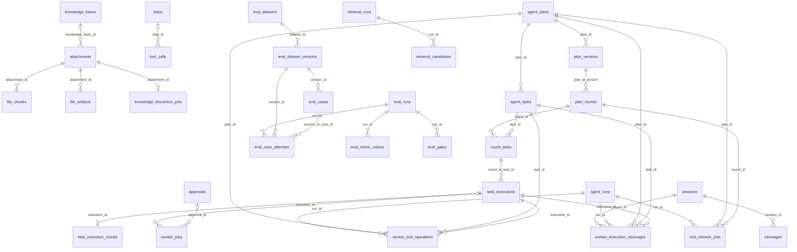

# 数据库表结构与使用情况审查

> 审查范围：2026-10-26 工作区的 PostgreSQL SQLAlchemy ORM 模型、`backend/src` 和 `frontend/src` 的直接引用，以及同日配置的本机 `athena` 数据库只读核验。2026-10-27 已移除 `MemoryJobScopeSnapshotModel`；本次没有重建数据库，因此旧表仍留在本机 schema 中。

## 结论

- 审查时 ORM 定义 **53 张表、563 个映射字段**；移除 `MemoryJobScopeSnapshotModel` 后当前 ORM 定义 52 张表、559 个映射字段。
- 本机 `public` schema 清理后有 57 张基础表：53 张来自 ORM，另有 4 张由 LangGraph PostgreSQL checkpointer 管理。
- 旧版 SQL 重建脚本已移除；当前 schema 由 PostgreSQL ORM 模型定义。
- 本次移除了两张没有应用代码消费者的代码索引表，以及 7 个未使用字段；`backend/scripts/prune_unused_postgres_objects.sql` 已在本机数据库执行。
- 本机只读核验：`code_symbols`、`code_dependencies`、`file_chunks` 均为 0 行；`agent_runs` 有 6 行，但 `user_id` 均为 NULL、4 个计数列均为 0；`task_executions` 为 0 行。其他环境仍需分别检查。
- `pg_stat_user_tables` 显示代码索引表曾有少量顺序扫描，但 `stats_reset` 为 NULL 且精确行数为 0；该统计不能证明外部系统永远不会访问这些表。

## 暂保留字段

| 表 | 字段 | 静态证据 | 建议核实方向 |
|---|---|---|---|
| `eval_runs` | `model_snapshot_json`, `judge_config_json` | 当前仓库代码没有读写；评估设计文档仍将它们定义为模型与 Judge 配置快照 | 暂保留以免丢失评估复现契约；若决定统一存入 `config_json`，再单独迁移 |

## 本次清理明细

| 对象 | 处理 | 依据 |
|---|---|---|
| `code_symbols`, `code_dependencies` | 删除表及 ORM 导出 | 当前 `backend/src` 无消费者；本机表均为空。代码分析工具只在文档中描述，当前仓库没有对应执行实现 |
| `file_chunks.content_fts` 及 GIN 索引 | 删除列和索引 | 文件检索当前走向量索引；没有全文查询引用，本机 `file_chunks` 为空 |
| `agent_runs.user_id` | 删除列 | 单用户架构；当前持久化与读取不使用，本机 6 行均为 NULL |
| `agent_runs.root_llm_turn_count`, `worker_llm_turn_count`, `total_worker_llm_turn_count`, `tool_call_count` | 删除 4 列 | 没有写入、读取或接口消费，本机已有行全为 0 |
| `task_executions.checkpoint_ref` | 删除列 | Worker checkpoint 由 LangGraph checkpointer 管理，本列没有代码读写；本机表为空 |

> 本次直接清理的是已核验的本机数据库。其他环境应用此 SQL 前，应分别检查 schema、写入数据、API 输出、离线任务/报表、手写 SQL，以及备份和回滚要求。

## 表字段目录

字段仅列 ORM 映射列名；主键、外键与索引以模型定义为准。

### `evaluation_models.py`

- **`eval_case_attempts`** (17): `attempt_id, run_id, case_id, version_id, attempt_number, status, input_snapshot_json, output_text, trace_json, retrieval_run_id, agent_run_id, duration_ms, input_tokens, output_tokens, estimated_cost, error_message, created_at`
- **`eval_cases`** (6): `case_id, version_id, task_type, case_json, tags_json, created_at`
- **`eval_dataset_versions`** (9): `version_id, dataset_id, version, manifest_sha256, status, case_count, schema_version, manifest_json, created_at`
- **`eval_datasets`** (7): `dataset_id, name, description, task_type, owner, created_at, updated_at`
- **`eval_gates`** (9): `gate_id, run_id, metric, status, rule_json, actual, baseline, reason, created_at`
- **`eval_metric_values`** (11): `metric_id, run_id, case_id, version_id, attempt_id, metric_name, value_numeric, value_json, evaluator_version, evidence_json, created_at`
- **`eval_runs`** (17): `run_id, version_id, mode, status, name, git_sha, config_json, model_snapshot_json, judge_config_json, baseline_run_id, case_count, completed_count, failed_count, started_at, completed_at, created_at, error_message`

### `file_models.py`

- **`adapter_registry`** (7): `name, version, mime_types_json, extensions_json, capabilities_json, enabled, updated_at`
- **`attachments`** (20): `id, logical_document_id, document_version, session_id, knowledge_base_id, message_id, filename, mime_type, size_bytes, sha256, storage_key, adapter_name, adapter_version, status, capabilities_json, parsed_metadata_json, error_message, created_at, updated_at, deleted_time`
- **`file_artifacts`** (8): `id, attachment_id, kind, cache_key, content, storage_key, metadata_json, created_at`
- **`file_chunks`** (10): `id, attachment_id, ordinal, content, embedding, token_count, locator_json, metadata_json, native_score, deleted_time`
- **`knowledge_bases`** (6): `id, name, description, created_at, updated_at, deleted_time`

### `orchestration_models.py`

- **`orchestration_commands`** (11): `message_id, scope_key, idempotency_key, payload_hash, command_type, plan_id, plan_version, round_id, status, result_json, created_at`
- **`orchestration_inbox`** (11): `consumer_name, message_id, event_type, payload_json, payload_hash, status, attempt, last_error, receipt_json, created_at, processed_at`
- **`orchestration_outbox`** (18): `message_id, dedupe_key, event_type, correlation_id, plan_id, plan_version, round_id, task_id, execution_id, payload_json, schema_version, status, attempt, available_at, lease_owner, lease_until, published_at, occurred_at`
- **`plan_rounds`** (9): `round_id, plan_id, plan_version, round_number, status, expected_task_count, terminal_task_count, created_at, completed_at`
- **`plan_versions`** (6): `plan_id, version, dag_json, change_reason, based_on_round_id, created_at`
- **`root_resume_jobs`** (13): `job_id, dedupe_key, run_id, plan_id, round_id, root_wait_generation, status, attempt, available_at, lease_owner, lease_until, created_at, updated_at`
- **`round_tasks`** (5): `round_id, task_id, status, active_execution_id, terminal_at`
- **`task_execution_results`** (6): `result_ref, execution_id, result_json, content_sha256, content_bytes, created_at`
- **`task_executions`** (15): `execution_id, round_id, task_id, attempt, worker_thread_id, status, lease_owner, lease_until, fencing_token, cancellation_epoch, result_ref, error_json, result_json, created_at, updated_at`
- **`worker_jobs`** (13): `job_id, dedupe_key, job_type, execution_id, approval_id, payload_json, status, attempt, available_at, lease_owner, lease_until, created_at, updated_at`

### `runtime_models.py`

- **`agent_commands`** (13): `command_id, session_id, run_id, command_type, schema_version, idempotency_key, payload_json, status, result_json, error_json, queued_at, started_at, completed_at`
- **`agent_events`** (14): `session_id, session_seq, run_id, message_id, attachment_id, event_type, durability, stream_id, stream_type, is_complete, parent_run_id, transition_id, payload_json, occurred_at`
- **`agent_plans`** (11): `plan_id, run_id, session_id, status, user_goal, max_parallelism, current_version, active_round_id, cancellation_epoch, created_at, updated_at`
- **`agent_runs`** (17): `run_id, session_id, status, request_json, response_json, error_json, root_thread_id, root_wait_generation, root_wait_checkpoint_id, root_wait_armed_at, root_wait_round_id, root_wait_plan_version, root_wait_interrupt_id, cancellation_epoch, cancellation_external_effect_status, created_at, updated_at`
- **`agent_tasks`** (19): `task_id, plan_id, run_id, title, objective, input_json, expected_output_json, allowed_tools_json, worker_type, timeout_seconds, status, output_json, error_json, execution_generation, worker_thread_id, active_execution_id, llm_turn_count, created_at, updated_at`
- **`approvals`** (21): `approval_id, session_id, run_id, approval_batch_id, plan_id, task_id, execution_id, worker_thread_id, interrupt_id, tool_call_id, tool_name, arguments_json, risk_level, args_hash, operation_key, status, decision, decided_by, created_at, expires_at, decided_at`
- **`embedding_metadata`** (3): `id, signature, dimension`
- **`knowledge_document_jobs`** (9): `job_id, attachment_id, status, attempt, available_at, result_json, error_json, created_at, updated_at`
- **`memories`** (22): `id, logical_memory_id, session_id, content, embedding, content_fts, metadata_json, expires_at, created_at, last_accessed_at, access_count, memory_type, category, confidence, source_kind, status, source_turn_id, last_observed_at, validity_status, valid_until, revision, deleted_time`
- **`memory_processing_jobs`** (11): `job_id, turn_id, session_id, user_text, assistant_text, status, attempt, available_at, error_json, created_at, updated_at`
- **`retrieval_candidates`** (22): `candidate_id, run_id, provider, stage, source_type, source_id, logical_source_id, revision_id, native_rank, native_score, fused_rank, fused_score, rerank_rank, rerank_score, filter_reason, selected_for_result, injected_into_context, content_preview, source_title, locator_json, metadata_json, created_at`
- **`retrieval_runs`** (16): `run_id, query, scope, status, config_json, index_generation, session_id, agent_run_id, message_id, candidate_count, selected_count, injected_count, duration_ms, error_message, created_at, completed_at`
- **`steps`** (15): `id, session_id, run_id, step_number, step_type, parent_step_id, parent_run_id, status, started_at, completed_at, duration_ms, llm_input_tokens, llm_output_tokens, error_message, deleted_time`
- **`tool_calls`** (16): `id, session_id, step_id, run_id, attempt_number, approval_id, tool_name, arguments_json, raw_output, status, started_at, completed_at, duration_ms, error_message, error_stack, deleted_time`

### `session_models.py`

- **`messages`** (12): `id, session_id, role, content, tool_calls_json, tool_call_id, run_id, tool_call_record_id, tool_name, message_type, timestamp, deleted_time`
- **`sessions`** (10): `id, title, status, run_id, created_at, updated_at, compression_summary, last_compressed_message_id, last_summarized_message_id, deleted_time`
- **`session_memory_settings`** (4): `session_id, use_memories, generate_memories, updated_at`

### `memory_models.py`

- **`memory_extraction_snapshots`** (3): `turn_id, snapshot_json, created_at`
- **`memory_run_evidence_snapshots`** (4): `turn_id, source_fingerprint, snapshot_json, created_at`
- **`memory_job_scope_snapshots`** (4): `turn_id, session_id, project_id, created_at`
- **`memory_episodes`** (9): `episode_id, turn_id, session_id, content, content_fts, summary_json, source_refs_json, source_fingerprint, created_at`
- **`memory_project_spaces`** (4): `id, name, created_at, updated_at`
- **`session_memory_project_bindings`** (3): `session_id, project_id, updated_at`
- **`memory_episode_project_bindings`** (3): `episode_id, project_id, created_at`
- **`memory_write_operations`** (9): `operation_id, turn_id, candidate_json, decision_json, status, result_memory_id, projection_status, created_at, updated_at`
- **`memory_source_suppressions`** (4): `source_type, source_id, item_fingerprint, created_at`
- **`memory_relations`** (6): `id, source_memory_id, target_memory_id, kind, operation_id, created_at`

### `tool_models.py`

- **`mcp_servers`** (4): `name, config_json, created_at, deleted_time`
- **`tools`** (11): `tool_name, execution_mode, server_name, remote_name, description, parameters_schema_json, risk_level, require_approval, enabled, created_at, updated_at`

### `tool_operation_models.py`

- **`worker_tool_operations`** (13): `operation_key, logical_operation_key, run_id, plan_id, task_id, execution_id, tool_name, tool_call_id, args_hash, status, result_json, created_at, completed_at`

### `worker_execution_message_models.py`

- **`worker_execution_messages`** (17): `message_id, session_id, run_id, plan_id, task_id, execution_id, execution_generation, invocation_id, sequence_no, entry_type, role, content_json, tool_call_id, tool_name, operation_key, result_ref, created_at`

## 表关系图

图中实线表示 ORM 显式声明的外键（含复合外键）；未画出只有同名字段但没有数据库 FK 约束的逻辑关联。

### 重要的逻辑关联（当前未声明外键）

- `agent_runs.session_id → sessions.id`、`agent_plans.run_id → agent_runs.run_id`、`agent_plans.session_id → sessions.id`：ORM 字段存在，但模型没有 `ForeignKey` 约束。
- `agent_events` 的 `session_id/run_id/message_id/attachment_id`、`approvals` 的业务 ID 字段、`eval_runs.version_id → eval_dataset_versions.version_id` 等均依赖应用层关联。
- `messages.tool_call_record_id`、`messages.run_id` 与 `tool_calls` / `agent_runs` 之间也没有 FK。

## 使用边界

- 本次“未使用”判定采用直接源码列名搜索，不等于动态查询、反射访问、数据库函数、BI/脚本或外部调用未使用。
- `checkpoints`、`checkpoint_blobs`、`checkpoint_writes`、`checkpoint_migrations` 不属于 ORM 元数据；`PostgresCheckpointer.start()` 调用 LangGraph `AsyncPostgresSaver.setup()` 管理这些表，因此本次保留。
- `pg_stat_user_tables` 的本机统计 `stats_reset` 为 NULL，只能作为辅助证据；没有据此推断其他环境或外部消费者。
- `backend/scripts/prune_unused_postgres_objects.sql` 是一次性脚本；本机已执行，其他环境需明确选择后单独执行。
