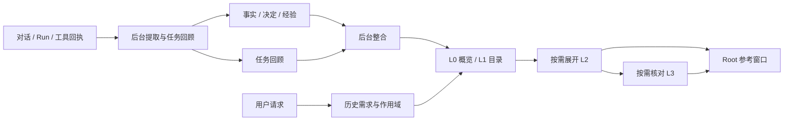

# Athena 分层记忆系统重设计

日期：2026-10-26。状态：P1–P4 的主要代码路径和管理入口已接入，包含事实/经验写入、任务回顾、分层检索、作用域绑定、遗忘与重建抑制、作业状态及召回诊断。38 个中文合成场景固定为 `athena-memory-baseline-cn@cea4cf8228ec`（SHA-256：`cea4cf8228ec674097c6953245cfab1993ec5fcae6ef3b792822ed2e928f4a8c`），但当前系统与候选系统的逐例结果及指标尚未生成，P0 质量基线测量未完成。当前单元与 PostgreSQL 集成套件已通过；真实模型已完成合成事实提取调用。隔离 PostgreSQL schema 上的浏览器验收已验证项目绑定及会话开关保存/回读、合成事实写入、同项目再次提问时召回 1 条记忆并由 Root 使用该事实回答。事实冲突并发写入已通过真实 PostgreSQL 的确定性冲突解析器验收；完整基准回放仍待完成。

## 1. 设计结论

建议将现有“每轮提取原子事实，再检索若干条事实”改为：

> 后台从对话与执行证据中提炼记忆；前台先读取短摘要和主题目录，再按需展开事实、任务经验和原始证据。

保留 PostgreSQL、pgvector、现有 Worker 与检索轨迹。记忆的业务记录、后台处理回执和来源引用仍在数据库；Markdown 可作为导出和检查视图。默认不增加文件与数据库的双向同步，也不建设第二套向量库。

默认覆盖三类需求：记住个人偏好、延续项目上下文、复用经过验证的经验。本文的“项目”包括软件项目及其他持续任务。

## 2. 依据与现状

### 2.1 从 Codex 借鉴什么

依据分为两部分，不能混为同一种证据：

- **官方文档确认的机制**：后台从合适的历史会话生成本地记忆；等待会话空闲；区分每会话提取与全局整合；读取与生成可分别控制；生成受资源预算约束。[Memories](https://learn.chatgpt.com/docs/customization/memories)、[配置参考](https://learn.chatgpt.com/docs/config-file/config-reference)。
- **当前 Codex 环境可观察的组织方式**：简短 `memory_summary.md` 提供概览，`MEMORY.md` 提供可搜索的主题索引，`rollout_summaries/` 保存任务回顾并关联原始会话，`skills/` 承载可复用流程。读取时逐层展开，并核对容易变化的信息。这是本环境的观察，不代表所有 Codex 版本的内部实现。

Athena 借鉴这些信息组织和处理方式。下面的表结构、预算、触发时机、项目绑定及一致性协议均为 Athena 的设计选择，不是对 Codex 实现的陈述。

### 2.2 当前代码确认的事实

| 位置 | 已有行为 | 本次设计要解决的问题 |
| --- | --- | --- |
| `application/runs/execution_service.py::_enqueue_memory`；`run_repository.py` 的完成事务 | 完成轮次可进入持久记忆队列；两个入口按 turn_id 去重 | 作业主要保存用户与最终助手文本，未向提取器提供执行证据 |
| `domain/memory/entities.py::CompletedTurn` | 一轮用户文本、助手文本、session、turn | 适合原子事实，不足以表达多轮任务的尝试、失败与验证 |
| `application/memory/extraction.py` | 单轮提取；正文拼成 key/value；提取和 Resolver 都查同 session 最近 50 条 | 写入比较范围与跨 session 读取范围不一致；事实与经验都被压进短文本 |
| 同上及 `prompt/memory_resolution.md` | 模型决定动作，目标由程序预选；异常时可能按相同 key 更新 | 不确定的候选可能影响错误目标，关系字段没有完整落库 |
| `application/memory/workflow.py` | 写入 revision，事务外调用 embedding | operation_key 依赖写入计数；embedding 异常被吞掉，缺少可修复状态 |
| `memory_repository.py::search` | 整句 `ILIKE '%query%'`，有生命周期过滤 | 并非文档描述的分词全文检索，长问题容易没有词法命中 |
| `memory/retrieval_service.py`、`root_workflow.py` | 词法与向量 RRF；Root 原文预检索、定向补检索；有界窗口和选择轨迹 | 缺少先读摘要、再定位主题、再展开证据的读取路径 |
| `domain/orchestration/worker_execution_messages.py` | 已定义持久 Worker 模型消息与工具回执 | 可以成为任务经验的证据输入，无须复制完整日志 |
| `domain/sessions/entities.py` | 会话有压缩摘要字段，未定义明确的项目绑定 | 会话压缩与跨会话记忆要分别建模；项目身份不能靠模型猜测 |
| `models/runtime_models.py::MemoryModel` | 已有 logical_memory_id、revision、状态、期限、访问次数 | 复用版本基础，补上作用域、来源与按类型表达的内容 |

`fact_extraction.md` 提到 `LongTermMemorySummarizer`，但在当前 `backend/src` 搜索不到该实现；`save_summary_to_memory` 等配置的存在不能证明叙事记忆已经接通。`athena-memory-retrieval.md` 中部分全文检索和重排描述也超出本次看到的实现，落地时须同步修订。

本文依据静态源码和官方文档，没有探测当前数据库、真实模型质量或线上延迟。下文参数都是首轮实验值。

### 2.3 与已有冲突处理草案的关系

已有 [长期记忆冲突处理改造方案](memory-conflict-resolution-design.md)。P1 已落实其中的结构化事实、证据、明确更正才修订、未决矛盾保留双方和稳定操作身份；候选创建/修订带事实组快照并在 PostgreSQL 事务内取得 advisory lock，直接修订、有效期变更和软删除也使用同一事实身份锁。P3 已在记忆 Provider 中展开同一事实组的冲突成员，把窗口身份与访问统计映射到真实成员 ID，并在窗口确认和每次模型调用前重新核验当前有效状态。合成事实的 Root/browser 写入、跨轮召回和回答已通过隔离 PostgreSQL schema 验收；另有真实 PostgreSQL 并发用例验证空快照竞态会触发重试，随后两个互斥值均保留并写入 `contradicts` 关系。人工冲突解决入口仍待实施。

该草案负责“同一事实如何正确更新”，本文负责“哪些内容成为记忆，以及如何组织和读取”。两者共用一套事实、operations 和 relations，不能各建一套。本文默认不安排旧数据回填和兼容路径；草案中的存量升级章节不自动成为此次实施要求。任何开发库清理需在实施时单独明确范围。

## 3. 记忆内容与四层读取结构

### 3.1 保存三类长期内容

| 类型 | 保存内容 | 必须保留的边界 |
| --- | --- | --- |
| 事实与决定 | 用户明确偏好、身份、项目约束、已采纳决定 | 来源、适用范围、陈述时间；助手建议不能自动成为用户决定 |
| 任务回顾 episode | 目标、关键尝试、失败原因、产物、实际验证、遗留问题 | 完成状态与验证状态分开；失败任务也可能有可复用经验 |
| 经验 procedure | 适用条件、操作步骤、成功判据、常见失败和限制 | 必须能指回回顾与工具证据；建议、已执行、已验证分别表达 |

短期进度继续放在当前会话、Run 和 checkpoint。一般知识继续由知识库负责。上下文压缩摘要只负责当前会话续接，不直接作为长期事实来源。

经验可由一次有充分证据的任务产生；重复出现只表明可能更常用，不自动提高真实性。自动经验首版作为参考资料，不能自动安装成技能、增加工具权限或改变审批规则。

### 3.2 四层结构

| 层 | 内容 | 默认读取方式 |
| --- | --- | --- |
| L0 概览 | 少量稳定偏好、当前绑定项目的重要约束、可展开的主题提示 | 需要历史时读取，严格限制 token；新会话首次需要时载入 |
| L1 主题目录 | 主题标题、适用范围、简短描述、关键词、条目/回顾引用、更新时间 | 按问题搜索；先定位再展开 |
| L2 记忆正文 | 事实、决定、经验，以及相关任务回顾 | 只展开命中主题下的相关内容 |
| L3 原始证据 | 用户消息、Run、具体执行代次的工具回执、产物引用 | 回顾详细过程、核实易变结论或需要准确引用时读取 |

L0/L1 是派生视图，不能作为独立证据。L2 的事实与经验有版本；任务回顾是可追溯的提炼结果。L3 复用已有业务记录。

概览和目录每个片段都关联来源 ID/版本。删除、更正、冲突或到期后，旧片段即使尚未重建也必须在读取时失效。不能让“事实已删，摘要仍记得”。

## 4. 作用域与信息可信程度

### 4.1 作用域

- `global`：当前实例的个人偏好与跨任务通用习惯。继续采用当前单实例共享假设，不能宣称已实现多用户隔离。
- `project`：明确绑定的持续项目；跨 session 复用。
- `session`：只在当前会话适用，或项目主体暂不明确的内容。

`session_id` 始终表示来源，不再兼任长期记忆的适用范围。明确是个人偏好的内容可进入 global；涉及项目的断言没有明确项目时保留 session 范围或暂缓，不能扩大为 global。

当前没有可直接复用的项目身份模型。项目阶段增加一个最小记忆空间目录：服务端生成稳定 ID，保存用户提供的名称；会话显式绑定该 ID。名称、相似路径和模型推断都不能自动合并记忆空间。暂不建设完整项目管理系统。

默认候选集合为 global + 当前 project + 当前 session。项目未绑定时只读 global + 当前 session；用户明确要求回顾其他项目时才显式指定额外空间。这是单实例的适用性约束；以后接入多用户必须另外实现服务端身份和授权过滤。

### 4.2 来源与验证

按条目保存有类型的 `source_refs`：用户 message_id、run_id、worker execution_id/generation、工具回执 message_id 或 result_ref。来源身份和时间由程序从存储读取，模型只提出引用候选，不能自造 ID。

事实记录“用户陈述/用户确认”；经验记录“建议/已执行/已验证”，同时保存验证覆盖范围。例如工具状态成功只能证明该调用成功，不能证明整条业务链已经通过。

记忆始终作为参考数据进入模型。当前用户明确更正先约束本轮回答，再异步持久化；记忆正文中的指令不能改变系统规则或执行授权。外部文档和工具输出不能未经确认提升为用户偏好。

## 5. 写入：及时记住明确事实，延后总结任务经验

### 5.1 每轮增量采集

完成轮次后复用现有持久队列，但输入改成真实消息与 Run 的引用，加冻结的提取清单。自动提取只处理新用户陈述、明确更正和已确认决定，允许正常输出零条。

“请记住……”与明确更正采用高优先级作业，不等待会话空闲。界面区分“等待保存 / 已保存 / 保存失败”；只有业务提交回执才能显示已保存。用户话题要求记忆时，不能仅凭助手回答“记住了”宣告成功。

新会话到来时优先调度已提交的个人事实作业。若上轮仍待处理，读取结果必须带 pending 状态；只在请求明确需要待保存内容时，读取对应原始用户陈述作为临时参考，标注尚未整合。这样不必让所有新请求等待后台 LLM。

### 5.2 任务回顾

触发条件：用户明确结束任务、会话空闲且无运行任务，或一个确定的任务单元终止。首轮实验用会话空闲 30 分钟；不照搬 Codex 的小时数。活跃任务默认不做全量整合。

回顾输入是一个冻结的任务/Run 集合与证据引用，记录输入指纹。新内容到达生成新版本，不把继续变化的会话当成已结束。

为失败和取消的 Run 增加回顾调度入口；不能只复用当前 completed 轮次入队。运行状态、取消原因和已发生的工具效果必须如实保留，不完整任务不能被标为完整成功。

回顾格式固定：目标、结果状态、关键过程、失败尝试、实际验证、产物、未解决事项、适用范围、证据引用。当前没有可靠多任务分段时，以确定的 Run/plan 为边界；不得让模型自由拼接多个无关任务。

提取前按证据与 token 预算选材，超限明确标记覆盖不足。只提炼有后续价值的内容；一次性解释和无变化的闲聊不生成长期条目。提取/解析失败必须失败重试，不能表现成“成功但没有候选”。

### 5.3 整合

同一记忆空间出现新事实或新回顾时设置 dirty 标记；后台去抖后处理，初值 5 分钟。删除、更正立即使旧派生片段失效，不等待此定时器。

整合负责同主题归并、概览/目录更新，以及从回顾中提出经验候选。它不能自行改写事实真值、抹掉冲突或把失败回顾改成成功。新经验仍走带来源与幂等回执的统一写入路径，随后构建读取视图。

整合输入只取受预算约束的新增/变化条目及相关旧主题，不每轮扫描全部历史。概览采用受限的主题片段，超预算时保留目录入口，避免越来越长。

后台作业配置单次输入 token、调用超时、并发数和每日调用/token 上限；预算耗尽时保留排队状态并让出前台资源，不标记成功或丢弃。明确记忆/更正的事实作业优先于自动回顾和整合，分别记录积压与等待时间。

### 5.4 提交、重试与投影

- 成功提取先持久化候选清单；重试复用清单。operation_id 由稳定输入身份与规范候选指纹生成，不依赖数组位置或写入数量。记忆作业入队时同时冻结当时的显式项目绑定；后续用户改绑不会把排队中的旧轮次移入新项目。
- 事实组的查询与语义判定在事务外执行；短事务内复核状态，提交版本、关系、来源和操作回执。复用冲突草案的并发协议。
- 模型失败时保留 pending；语义不确定时保存 deferred；没有可记内容是单独的正常结果。三者不能混用。
- embedding、图投影和概览生成在提交后执行；有独立 pending/ready/failed 状态，可只补投影。失败时保留关键词与精确键读取能力。
- 每个 scope 有单调递增的内容 generation；写入、更正、到期失效和删除都使相关视图过期。整合只在输入 generation 未变化时发布；不一致则重试，避免旧作业覆盖新事实。
- 读取视图按来源版本再次过滤；到期按实际时间校验，不能依赖定时任务及时运行。必要时保守跳过整个旧摘要片段，并展开仍有效的 L2。
- 后台领取使用可续租的作业 lease；恢复只接管租约过期项，不能重置另一进程仍在执行的任务。相同 scope 的视图发布串行化，失败作业保留最后错误与重试时间。

## 6. 读取：概览引路，证据支撑回答

### 6.1 接入 Root 现有两阶段检索

1. 请求准备加载记忆开关、绑定 scope 与有效概览，不触发前台摘要 LLM。
2. 自包含的一步问题可以跳过记忆；明确回顾、用户偏好、项目相关或含糊依赖历史的问题进入预检索。是否跳过使用当前请求和已绑定空间判断；其余情况沿用原文预检索，不加一次独立分类 LLM。
3. Memory provider 在范围过滤后查询 L1 目录，同时直接检索 L2 的精确事实键和正文；目录缺失或过时不能让新事实变得不可见。
4. 词法查询改成实际使用现有中文 TSVECTOR/GIN；专有词另保留精确匹配。与向量通道并发，RRF 融合，随后展开相关条目和回顾。
5. 预算内进入 Root 参考窗口；不足时仍用现有定向检索机会展开主题或核对证据，不另建无上限的记忆循环。
6. 生成回答前核验来源版本、有效性和冲突组；输出中需要依赖易变旧信息时，核对当前来源或明确说明记忆时间与验证限制。

当前实现增加独立 `episode` Provider：Root 预检索和定向查询都可读取当前会话任务回顾，使用中文 `tsvector`/GIN OR 词项召回，保留 `ILIKE` 字面回退，再按命中率和完整 query 命中排序。默认召回当前会话；会话显式绑定项目后，也可跨会话召回同项目回顾。每次最多读取 100 个候选、最多注入配置上限。只有 Root 设置 `include_sources=true` 才会重新核验来源范围并读取有限的用户消息、Worker 工具回执或完整性校验后的 Task 结果；每条最多 1,600 字符、每个回顾最多 4 条。episode 尚无向量召回，不能视为完整的经验检索。

Memory Provider 会从当前作用域下最多 80 条有效事实实时派生 L0 概览和 L1 主题目录，不持久化第二份摘要。L0 只显示无冲突且未设到期时间的个人偏好/背景与当前项目约束；L1 只列主题键，不替代事实正文。每次模型调用前重读并重建目录，目录不增加事实访问次数。目录截断、超时或没有来源时直接省略，不阻断正文检索。

词法、向量和证据通道独立标状态；向量超时不能丢弃已经完成的精确/词法结果。沿用现有 3 秒预检索阶段上限，预留末尾核验时间；超时取消剩余任务并记录 partial/timeout。定向展开也受现有阶段与 Root 总预算约束。

排序先过滤作用域和有效性，再按与问题的相关性选择。当前项目范围内更具体的内容优先；时间和访问次数只影响检索排序，不决定哪个冲突值为真，也不自动延长有效期。

### 6.2 上下文预算

首轮实验给记忆和任务回顾共同分配最多 2,000 token，包括 L0–L3 的所有注入文本、引用和说明，并且仍受现有共享资料窗口限制。采集合并、Root 窗口合并和最终复核后预算都会应用此上限：

| 用途 | 初始上限 |
| --- | --- |
| 概览 | 400 token |
| 主题目录 | 300 token |
| 正文与必要证据 | 使用剩余预算 |

这些是上限，未使用的部分可给正文。概览与正文引用同一事实时去重，不能重复占预算。冲突事实作为整组保留、压缩或淘汰；读取更多证据时替换已有材料，不持续追加。

概览作为 ContextItem 进入同一个窗口，不作为额外系统提示绕过预算。Worker 默认只接收任务需要的条目，不能把整份个人概览广播给所有 Worker。

### 6.3 使用轨迹

保留现有 retrieval_run/candidate 和 confirm_selection；补充 level、scope、条目版本、来源、展开原因、过滤原因与 token。概览为聚合条目，必须能关联实际引用的成员。

`retrieved` 表示召回，`selected` 表示进入 Root 窗口，`injected` 表示实际进入某次决策/正文模型请求；它们都不证明模型确实采纳了内容。沿用当前 access_count 的 selected 语义，额外记录调用注入集合，不能因为载入整个目录就给所有成员增加访问次数。

## 7. 最小数据改动

逻辑分层不等于每层新建一套存储。

| 对象 | 用途与必要字段 |
| --- | --- |
| 现有 `memories` | 保留版本/有效性；增加 scope、subject、kind、topic_key、严格类型的 payload、source_refs 与验证信息。fact/decision/procedure 用判别联合表达，content 是展示/检索文本 |
| 新增 `memory_episodes` | 冻结任务输入的回顾：scope、source set/fingerprint、revision、typed summary、coverage、source_refs；不复制完整工具日志 |
| 新增 `memory_run_evidence_snapshots` | 每个 Run 首次领取记忆作业时冻结有限任务终态、最新执行代次、工具回执状态和 source_refs；重试复用相同 fingerprint |
| 新增 `memory_job_scope_snapshots` | 每轮作业入队时冻结 `session_id` 对应的项目绑定；新绑定只影响后续作业 |
| 派生 L0/L1（首版不持久化） | 从当前有效、已过滤范围的事实实时生成概览/主题入口；模型调用前重建，以来源记录作为唯一事实源。若后续实测需要降低读取成本，再引入带 generation 和来源版本的 `memory_views` |
| 新增 `memory_project_spaces` 与绑定表 | 为明确项目绑定提供稳定 ID 和名称；不自动识别或合并项目，也不是多用户权限表。global/session 继续由结构化事实 scope 表达 |
| 复用草案的 `memory_write_operations` / `memory_relations` | 所有候选、决策、幂等回执、投影状态，以及替代/矛盾关系；不另建一套经验审计表 |
| 新增 `memory_source_suppressions` | 保存来源类型/ID 与不可逆条目指纹；不保存被遗忘正文，用于阻止同一历史来源重建记忆和派生回顾 |
| `memory_processing_jobs` 与证据快照 | 本轮实现继续复用现有轮次队列；execution evidence 单独冻结到快照表，后续再扩展 job_kind 和 scope 整合任务 |
| 新增 `session_memory_settings` | 保存每个会话独立的 `use_memories` 与 `generate_memories` 开关；缺省保持当前行为（均开启）。本阶段将设置放入独立表，不修改既有 `sessions` 结构 |

候选清单、来源、任务 payload 和视图内容均使用明确 Pydantic 模型，在 JSON 边界统一序列化。需要查询/唯一约束的字段使用普通列，不能都塞进开放 metadata。

新增 episode 的正文检索复用现有词法/向量适配器能力；事实与经验继续复用 memories 的索引。图查询为辅助投影，冲突正确性与基本记忆读取不依赖 Neo4j。

本次设计不提供旧 schema 自动升级、兼容读取、历史重跑或数据搬迁脚本。实现时更新 ORM 与建表定义；已有开发库的处置须明确后再执行。

## 8. 用户控制与遗忘

读取、生成分别配置，组合效果应清晰：

| 读取 | 生成 | 行为 |
| --- | --- | --- |
| 开 | 开 | 正常复用并积累 |
| 开 | 关 | 使用既有记忆，本会话不贡献新记忆 |
| 关 | 开 | 本会话不读取历史，但允许以后使用本会话提炼结果 |
| 关 | 关 | 本会话不使用也不生成长期记忆 |

改变生成设置后，尚未开始/提交的作业必须重查策略；关闭读取后恢复旧 checkpoint 也不能把记忆重新注入。关闭生成不等于删除既有记忆。

“删除记忆”撤销该条目及其同源任务回顾的可用性，并在一个事务内写入来源抑制标记。后台不得从相同历史证据再次生成它；用户新的明确陈述可以产生新记忆。当前实现按事实身份或规范正文计算不可逆指纹，不在标记中保存记忆正文。“删除整个空间”会移除项目范围事实、项目任务回顾和派生经验，解除所有会话绑定，并清理冻结到该项目的待处理作业与证据快照。事务会保留项目 ID 与来源轮次的抑制标记；新旧作业都必须与删除串行化，旧来源不能在空间删除后重建。记忆行沿用现有软删除语义；项目目录、回顾、绑定和作业快照在事务中删除。原始会话与执行记录仍保留。

删除来源会话时，依赖该来源的条目先失效；有其他独立有效来源的条目去除该来源后重新核验。失去全部证据的经验不能继续标记为已验证。历史会话内容保留与记忆删除分别表达，页面不承诺删除记忆就清除原始聊天。

来源抑制沿回顾、经验、概览的引用链传递，提取与最终提交都检查；不能通过重读旧回顾绕过删除。保留最小抑制身份即可，不在删除标记中继续保存已删除正文。

长期保留与事实有效性分别处理：稳定偏好默认没有固定 TTL；项目事实按明确有效期过滤；任务回顾和经验可因长期未用退出热目录，但不据此认定事实失效或立即物理删除。访问只影响热度，不延长 TTL/事实期限，不把旧验证自动改为最新验证。

当前 MemoryView 可管理事实/经验记忆和任务回顾，查看适用范围、来源、验证边界、版本及替代/冲突关系，并遗忘单条记忆或回顾；原始聊天记录仍保留。MemoryView 另有处理/召回视图，显示脱敏的作业状态、最近的记忆召回及候选过滤/上下文选择原因。会话详情页提供项目记忆空间创建、绑定和删除入口，删除会解除所有会话绑定。会话提供两个记忆开关和明确项目绑定入口。

## 9. 实施顺序与代码落点

| 阶段 | 可独立验收的结果 | 主要落点 |
| --- | --- | --- |
| P0：基线 | 已固定 38 个合成中文验收场景并通过 loader 校验，manifest 版本/hash 见本文状态；这些场景目前不是可直接运行的生产记忆回放，不代表质量分数。通用 retrieval CLI 现在会拒绝执行 `memory_acceptance` 数据集，避免产生空记忆指标的虚假通过。仍需补齐同输入的当前/候选输出、召回/回答质量及延迟/token/错误指标 | `tests/memory_eval/baseline_cn_v1.jsonl`、现有评测模块、记忆测试与运行轨迹 |
| P1：可信事实写入 | 已接入：结构化事实、作用域、基数规则、证据约束撤回、冻结候选、稳定回执、修订/矛盾关系、投影状态、会话级读写开关和事实组锁已接入 create/revise/validity/delete。Run 开始时冻结项目范围；项目遗忘与晚到终态共享项目/来源锁并检查抑制标记，已在隔离 PostgreSQL schema 实际执行并通过。另以确定性冲突解析器验证了两个并发空快照只提交一个，另一方收到状态变化后重试并保留两值矛盾关系。当前产品设计采用会话级开关，默认开启，不另设全局开关 | `domain/memory`、`application/memory/{extraction,workflow,service}.py`、prompts、jobs/repository、Run 两个入队入口、sessions/bootstrap；合并冲突草案 |
| P2：任务经验 | 已接入代码路径：首次领取记忆作业时冻结当前 Run 的任务终态、最新执行代次、有限工具回执和结果引用；LLM 生成结构化回顾，程序限定来源并用真实任务状态覆盖模型 outcome。成功、失败与取消终态均排队回顾；`reusable_learnings` 通过稳定 operation ID 写入有来源的 procedure 记忆。PostgreSQL Run 终态入队/恢复用例已执行；真实 Run 生成回顾的端到端验收仍待完成 | 新增 `MemoryExecutionEvidence`、`memory_run_evidence_snapshots`、`memory_episodes`；复用 Run/Worker 消息和结果仓储；扩展 `MemoryWriteWorkflow` 和独立 `episode` Context Provider |
| P3：分层读取 | 已接入代码路径：事实组冲突展开、整组窗口合并、模型调用前失效复核、显式项目绑定、跨会话同项目回顾、实时 L0/L1 概览目录及按需来源展开。事实与回顾使用中文全文 GIN 和有界词项排序；episode 尚无向量召回。实时目录最多取 80 条来源；项目删除/Run 竞态和检索轨迹的 PostgreSQL 覆盖已通过。另以隔离 PostgreSQL schema 完成合成事实的真实聊天写入、再次提问召回及 Root 回答浏览器验收 | ORM/repository、`memory/retrieval_service.py`、`runs/context`、`root_workflow.py`、设置与 bootstrap |
| P4：完整产品验收 | 单条记忆/任务回顾/项目空间删除、同源重建抑制、派生 procedure 撤下、来源/验证范围/版本/关系详情、回顾管理、作业状态和最近召回原因已接入。单元测试、完整 PostgreSQL 集成套件、真实模型提取 smoke 和浏览器设置/绑定及合成事实跨轮召回回答流程已执行。P0 指标测量仍待完成 | `query_controller.py`、项目/回顾/作业仓储、前端 API/types/MemoryView/会话入口、文档与评测 |

P1 是先修正确性的阶段；P1–P4 完成后才构成此次分层记忆重设计的完整交付。复用 WorkerSupervisor，不增加独立消息中间件或第二条后台运行体系。

首版暂不做自动生成可执行技能、多级智能体记忆、图谱大重构、自动项目识别、后台无限回读历史。Markdown 导出为可选后续功能，不是核心交付的前置条件。

## 10. 验收与实验

| 场景 | 可观察结果 |
| --- | --- |
| A 会话说“我喜欢苹果”，B 会话追问 | 保存完成后跨会话召回；未完成时显示 pending，不能伪装成没有说过 |
| 同一句重复三次，然后明确更正 | 不新增三个等价 active 事实；保留来源；新版本和旧版本关系正确 |
| “也喜欢梨”与“现在不喜欢苹果” | 多值追加与撤回正确；未决冲突不被排序分数或摘要抹平 |
| 两个项目使用不同技术栈 | 项目绑定后各自召回；无绑定时不猜项目、不把项目事实提升为个人偏好 |
| 助手提出某方案，但用户未确认、工具未执行 | 可出现在回顾的建议部分，不能成为已采纳决定或已验证经验 |
| 工具调用成功，但只验证编译 | 经验明确“编译已验证”；不能写成真实业务 E2E 成功 |
| 任务失败但找到了可复用根因 | 回顾保留失败与证据；复用时仍表达验证范围 |
| 新事实尚未进入目录、向量不可用 | 精确/全文读取仍可看到它；不会等整合完成才可用 |
| 概览生成时用户更正/删除/事实到期 | 旧视图不能重新发布为当前版本；最终窗口不含失效内容 |
| 删除后重启 worker 并重跑旧作业 | 相同旧来源不能把删除内容重新写回来 |
| 生成关闭、读取关闭、旧 checkpoint 恢复 | 分别遵守两个开关；旧窗口不绕过设置 |
| 模型解析失败、重复投递、乱序及并发更正 | 失败可见且可恢复；操作回执稳定，无多当前版本或静默覆盖 |
| 问“上次怎么解决这个错误” | 目录命中相关经验，必要时展开回顾/回执；可定位真实历史来源 |
| 无关的一步问题 | 可跳过记忆；未跳过时仍满足预算，不强行带入无关偏好 |

固定集 `tests/memory_eval/baseline_cn_v1.jsonl` 包含 38 个合成中文场景，覆盖指代、改口、项目隔离、失败任务、否定事实、pending、遗忘、预算和溯源。loader 已验证 manifest 与 schema；通用 retrieval CLI 会拒绝这些 `memory_acceptance` 操作，也不会产生质量分数。P0 完成条件仍包括实现可重复的当前/候选系统回放器，为相同输入保存召回和回答，再计算下列指标。不能把数据集存在或结构有效报告成基线结果。

评估分开统计：应召回集合的召回率、最终注入集合的准确率、回答事实准确率、错误覆盖/越范围/删除复活次数、证据可追溯率，以及前台 p50/p95、注入 token、后台 LLM 调用量。模型确实使用了哪些内容不能仅靠访问次数判定。

硬门槛：指定反例中的错误覆盖、越范围读取和删除复活为零；所有标记已验证的经验都有可解析来源；全部请求满足预算；故障和 pending 不伪装成 empty。质量与延迟目标在 P0 实测后设定，不把 3 秒阶段超时当成测得的性能。

单元测试验证事实、预算和状态规则；真实 PostgreSQL 验证事务/锁/重试/到期；真实 LLM 验证提炼与回答；浏览器验证开关、绑定、来源、保存和遗忘状态。静态检查不能代替这些验收。

## 11. 实施前需要明确的产品选择

当前方案按“保留数据库，全面改善个人、项目和经验记忆”设计。主要实现阶段已接入，单元与 PostgreSQL 集成套件通过；隔离浏览器流程已验证一条合成记忆从写入、跨轮召回到 Root 回答。38 个场景尚未由可重复的当前/候选系统回放器执行，因此 P0 质量指标仍未产生；该单条验收不替代完整基准或冲突并发验收。

主要待确认项是是否把“可直接读写 Markdown 文件”本身作为产品要求。如果需要文件作为唯一业务事实源，就必须另行设计并发编辑、删除、索引与恢复协议，这将改变本文的存储建议。

会话空闲 30 分钟、整合去抖 5 分钟、记忆预算 2,000 token 均是待 P0/P2 实验调整的初值，不是实施阻塞项。
