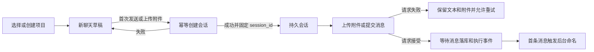

# 项目化聊天管理与首轮自动命名改造方案

状态：设计完成，尚未实施。本文以当前工作树代码为基线，覆盖前端、会话接口、项目归属和记忆范围。实施时以本文中的行为和验收标准为准。

## 1. 当前行为与问题

| 当前行为 | 代码依据 | 需要解决的问题 |
| --- | --- | --- |
| 创建聊天时生成包含毫秒的时间标题，并立即保存会话 | `frontend/src/App.tsx` 的 `handleNewSession` | 标题无法表达聊天内容，点击新聊天会留下空会话 |
| 侧栏平铺所有会话，点击查看会将会话临时前移 | `frontend/src/components/Sidebar.tsx`、`App.tsx` | 缺少项目分组，前端排序与后端排序可能不同 |
| 项目空间可以创建、列出、遗忘；项目绑定放在会话记忆设置中 | `application/memory/project_space_service.py`、`SessionDetailView.tsx` | 聊天归属与记忆范围分离，用户需要另行绑定 |
| `Session` 没有 `project_id`，`SessionMemorySettings` 带有该字段 | `domain/sessions/entities.py`、`domain/memory/settings.py` | 项目只被视为记忆配置，无法直接表达项目包含哪些聊天 |
| 项目绑定单独存于 `session_memory_project_bindings` | `infrastructure/persistence/postgres/models/memory_models.py` | 项目升级为聊天容器后，应收敛为一处归属来源 |
| 发送回调启动 HTTP 请求后立即返回布尔值 | `App.tsx` 的 `sendEvent`、`Chat.tsx` 的 `handleSend` | UI 会在 HTTP 请求失败前清空输入，草稿流程不能沿用这个成功判定 |
| 附件上传和附件类型查询都需要已有的会话 ID | `Chat.tsx`、`interfaces/http/controllers/files_controller.py` | 草稿聊天必须先获得会话 ID，才能上传附件 |
| 用户消息在请求准备阶段落库，随后发布 `message.persisted` | `application/runs/request_preparation.py` | 自动命名应以这个实际落库边界为起点 |
| 记忆任务已有项目范围快照及遗忘抑制机制 | `memory_suppression.py`、`memory_job_repository.py` | 改造须保留旧任务不能向已删除项目重新写入的保证 |

现有手动改名、聊天历史、附件处理、Root/Worker 执行和会话 SSE 均继续作为本次改造的基础。

## 2. 首期范围与确定的规则

1. 所有新聊天必须属于一个项目；先创建或选择项目，再创建聊天。
2. 复用现有项目记忆空间的概念，将其提升为正式 `Project`，聊天和项目记忆使用同一个项目 ID。
3. `Session.project_id` 是会话当前归属的唯一来源，创建后不可修改；首期不提供跨项目移动聊天。
4. `SessionMemorySettings` 只控制 `use_memories` 和 `generate_memories`；读取记忆范围由会话所属项目推导。
5. 点击新聊天先进入草稿；首次发送或上传附件时创建持久会话。
6. 自动标题依据第一条成功持久化的用户消息生成一次；手动标题始终优先。
7. 项目支持创建、重命名、删除；聊天沿用重命名和删除，并按项目展示。
8. 本期不扩展项目文件共享、项目专属工具、多人权限、聊天全文搜索或跨项目移动。

沿用本项目开发阶段直接调整目标结构的约定，不安排旧 API 兼容和历史数据迁移。本文不执行数据库变更；实施切换时须根据当时的开发数据状态应用目标结构，不能把 `create_all` 当成已有字段的修改工具。

## 3. 用户界面

### 3.1 侧栏与聊天顶部

```text
新聊天

项目                         ＋
▾ Athena                    ⋯
    新聊天                  ＋
    记忆系统重新设计
    排查检索延迟
▸ RaftKVStore               ⋯
▸ VPS 搭建                  ⋯

工作区管理入口
```

- 项目行可以展开、折叠；项目菜单提供重命名、删除。
- 选择项目显示该项目的聊天入口和空状态；选择具体聊天同时切换所属项目。
- 项目内的新聊天入口直接打开该项目的草稿。
- 顶部“新聊天”优先使用当前项目；没有当前项目时打开项目选择器，其中提供创建项目入口。
- 项目为空时展示“在此项目中开始第一次聊天”；没有任何项目时展示创建项目引导。
- 聊天顶部显示“项目名 / 聊天标题”，记忆设置中显示只读的所属项目及两个开关。
- 日期作为辅助信息展示；完整标题通过悬停和可访问标签读取，列表长标题截断。
- 项目展开状态可以保存到本地；项目、会话内容和归属以 API 为准。
- 手机端复用当前侧栏抽屉，选择聊天后关闭；支持键盘展开、菜单操作和 Escape 关闭。

排序统一为：聊天按 `last_activity_at DESC, id DESC`；项目按其未删除聊天的最近活动时间排序，空项目使用创建时间。查看聊天、生成标题和项目改名不改变活动时间。

### 3.2 草稿、发送和附件

草稿包含稳定的 `draft_id`、`project_id`、输入文本及附件选择。草稿保存在当前页面内存中；刷新不承诺恢复尚未提交的文本或本地文件。创建新草稿、切换现有聊天不能清空其他草稿的输入。



`ensureSession(draft_id)` 负责创建草稿对应的会话：

- 同一草稿的发送、粘贴上传和文件选择共享一个创建中的 Promise。
- 会话创建使用稳定的幂等键；网络超时重试返回相同会话。
- 创建成功后立即固定会话 ID，后续提交失败仍重试该会话，不能再次创建。
- 进入持久会话时保留原草稿文本和附件；不能让现有会话切换 effect 清空它们。
- 上传过程中切换聊天，响应只更新原会话的附件，不污染当前会话。
- 上传附件已构成持久操作，因此可能出现“只有附件、尚无消息”的聊天；此时保留“新聊天”标题，用户可以手动删除。

当前支持附件类型的查询需要会话 ID。新增与会话无关的类型查询接口供草稿使用，复用原有类型来源；文件类型仍由上传服务最终校验。上传文件前调用 `ensureSession`。

发送函数改成返回实际请求结果的异步函数，并显式传入目标 `session_id`，避免闭包仍引用旧会话。每次用户发送生成稳定的 `command_id` 和 `message_id`；不确定结果的重试沿用这两个 ID。HTTP 接受后才清除本次输入和附件选择；消息持久化和执行进展继续以 SSE/历史查询为准。

### 3.3 删除行为

- 删除聊天继续使用既有聊天删除流程；项目级记忆具有独立生命周期，删除一段聊天不等于遗忘整个项目。
- 删除项目表示删除其全部聊天、项目级记忆和任务回顾，确认框明确列出这个范围。
- 项目存在非终态 Run 或未结束的启动命令时返回 `409 project_busy`，提示先停止运行，再删除；本期不增加自动停止后级联删除的流程。
- 项目删除事务需要锁定项目，并与创建聊天、提交 Run 使用相同的并发校验边界，防止检查后又出现新的运行。
- 项目有效性检查必须进入实际创建会话、启动命令入队的事务；仅在 Controller 提前查询一次不足以防止删除竞争。实施时统一项目锁、会话锁和既有遗忘锁的获取顺序，并覆盖相反执行次序的并发用例。
- 项目与聊天采用逻辑删除，保留现有恢复/引用需要的行；项目遗忘抑制标记和旧作业清理继续生效，后台命名也必须停止写入。
- 删除后保留同名新建能力，新建项目获得新的 ID，旧队列不会写入新项目。
- 当前“遗忘项目空间”会删除空间，不能直接作为一个普通分组删除按钮使用；它的记忆清理逻辑应纳入上述项目删除用例。首期不额外提供“清空记忆后继续沿用同一项目 ID”的操作。

## 4. 数据模型

### 4.1 项目与会话

| 对象 | 字段或调整 | 用途 |
| --- | --- | --- |
| `projects` | `id, name, created_at, updated_at, deleted_time` | 统一项目目录，由现有 `MemoryProjectSpace` 提升而来，替换其原表 |
| `sessions` | 新增必填 `project_id` 外键 | 一段聊天只属于一个项目，物理删除使用 RESTRICT |
| `sessions` | 新增 `creation_request_id` 唯一键 | 草稿会话创建在超时重试时保持幂等 |
| `sessions` | 新增 `title_source` | `placeholder / fallback / generated / manual`，区分命名来源 |
| `sessions` | 新增 `title_revision`，初始为 0 | 防止自动生成、手动改名和旧事件互相覆盖 |
| `sessions` | 新增 `last_activity_at` | 将消息活动排序与元数据修改分开 |
| `session_memory_settings` | 保留两个布尔开关 | 不再持久化或返回可编辑的项目归属 |
| `session_memory_project_bindings` | 移除 | 归属集中到 `sessions.project_id` |

项目名称沿用去除首尾空白后 1–120 个字符的规则，允许同名，身份始终由 ID 区分。聊天手动标题限制为 1–120 个字符。

新增索引为 `sessions(project_id, deleted_time, last_activity_at, id)`。项目最近活动时间由其会话聚合取得，不额外维护另一份项目活动时间。

`last_activity_at` 在创建会话时初始化，并在用户消息、最终助手消息持久化的事务中按时间最大值推进；运行中间事件、标题和项目元数据修改不更新它。

记忆事实的 `scope_kind/scope_id`、任务回顾项目快照和 Run 记忆作业项目快照继续保留。它们记录事实和证据产生时的范围；所有项目外键统一引用 `projects.id`。新增会话归属不会将个人/global 记忆自动变成项目记忆。

### 4.2 自动标题任务

新增一张小型持久任务表 `session_title_jobs`，每个会话最多一条任务：

| 字段 | 用途 |
| --- | --- |
| `session_id` 主键、`source_message_id` | 固定本次命名依据的第一条用户消息，正文从消息表读取 |
| `expected_title_revision` | 任务仅能替换它开始时对应的回退标题 |
| `status` | `queued / running / completed / failed / cancelled` |
| `attempt, available_at, lease_expires_at` | 有界重试、崩溃恢复和任务租约；attempt 同时作为旧领取者提交校验条件 |
| `created_at, updated_at, error_code` | 运行诊断，错误字段只保存受控错误码 |

使用独立任务的原因是：标题生成需要异步调用 LLM、进程重启后继续处理，而且不受 `generate_memories` 开关影响。复用现有 PostgreSQL 任务领取模式，不引入消息中间件或通用任务平台。

## 5. 自动命名流程

### 5.1 触发和事务

1. 创建会话时标题为“新聊天”，来源为 `placeholder`。
2. 第一条用户消息保存时，在同一事务中锁定会话、写入消息、保存回退标题，并插入该会话唯一的标题任务。
3. 重复处理同一消息或后续消息不再创建任务。并发消息以数据库首次成功提交的用户消息为准。
4. 用户已手动命名时直接保留标题，不创建命名任务。
5. 回退标题更新与任务入队必须原子提交。不能在消息保存后仅启动一个无持久记录的后台协程。

实施落点为消息持久化端口及其 PostgreSQL 仓储，`RunRequestPreparationService.prepare` 调用该端口。事务不调用 LLM；正常消息处理不等待标题生成。

### 5.2 生成规则和失败回退

- 使用第一条用户消息中的真实文本，保留任务对象和目标，去掉“请帮我”等泛化开头。
- 中文建议 8–20 字，英文建议 3–10 个词；自动标题最终上限为 48 个 Unicode 字符。
- 输入限定为首条文本的前 2,000 字符及其附件文件名，不加载整个历史、其他项目记忆或附件正文。
- 附件发送若使用系统补充的通用文本，标题依据附件文件名，例如“分析架构设计.pdf”；不能把通用补全文本当作用户意图。
- 无法概括时回退到首句前 32 个字符；没有可用文本则使用附件名，均无内容才保持“新聊天”。
- 通过现有配置的 LLM Provider 生成结构化结果；不增加用户必须配置的第二套模型入口。
- 每次生成超时 8 秒，最多调用 3 次，失败后分别等待 5 秒、30 秒再尝试；最终失败保留回退标题，不影响聊天 Run。
- 超时覆盖 Provider 自身重试，标题 Worker 的生命周期停止须取消在途调用；这组限制不修改正常聊天请求的超时策略。
- 提示词要求仅生成标题；输出去除外围引号、换行并检查长度，空结果或无效结构视为本次失败。

示例：

| 首次输入 | 建议标题 |
| --- | --- |
| 请参考 Codex，重新设计现在的记忆系统 | 记忆系统重新设计 |
| PostgreSQL 启动后查询一直超时，帮我排查 | 排查 PostgreSQL 查询超时 |
| 对比 Raft 日志复制和快照恢复流程 | Raft 复制与快照恢复对比 |
| 仅上传 `部署方案.pdf` | 分析部署方案.pdf |

### 5.3 并发、重启和手动命名

- Worker 领取任务时使用行锁和租约，过期任务可以重新领取；旧领取者须匹配当前 attempt 才能提交。
- 提交自动标题使用条件更新：会话及项目有效、来源仍为 `fallback`、revision 等于任务预期值。成功后来源变为 `generated`，revision 加一。
- 手动改名始终只更新标题相关列，来源改为 `manual`、revision 加一，并取消未完成任务。
- 其他业务保存会话状态时不得回写旧标题。需调整当前 `SessionRepository.save` 的整对象更新方式，分离改名和运行状态更新。
- 删除会话或项目后，排队任务取消；正在调用 LLM 的任务提交时再次校验有效性。
- 生成一次后不根据后续消息反复改名，首期不提供重新生成按钮。

## 6. HTTP 与事件契约

### 6.1 接口调整

| 接口 | 目标行为 |
| --- | --- |
| `GET /api/projects` | 返回未删除项目，按项目最近活动排序 |
| `POST /api/projects` | 请求 `{name}`，返回统一 Project |
| `PATCH /api/projects/{id}` | 请求 `{name}`，只修改项目名称 |
| `DELETE /api/projects/{id}` | 执行第 3.3 节的完整项目删除语义 |
| `POST /api/sessions` | 请求 `{project_id}`，要求 `Idempotency-Key`；创建“新聊天”并返回 Session |
| `GET /api/sessions?project_id=...` | 按项目查询未删除聊天；省略参数时供现有管理页面查询全部 |
| `GET /api/sessions/{id}` | 返回带项目归属和标题元数据的 Session |
| `PATCH /api/sessions/{id}` | 请求 `{title}`，执行手动命名 |
| `GET/PUT /api/sessions/{id}/memory-settings` | 仅含两个开关，项目归属从 Session 读取 |
| `GET /api/attachment-types` | 草稿查询附件类型；复用当前类型来源 |

`/api/memory-projects` 由统一项目接口替换，其前端调用与路由一并调整，避免保留两个项目目录。现有消息、附件上传、运行提交、审批和会话事件流地址保持使用。

Session 响应新增 `project_id, title_source, title_revision, last_activity_at, title_pending`。`title_pending` 从标题任务状态投影，标明是否还有后台命名工作，不在 sessions 中重复保存。

同一幂等键重复创建时返回原会话；键已用于另一项目时返回 `409 idempotency_conflict`；原会话已删除时返回 `409 session_deleted`，不能复活。无效或已删除项目返回 404，缺少项目参数返回 422。

### 6.2 标题事件及恢复

新增持久事件 `session.updated`，载荷包含：

```json
{
  "session_id": "...",
  "project_id": "...",
  "title": "记忆系统重新设计",
  "title_source": "generated",
  "title_revision": 2,
  "updated_at": "...",
  "title_pending": false
}
```

- 回退命名、生成命名和手动命名均产生事件，使用稳定的 `session:{id}:title:{revision}` transition ID。
- 标题更新、任务完成和事件记录在同一 PostgreSQL 事务提交；复用现有 `agent_events`，为事件仓储增加事务内写入能力，提交后通知现有 SSE 通道。
- 事件作为会话元数据更新，不呈现为助手消息或执行步骤。
- 前端按 `title_revision` 拒绝旧标题，不因重复 SSE 或晚到的 GET 响应覆盖新标题。该 revision 只管理标题字段；任务失败后 `title_pending` 可以在标题 revision 不变的情况下从 true 变成 false，前端需正常接收最新任务状态。
- 当前只有活动聊天订阅 SSE。可见列表中存在 `title_pending=true` 时，每 3 秒批量刷新该项目的会话列表，所有任务结束后停止；页面隐藏时暂停，重新可见时刷新一次。
- 项目切换、项目展开和页面恢复焦点时重新校验目录，避免增加全局 SSE。

## 7. 模块与文件落点

以下“新增”为拟新增路径，其余路径已在当前仓库确认。

| 层次 | 修改或新增位置 | 职责 |
| --- | --- | --- |
| 项目领域/用例 | 新增 `backend/src/domain/projects/`、`application/projects/` | 由现有 MemoryProjectSpace 提升为 Project，定义创建、重命名、删除 |
| 会话领域/用例 | `domain/sessions/entities.py`、`application/sessions/service.py`、`application/common/responses.py` | 必填项目归属、创建幂等、标题来源和字段级改名 |
| 命名用例 | 新增 `application/sessions/title_service.py`、`title_worker.py` 及端口 | 有界生成、任务领取和命名提交；LLM 调用通过既有 Provider |
| 提示词 | 新增 `backend/prompt/session_title.md` | 首条消息生成标题的输出要求 |
| 持久化 | `models/session_models.py`、`models/memory_models.py`、`repositories/session_repository.py`、`message_repository.py` | 统一项目表、删除绑定表、原子首消息和命名入队 |
| 持久化 | 调整现有 `memory_project_space_repository.py`，新增标题任务仓储 | 项目生命周期和后台命名任务 |
| 记忆范围 | `application/memory/`、`application/orchestration/root_workflow.py`、`repositories/memory_suppression.py`、Run/Worker 仓储 | 通过 Session 解析项目，保留开关、范围快照与遗忘约束 |
| 接口 | 新增项目 Controller/DTO；修改 `sessions_controller.py`、`dto/sessions.py`、`query_controller.py`、文件 Controller | 统一项目 API、调整 Session 响应、移除记忆设置里的绑定操作 |
| 生命周期 | `bootstrap/postgres.py`、`bootstrap/app.py`，沿用 `bootstrap/lifespan.py` 协议 | 注入项目服务与标题 Worker，停止时释放任务和 Provider 资源 |
| 前端协调 | `frontend/src/App.tsx`、`store/chatStore.ts` | 项目/会话选择、草稿持有、幂等创建和真实请求结果 |
| 前端展示 | `Sidebar.tsx`，新增 `ProjectPicker.tsx` 及草稿协调 hook | 项目树、选择/创建项目、项目菜单及单次会话创建 |
| 聊天输入 | `Chat.tsx`、`api/client.ts` | 草稿可输入可上传、显式目标会话提交、失败恢复输入 |
| 元数据更新 | `hooks/useSessionEventStream.ts`、`types/events.ts`、`types/index.ts` | Session 新字段、标题 revision 与 SSE 投影 |
| 管理页面 | `pages/SessionDetailView.tsx`、`ctx/SessionPicker.tsx` | 显示项目、移除可编辑记忆绑定、兼顾全部会话查询 |

前端会话对象只维护一份；项目分组由 `project_id` 派生。`activeProjectId` 与 `activeSessionId` 分别表示当前项目和已持久化聊天，草稿另有身份，不用虚假的 session ID 模拟持久会话。

## 8. 实施顺序与交付边界

| 阶段 | 工作 | 完成标准 |
| --- | --- | --- |
| P1 项目与会话归属 | 统一 Project，调整 Session/设置/快照读取，项目 API 和创建幂等 | API 可创建项目及其聊天；读写记忆范围由会话归属决定，无第二套绑定 |
| P2 项目侧栏与草稿 | 项目树、项目选择器、草稿、附件类型接口、异步发送结果 | 可以从空库创建项目、开始聊天并上传附件；失败后可重试且不会重复创建 |
| P3 首轮自动命名 | 首消息事务、回退标题、持久任务、LLM Worker、手动命名条件更新 | 自动标题不阻塞主回复，重启可恢复，手动改名不可覆盖 |
| P4 同步与完整验收 | 标题事件、可见列表刷新、项目删除、管理页与移动端检查 | 刷新/切换/重连不丢归属和标题，删除后无旧任务重新写入 |

阶段可分别审阅，但完整交付须包含 P1–P4。切换目标数据结构与前后端接口应作为同一次开发版本变更，不向用户留下项目可创建但聊天无法归属的中间状态。

## 9. 验收标准

| 场景 | 可观察结果 |
| --- | --- |
| 空数据库首次进入 | 展示创建项目引导，不自动创建持久空会话 |
| 创建项目后点新聊天但不发送 | 可以输入，侧栏和数据库没有新增持久会话 |
| 第一次发送 | 恰好创建一个属于所选项目的会话，输入在请求被接受后清除 |
| 同一草稿同时触发上传与发送、或创建超时重试 | 复用同一个 session；请求幂等键不变 |
| 上传附件后尚未发送 | 附件绑定正确会话，可继续输入，上传状态正常显示 |
| 发送或上传失败 | 原文本和附件选择可恢复，重试不串到当前其他聊天 |
| HTTP 仅返回接受 | 页面等待真实消息持久化与 Run 事件，不伪造已经完成 |
| 首条消息落库 | 立即可查到回退标题和一条标题任务；后续消息不再排队 |
| 真实 LLM 可用 | 后台标题反映首条请求主题，聊天回复和执行继续进行 |
| LLM 超时或结构错误 | 有界重试后保留回退标题，不使聊天 Run 失败 |
| 命名期间手动改名 | 手动标题持久化，晚到的自动结果和旧事件均不能覆盖 |
| Worker 领取后重启或租约过期 | 任务可恢复，旧领取者不能覆盖新处理结果 |
| 关闭记忆生成或读取 | 命名照常工作；两个记忆开关分别生效 |
| 同一项目不同聊天 | 可召回项目级记忆，各聊天历史和执行记录仍独立 |
| 不同项目 | 不能读取另一项目的项目级记忆、回顾和目录；global 记忆沿用既有规则 |
| 改项目名称、生成标题或只查看聊天 | ID、归属、记忆范围和最近活动排序不被改写 |
| 刷新、切换项目、SSE 重连 | 归属和标题从服务端恢复，旧响应不覆盖新 revision |
| 删除有活动 Run/待启动命令的项目 | 返回 409，项目和会话仍可访问 |
| 删除无活动执行的项目 | 聊天不再列出，相关项目记忆不可召回，旧标题/记忆作业不能恢复数据 |
| 重新创建同名项目 | 获得新 ID，旧项目数据和作业不进入新空间 |
| 桌面和手机端 | 项目树、长标题、重命名、抽屉和管理页面入口均可操作 |

验证使用必要的领域/接口测试和真实 PostgreSQL 并发检查，重点覆盖创建幂等、首消息原子入队、标题条件更新和删除竞争。前端执行 typecheck/build，并通过真实浏览器及已配置的真实 LLM 走通创建项目 → 草稿 → 附件 → 首次聊天 → 自动标题 → 手动改名 → 切换/刷新流程。构建通过不能替代这条运行验收。

## 10. 实施准备结论

当前业务行为、代码边界和接口变化已明确，可以按上述顺序开始实施。实际实施前须重新检查工作区改动；当前存在尚未提交的记忆系统修改，项目归属调整应基于这些代码继续收敛，避免覆盖已有工作。

本次交付为方案文档及索引，不代表功能已实现；未运行应用测试，也未修改数据库。
