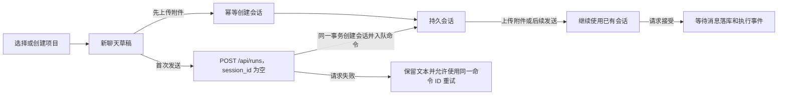

# 项目化聊天管理与首轮自动命名改造方案

状态：主要实现已落地，静态检查已通过；真实数据库重建和运行时验证待完成。本文记录项目化聊天、项目归属和记忆范围的目标行为与验收边界。

## 1. 当前行为与问题

| 当前行为 | 代码依据 | 需要解决的问题 |
| --- | --- | --- |
| 创建聊天时生成包含毫秒的时间标题，并立即保存会话 | `frontend/src/App.tsx` 的 `handleNewSession` | 标题无法表达聊天内容，点击新聊天会留下空会话 |
| 侧栏平铺所有会话，点击查看会将会话临时前移 | `frontend/src/components/Sidebar.tsx`、`App.tsx` | 缺少项目分组，前端排序与后端排序可能不同 |
| 项目空间可以创建、列出、遗忘；项目绑定放在会话记忆设置中 | `application/memory/project_space_service.py`、`SessionDetailView.tsx` | 聊天归属与记忆范围分离，用户需要另行绑定 |
| `Session` 没有 `project_id`，`SessionMemorySettings` 带有该字段 | `domain/sessions/entities.py`、`domain/memory/settings.py` | 项目只被视为记忆配置，无法直接表达项目包含哪些聊天 |
| 项目绑定单独存于 `session_memory_project_bindings` | `infrastructure/persistence/postgres/models/memory_models.py` | 项目升级为聊天容器后，应收敛为一处归属来源 |
| 发送回调启动 HTTP 请求后立即返回布尔值 | `App.tsx` 的 `sendEvent`、`Chat.tsx` 的 `handleSend` | UI 会在 HTTP 请求失败前清空输入，草稿流程不能沿用这个成功判定 |
| 附件上传和附件类型查询都需要已有的会话 ID | `Chat.tsx`、`interfaces/http/controllers/files_controller.py` | 草稿聊天必须先获得会话 ID，才能上传附件 |
| 用户消息在请求准备阶段落库，随后发布 `message.persisted` | `application/runs/request_preparation.py` | 标题从首次提交的文本同步确定，不再依赖消息落库后的后台任务 |
| 记忆任务已有项目范围快照及遗忘抑制机制 | `memory_suppression.py`、`memory_job_repository.py` | 改造须保留旧任务不能向已删除项目重新写入的保证 |

现有手动改名、聊天历史、附件处理、Root/Worker 执行和会话 SSE 均继续作为本次改造的基础。

## 2. 首期范围与确定的规则

1. 所有新聊天必须属于一个项目；先创建或选择项目，再创建聊天。
2. 复用现有项目记忆空间的概念，将其提升为正式 `Project`，聊天和项目记忆使用同一个项目 ID。
3. `Session.project_id` 是会话当前归属的唯一来源，创建后不可修改；首期不提供跨项目移动聊天。
4. `SessionMemorySettings` 只控制 `use_memories`；读取记忆范围由会话所属项目推导，记忆生成由后台流程处理，不提供会话级关闭开关。
5. 点击新聊天先进入草稿；首次发送或上传附件时创建持久会话。
6. 首次发送时按用户文本确定会话标题；手动改名始终优先。
7. 项目支持创建、重命名、删除；聊天沿用重命名和删除，并按项目展示。
8. 本期不扩展项目文件共享、项目专属工具、多人权限、聊天全文搜索或跨项目移动。

沿用本项目开发阶段直接调整目标结构的约定，不安排旧 API 兼容和历史数据迁移。移除已有数据库字段时须重建本地开发数据库；`create_all` 只补建缺失对象，不会移除旧列或旧表。

## 3. 用户界面

### 3.1 侧栏与聊天顶部

```text
新聊天

项目                         ＋
▾ Athena                    ⋯
    新聊天                  ＋
    记忆系统重新设计
    排查检索延迟
▸ RaftKVStore               ⋯
▸ VPS 搭建                  ⋯

工作区管理入口
```

- 项目行可以展开、折叠；项目菜单提供重命名、删除。
- 选择项目显示该项目的聊天入口和空状态；选择具体聊天同时切换所属项目。
- 项目内的新聊天入口直接打开该项目的草稿。
- 顶部“新聊天”优先使用当前项目；没有当前项目时打开项目选择器，其中提供创建项目入口。
- 项目为空时展示“在此项目中开始第一次聊天”；没有任何项目时展示创建项目引导。
- 聊天顶部显示“项目名 / 聊天标题”，记忆设置中显示只读的所属项目及读取开关。
- 日期作为辅助信息展示；完整标题通过悬停和可访问标签读取，列表长标题截断。
- 项目展开状态可以保存到本地；项目、会话内容和归属以 API 为准。
- 手机端复用当前侧栏抽屉，选择聊天后关闭；支持键盘展开、菜单操作和 Escape 关闭。

排序统一为：聊天按 `last_activity_at DESC, id DESC`；项目按其未删除聊天的最近活动时间排序，空项目使用创建时间。查看聊天、生成标题和项目改名不改变活动时间。

### 3.2 草稿、发送和附件

草稿包含稳定的 `draft_id`、`project_id`、输入文本及附件选择。草稿保存在当前页面内存中；刷新不承诺恢复尚未提交的文本或本地文件。创建新草稿、切换现有聊天不能清空其他草稿的输入。



普通文字聊天不预先调用会话创建接口。首次发送时，`POST /api/runs` 接收 `session_id: null`、`project_id` 和稳定的 `command_id`；后端在同一事务中创建会话并入队首条运行，响应返回实际 `session_id`。相同命令 ID 的并发请求会串行化并复用已创建会话。HTTP 接受后，前端把草稿切换为返回的持久会话；失败时保留文本和原命令身份供重试。

`ensureSession(draft_id)` 仅用于附件先上传的流程，因为上传接口需要会话 ID：

- 同一草稿的上传共享一个创建中的 Promise，并使用稳定的创建请求 ID。
- 会话创建成功后固定会话 ID，之后的附件上传或消息发送都使用该会话。
- 上传过程中切换聊天，响应只更新原会话的附件，不污染当前会话。
- 上传附件已构成持久操作，因此可能出现“只有附件、尚无消息”的聊天；会话标题取附件名，用户可以手动删除。

当前支持附件类型的查询需要会话 ID。新增与会话无关的类型查询接口供草稿使用，复用原有类型来源；文件类型仍由上传服务最终校验。上传文件前调用 `ensureSession`。

发送函数改成返回实际请求结果的异步函数，并显式传入目标 `session_id`，避免闭包仍引用旧会话。每次用户发送生成稳定的 `command_id` 和 `message_id`；不确定结果的重试沿用这两个 ID。HTTP 接受后才清除本次输入和附件选择；消息持久化和执行进展继续以 SSE/历史查询为准。

### 3.3 删除行为

- 删除聊天继续使用既有聊天删除流程；项目级记忆具有独立生命周期，删除一段聊天不等于遗忘整个项目。
- 删除项目表示删除其全部聊天、项目级记忆和任务回顾，确认框明确列出这个范围。
- 项目存在非终态 Run 或未结束的启动命令时返回 `409 project_busy`，提示先停止运行，再删除；本期不增加自动停止后级联删除的流程。
- 项目删除事务需要锁定项目，并与创建聊天、提交 Run 使用相同的并发校验边界，防止检查后又出现新的运行。
- 项目有效性检查必须进入实际创建会话、启动命令入队的事务；仅在 Controller 提前查询一次不足以防止删除竞争。实施时统一项目锁、会话锁和既有遗忘锁的获取顺序，并覆盖相反执行次序的并发用例。
- 项目与聊天采用逻辑删除，保留现有恢复/引用需要的行；项目遗忘抑制标记和旧作业清理继续生效。
- 删除后保留同名新建能力，新建项目获得新的 ID，旧队列不会写入新项目。
- 当前“遗忘项目空间”会删除空间，不能直接作为一个普通分组删除按钮使用；它的记忆清理逻辑应纳入上述项目删除用例。首期不额外提供“清空记忆后继续沿用同一项目 ID”的操作。

## 4. 数据模型

### 4.1 项目与会话

| 对象 | 字段或调整 | 用途 |
| --- | --- | --- |
| `projects` | `id, name, created_at, updated_at, deleted_time` | 统一项目目录，由现有 `MemoryProjectSpace` 提升而来，替换其原表 |
| `sessions` | 新增必填 `project_id` 外键 | 一段聊天只属于一个项目，物理删除使用 RESTRICT |
| `sessions` | 新增 `creation_request_id` 唯一键 | 草稿会话创建在超时重试时保持幂等 |
| `sessions` | 新增 `last_activity_at` | 将消息活动排序与元数据修改分开 |
| `session_memory_settings` | 保留 `use_memories` 读取开关 | 不再持久化或返回可编辑的项目归属 |
| `session_memory_project_bindings` | 移除 | 归属集中到 `sessions.project_id` |

项目名称沿用去除首尾空白后 1–120 个字符的规则，允许同名，身份始终由 ID 区分。聊天手动标题限制为 1–120 个字符。

新增索引为 `sessions(project_id, deleted_time, last_activity_at, id)`。项目最近活动时间由其会话聚合取得，不额外维护另一份项目活动时间。

`last_activity_at` 在创建会话时初始化，并在用户消息、最终助手消息持久化的事务中按时间最大值推进；运行中间事件、标题和项目元数据修改不更新它。

记忆事实的 `scope_kind/scope_id`、任务回顾项目快照和 Run 记忆作业项目快照继续保留。它们记录事实和证据产生时的范围；所有项目外键统一引用 `projects.id`。新增会话归属不会将个人/global 记忆自动变成项目记忆。

### 4.2 会话标题

标题是会话创建时写入的普通字段，不新增标题来源、revision、任务表或后台 Worker。新聊天首次发送时，后端根据这次请求的用户文本提取标题；先上传附件的流程使用附件文件名生成标题。创建完成后标题保持稳定，用户可通过现有改名接口手动修改。

## 5. 首次命名流程

### 5.1 触发和事务

1. 草稿首次发送时，前端向 `POST /api/runs` 提交空 `session_id`、目标 `project_id`、消息和稳定的 `command_id`。
2. 后端从首条用户文本提取标题，并在命令事务中创建 Session、校验项目仍可写、写入运行命令和 Run。任一校验或入队失败，整个事务回滚，不留下空会话。
3. 相同 `command_id` 的请求先通过 PostgreSQL advisory lock 串行化；重试直接返回已存在命令的 `session_id`，不会再创建会话。
4. 已有会话继续走同一 `POST /api/runs` 请求，只需传现有 `session_id`。
5. 附件必须先上传时，前端仍以稳定的草稿 ID 调用会话创建接口，标题使用附件文件名；随后普通消息请求传入该会话 ID。

标题规则是确定性的轻量文本处理，不调用 LLM：压缩空白，去掉“请帮我”“麻烦”等常见开头，取第一句并截断到 48 个字符。系统补充的“请处理附件”统一标题为“附件分析”。首条用户文本为空时使用“新聊天”。

示例：

| 首次输入 | 规则提取的标题 |
| --- | --- |
| 请参考 Codex，重新设计现在的记忆系统 | 参考 Codex，重新设计现在的记忆系统 |
| PostgreSQL 启动后查询一直超时，帮我排查 | PostgreSQL 启动后查询一直超时，帮我排查 |
| 对比 Raft 日志复制和快照恢复流程 | 对比 Raft 日志复制和快照恢复流程 |
| 仅上传 `部署方案.pdf` | 分析部署方案.pdf |

### 5.2 并发、失败和手动命名

- 会话创建、项目可写校验和首条命令入队在同一数据库事务中；事务失败不会留下半成品。
- 命令 ID 锁让相同请求的并发重试返回同一个会话。前端在收到接受响应前保留输入，并沿用原命令 ID 重试。
- 首条消息标题只在创建 Session 时确定；后续消息不会自动改名。
- 手动改名使用现有 `PATCH /api/sessions/{id}`，不需要 revision 竞争控制或取消标题任务。

## 6. HTTP 与事件契约

### 6.1 接口调整

| 接口 | 目标行为 |
| --- | --- |
| `GET /api/projects` | 返回未删除项目，按项目最近活动排序 |
| `POST /api/projects` | 请求 `{name}`，返回统一 Project |
| `PATCH /api/projects/{id}` | 请求 `{name}`，只修改项目名称 |
| `DELETE /api/projects/{id}` | 执行第 3.3 节的完整项目删除语义 |
| `POST /api/sessions` | 请求 `{project_id, title?}`，要求稳定的 `Idempotency-Key`；供附件上传前持久化草稿会话 |
| `POST /api/runs` | 请求 `{session_id, project_id?, message, command_id, message_id?, attachment_ids}`；session_id 为空时在命令事务中创建会话，返回最终 `session_id` |
| `GET /api/sessions?project_id=...` | 按项目查询未删除聊天；省略参数时供现有管理页面查询全部 |
| `GET /api/sessions/{id}` | 返回带项目归属的 Session |
| `PATCH /api/sessions/{id}` | 请求 `{title}`，执行手动命名 |
| `GET/PUT /api/sessions/{id}/memory-settings` | 仅含 `use_memories`，项目归属从 Session 读取 |
| `GET /api/knowledge-bases/attachment-types` | 草稿查询附件类型；复用当前类型来源 |

`/api/memory-projects` 由统一项目接口替换，其前端调用与路由一并调整，避免保留两个项目目录。运行提交统一使用 `POST /api/runs`；消息、附件上传、审批和会话事件流继续使用各自接口。

Session 响应包含 `project_id` 和 `last_activity_at`；标题只保留 `title` 字段。`POST /api/runs` 响应新增最终的 `session_id`，前端据此从草稿切换到持久聊天。

同一幂等键重复创建时返回原会话；键已用于另一项目时返回 `409 idempotency_conflict`；原会话已删除时返回 `409 session_deleted`，不能复活。无效或已删除项目返回 404，缺少项目参数返回 422。

### 6.2 标题读取与同步

创建会话后的命令响应提供 `session_id`。前端据此读取 Session 并刷新项目聊天列表；标题不走单独 SSE 事件，也不做标题任务轮询。手动改名仍通过 Session API 返回的最新 `title` 同步列表。

## 7. 模块与文件落点

以下“新增”为拟新增路径，其余路径已在当前仓库确认。

| 层次 | 修改或新增位置 | 职责 |
| --- | --- | --- |
| 项目领域/用例 | 新增 `backend/src/domain/projects/`、`application/projects/` | 由现有 MemoryProjectSpace 提升为 Project，定义创建、重命名、删除 |
| 会话领域/用例 | `domain/sessions/entities.py`、`application/sessions/service.py`、`application/common/responses.py` | 项目归属、创建幂等和手动改名 |
| 持久化 | `models/session_models.py`、`models/memory_models.py`、`repositories/session_repository.py`、`run_repository.py` | 统一项目表、删除绑定表，并原子创建首条会话与运行命令 |
| 记忆范围 | `application/memory/`、`application/orchestration/root_workflow.py`、`repositories/memory_suppression.py`、Run/Worker 仓储 | 通过 Session 解析项目，保留开关、范围快照与遗忘约束 |
| 接口 | 新增项目 Controller/DTO；修改 `sessions_controller.py`、`dto/sessions.py`、`query_controller.py`、文件 Controller | 统一项目 API、调整 Session 响应、移除记忆设置里的绑定操作 |
| 生命周期 | `bootstrap/postgres.py`、`bootstrap/app.py`，沿用 `bootstrap/lifespan.py` 协议 | 注入项目服务并管理现有 Worker |
| 前端协调 | `frontend/src/App.tsx`、`store/chatStore.ts` | 项目/会话选择、草稿持有、空 session_id 首发和真实请求结果 |
| 前端展示 | `Sidebar.tsx`，新增 `ProjectPicker.tsx` 及草稿协调 hook | 项目树、选择/创建项目、项目菜单及单次会话创建 |
| 聊天输入 | `Chat.tsx`、`api/client.ts` | 草稿可输入可上传、显式目标会话提交、失败恢复输入 |
| 元数据更新 | `types/index.ts`、`api/client.ts`、`App.tsx` | Session 标题和新建会话响应的前端投影 |
| 管理页面 | `pages/SessionDetailView.tsx`、`ctx/SessionPicker.tsx` | 显示项目、移除可编辑记忆绑定、兼顾全部会话查询 |

前端会话对象只维护一份；项目分组由 `project_id` 派生。`activeProjectId` 与 `activeSessionId` 分别表示当前项目和已持久化聊天，草稿另有身份，不用虚假的 session ID 模拟持久会话。

## 8. 实施顺序与交付边界

| 阶段 | 工作 | 完成标准 |
| --- | --- | --- |
| P1 项目与会话归属 | 统一 Project，调整 Session/设置/快照读取，项目 API 和创建幂等 | API 可创建项目及其聊天；读写记忆范围由会话归属决定，无第二套绑定 |
| P2 项目侧栏与草稿 | 项目树、项目选择器、草稿、附件类型接口、异步发送结果 | 可以从空库创建项目、开始聊天并上传附件；失败后可重试且不会重复创建 |
| P3 首轮标题 | 空 session_id 提交、会话和运行命令事务、命令 ID 幂等、首条文本标题 | 首次发送只请求一次；重试复用同一 session；手动改名正常 |
| P4 同步与完整验收 | 项目删除、管理页和移动端检查 | 刷新/切换后项目归属和标题从 API 恢复 |

阶段可分别审阅，但完整交付须包含 P1–P4。切换目标数据结构与前后端接口应作为同一次开发版本变更，不向用户留下项目可创建但聊天无法归属的中间状态。

## 9. 验收标准

| 场景 | 可观察结果 |
| --- | --- |
| 空数据库首次进入 | 展示创建项目引导，不自动创建持久空会话 |
| 创建项目后点新聊天但不发送 | 可以输入，侧栏和数据库没有新增持久会话 |
| 第一次发送 | 恰好创建一个属于所选项目的会话，输入在请求被接受后清除 |
| 同一草稿同时触发上传与发送、或创建超时重试 | 复用同一个 session；请求幂等键不变 |
| 上传附件后尚未发送 | 附件绑定正确会话，可继续输入，上传状态正常显示 |
| 发送或上传失败 | 原文本和附件选择可恢复，重试不串到当前其他聊天 |
| HTTP 仅返回接受 | 页面等待真实消息持久化与 Run 事件，不伪造已经完成 |
| 首次发送 | 返回一个会话 ID；会话标题取首条文本，Session 与 Run 命令一并提交 |
| 相同 command_id 并发或重试 | 所有响应复用同一会话，不新增空聊天 |
| 首条文本包含客套语或多句话 | 标题去掉常见客套前缀，取首句并限制长度 |
| 先上传附件 | 会话先以文件名命名，附件与后续消息都绑定同一会话 |
| 手动改名 | 手动标题保存并在列表刷新后保持 |
| 关闭记忆读取 | 命名照常工作；模型请求不读取历史记忆，后台记忆处理仍按既有流程运行 |
| 同一项目不同聊天 | 可召回项目级记忆，各聊天历史和执行记录仍独立 |
| 不同项目 | 不能读取另一项目的项目级记忆、回顾和目录；global 记忆沿用既有规则 |
| 改项目名称、生成标题或只查看聊天 | ID、归属、记忆范围和最近活动排序不被改写 |
| 刷新、切换项目、SSE 重连 | 归属和标题从服务端恢复 |
| 删除有活动 Run/待启动命令的项目 | 返回 409，项目和会话仍可访问 |
| 删除无活动执行的项目 | 聊天不再列出，相关项目记忆不可召回，旧记忆作业不能恢复数据 |
| 重新创建同名项目 | 获得新 ID，旧项目数据和作业不进入新空间 |
| 桌面和手机端 | 项目树、长标题、重命名、抽屉和管理页面入口均可操作 |

验证应覆盖领域/接口行为和真实 PostgreSQL 并发边界，重点检查创建幂等、首条命令原子入队和项目删除竞争。前端执行 typecheck/build，并通过浏览器走通创建项目 → 草稿 → 附件/首次发送 → 自动标题 → 手动改名 → 切换/刷新流程。构建通过不能替代运行验收。

## 10. 实施准备结论

当前工作树已实现项目聊天、草稿首条发送时创建会话，以及基于首条文本的确定性标题。首次发送经 `POST /api/runs` 入队；附件先上传时仍会提前创建会话。

收敛版本已在随机隔离 schema 中通过两项真实 PostgreSQL 回归：并发首次发送只生成一条会话和 Run，命令校验失败后新会话回滚；重复命令也不会覆盖手动标题。受控 API 的浏览器检查验证了失败后的输入恢复、不同聊天的重试 ID 隔离、返回原聊天重试时保留原 ID，以及提交期间禁用输入和附件上传。浏览器附件检查受 Chrome 扩展本地文件访问权限限制，尚未完成真实附件上传和真实 LLM 的完整端到端验收。
