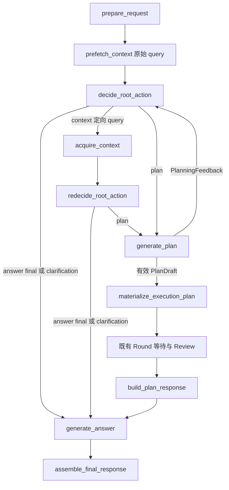

# Root 首次决策前预检索与两阶段检索方案

日期：2026-10-24

状态：已实施核心链路。67 项定向测试、真实 PostgreSQL 轨迹与 checkpoint 恢复验证通过；独立实例的 5 次真实模型跨会话水果问答通过。未知蔬菜偏好问题仍会附带复述无关的苹果偏好，P4 相关性验收未全部通过。完整证据、性能边界和未通过的广泛回归项见 [实施验收记录](verification/root-context-prefetch-20261024.md)。第 2 节保留实施前的代码现状，不代表实施后的实时流程；未重放用户最初报告的原 Run。

## 1. 需求概览

用户询问“你知道我喜欢吃什么水果吗？”，若长期记忆中已有“用户喜欢吃苹果”，系统应先利用这条事实，回答“你喜欢吃苹果”。第一次决策不能因为尚未读取记忆，就直接把问题转成“你喜欢吃什么水果？”。

本方案采用两阶段检索：

1. 第一次决策前，程序直接用原始用户 query 查询记忆和知识库，不增加前置 LLM 调用。
2. 第一次决策读取预检索结果；若事实仍不足，由 LLM 生成具体 query，按需查询记忆、知识库、图或当前附件。
3. 补充检索后沿用专用再决策节点，选择回答、澄清或计划，不增加自由循环检索。

这是对当前入口的增量调整。流式正文生成、独立计划生成、规划反馈、Round Review 和审批继续使用现有职责边界。

## 2. 当前现状与问题

本节基于当前未提交工作树，不能用旧设计稿中的历史链路替代。尤其需要以 [流式输出实施文档](streaming-output-implementation-plan.md) 和现有代码中的 decide/redecide/plan/answer 分离为基础。

| 位置 | 已核查的行为 | 问题或可复用能力 |
| --- | --- | --- |
| `src/application/orchestration/root_workflow.py::prepare_request` | 准备消息、历史、附件元数据、知识库目录、工具目录，默认初始化空资料窗口 | 没有读取长期记忆或知识库正文 |
| `src/application/orchestration/langgraph/graphs/root.py` | prepare 后直接 decide；answer 进入 generate_answer，context 才进入 acquire_context | 第一次选择 clarification 会跳过所有检索 |
| `prompt/root_decision.md` | 要求无法从可用资料获得必要信息时才澄清 | 约束仅在提示词中，首次输入通常只有目录，没有查询结果 |
| `src/application/orchestration/root_decision.py` | RootDecision 为 AnswerIntent / ContextRequest / PlanIntent；RootReDecision 不含 ContextRequest | 应保留两种决策的不同权限 |
| `src/application/orchestration/root_workflow.py` | 已有批量检索、结果摘要、窗口合并和 confirm_selection | 两阶段共用这些逻辑，避免复制采集服务 |
| `src/application/runs/context/service.py` | 通道并发执行，独立记录候选、最终窗口选择和访问统计 | 可以复用轨迹与事件；需增加预检索的外层超时 |
| `src/application/files/retrieval_service.py::KnowledgeContextProvider` | 先枚举知识库文档，再进入文件 Provider 检索 | 预检索超时必须覆盖枚举文档，不能只限制向量查询 |
| `src/configuration/settings.py` 与 `src/bootstrap/postgres.py` | 记忆检索配置默认 60 秒，实际注入 Provider | 不宜直接把这个等待时长加到每个请求入口 |
| `src/application/orchestration/answer_generation.py` | 正文输入包含资料，但没有结构化查询结果摘要 | 应把失败/空结果状态传到正文生成，避免无依据地声称“没有记录” |

现有测试证明“模型先选择 context 时可以用苹果记忆回答”，不证明“第一次决策前一定检索”，也不证明真实模型不会过早澄清。

## 3. 目标与范围

必须达到：

- 正常新 Run 在首次决策前完成一次有界预检索；没有可用通道时显式跳过。
- 第一次决策能同时看到原始请求、相关资料、查询状态和剩余决策轮数。
- 预检索未命中后仍有一次现有的 LLM 定向补充检索机会，默认配置下不会被预检索消耗掉。
- 空结果、失败、超时、未启用分别表达；查询失败不等于事实不存在。
- 不增加前置分类模型、查询改写模型、第二套检索服务或新数据库表。

首版不扩展召回算法、历史附件恢复、知识库生命周期、多用户权限、普通 RUN_START 的宕机自动重投，也不新增检索缓存、LLM 相关性评审和旧 checkpoint 兼容层。数据迁移不在本次范围内。

结构上保证的是“先尝试读取资料再决策”；LLM 是否正确理解资料仍需真实模型验收，不能仅靠节点接线承诺绝不会误判。

## 4. 目标流程



图中只展示正常或可恢复路径。prepare/prefetch/decision/context 等节点的不可恢复错误进入既有失败组装；取消向上传播，不继续调用模型。prefetch 仅位于入口边上，规划反馈回到 decide、Round 恢复都不回到 prefetch。

## 5. 详细设计

### 5.1 预检索节点与查询范围

在 RootWorkflowPort 增加 `prefetch_context(state)`，实现放在 RootWorkflow；图文件只负责接线与节点事件。

节点行为：

1. 从 `request.user_message` 读取原始文本，取 `strip()` 后前 500 字符作为检索 query，与现有查询契约上限一致。不调用 LLM，不拼接助手输出，不把历史全文塞进 query；完整原始消息仍照常交给决策和正文模型。
2. 对已装配 memory 构造 MemoryQuery；对已装配 knowledge 且目录中 `ready_document_count > 0` 的知识库构造 KnowledgeQuery，并显式填写这些真实知识库 ID。
3. 预检索只查询 memory / knowledge，不查询 graph / file。附件和图在定向阶段按需查询。
4. 空 query、未装配通道或没有就绪知识库时跳过对应通道；非空 query 的跳过情况写入 ContextQueryOutcome，说明原因。空 query 不构造违反 min_length 的假查询。
5. 使用 ContextPlanner 生成计划，调用同一个 ContextAcquisitionService；写入现有 context_bundle / context_queries，再进入第一次决策。

长消息截断是确定性降级，不保证覆盖后半段的检索主题；LLM 仍能依据完整消息在第二阶段生成更准确的 query。该边界必须在测试中覆盖。

预检索每个新 Run 正常执行一次。不增加 prefetch_done 布尔值：入口拓扑已经表达执行位置，checkpoint 已完成节点按 LangGraph 语义处理；不承诺异常重执行下的外部调用 exactly-once。

### 5.2 有界等待与资源开销

首版复用现有 `knowledge_context_max_items`、`knowledge_context_max_tokens`、候选规模与 Provider 限制，不另建预检索排名规则和一组重复的数量配置。当前代码默认窗口为 12 条 / 4000 token，实际以运行配置为准。第二阶段继续使用同一个最终窗口上限，不将两阶段额度相加。

新增一个必要配置：

| 配置 | 默认值 | 含义 |
| --- | --- | --- |
| `context_prefetch_timeout_seconds` | 3.0，必须大于 0 | 预检索中每个通道完整调用的等待上限 |

在 ContextPlan 增加 `provider_timeout_seconds: float | None`；None 表示保持现有 Provider 超时。Root 只给预检索计划设置该值，定向检索仍使用现有超时。

ContextAcquisitionService 在 `_invoke_provider` 中对整个 `provider.retrieve_context(...)` 应用此上限，覆盖知识库文档枚举、关键词和向量读取。两个通道并发；快通道结果正常保留，慢通道形成 `timeout` 结果后统一合并。TimeoutError 应单独转换为 timeout，不能落入通用 failed；外部 CancelledError 必须传播并清理子任务。

3 秒是首次配置建议，需要真实环境验证，特别是冷启动 embedding。它限制通道等待，不是“整个预检索节点必定 3 秒结束”的承诺：轨迹持久化、事件、选择确认和取消清理仍有开销。复用已有轨迹超时；实测若选择确认等 I/O 无界，应在对应 I/O 边界补齐限制，不能整批取消后丢失已完成通道。

本次不声称仅减少窗口就能限制知识库底层扫描成本；当前 Provider 仍会枚举和读取指定范围的数据。超时与候选/窗口限制先控制入口等待和模型输入，底层知识库查询优化另行以性能证据决定。

### 5.3 两阶段结果契约

在现有 context/contracts.py 定义 `RetrievalStage = Literal["prefetch", "directed"]`，给 ContextQueryOutcome 增加必须由程序填写的 `stage`。不把 stage 加入 LLM 的 ContextRequest 输出，也不让模型决定自身是否处于预检索阶段。

摘要示例：

```json
{
  "stage": "prefetch",
  "query": {"provider": "memory", "query": "你知道我喜欢吃什么水果吗？"},
  "status": "empty",
  "result_count": 0,
  "error_message": null
}
```

- status 沿用 succeeded / empty / failed / timeout / skipped，不新增同义状态。
- result_count 仍表示 Provider 返回条数，不冒充最终窗口保留数或事实相关性分数。
- RootAgentInput 和 RootPlanInput 已持有 context_queries，沿用原字段；阶段信息直接进入其模型消息。
- AnswerGenerationInput 新增同类型 context_queries；正文只接收轻量摘要，不复制候选全集。其内容计入现有正文总输入预算。
- 同步显式序列化与校验、测试 fixture 和所有构造调用点；新契约直接替换，不提供历史缺省猜测。

RootGraphState 继续只保存一份 context_bundle 和一份 context_queries，不新增 prefetch_bundle、prefetch_answer、重复对话或阶段计数器。

### 5.4 复用采集和上下文合并

把 acquire_context 中“校验通道/范围 → 采集 → 合并窗口 → confirm_selection → 追加摘要”的逻辑提取为 RootWorkflow 内部共用方法。输入为 state、具体 queries、stage 和可选通道等待上限；返回状态更新。

prefetch 构造程序查询后调用它；acquire_context 校验 ContextRequest 后调用它。禁止为了复用而把 prefetch 伪装成 RootDecision=context，或写入一份不存在的模型决策。

继续使用 `_merge_context_window`：新结果优先、按 provider/source_id 去重、无 ID 按同通道正文去重、使用现有条目/token 上限。第二阶段补充材料可替换第一阶段材料；新查询为空或失败时仍保留第一阶段可用资料。

每一批采集只对该批最终进入合并窗口的候选调用一次 confirm_selection，保留现有轨迹与访问统计语义。旧条目被带入下一批窗口不能因此重复记一次旧批次访问；同一记忆被两个真实检索批次分别召回并选中时，沿用每批计数，不新增跨 Run 访问去重。

现有轨迹的 context_selected 表示该批采集后窗口的选择，不改成“整个 Run 最后一次回答确实引用”。不回写旧批次的历史选择来冒充最终答案归因。

### 5.5 决策规则与澄清边界

修改 root_decision.md，明确按当前问题检查事实充分性：

| 情况 | 第一次决策行为 |
| --- | --- |
| 资料包含相关且明确的苹果偏好 | answer/final，instructions 指示根据该事实回答 |
| 资料未命中或不相关，但可用来源可能包含所需事实 | context，生成更具体 query，按需选择通道 |
| 预检索超时或失败，仍需所缺事实 | 有预算时允许定向查询；不能声称用户从未提供过该事实 |
| 缺少无法从资料可靠确定的本次用户选择、授权或当前参数 | answer/clarification，只询问必要内容 |
| 原问题无需外部事实，已有信息足够 | answer/final，不因已有检索结果而强行引用 |
| 有可执行目标、必要信息足够 | plan，沿用独立计划生成 |

不依赖“水果”“我喜欢”等关键词规则去判路由，也不新增 LLM 分类器。预检索已完成不代表问题已查清；只有真正相关的事实才能支持回答，多个互相矛盾的偏好不能任意选一个。

仅靠通用程序无法可靠区分全部“缺事实”和“缺用户选择”；首版以显式提示、真实资料和模型验收控制这一语义。若模型仍跳过必要补充检索，记录其输入和决策，再以失败样例调整，不能宣称添加预检索即彻底消除误判。

补充检索后修改 root_redecision.md：结合两阶段资料、查询状态判断 final / clarification / plan，仍禁止输出 context。查询失败时，可以说明暂时无法确认并询问用户；不能编造苹果偏好，也不能声称系统一定没有记录。answer_generation.md 同步这些事实约束。

### 5.6 决策轮数与规划反馈

- prefetch 不调用决策模型，不增加 root_turn_count。
- 默认 root_max_turns=4 保持不变；decide 和 redecide 各计一轮，一次格式修复仍在同一轮中。
- 普通预检索命中：一次 decide + 一次正文生成；预检索未命中、定向检索后回答：一次 decide + 一次 redecide + 一次正文生成。
- redecide 不回到检索或首次决策；保留现有三结果契约。
- generate_plan 返回新的 PlanningFeedback 时仍回到 decide，不重新预检索；允许为该信息缺口走现有定向检索，受同一个决策轮数预算约束。因此“一次补充”指普通问答路径，不禁止既有规划反馈链路中的新一批查询。
- `planning_context_updated` 仍以窗口是否增加/替换有效资料判断。预检索在规划反馈之前发生，不能被当作反馈之后取得的新进展。
- 最后一轮请求 context 仍按 root_budget_exhausted 失败，不增加隐藏决策调用；root_max_turns=1 时有预检索但没有补充检索机会，提示必须反映此限制。

### 5.7 轨迹与用户界面

沿用 node.started/completed/failed 和 retrieval.* 事件，新增节点自然记录为 prefetch_context。采集服务显式接收程序提供的 stage，并将其写入本批事件 payload；预检索活动 name 使用 prefetch_context，定向活动使用 acquire_context，避免所有活动都被硬编码成 acquire_context。

持久轨迹不新增表或列：在现有 RetrievalProviderTrace.effective_params 中由程序写入 retrieval_stage，记录实际 query、范围、耗时、候选和选择。与既有 typed trace 一同持久化；阶段由应用参数统一传递，不能依赖 query 字符串猜测。阶段归因可以通过现有检索详情读到，不要求新建前端筛选器。

前端仅在节点/活动显示名映射确有需要时增加“预检索资料”；保留服务端 occurred_at 与独立 invocation_id。不要在助手正文输出阶段、内部节点或查询诊断。预检索结束前不产生正文 delta，继续使用现有运行活动展示等待。

## 6. 需要修改哪些地方

下表文件路径相对 backend，前端条目另作说明。

| 文件或模块 | 具体修改 |
| --- | --- |
| `src/application/orchestration/protocols.py` | RootWorkflowPort 增加 prefetch_context |
| `src/application/orchestration/root_workflow.py` | 新节点；程序构造原始查询；提取共用采集更新方法；传递 stage、上限和正文摘要 |
| `src/application/orchestration/langgraph/graphs/root.py` | prepare → prefetch → decide，错误边完整接线；后续决策/计划/等待链保持现有职责 |
| `src/application/runs/context/contracts.py` | RetrievalStage、ContextQueryOutcome.stage、ContextPlan.provider_timeout_seconds |
| `src/application/runs/context/__init__.py` | 按需导出新增契约 |
| `src/application/runs/context/service.py` | 完整 Provider 调用的可选超时、timeout 状态、事件名称与 stage 轨迹 |
| `src/application/orchestration/answer_generation.py` | 正文输入及 prompt 渲染加入查询摘要，沿用总输入预算 |
| `prompt/root_decision.md`、`prompt/root_redecision.md`、`prompt/answer_generation.md` | 两阶段语义、事实与用户选择的区别、失败和冲突处理 |
| `src/configuration/settings.py`、`src/application/orchestration/dependencies.py`、`src/bootstrap/postgres.py`、`.env.example` | 单一预检索超时配置、校验与显式注入 |
| `tests/unit/test_root_graph.py`、`test_root_context_contracts.py`、`test_configured_root_agent_planning.py` 及相关构造调用点 | 节点顺序、输入/输出摘要、超时、取消、预算和既有计划回归 |
| `../frontend/src/components/pages/RunChainView.tsx` | 实施时先核查实际显示名映射，仅在需要时补预检索标签 |
| `docs/athena-memory-retrieval.md`、`docs/athena-runtime.md`、`docs/streaming-output-implementation-plan.md` | 实施后同步实际流程与验证状态；本设计不改写旧实施结果 |

不需要为此修改 MemoryQuery、KnowledgeQuery、GraphQuery 的 LLM 输出字段，也不需要改写底层检索算法。若实施中新契约影响测试或评测调用，必须按真实引用同步，不能只修生产路径。

## 7. 验收标准

### 7.1 定向自动化验证

| 场景 | 必须观察到的结果 |
| --- | --- |
| 预检索命中“喜欢吃苹果” | 首次 decide 输入已有该事实，发生在任何模型决策之前；final 进入正文，无第二批检索 |
| 原始 query 未命中、定向 query 命中 | 第一批 stage=prefetch，第二批 directed；改写查询实际执行，redecide 得到苹果事实 |
| 知识库预检索命中 | 仅使用就绪知识库真实 ID；知识库正文进入第一次决策 |
| 没有就绪知识库或未装配通道 | 不执行对应读取，摘要为 skipped，仍可决策 |
| 某通道超时、另一个成功 | 成功材料保留；慢通道为 timeout；知识库枚举也受上限约束 |
| 某通道抛异常或所有通道失败 | 状态与原因可见，不将失败变为空结果，不生成伪造事实 |
| 预检索中取消 Run | 子任务结束，CancelledError 传播，不进入 decide 或正文 |
| 输入超过 500 字符 | 检索使用确定截断文本；首次决策仍收到完整原文 |
| 两阶段同源条目、超出窗口 | 新资料优先，去重和 token/条目上限生效；旧批次带入条目不重复计访问 |
| 预检索部分失败、第二批为空 | 第一次有效材料不被空批次清空；正文输入保留必要查询状态 |
| root_max_turns=1 与最后一轮 context | prefetch 不计轮数，既有耗尽行为明确，无隐藏检索或模型调用 |
| 计划缺参返回首次决策 | 不重复预检索，进展标记按新资料更新，保留有界反馈回路 |
| Round 恢复、审批、流式回答 | 不回到预检索；既有计划提交和正文生成边界不变 |
| 检索事件与持久详情 | 两阶段各有独立调用身份、实际 query 和 stage；不混成一次检索 |

Mock Agent 测试只能证明执行顺序和数据传递，不能证明真实模型会选择正确动作。超时测试用短配置和可控阻塞 Provider 验证，不等待默认 3 秒或 60 秒。

### 7.2 真实环境验收

1. 在会话 A 明确记录“我喜欢吃苹果”，等待实际记忆处理完成，核查数据库中有效事实和可用索引；不能只把固定文本塞进模拟 Provider。
2. 在无这段会话历史的会话 B，通过真实聊天页面询问“你知道我喜欢吃什么水果吗？”。同时保留 Run、检索详情和模型实际输入证据，确认苹果进入首次决策，页面回答表达“喜欢吃苹果”，不擅自升级成“最喜欢”。
3. 原始 query 漏召回但定向 query 可召回的可控样例：确认第二批真实调用发生，最终回答有事实依据。若真实索引难以稳定制造漏召回，故障注入只能作为单独证据，不能冒充自然发生的真实召回结果。
4. 验证一个知识库问题、一个必须由用户选择目标的歧义问题、一个无相关记忆问题及一个通道不可用问题；不引用无关记忆，不把失败说成没有记录。
5. 预置冲突偏好样例，验证使用有效事实/时间依据，无法确定时承认不确定；不能从无关的相似内容推断当前用户偏好。
6. 使用固定样例集和固定模型配置，对比改动前后的过早澄清次数、正确回答、补充检索次数、首个正文耗时；记录冷/热启动差异。首批关键样例重复至少 5 次，出现误路由应作为未通过项记录，不以单次成功结案。

真实环境是否能满足 3 秒通道等待需以实测判断。自动化通过、真实 Provider 验收、数据库证据和浏览器验收分开记录，未执行的项目明确标为未验收。

## 8. 实施顺序与开工条件

| 阶段 | 交付内容 | 完成条件 |
| --- | --- | --- |
| P1 | 新增契约与可选 Provider 超时；更新构造调用 | 类型/序列化、快慢通道与取消验证通过 |
| P2 | 共用采集逻辑、prefetch 节点、图接线、装配 | 首次决策前读取资料；预算/窗口/规划回归通过 |
| P3 | 决策与正文提示、查询状态透传、阶段事件和持久轨迹 | 两阶段查询与失败状态能完整追踪 |
| P4 | 真实数据库/模型/浏览器验收与文档同步 | 第 7 节证据齐全，明确性能边界与未通过项 |

P1–P3 已按当前工作树完成，没有引入额外的检索服务或模型路由。已有流式输出等未提交改动保留；定向测试同时覆盖初始计划提交、工具范围与版本拆分，旧计划测试夹具已同步为读取 plan_draft。

3 秒上限在冷启动样例中触发后，定向检索成功取得苹果事实；4 次热启动预检索耗时约 0.19–0.22 秒。它是通道调用等待上限，不是完整节点或首个正文的总耗时保证。P4 的具体覆盖范围以验收记录为准，不将样例成功扩大为全部模型场景已通过。
