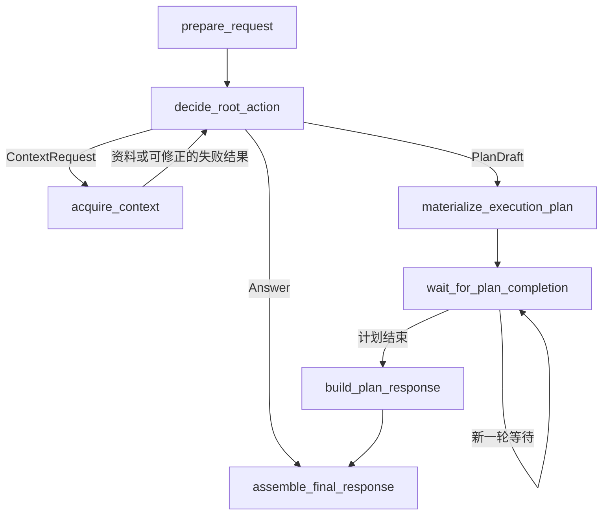

# Athena Root 统一决策设计与实施方案（首期收敛版）

> 更新：2026-10-23｜状态：D1–D3 已完成；D4 审批与工具执行已验收，stdout 展示已修复并通过定向测试｜代码基线：`78225b9`
> “当前现状”记录实施前状态；“改动方案”作为本次实施的验收依据。
> 总体架构见 [Agent 架构 v1.1 实施方案](agent-architecture-v1.1-implementation-plan.md)。

## 1. 需求概览

Athena 是单用户通用 Agent。用户表达目标、业务限制和期望结果，Root 根据完整对话、可用资源及系统能力决定如何完成任务。

| 用户需求 | 期望行为 |
| --- | --- |
| 解释、写作，或已有信息足够 | 直接回答 |
| 需要记忆、当前附件、知识库或图数据中的参考信息 | 按需检索，再判断下一步 |
| 需要运行程序、修改文件、调用业务工具或执行复杂处理 | 生成计划，由 Worker 执行 |
| 缺少必要信息且无法检索获得 | 向用户澄清 |

用户不需要知道工具名称，也不负责指定工具清单。系统提供可用工具目录，Root 分配任务工具范围，Worker 选择具体调用；具体操作继续按策略审批。

本期调整前置分类、Root 初始决策和按需检索，复用已有计划调度、Round Review、Worker、审批、取消与恢复机制。

## 2. 当前现状

### 2.1 当前执行链路

```text
prepare_request → understand_task
  ├─ 需要澄清 → clarification_response → assemble_final_response
  └─ 其他请求 → plan_context → acquire_context → prepare_harness_input
                → run_root_execution_loop
                  ├─ 普通答复 → assemble_final_response
                  └─ 计划 → materialize_execution_plan
                           → wait_for_plan_completion（Round 恢复后 Review，可开始下一轮）
                           → build_plan_response → assemble_final_response
```

当前业务逻辑位于 `application/orchestration/root_workflow.py`，图接线位于 `application/orchestration/langgraph/graphs/root.py`。以下代码路径均以 `backend/src` 为基准，另有说明的除外。

### 2.2 已有实现与本次问题

| 位置 | 当前行为 | 本次需要解决的问题 |
| --- | --- | --- |
| RootWorkflow.understand_task | 调用 TaskUnderstandingService，生成 task_spec、mode、检索需求和澄清信息 | 前置分类先限制后续行为，Root 不能统一决定下一步 |
| plan_context / acquire_context | 根据 task_spec 生成 ContextPlan，检索一次后进入 Root | 没有“Root 请求资料 → 检索 → 返回 Root”的回路 |
| prepare_harness_input | 拼接消息和参考内容；仅 mode=plan 时提供 Worker 工具目录 | 是否能规划依赖前置分类，而非 Root 对完整信息的判断 |
| ConfiguredRootAgent.__call__ | 按 mode 决定输出处理；计划格式错误修复一次，仍失败则返回文本 | 输出契约不统一，无效计划可能被当作答复返回 |
| run_root_execution_loop | 兼容 next_route、route、execution 等返回形态，并根据 mode 或 plan 再判路由 | 存在多套分流依据，节点职责不清 |
| ContextPlanner / Provider | 接收 task: Any，混用对象属性与字典字段；部分查询回退到 goal | 类型不明确，查询与资源范围隐藏在探测逻辑中 |
| scope_execution_plan | 从 task_spec 读取用户工具白名单，并据此过滤任务工具 | 与“用户不指定系统工具”的需求不一致 |
| 节点与检索事件 | 活动 ID 主要由 run_id、节点名或通道名组成 | 增加循环后，同名活动可能相互覆盖 |

已有 ContextPlan、ContextBundle、四类检索 Provider、计划提交事务、Round interrupt/resume、Review、Worker 和审批链可继续使用。当前资料裁剪仅针对一次采集结果，尚无跨轮窗口替换机制。

Root 状态当前保存在 `application/orchestration/langgraph/graphs/state.py`，包含 understanding、context_plan、harness_input、execution 和 next_route 等旧链字段。bootstrap 仍装配分类服务、分类 factory 和分类超时。

当前 RUN_START 消费者只领取 queued 命令；本次不能把保存 checkpoint 等同于初始规划阶段已支持宕机自动重投。

## 3. 目标

1. **统一决策**：取消独立分类调用，Root 输出回答、检索请求或计划草稿。
2. **按需取资料**：允许多轮检索，统一限制 Root 决策轮数和当前参考资料量。
3. **职责清晰**：模型负责判断；应用服务负责检索、校验和事务；Worker 负责实际操作。
4. **完整替换旧链**：删除旧节点、类型、提示、配置和兼容分支，保持既有执行协议。

本期不扩展历史附件恢复、记忆访问统计、初始 RUN_START 自动重投，也不新增上下文引用协议、多用户体系或多套预算。

## 4. 改动方案：改哪里、怎么改

### 4.1 定义 Root 的输入输出

**位置：** 新增 `application/orchestration/root_decision.py`；查询类型放在现有 `application/runs/context/contracts.py`。

RootAgentInput 包含以下数据，均通过明确字段传入：

| 输入 | 来源和处理 |
| --- | --- |
| session_id、run_id、message_id | 程序提供，用于关联当前运行和事件 |
| messages | 现有历史与完整当前消息，当前消息只加入一次 |
| attachments、knowledge_bases | 已验证的当前附件、真实知识库元数据 |
| worker_tools、available_context_providers | 系统提供的工具描述、参数、审批属性及实际装配的检索通道 |
| context | 当前有界 ContextBundle |
| context_queries、remaining_turns | 轻量查询结果摘要、剩余决策轮数 |

输出使用以 `action` 为判别字段的联合类型，不再依赖 mode 或路由字符串：

| 输出 | 必要字段 | 校验与默认值 |
| --- | --- | --- |
| Answer | action=answer、kind、content | kind 为 final/clarification，正文去空白后非空 |
| ContextRequest | action=context、queries | 1–4 条具体查询，通道限定为已定义类型 |
| PlanDraft | action=plan、goal、tasks、edges、max_parallelism | 目标非空，任务非空，并行度默认 1 且为正整数 |
| PlanTaskDraft | task_id、title、objective、allowed_tools、input、expected_output、plan_version | 标识与目标非空；版本默认 1；工具范围由 Root 选择 |
| PlanEdgeDraft | from_task_id、to_task_id | 引用真实任务，后续执行既有 DAG 校验 |

稳定结构使用具体 Pydantic 类型，拒绝未知字段；Task 自定义数据使用 `dict[str, JsonValue]`。资源 ID 是否有效、工具是否可用属于应用校验，不只依赖模型输出结构。

模型只生成草稿内部任务标识，不生成 Run/Session 数据库身份；Plan 身份由程序构造，任务标识绑定当前 Run。唯一 Worker 类型 general 和默认时限由应用提供。

**完成结果：** 调用方只接受一种具体输入和三类决策，不再解释多种返回字典形态。

### 4.2 改造 Agent 方法与提示

**位置：** `application/orchestration/agents/root_agent.py`、`protocols.py`；新增 `backend/prompt/root_decision.md`。

1. 将初始调用改为显式异步方法 `decide(inputs: RootAgentInput) -> RootDecision`，删除 `__call__` 入口与转发逻辑。现有 review 方法保持原协议。
2. 用统一提示说明回答、检索、计划三类动作。Root 可做现有有界只读检索；程序执行、外部写入、批处理或超出参考窗口的复杂工作交给 Worker。
3. 提示中加入系统能力、有效资源目录、剩余轮数与自然语言业务限制。检索正文和历史记忆作为参考资料，不作为系统指令。
4. 通过已有 LLMPort 与事件机制调用模型，只解析完整 JSON；允许移除包住整个对象的一层代码围栏，删除扫描任意文本中第一个 JSON 对象的逻辑。
5. JSON 或结构错误时，带上错误与前次输出修复一次；仍无效就抛出明确协议错误，不回退为成功文本。格式修复计入同一 Root 轮次。

删除初始决策中的 planning 开关、用户工具白名单提示及条件版本提示。分版本规则写入统一提示，分版执行留给物化阶段。

**完成结果：** 普通请求无需先做分类调用；模型返回的动作就是工作流分流依据。

### 4.3 调整请求准备和节点职责

**位置：** `application/runs/request_preparation.py`、`application/orchestration/root_workflow.py`。

| 方法 | 修改步骤 | 写回内容 |
| --- | --- | --- |
| prepare_request | 复用消息幂等保存、历史和当前附件校验；加载知识库元数据、系统工具目录；初始化轮数和空资料窗口 | request、资源/能力目录、root_turn_count、context_bundle |
| decide_root_action | 检查轮数，构造 RootAgentInput，直接 await agent.decide，记录本轮决策 | root_decision、root_turn_count；仅 Answer 写 response |
| acquire_context | 将 ContextRequest 转成 ContextPlan；读取资源，合并当前资料窗口，记录轻量结果摘要 | context_bundle、context_queries |
| materialize_execution_plan | 读取已验证 PlanDraft，规范化身份、工具和版本，再调用原提交用例 | 已提交 plan、deferred_plan_versions、运行状态 |
| wait_for_plan_completion | 保留 Round 等待、interrupt/resume 与 Review 推进 | 原等待和计划结果状态 |
| build_plan_response / assemble_final_response | 复用计划结果组装与最终输出；错误优先处理，禁止残留草稿充当答复 | response、result、最终状态 |

prepare_request 不扩展历史附件目录；历史文字提到、但不在当前有效目录中的文件，不能凭空生成 ID。工具和知识库目录准备一次保存到状态，后续 Root 决策复用。

`decide_root_action` 不做实际检索、工具调用、版本拆分或命令提交。澄清仍是 Answer：保存问题并结束本次 Run，用户补充后创建新 Run。

**完成结果：** 每个节点对应明确业务步骤，检索和事务不会塞进 Root 决策方法。

### 4.4 改造检索输入和资料管理

**位置：** `application/runs/context/contracts.py、planner.py、protocols.py、service.py`，以及三处 Provider 文件：`application/memory/retrieval_service.py`、`application/files/retrieval_service.py`、`application/retrieval/graph_service.py`。

**查询和范围：**

| 查询类型 | 输入与解析规则 |
| --- | --- |
| MemoryQuery | 非空 query，沿用跨会话记忆召回 |
| FileQuery | 非空 query、file_ids；空列表表示当前有效附件，显式 ID 必须属于该目录 |
| KnowledgeQuery | 非空 query、knowledge_base_ids；空列表表示当前配置知识库，由程序展开真实 ID |
| GraphQuery | 非空 query，只使用已装配的图检索能力 |

具体实施：

1. ContextPlanner.plan 改为接收具体 queries 和有效资源目录，生成现有 ContextPlan；不引用编排层的 RootDecision。保留每通道一组查询，同通道多个主题组合查询或分轮处理。
2. 采集服务和 Provider 的 retrieve_context 改为显式接收 `session_id: str、run_id: str、plan: ContextPlan`。移除 task 参数、goal 回退和对象/字典双形态探测。
3. Planner 检查文件和知识库范围；无效选择返回可描述的查询失败，不能执行越界读取。无有效知识库时不使用 list_all_attachments 回退。
4. 采集服务复用现有并发、轨迹与 ContextBundle；轨迹记录实际通道查询，不再统一取 task.goal。活动关联另传 invocation_id。
5. 新增 ContextQueryOutcome，只含查询、状态、结果数量与可空错误说明；将状态摘要交给 Root，不重复传入 ProviderResult 中的全部正文。

**多轮资料合并：** 在工作流侧增加纯函数处理“旧 ContextBundle + 本批 ContextBundle”，采集服务只负责本次读取。先放新结果，再补旧内容；同 Provider/source_id 保留最新，无 ID 时按同 Provider 相同正文去重；按现有 token/条目限制裁剪。返回仍用 ContextBundle，每次模型输入只渲染当前 items 一份正文，不保存多版本内容。

这样第一轮即使用满 4000 token，第二轮的新资料仍可替换旧资料。详细检索记录留在既有轨迹，checkpoint 不再额外累计所有轮次正文。

**失败处理：** 超时、零结果、通道不可用和无效资源选择反馈给 Root，由它选择重查、换查询、回答或澄清。相同查询可以再次执行，受 Root 总轮数限制；不新增查询缓存或独立重试状态机。沿用 Provider 已有重试和超时；协议损坏、不可恢复错误明确失败。CancelledError 必须传播，并回收采集子任务。

**完成结果：** 四类 Provider 使用明确查询；新资料能进入窗口，失败可供 Root 判断，长期记忆正文实际进入模型输入。记忆访问统计位置本期不改。

### 4.5 接线目标图、状态和轮数限制

**位置：** `application/orchestration/langgraph/graphs/root.py、state.py`、`dependencies.py`、`protocols.py`。

目标图保留 7 个业务节点：



接线时逐项处理：

- prepare、decide、acquire、materialize 结束后先检查 error；不可恢复错误转到 assemble_final_response，不沿成功边继续使用旧状态。上图只展示正常和可继续的检索路径。
- 删除 understand_task、clarification_response、plan_context、prepare_harness_input；将 run_root_execution_loop 替换为 decide_root_action，路由只读取合法 action。
- Wait 保持专用 interrupt 包装，不能放入会吞掉中断的普通异常包装器；Submit 与 Wait 保持独立节点。
- 保留 request、资源/能力目录、root_decision、root_turn_count、context_bundle、context_queries，以及既有 plan、延期版本、等待、结果和终态字段。
- 删除 understanding、临时 context_plan、harness_input、Root.execution、next_route。每次临时构造 RootAgentInput，不把同一输入再保存一份。
- 决策模型写 checkpoint 时显式序列化，读取时按具体契约验证；不借此改造全项目序列化框架。

新增唯一业务配置 `root_max_turns`，默认 4。remaining_turns 为“本轮在内还可决策几次”；一次正常决策计一轮，格式修复不另计。最后一轮输出 ContextRequest 时，以 root_budget_exhausted 结束，不调用 Provider，也不增加隐藏的最后一次回答调用。

模型与 Provider 继续使用现有超时；LangGraph recursion_limit 在调用配置中留足回路余量，可设内部值 128，避免框架先于业务轮数截断；不将其新增为产品预算配置。

**完成结果：** 图分流、checkpoint 状态与业务循环使用同一决策契约，Round 恢复不重跑初始决策。

### 4.6 调整计划物化和工具范围

**位置：** `application/orchestration/plan_materialization.py、plan_versions.py`、Agent 中的初始计划解析逻辑；检查既有 Review/Revision 调用方。

1. 将 coerce_plan 的输入改为已验证的 PlanDraft，删除 task_spec 依赖和任意字典补齐逻辑。保留完整原始用户目标，程序构造 Plan 身份并将任务和边绑定当前 Run。
2. scope_execution_plan 只接收本次系统能力清单和具体计划，不再接收用户工具白名单。删除根据 Task.input 的键名追加工具、静默过滤非法工具等逻辑；声明未知或不可用工具时明确拒绝。
3. Task.allowed_tools 保留为内部委派范围。Root 从系统目录中选择，Worker 在该范围内调用；Worker 执行前仍检查工具当前启用状态和审批策略，旧 checkpoint 不能重新启用已停用工具。
4. 将 Agent 中已有版本分组逻辑移入现有 plan_versions.py。普通任务 plan_version 默认 1，先后步骤由 DAG/Round 表达；明确分版本时校验连续性与依赖，仅提交首版，延期定义沿原 Review/Revision 推进。
5. 删除 _explicit_plan_versions、_plan_version_contract 等关键词和条件提示逻辑；保留现有 deferred_version_review_decision 策略，不另外增加一轮 Review 模型调用。
6. Root 把 Worker 所需参考资料及来源写进现有 Task.input，只传自身任务和必要上游结果，不新增 context_ids 或专用上下文引用协议。

materialize_execution_plan 按“验证草稿 → 规范化身份和工具 → 处理显式分版 → 构造原提交命令 → submit_plan → 写回投影”的顺序执行，保留稳定命令键。命令重放使用已保存草稿和能力清单，不因重新查询工具目录改变已生成命令内容。

提交用例中的命令幂等、Plan/Version/Task、Round 成员、Worker Job、Outbox 与回执保持**同一事务**。允许拆纯函数和事务内辅助方法，不能拆成自行提交的多个仓储调用；模型、检索和等待都在事务外。

**完成结果：** 初始计划和 Review/Revision 都遵守系统能力边界，用户不用提供工具名，既有 DAG、审批及事务保证仍成立。

### 4.7 装配、活动事件和旧链清理

| 修改位置 | 实施内容 |
| --- | --- |
| bootstrap/postgres.py | 移除 TaskUnderstandingService 及 task_understanding_factory；继续装配四类 Provider，显式传入实际通道目录和 root_max_turns，不探测 _providers |
| configuration/settings.py、backend/.env.example | 删除分类专用超时及其示例，新增 root_max_turns，保留现有上下文限制 |
| orchestration/dependencies.py、protocols.py | 删除分类服务和旧节点方法；接入 decide 与必要配置，更新所有构造调用方 |
| graphs/root.py 与 context/service.py 的活动事件 | 每次执行生成独立 invocation_id；started/completed/failed 使用同次 ID；Provider 子活动关联本次采集；LLM 复用现有 call_id |
| frontend/src/components/pages/RunChainView.tsx | 按需更新旧节点示例；验证同名节点的多次活动分别显示，保留服务端 occurred_at |
| application/runs/task_understanding/、backend/prompt/task_understanding.md | 删除整个旧分类包和提示，清理导出、配置引用及测试替身 |

工具链还需删除 _explicit_allowed_tools、UserTaskSpec 中的工具白名单字段、user_allowed_tools 提示及物化分支。工具文本仅按普通用户内容理解，不能变成权限配置。

保留既有 Round interrupt/resume、Review 决议复用、图执行锁和 Submit 幂等。切换前结束受影响的活动测试 Run，按 thread 清理旧测试 checkpoint；不增加旧节点别名、状态迁移或新旧桥接层。

**完成结果：** 生产路径只剩新入口，同名循环活动可区分；本期不承诺初始规划阶段宕机自动恢复。

### 4.8 实施顺序与阶段交付

| 步骤 | 工作 | 阶段检查 |
| --- | --- | --- |
| D1 契约与 Agent | 完成 4.1、4.2：具体模型、统一提示、decide 和一次格式修复 | 三种输出可解析；普通解释、检索、执行和格式错误有定向测试 |
| D2 检索与窗口 | 完成 4.4：明确查询、四个 Provider、范围、合并和失败反馈 | 跨会话记忆正文、真实资源范围、窗口替换及取消可验证 |
| D3 图与运行时切换 | 完成 4.3、4.5–4.7：节点、状态、物化、装配、事件和旧链删除 | 新图完整接通；调用方同步；无旧链生产引用，既有执行回归通过 |
| D4 验收与交付 | 执行第 5 节，补真实模型/工具/浏览器证据并同步文档 | 各项证据记录清楚，失败项不能标为完成 |

四步在同一开发分支推进；D2/D3 作为一个完整运行时切换验收，不为了独立上线阶段产物增加兼容代码。

## 5. 验收标准

| 编号 | 验收项 | 通过条件 |
| --- | --- | --- |
| A01 | 回答与澄清 | 普通解释直接回答，无前置分类调用；缺少必要信息时澄清，不因 shell、多 Agent 等关键词误执行 |
| A02 | 决策协议 | 三类动作正确分流；无效结构最多修复一次，仍失败则报错；控制 JSON 不泄露为答复 |
| A03 | 工具选择 | 用户只描述目标也能完成单 Task 执行，不被要求提供工具名；讨论 allowed_tools 或错误 JSON 不被当作权限指令 |
| A04 | 工具与审批边界 | 初始规划和 Review/Revision 均只能委派系统可用工具；Worker 不越过 Task 范围；需审批的操作按原流程执行 |
| A05 | 检索范围与有效内容 | 跨会话记忆正文进入 Root；附件、知识库和图查询使用真实有效资源，无越界全附件回退 |
| A06 | 多轮检索 | 首批占满窗口后，新资料仍能进入；无重复正文注入；超时、零结果和资源选择错误可反馈后继续判断，相同查询允许重试 |
| A07 | 循环上限 | 不超过 root_max_turns；最后一轮仍要求检索时明确结束，没有隐藏的额外查询或决策 |
| A08 | 计划行为 | 普通多步任务使用 DAG/Round；明确分版仍按原路径推进；Task.input 能向 Worker 提供必要参考信息 |
| A09 | 事务与幂等 | 非法 DAG 被拒绝；计划相关记录同事务提交；重复 Submit 不重复创建业务记录 |
| A10 | 恢复与取消 | Round 恢复复用原 checkpoint 和已提交 Review；取消后回收采集任务，迟到结果不能创建新执行 |
| A11 | 展示与终态 | 多轮同名活动分别显示并使用服务端时间；最终消息、Run 终态和 memory job 沿用既有幂等收敛 |
| A12 | 旧链清理 | 生产代码无旧分类类型、节点、配置、工具白名单解析及兼容分支；调用方与测试同步更新 |

验证方式：

- **单元测试**：改造 test_root_graph、test_configured_root_agent_planning、test_root_plan_submission、test_memory_context_recall；保留 test_configured_root_agent_review 回归。补充窗口替换、失败反馈、轮数限制和取消测试，删除旧分类/文本白名单断言。
- **PostgreSQL 集成测试**：回归计划事务、幂等、Round 恢复、审批、取消和终态；测试配置 ATHENA_TEST_DATABASE_URL。
- **真实模型与工具**：验证三类语义选择、业务限制、无需用户指定工具及真实执行证据，不能只用固定输出替身证明。
- **浏览器**：验证审批和多轮活动展示；前端有改动时完成类型检查与构建。

完成定向回归及后端全量测试，记录未通过项；代码检查和 git diff --check 通过。历史附件扩展、访问统计修正和初始命令自动重投不计入本期完成条件。

## 6. 当前实施状态

截至 2026-10-23，D1–D3 的代码切换已完成：统一 Root 决策、按需检索回路、资料窗口、工具目录校验、显式版本物化和旧分类链清理均已接入；计划提交仍由原命令处理器在同一事务内完成。

本地验收结果：后端单元测试 `330 passed`；PostgreSQL 集成测试 `34 passed`；Python 编译检查和 `git diff --check` 通过；前端类型检查与构建通过。生产代码及提示中已无旧 Task Understanding 节点、类型和提示引用。

D4 真实模型验收（2026-10-23）：普通解释请求直接回答；“请帮我处理那个文件”在没有附件时询问文件和所需操作；只描述“列出 d4-validation 目录中的文件名”的请求也完成了工具执行，Root 生成单任务计划，Worker 从系统工具目录选择 `list_directory`，账本状态为 `completed`，最终返回 `marker.txt`，Run 终态为 `completed`。该工具测试未在用户输入中指定工具名。

验收期间发现 Review 提示没有对所有动作明确要求 `reason`，与 `ReviewDecision` 的非空校验不一致；已补齐提示，并由 `test_configured_root_agent_review.py` 的 6 项测试覆盖。模型调用超时由 60 秒调整为 120 秒，更新了 Settings 默认值、`.env.example` 和本地 `.env`；60 秒时曾出现一次模型调用超时，使用 120 秒配置的最终工具链路通过。由于模型响应时间会波动，这次验收只能说明 120 秒配置下链路通过，不能单独证明超时调整是成功的唯一原因。

D4 多轮活动验证（2026-10-23）：RunChainView 合并同一活动的状态事件时保留首次服务端 `occurred_at`，历史分页缺少开始事件时使用服务端 `started_at`；事件先按持久化 `session_seq` 排序，避免本地时钟格式和跨日边界导致错序。新增 Root Graph 回归测试覆盖两轮检索、三次 Root 决策，确认同名节点活动 ID 各自唯一，且开始/完成事件一一对应。浏览器静态演示确认两条 `decide_root_action` 可分别展开和查看详情；同时修复浅色工作区的暗色悬停背景。后端单元测试 `330 passed`，PostgreSQL 集成测试 `34 passed`；前端类型检查、生产构建和 `git diff --check` 通过。

D4 真实多轮会话验收（2026-10-23）：登录后通过真实模型完成多轮记忆检索，Run `2026.10.23.05.48.32.346`、Session `2026.10.23.05.47.40.720`，Run 状态为 `completed`。Root 依次产生 4 次 `decide_root_action` 和 3 次 `acquire_context` 活动，活动各有独立 ID，并显示服务端时间；持久化事件包含 5 组 LLM started/completed、9 组节点 started/completed、3 组 retrieval.started/completed、1 组 provider.completed、1 组 message.delta/completed 及 run.started/completed。浏览器重载并重新选择会话后，最终回答和三条检索到的记忆值仍可见，确认会话回放使用持久化事件。另一个直接回答 Run `2026.10.23.05.58.14.319`（Session `2026.10.23.05.58.05.650`）也在重载后显示最终答复。

为展示验收修复审批日志页与后端响应字段不匹配的问题：前端改用 `approval_id`、`created_at`、`resolution` 等真实字段，并采用后端返回的 `pending/approved/denied/total` 统计结构。修复后页面可渲染历史记录；本次浏览器检查显示历史审批记录存在，但当前待审批数为 0。工具管理页共列出 41 个工具，搜索 `exec_shell` 没有结果，因此当前无法从 UI 发起一条新的高风险审批请求。历史审批记录不作为本轮新审批交互的替代证据。

D4 真实审批与工具执行（2026-10-23）：本地测试库临时注册高风险 `exec_shell` 后，用户在 Athena 浏览器中批准了唯一指定命令 `python -c 'import sys; print(sys.version.split()[0])'`。正确命令对应 Run `2026.10.23.06.23.51.814`、Session `2026.10.23.06.23.38.320`、Approval `approval:58cf0df802a67d19bfed31dd1087d9b3`；审批状态为 `approved`，Worker 操作账本为 `completed/success`，退出码 0，标准输出 `3.12.14\n`。执行容器禁网、未挂载工作区且根文件系统只读。浏览器确认审批卡片和 Worker 完成状态，但当时 Root 最终回复没有显示标准输出。检查持久化任务结果后发现 stdout 位于嵌套的 `output.stdout` 字段，而 `_result_text` 未识别该字段；现已调整提取顺序并新增对应的计划结果渲染回归测试，`test_plan_result_rendering.py` 的 3 项测试通过。为遵守“指定命令执行一次”的授权，没有在修复后再次执行命令；修复后的 stdout 展示由定向测试覆盖。

提交前工作区复核（2026-10-23）：后端全量测试 `347 passed, 34 skipped`；其中 34 项 PostgreSQL 集成测试因当前进程未配置 `ATHENA_TEST_DATABASE_URL` 而跳过。唯一失败项 `test_domain_does_not_depend_on_outer_layers` 检出 `domain/runs/entities.py` 与 `domain/runs/payloads.py` 对 Pydantic 的导入；这两个文件在本次工作区中没有改动，该边界问题早于本专项。Root 轮数回归检查修正为只在最后一轮请求 Context 时结束；计划草稿仍在该轮进入物化。资料窗口合并现在复用配置模型的 token 计数器，避免中文内容被空格分词低估。

验收过程中我曾误将一个只输出 Python 主版本的近似命令提交到独立测试会话，输出为 `3\n`；这次错误尝试不计入上述验收，也没有替代正确命令。临时 `exec_shell` 配置已从测试库删除，两条临时测试会话已通过 Athena 软删除，后端进程也已以 `EXEC_SHELL_ENABLED=false` 重启；审批、事件和 Worker 操作审计记录保留用于追溯。
