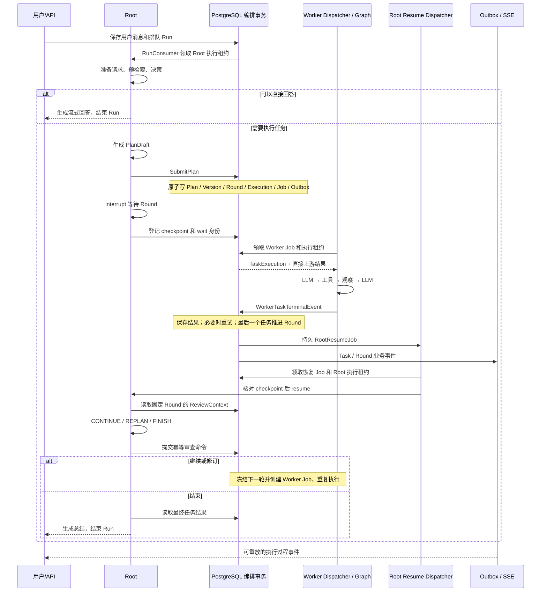

# Root 与 Worker 交互梳理及简化评审

评审日期：2026-10-28。依据：`universal` 分支当前源码、现有相关单元测试和四个隔离复现场景。本轮只新增分析文档及索引，没有修改业务代码、数据库或接口。

## 1. 判断

当前主干是合理的：Root 决定目标和计划，确定性代码管理 DAG 与执行状态，Worker 自主完成单项任务，Root 按轮审查后继续、修订或结束。PostgreSQL 保存业务事实，LangGraph 保存可恢复执行位置，LeaseCenter 管理执行所有权。

可简化的空间主要在三个层面：

1. **先修交互边界**：工具契约的导入身份、连续审批、批内审批后的剩余调用、Root 恢复并发上限存在具体问题；这些问题需要修复，不属于可选的产品裁剪。
2. **保持功能的代码收敛**：复用 Worker 编译图，提取执行入队和状态转换，减少重复 JSON 转换、等待时结果加载及兼容分支。
3. **可选的功能收敛**：简单任务使用较轻规划，普通成功轮次采用确定性审查，按依赖就绪即执行。这些会改变当前行为，尤其最后一项改变严格 Round 契约，不应混入普通重构。

目前没有必要重建一套消息中间件、通用 Agent 框架或第二套调度系统。

## 2. 实际部署与职责

当前 `bootstrap/postgres.py` 在同一个应用生命周期内创建 Root、Worker executor 和各后台 dispatcher。这里的 Worker 是独立任务执行器，并不等于已部署在另一台机器上的 HTTP Worker 服务。

现有链路中，没有 Root 到外部 Worker 的 HTTP 注册、心跳或任务结果回调协议。执行所有权心跳由 `LeaseGuard` 续租 PostgreSQL 租约完成。

| 组件 | 实际职责 | 不应混入的职责 |
| --- | --- | --- |
| Root Agent | answer/context/plan 决策、计划草稿、轮次审查 | 直接修改任务状态或绕过工具治理执行副作用 |
| RootWorkflow | 准备输入、组织决策、提交编排命令、等待和总结 | 实现数据库锁和领取算法 |
| 编排命令/终态事务 | 校验 DAG、冻结 Round、创建执行和 Job、处理重试与计数 | 调用 LLM 或长时间等待工具 |
| Worker Agent | 根据目标、输入、上游结果和工具结果决定下一步 | 查看完整会话或修改其他 Worker 的执行 |
| WorkerWorkflow / WorkerToolExecutor | 工具循环、审批中断、权限、操作账本和结果引用 | 制定全局 DAG 或推进下一轮 |
| Dispatcher | 领取、并发限制、持有租约、调用执行器和提交结果 | 再实现一套业务决策 |
| OutboxDispatcher | 将业务事务产生的事实投递到持久事件/SSE | 作为 Root 唤醒的唯一来源 |

## 3. 正常交互全流程



### 3.1 请求进入 Root

`RunService.submit()` 保存用户消息与 Run；`RunConsumer` 领取后调用 `RunExecutionService`，再经 `LangGraphRunExecutor → LangGraphRootGraph → invoke_root_graph()` 启动图。

Root 的实际图路径为：

```text
prepare_request → prefetch_context → decide_root_action
  answer  → generate_answer → assemble_final_response
  context → acquire_context → redecide_root_action → answer 或 plan
  plan    → generate_plan → materialize_execution_plan → wait_for_plan_completion
```

规划返回信息缺口时，可以回到决策节点；`root_max_turns` 和“没有新增信息时禁止重复规划”限制这一阶段的循环。检索及规划失败会走错误收敛。

这里直接回答和澄清都不必经过 Worker。Root 的预检索是资料获取流程，Worker 工具是任务执行流程，两者不能简单合并成同一个入口。

### 3.2 计划提交和严格 Round

`RootWorkflow.materialize_execution_plan()` 依次进行：

1. 校验 `PlanDraft`，处理用户明确要求的后续版本。
2. 转换领域 Plan/Task，给任务 ID 绑定本次 Run，核对工具范围。
3. 提交带 Root 租约的 `SubmitPlan` 幂等命令。
4. 在一个事务中保存计划、不可变版本、首轮成员、TaskExecution、WorkerJob 和 Outbox。

`freeze_ready_round()` 把当时全部 ready Task 冻结为本轮成员。**Round 成员数不受并发额度裁剪**，实际启动时再检查 Plan 的 `max_parallelism` 和本进程 dispatcher 的 `max_concurrency`。

例如 A、B 同时 ready，C 只依赖 A：即使 A 已完成，C 仍然要等 B 结束、整轮审查通过后才能启动。这是当前严格 Round 的明确语义，存在批次屏障造成的等待。

用户显式指定的后续计划版本暂存在 Root checkpoint 的 `deferred_plan_versions`，到当前版本完成时由确定性代码转换成 Revision。它与运行中根据结果动态 REPLAN 不完全相同；不能直接当成同一份多余数据删除。

### 3.3 Worker 领取和执行

`PostgresWorkerJobRepository.claim_next()` 从租约中心查可领取资源，再按业务归属核对 Run、Plan、Round、Task、Execution、Job 和取消代际。领取事务更新相关运行状态，并创建执行租约。

dispatcher 在事务之外运行 Worker，并由 `LeaseGuard` 续租；同一个 checkpoint thread 还有跨进程 advisory lock，防止旧执行与接管执行同时操作图。

Worker 的模型输入来自 `_worker_messages()`：

- 当前任务的 objective、input、expected_output。
- 直接上游的 TaskResult。
- 当前任务的 allowed_tools 和可用工具说明。
- 当前执行已经得到的工具结果。

Worker 不会自动获得 Root 的全部会话、资料窗口、完整 DAG 或其他 Worker 对话。Root 若要让 Worker 使用某段检索材料，应通过任务输入或可用资源引用明确传递。

Worker 图当前路径：

```text
prepare_worker → worker_agent_loop → approval_gate
  有工具调用 → execute_tool_batch → worker_agent_loop
  需要审批   → request_worker_approval interrupt → 恢复后 worker_agent_loop
  完成/失败  → finish_worker
```

每个工具批次串行执行，轮数与每轮调用数有上限。`WorkerToolExecutor` 再校验 allowed_tools、当前工具配置和参数，处理审批、操作账本以及大结果引用。

`expected_output` 当前主要作为模型提示和 Root 语义审查输入，不是普遍执行的 JSON Schema 验收器。不能把 Worker 返回 `completed` 等同于已通过确定性的结果验收。

### 3.4 任务结果回到 Root

Worker 完成后，dispatcher 将 TaskResult 转为 `WorkerTaskTerminalEvent`。终态事务完成：

1. Inbox 去重和内容一致性校验。
2. 核对当前执行身份、租约、Plan/Run 状态和取消代际。
3. 保存执行结果；大结果单独存储。
4. 可重试失败且未到次数上限时，创建同一 Round 下的新 Execution/Job；不把逻辑任务计为终态。
5. 最终终态更新 Task/RoundTask，只增加一次 Round 计数。
6. 全部成员终态后，Round completed、Plan waiting_review，并原子插入 RootResumeJob 和 RoundCompleted Outbox。

**RootResumeJob 负责控制流，Outbox/SSE 负责事实展示。** 当前 Root 唤醒不依赖前端收到 SSE，也不依赖 OutboxDispatcher 先转发 RoundCompleted。

### 3.5 Root 恢复和审查

`RootResumeDispatcher` 核对 Run/Plan/Round、wait generation、checkpoint 和 interrupt。若图中断已经保存但 Run 尚未登记 wait 身份，会从 checkpoint 找回身份补登记。

恢复之后，Root 根据固定版本、全 DAG 摘要、历史结果、当轮结果和剩余任务审查：

| 动作 | 业务效果 |
| --- | --- |
| CONTINUE | 在同一版本传播失败依赖，再冻结下一轮 |
| REPLAN | 校验保留/取消/新增任务及依赖，保存新版本并冻结下一轮 |
| FINISH | 结束 Plan，取消尚未启动的任务，随后生成最终总结 |

审查命令用 Round 作为幂等身份。已经提交的决策会优先从命令记录恢复；崩溃可能导致模型重算，但不能重复创建有效下一轮。

`FINISH` 与 Run 完成是不同时间点：Plan 结束后，Root 还要生成回答，Run 才进入终态。

Root 等待 Worker 时，持久 Run 状态仍为 running，由 root_wait 字段和 `run.root_suspended` 事件表达等待；这也是 Worker 领取时仍要求 Run running 的原因。

## 4. 审批、故障、取消

| 场景 | 当前路径 | 应保留的保证 |
| --- | --- | --- |
| 高风险工具 | 冻结参数与操作身份 → Worker interrupt → 登记审批和 Outbox → 结束当前 Job、释放租约 | 等用户时不占用长期活跃 Worker 调用 |
| 批准/拒绝/过期 | 审批仓储原子写决定和 resume_worker Job → 同一 Worker thread 恢复 | 回执绑定 interrupt、execution、参数哈希和 operation key |
| 拒绝审批 | 生成明确的 denied 工具结果，交回 Worker 模型 | 不直接等同于 TaskFailed，也不立即唤醒 Root |
| Worker 超时/异常 | 生成可重试失败 → 终态事务决定新 attempt | 新 attempt 与租约接管分别处理 |
| 执行进程退出 | 过期租约可接管；识别已保存审批中断，工具账本约束重放 | 旧 owner 的迟到结果不能覆盖新 owner |
| 工具副作用已发生但结果未落库 | 操作账本可能保留 executing，拒绝盲目重做 | 不能承诺任意外部副作用 exactly once |
| 用户停止 | Run 置 stopping、增加取消代际、取消未启动任务和待审批/恢复项，撤销相关租约，后台收敛 | 不再创建新 Round，不让过期恢复把 Run 复活 |

审批期间同轮其他 Worker 可以继续。由于当前采用严格 Round，其他 Worker 完成也不能越过仍待审批的成员去启动下一轮。

## 5. 四个已核实的交互问题

以下问题经源码和隔离场景核实；隔离复现使用内存执行器或会话替身，未执行真实数据库并发验收。

### 5.1 P1：审批恢复后再次申请审批会被拒绝

代码：`repositories/worker_job_repository.py:wait_for_approval()`，其中有 `lease.job_type != "execute"` 的拒绝条件。

触发：同一 Worker 批准第一个写操作后，由 `resume_worker` Job 继续执行，又产生第二个需要审批的操作。

结果：第二次审批无法登记；dispatcher 只记录 `worker_approval_request_rejected` 并退出本次调用，没有将这个失败转换成明确终态。后续接管还可能尝试使用第一份恢复回执，存在任务无法正常继续的风险。

隔离结果：`second_approval_from_resume_job_accepted: False`。这是针对仓储入口的复现，未声称已模拟完整数据库恢复链。

建议：把“当前执行可以进入等待审批”统一成状态转换，允许有效 execute/resume_worker 执行登记下一次审批，同时校验新 interrupt 和操作身份。旧 Job 结束、新审批落库、执行状态等待及租约释放继续放在同一个事务内。

验收：同一任务连续两次批准、批准后拒绝、批准后过期均能收敛；第二次审批不能复用第一次的授权或重复产生副作用。

### 5.2 P1：批内审批后的剩余工具调用丢失执行安排

代码：`WorkerWorkflow.execute_tool_batch()`、`complete_tool_approval()`，以及 Worker 图中审批恢复后直接进入 `worker_agent_loop` 的边。

触发：模型一次返回 `[read, needs_approval, tail]`。

结果：执行 read、遇到审批后提前返回，`result` 被覆盖成 waiting_approval；没有保存 `tail` 的待执行列表或游标。恢复只处理被审批的操作，然后再问模型。原 assistant 消息可能仍保留完整调用审计，但工作流已不保证剩余调用继续执行，是否重新提出 tail 依赖下一次模型输出。

隔离结果：执行列表只有 `read, needs_approval`；状态补丁没有 tail。

建议：保存一个明确的工具批次及当前位置，审批完成后回到同一个批次执行剩余操作，全部完成才进入下一次模型调用。若选择“一次模型输出只允许一个工具”，实现会更简单，但属于能力收缩，应明确变更调用数契约，不能默默丢弃。

验收：审批位于批首/批中/批尾都不漏调用；拒绝后按既定策略继续或显式取消剩余调用；多个审批逐个恢复；崩溃重放遵守同一操作身份。

### 5.3 P1：Root 恢复调度器的 8 并发不是实际硬上限

代码：`RootResumeDispatcher.run()`。它在创建任务后用 `len(_inflight) >= 8` 退出内层循环，但下一轮外层循环会继续领取，没有在领取前检查剩余额度。

隔离结果：阻塞所有恢复处理、提供 12 个 Job，最终 `_inflight` 为 12。

建议：把额度检查放进领取循环前置条件，达到上限时等待停止信号或任务完成；将上限变成构造参数。可以复用 WorkerJobDispatcher 的容量判断方式，不必因此引入通用调度框架。

验收：提供超过上限的 Job 时运行中数量始终不超限；某个执行完成后只补充释放的额度；停止时能取消现有调用并交回可恢复执行权。

### 5.4 P1：工具清单与 Root 输入的模型类不是同一个身份

代码：`worker_tools.py:17` 从 `backend.src.application.orchestration.root_decision` 导入 RootWorkerTool，而 RootWorkflow/RootAgentInput 使用 `application.orchestration.root_decision`。

这两个导入路径在当前环境加载为两份不同的 Python 模块，Pydantic 将对应类视为不同类型。`worker_tool_manifest()` 返回前者实例，`RootWorkflow._agent_input()` 将其直接传给后者定义的 `RootAgentInput.worker_tools`；规划输入及审查入口也有同类边界。

隔离复现调用真实 `worker_tool_manifest()`，用一个启用的 native 工具构造清单，再构造真实 RootAgentInput：失败位置为 `('worker_tools', 0)`，错误类型为 `model_type`。两个 RootWorkerTool 类的 `is` 比较为 False。

因此这已超出导入风格问题：按当前导入入口，只要工具清单非空，首次 Root 决策就可能在调用模型前失败。该复现没有启动整个生产 HTTP 服务，线上启动方式是否存在额外模块别名仍需运行验收。

建议：统一为生产采用的 `application...` 导入路径；同时清理 WorkerWorkflow 的同类混用。不要在每个调用点增加 model_dump/model_validate 绕过类身份分裂。

验收：用真实工具清单走 RootAgentInput、RootPlanInput 和 Review 三个边界，至少一个启用工具时全部成功；生产启动和测试导入同一份契约模块。

## 6. 保持现有功能即可实施的简化

| 优先级 | 简化点 | 具体改法和收益 | 边界 |
| --- | --- | --- | --- |
| 高 | Worker 按 Task/attempt 编译并永久缓存图 | `LangGraphWorkerExecutor._graphs` 没有淘汰；生产 workflow 只保存依赖和配置，可像 Root 一样复用一个编译图，以 thread_id 隔离 checkpoint。减少编译与缓存增长 | 验证多任务并发、审批恢复和 state 隔离；测试专用工厂的语义单独处理 |
| 高 | 执行与 Job 创建有三份相似代码 | 首轮 `_schedule_initial_round`、后续 `_schedule_review_round`、重试 `_schedule_retry` 提取相同的 Execution/Job 构造与入队部分 | 首轮/后续/重试的 Round 成员和计数规则不同，保留调用方决策及原事务 |
| 高 | Task、RoundTask、Execution、Job 状态在多处手写 | 提取“开始执行、等待审批、结束 attempt、取消执行”等明确转换，集中维护关联行更新和不变量 | 暂不删除历史表或把各层状态硬合成同一枚举；先减少写路径重复 |
| 高 | 等待计划也加载全部结果 | `PostgresPlanLoader.__call__()` 每次依次读状态、结果和 wait；运行中只加载 wait 身份，计划终态再读结果。减少等待/恢复期间数据库读取和大结果反序列化 | 保留恢复前后重新查询业务事实的必要动作 |
| 中 | Root 启动和恢复缺少统一容量规则 | RunConsumer 启动调用没有全局并发上限，RootResume 另写固定 8；先修恢复上限，再按模型/进程资源需求定义共享容量规则 | 不能只限制 Worker 数量就假定限制了 Root 模型并发；无需统一两类持久 Job |
| 中 | RootWorkflow 同时管理资料窗口与执行审查 | 当前约 1500 行，且类之前大量函数负责上下文合并、预算、范围过滤；将上下文窗口规则移到现有 runs/context，把审查协调集中到少量函数或模块 | 保留应用层编排职责；不用为每个节点新建一个 Service |
| 中 | Worker 图节点过薄 | `prepare_worker` 的 input、`approval_gate` 的 status 以及 `finalize` 存在可推导字段；可把路由直接接到 worker_agent_loop，终态转换集中到 executor | 工具审批 interrupt 和批次游标必须保留；checkpoint 节点变化要处理在途恢复 |
| 中 | 审批恢复执行上下文重复合并 | `invoke_worker_graph` 与 `_restore_approval_execution` 都合并 execution、保留 tool_results/私有结果引用；改成明确的恢复上下文契约，图适配器负责注入，工作流负责身份校验 | 不能让 checkpoint 中的旧租约覆盖新 owner 的 grant |
| 中 | 结果多层 output 包装 | dispatcher 构造 event.result 时已包含 output/evidence 等，终态仓储又把它放入 output，读仓储和展示层再拆解；固定一个持久 TaskOutcome 结构，边界只转换一次 | 真正的历史结构需要迁移或明确兼容；错误、证据、大结果引用不能丢 |
| 中 | 已统一租约仍保留多套入口 | 运行时已通过 LeaseGuard 直接调用 LeaseCenter，dispatcher 仍能 `getattr(jobs, "_leases")`，Worker 仓储仍暴露 renew_lease。明确注入必需 LeaseCenter，再核对全仓调用方清理旁路 | 仓储的事务内 fencing 操作必须保留；其他队列调用方逐个确认 |
| 中 | 不可能配置/动态能力探测 | WorkerDispatcher 必需的 approval_service/thread_lock 仍判断 None；RootResume 对 Protocol 已声明方法仍 getattr/callable；RunExecutionService 对不同落库模式还有分支 | 在只保留一个生产契约后清理，替身实现相同端口；确有第二实现时保留语义，不为测试造生产分支 |
| 高 | 混用包路径 | worker_workflow 与 worker_tools 混用 `backend.src.application...` 和 `application...`；统一导入根，解决第 5.4 节已复现的工具契约类型不一致 | 同时确认启动、测试及打包入口；隔离复现不等于线上故障验收 |
| 低 | 通用 Worker 类型选择 | 生产仅组装一个 ConfiguredWorkerAgent，任务作用域化固定 general；当前没有按 worker_type 选择执行器 | 可先停止扩张类型分支，不必为删一个字段牵动历史 schema；未来远程能力路由另行设计 |

这些收敛不需要改变严格 Round、每轮 Root 审查、审批权限或取消语义。

## 7. 功能上是否可以更简单

### 7.1 简单任务的规划成本可以降低，但应晚于代码收敛

一个需要 Worker 的普通请求，忽略格式修复、资料补查和特殊分支，Root 通常调用模型：首次决策 1 次、生成计划 1 次、每轮审查 R 次、最终回答 1 次，即 R + 3 次。单任务一轮也通常有 4 次 Root 模型调用，另加 Worker 自身调用。

如果实际数据表明大量请求只是“执行一个明确操作”，可以让 plan 决策直接携带单任务草稿，复用原有 SubmitPlan/Worker/审批流程，从而省去独立规划调用。不要为单任务再建第二套队列和审批流程。

代价：首次决策重新承担较重的计划输出，和当前轻量意图/专用规划的职责拆分有取舍。应先测单任务占比、规划错误率和延迟，不能仅按节点数决定。

### 7.2 每轮都调用 Root 审查，可以改成“确定性审查优先”

对明确的静态 DAG，若当前轮全部成功、结果已满足可检验条件、没有阶段审查要求，可以由确定性规则生成 CONTINUE 或 FINISH，继续走原有幂等命令；异常、语义验收和动态修订再调用 Root。

代码已有 `deferred_version_review_decision()` 这一种确定性审查先例，可沿用同一决策接口。

但它改变“每轮由 Root 模型评估是否需要调整”的行为。尤其 expected_output 当前不是普遍强验收契约，不能仅看到 completed 就默认质量达标。建议作为显式策略选择，当前默认行为保持。

### 7.3 严格 Round 是最大功能复杂度来源，也是明确契约

若产品目标是“依赖满足就尽快执行”，可以取消普通任务的全轮屏障，保留用户指定的阶段门和异常审查点。A 完成后 C 就能开始，无需等待同轮独立任务 B。

这会影响 Round 成员冻结、计数、RootResumeJob 去重、ReviewContext、一轮只决策一次、前端 Round 展示及取消测试。现有 v1.1 方案明确要求严格 Round，因此这应视为另一项架构变更，当前不建议作为首批简化。

### 7.4 “预先排好的未来版本”更像阶段，动态 version 更像修订

当前 PlanVersion 同时表达不可变计划修订和用户预先声明的阶段。可以考虑把预先阶段表示成现有 DAG 中的阶段门，让 version 只代表真正修改过的计划，逐步减少 deferred checkpoint 状态和专用转换代码。

这是术语和行为契约调整；现有显式版本边界有专门测试，不能直接删除。也不应为了改名先新增一整套 Phase 表和调度器。

### 7.5 审查循环的预算应成为真实规则

`root_max_turns` 限制的是前期 decide/redecide；`review_completed_round()` 没有消费这一计数。ReviewContext.remaining_budget 从版本 DAG 读取，而当前普通 `_plan_document()` 没写入对应预算。

因此现有字段不能证明已经有统一的总审查预算。可以按明确需求选择一个最小的总轮次或总耗时上限，在提交下一轮命令时确定性检查，并向模型展示同一份真实剩余额度。不要只继续增加提示词字段。

## 8. 应保留的复杂度

| 机制 | 为何目前仍有必要 |
| --- | --- |
| 持久 WorkerJob / RootResumeJob | 等待期间进程会退出，恢复不能只依赖 asyncio Task 或内存通知 |
| 事务性 Outbox / 终态 Inbox | 业务提交与通知投递、重复结果处理有不同失败窗口 |
| 业务数据库 + checkpoint | 前者是任务事实，后者是执行位置；现有框架下需要跨边界恢复，不能删一份字段就宣称一致性解决 |
| Lease fencing + graph thread lock | 前者阻止旧 owner 提交，后者串行操作同一 checkpoint；两者保护的资源不同 |
| operation ledger | 图恢复和任务重试可能重放工具，外部副作用需要单独保护 |
| attempt / fencing token / wait generation / cancellation epoch | 分别表示业务重试、执行所有权、Root 等待代际、取消代际，语义不同 |
| Plan 并发额度 + 本进程 Worker 并发额度 | 分别约束一个计划和一个进程，多计划、多进程下不能相互替代 |
| Task / Execution 历史 | 逻辑任务与实际尝试需要分别审计，特别是重试、审批和取消 |

可减少映射和重复校验，不能把所有身份和状态都压缩成一个通用 status 或 version。

## 9. 推荐实施顺序与验收

1. **交互正确性**：修四个已核实问题；补真实工具清单契约、连续审批、批次游标、恢复并发上限的回归测试。
2. **低风险收敛**：先复用 Worker 编译图、按终态加载计划结果、统一导入和必需依赖，再提取执行入队与状态转换。
3. **恢复契约收敛**：明确 Worker 执行上下文、工具批次和 TaskOutcome 的类型与序列化边界，移除重复拼装。对存量结果、checkpoint 节点和在途 Job 明确迁移策略。
4. **再判断功能优化**：记录单任务占比、Root 规划/审查耗时、Round 屏障等待、审批后模型调用次数，再决定是否引入确定性审查或简化单任务规划。严格 Round 的改变单独评审。

重构需覆盖：多 Worker 并发隔离、过期 owner 迟到结果、Task 重试不重复计数、审批连续恢复和拒绝、操作结果重放、Root checkpoint 已存但尚未 armed、审查已提交但恢复 Job 未确认、取消与完成竞争、Plan 结束后最终回答期间取消。

涉及数据库结构或 checkpoint 形状的改动，必须核对当前数据库迁移和在途执行处理方式；本次没有验证线上 schema，也没有重建数据库。

## 10. 本次验证及代码导航

运行相关现有单元测试：

```bash
.venv/bin/python -m pytest \
  backend/tests/unit/test_root_graph.py \
  backend/tests/unit/test_root_plan_submission.py \
  backend/tests/unit/test_root_review_workflow.py \
  backend/tests/unit/test_root_resume_dispatcher.py \
  backend/tests/unit/test_worker_approval.py \
  backend/tests/unit/test_worker_task_timeout.py \
  backend/tests/unit/test_worker_dispatcher_shutdown.py \
  backend/tests/unit/test_orchestration_task_events.py \
  backend/tests/unit/test_orchestration_domain.py -q
```

结果：**61 passed**。此外通过临时隔离脚本复现四个边界，输出为：

```text
batch_before_approval: ['read', 'needs_approval']
batch_after_interrupt_result: {'status': 'waiting_approval'}
batch_saved_pending_tail: False
root_resume_inflight_at_8_limit: 12
second_approval_from_resume_job_accepted: False
root_input_accepts_actual_tool_manifest: False
root_input_manifest_error: ('worker_tools', 0) model_type
```

这些验证不等于真实 PostgreSQL 并发、进程重启、外部工具副作用或浏览器端到端验收。

关键源码均相对 `backend/src/`：

| 路径 | 阅读入口 |
| --- | --- |
| `bootstrap/postgres.py` | 生产 Root/Worker、队列和共享依赖组装 |
| `application/runs/run_service.py` | 用户请求入队和停止用例 |
| `application/runs/execution_service.py` | Root 启动/恢复及 Run 收敛 |
| `application/orchestration/langgraph/graphs/root.py` | Root 路由、Round interrupt 和恢复 |
| `application/orchestration/root_workflow.py` | 资料、决策、SubmitPlan、Review 和最终回答 |
| `application/orchestration/plan_versions.py` | 预声明版本与确定性延期修订 |
| `domain/orchestration/dag.py`、`rounds.py` | DAG 就绪规则、失败传播和严格 Round |
| `infrastructure/persistence/postgres/repositories/orchestration_command_repository.py` | 计划提交、审查命令、版本和轮次事务 |
| `workers/worker_job_dispatcher.py` | Worker 领取、超时、审批与终态提交 |
| `application/orchestration/langgraph/runtime/worker_executor.py` | Worker 图缓存、调用和中断转换 |
| `application/orchestration/langgraph/graphs/worker.py` | Worker 图与审批中断 |
| `application/orchestration/worker_workflow.py` | 工具批次、审批恢复和工具结果追加 |
| `application/orchestration/agents/worker_agent.py` | Worker 实际模型输入输出和消息持久化 |
| `application/orchestration/worker_tools.py` | 权限、审批、操作身份和工具调用 |
| `infrastructure/persistence/postgres/repositories/worker_job_repository.py` | 领取、审批登记和取消收敛 |
| `infrastructure/persistence/postgres/repositories/approval_repository.py` | 审批决定与 resume_worker Job |
| `infrastructure/persistence/postgres/repositories/orchestration_event_repository.py` | 任务终态、重试、Round 计数和 RootResumeJob |
| `workers/root_resume_dispatcher.py` | Root checkpoint 补登记和恢复投递 |
| `infrastructure/persistence/postgres/repositories/root_resume_job_repository.py` | Root 恢复 Job 的领取、过期和去重 |
| `infrastructure/persistence/postgres/repositories/lease_center.py`、`workers/lease_guard.py` | 统一执行所有权与续租 |
| `infrastructure/persistence/postgres/graph_thread_lock.py` | checkpoint thread 跨进程独占 |
| `workers/orchestration_outbox_dispatcher.py` | 业务事实到持久事件/SSE 的投递 |

`backend/docs/architecture.md` 仍描述旧 `athena/runtime` 等目录，不能用于证明当前调用链；后续架构文档更新应以当前 bootstrap 和实际实现为准。
