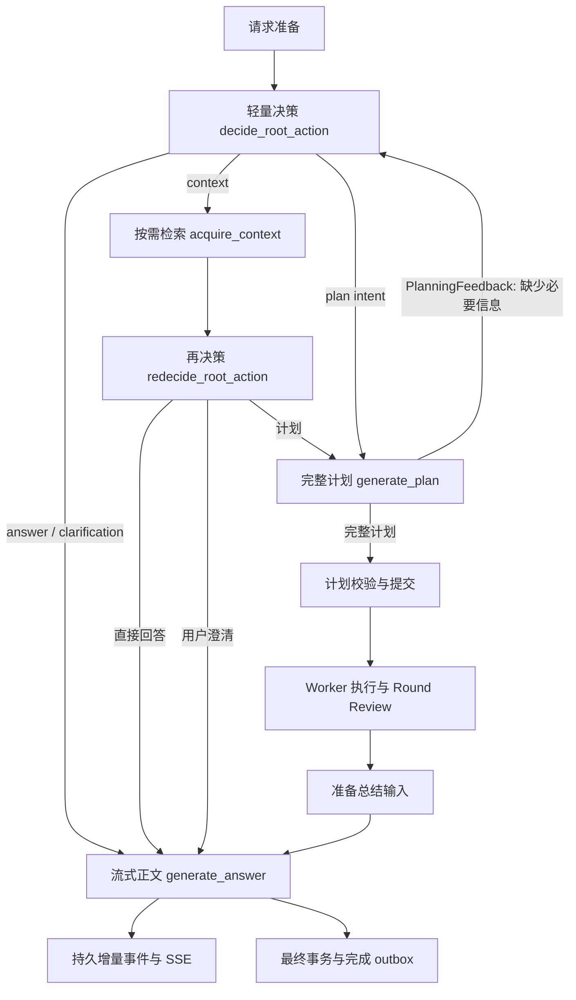

# 流式输出设计方案

日期：2026-10-24

状态：实施中。工作区已包含部分后端与前端改动；真实 provider、PostgreSQL 和浏览器验收尚未完成。详细实施文档记录目标契约和待验收项。

详细接口、逐文件改动、阶段任务与验收命令见[流式输出详细实施文档](/Users/udouble/Documents/code/Athena/backend/docs/streaming-output-implementation-plan.md)。本文保留设计概述，具体实现以该文档为准。

## 1. 已确认的用户体验与范围

第一版覆盖面向用户的直接回答、澄清问题、任务完成后的总结。回答生成期间正文逐步增长；停止或失败后保留已展示内容并标明状态；刷新或网络重连后恢复已持久化正文，并继续接收后续输出。

用户已确认：

1. 只流式展示用户可见回答，Worker 原始输出和供应商 reasoning 文本不进入本次流式正文范围。
2. 刷新页面或 SSE 断线重连后，恢复当前已生成正文，并继续接收后续输出。
3. Root 先完成结构化决策，再单独流式生成正文，接受增加一次模型调用。
4. 将现有入口收敛为轻量初次决策；需要执行时，由独立节点生成完整计划。
5. acquire_context 后执行 redecide_root_action，只输出直接回答、用户澄清或计划；前两者路由到 generate_answer，计划路由到 generate_plan，再决策不输出检索请求。

第一版恢复要求针对后台持续运行时的浏览器刷新和网络连接中断。后端进程退出后的执行恢复单独设计；已持久化正文仍可查看，但本次不保证继续生成或自动收敛终态。

## 2. 实施改动前的代码基线

以下是开始本次流式输出实施前核对的代码状态，不代表当前工作区的实时状态；当前实施进度以详细实施文档开头的状态说明和代码变更为准。

| 位置 | 当前行为 | 对设计的影响 |
| --- | --- | --- |
| `domain/integrations/llm_ports.py` | 只有 `complete`、`invoke`、`invoke_structured` | 需要新增异步流式端口 |
| `infrastructure/integrations/llm/llm_provider.py` | 通过 `ainvoke` 等待完整响应，并做重试与超时 | 需要独立的流式读取、关闭与重试规则 |
| `application/orchestration/agents/root_agent.py` | Root 使用结构化 schema，返回完整 answer/context/PlanDraft | 决策改为简短动作；完整正文与计划分别生成 |
| `application/orchestration/root_workflow.py` | 直接回答来自 `Answer.content`；计划结果由 `render_plan_results` 拼接 | 两条回答路径都需要明确的输出边界 |
| `infrastructure/persistence/postgres/repositories/run_repository.py` | 成功完成时，同事务写 Run、助手消息、记忆任务和完成 outbox；整段答案进入 `RunAnswerDelta` | 必须保留事务边界，并去掉完成时再次追加整段正文的行为 |
| `application/runs/execution_service.py` | 非 completion-outbox 适配器也会在完成后整段发布答案 | 需同步改成统一的完成契约 |
| `workers/orchestration_outbox_dispatcher.py` | 将答案与 Run 终态 outbox 投递为持久事件 | 保留可靠终态投递，调整答案完成 payload |
| `interfaces/http/sse/events.py` | 会话级 SSE，支持 Last-Event-ID、历史水位、订阅队列和心跳 | 复用现有接口 |
| `infrastructure/persistence/postgres/repositories/event_repository.py` | 持久事件有会话序号；订阅广播使用进程内队列 | 当前单进程入口可复用；多进程实时投递另有边界 |
| `frontend/src/hooks/useSessionEventStream.ts` | 已处理 started/delta/completed/snapshot；completed 只结束已有缓冲区 | 需要按最终正文校正、补齐状态和严格的版本判定 |
| `frontend/src/components/Chat.tsx` | 历史与实时消息合并时会比较文本长度 | 流式期间应改成按版本与终态判断，长度不能代表新旧 |

当前 PostgreSQL 事件行没有独立保存 `chunk_id`，历史重放信封会把它还原为 null。设计要求同时将 `chunk_id` 放入 payload，并在读取时恢复，避免增加专门的 chunk 表。

上述路径未带仓库前缀时均从 `backend/src` 起算；前端路径从仓库根目录起算。

## 3. 确定的生成路径

### 3.1 轻量决策、计划与正文生成

复用 decide_root_action 作为初次决策，返回 AnswerIntent、ContextRequest 或 PlanIntent；初次回答/澄清和计划分支保留。检索后进入独立 redecide_root_action，复用 AnswerIntent(kind=final)、AnswerIntent(kind=clarification)、PlanIntent 表达三种业务结果，不包含 ContextRequest。两类决策均不生成完整正文或 DAG，也不再额外增加固定分类调用。

PlanIntent 只包含 action=plan、goal 和简短 instructions。generate_plan 返回 PlanDraft 或 PlanningFeedback：完整计划进入物化，信息缺口反馈仍回到初次决策，需要补充资料时再次经过 acquire_context 与再决策。再决策本身不能直接重启检索。规划节点不产生 AnswerIntent，也不直接进入 generate_answer；原始目标、约束、工具范围、版本和提交幂等继续保留。

规划输入直接从已有图状态构造，不包含入口 remaining_turns，不再保存整份 plan_input 快照。answer_input 只保留简短生成要求，不复制完整对话、目录和资料。PlanningFeedback 只包含 action=needs_information、missing_information 与 reason，不代替入口选择后续动作。

初次决策与再决策共用 root_max_turns，每次实际判断都消耗一轮，检索和规划本身不另计。初次决策选择 context 必须为再决策预留一轮。存在规划反馈但没有资料进展时，只禁止重复规划：初次决策可直接回答、澄清或检索；再决策可直接回答或澄清，仍不能检索。轮数耗尽走既有 root_budget_exhausted，不绕过决策调用正文；成功规划或合法回答后清理已消费反馈。

规划反馈不强制澄清，也不代表已有资料一定不足。决策节点须依据原始目标判断是否能够直接回答；确实缺少必要信息才澄清。直接回答不得通过缩减目标、编造事实或宣称未执行的操作已完成来绕过缺参问题。

再决策使用独立输出 schema 和 prompt，不新建输入快照或 Agent 服务。空检索或可恢复错误仍可依据已有资料回答、澄清或选择合法计划；不可恢复采集错误直接失败。返回 context 是再决策协议错误，不能暗中转回初次决策执行。

plan_draft 沿既有 checkpoint 保存，供同一次图执行的物化节点读取，提交沿用既有幂等保证。不增加恢复到规划节点之后的执行入口，也不将规划阶段恢复列为验收项；既有 Round 等待恢复不变。

普通直接问答仍经过初次决策与正文两次调用；检索后回答经过初次决策、采集、再决策和正文；执行请求增加独立计划生成调用。该拆分明确职责，不承诺仅靠节点拆分就降低首字时延。

将 answer 分支改成回答意图：保留 final/clarification 类型，携带必要的回答要求，不在决策中生成整篇正文。完整决策通过校验后，进入正文生成节点，由该节点读取原始请求、对话、已选参考资料以及回答意图，只输出用户正文。

这样避免先生成一遍完整答案、再让第二次调用重写。代价仍然是直接问答多一次模型请求，首字出现前需要完成决策；应记录用户提交至首个正文片段的实际耗时，不能把流式等同于整体延迟降低。

计划完成后的回答生成节点读取原始目标、任务结果、证据和不确定项，产出用户总结。当前这里只做确定性的结果拼接；根据已确认的范围，改为模型流式生成总结。Worker 的执行与工具审批不因正文生成而重新运行。

正文生成复用一个 `generate_answer` 节点：

- 直接回答或澄清：`decide_root_action → generate_answer → assemble_final_response`。
- 检索后直接回答或澄清：`decide_root_action → acquire_context → redecide_root_action → generate_answer`。
- 检索后计划：`decide_root_action → acquire_context → redecide_root_action → generate_plan`。
- 需要执行：`decide_root_action → generate_plan → materialize_execution_plan`；轻量入口使用 PlanIntent，完整 PlanDraft 不再属于入口决策联合。
- 规划缺少信息：`generate_plan → decide_root_action`；初次决策选择 acquire_context 时，采集后由再决策判断，选择直接回答或 clarification 时进入正文；规划不能直接生成正文。
- 计划执行：保留等待和 Round Review；`build_plan_response` 整理有界的总结输入，再进入 `generate_answer → assemble_final_response`。
- 无法继续的工作流错误直接进入失败收敛，不再调用模型生成一份看似成功的答案。

两类决策复用回答意图契约：action=answer、kind=final|clarification、非空 instructions。再决策三结果对应正文、正文、规划三条明确路由。正文节点不请求工具、不决定路由，也不检索；最终正文仍沿用 Run 结果中的 content。

统一正文节点的输入包含原始请求、经过选择的对话和资料，以及回答意图或已完成计划的结果摘要。只设一个正文总输入预算；超限时优先保留任务状态、失败原因、最终结论、产物标识和必要证据，再裁剪长正文预览。应用侧复用既有结果加载，正文模型不增加读取工具或额外摘要调用；必要事实本身超限则明确失败。

正文全部输入由 provider 的 `input_budget_tokens` 约束，来自 LLM_PROVIDERS 配置，未填写初始默认 8192，显式 null/0/负数拒绝；输出不计入该输入额度。该值是应用预算，不是自动发现的模型容量，不透传 SDK。真实端点验收需确认此值与端点容量及输出额度相容；若已有等价预算配置则复用，不保留重复来源。

### 3.2 模型端口与应用责任

- `LLMPort` 新增流式方法，返回应用可理解的文本增量；实现层隔离 LangChain 消息块、reasoning、工具调用和供应商元数据。
- Provider 使用异步流式接口读取，正确关闭流，并让取消继续向上传播。仅收到结束信号且响应未被截断时才算正文生成成功；空输出、长度上限截断和读取异常不能误报 completed。
- 回答生成节点负责收集完整正文，返回给 Run 完成路径；Provider 不直接操作 SSE、数据库或会话 ID。
- 通过应用层的回答输出逻辑发布事件。只增加这一处必要的输出协调，不引入第二套 Run 执行器或 HTTP 流式提交接口。

LangChain 提供模型流式接口，但具体 provider 是否真的逐步返回文本，必须用项目配置的真实端点验证，不能仅凭方法存在判定成功。

## 4. 事件、持久化与重放

### 4.1 标识与事件

沿用稳定的 `message_id=assistant:{run_id}`。一次生成尝试拥有一个 `stream_id`；如果显式重新生成，使用新的 stream_id，同一消息的不同尝试不得拼接。

| 事件 | 内容 | 投递规则 |
| --- | --- | --- |
| `message.started` | 消息 ID、流 ID、回答类型、开始时间 | 持久化后发送；需补全领域枚举 |
| `message.delta` | `delta`、从 1 递增的 `chunk_id` | 合并片段后持久化，再发送 |
| `message.completed` | 权威完整 `content`、`last_chunk_id`、成功状态 | 完成事务生成 outbox，可靠投递 |
| `run.failed` / `run.cancelled` 等既有 Run 事件 | Run 身份与失败/取消状态 | 关闭关联的未完成正文，保留已提交片段；失败也进入终态 outbox |

`session_seq` 继续负责会话事件顺序和重连游标；`stream_id + chunk_id` 负责正文拼接与重复保护。终态事件使用稳定 transition ID，重复投递不改变结果。终态之后到达的 delta 一律忽略。

### 4.2 片段合并

初始建议：首个非空正文片段尽快提交；后续约每 100ms 或累计 256 个字符提交一次，结束时提交剩余片段。这是实现起点，需根据真实模型速率、并发量和数据库写入耗时校准。

按批次 await 持久化形成背压，避免高速生成导致内存无限增长。持久通知使用有界缓冲，满时合并唤醒信号，正文从数据库有序补读；不重构非持久 realtime 协议。

第一版复用 `agent_events`，不新增专门的流状态表、快照缓存或消息中间件。重连从持久事件恢复；SSE 历史读取应分页到连接水位，避免长会话一次载入所有增量事件。

### 4.3 最终正文和事务

保留现有 Run 成功、`messages`、记忆任务和 outbox 的同事务提交。只在成功完成后把最终正文写入正式助手消息并进入后续对话历史；未完成正文保留在事件记录和 UI 中，并明确标记未完成。

完成路径不再发送“整段正文作为新的 delta”，而是发布携带完整正文的 completed 事件。前端使用完整正文替换该流的临时内容，从而同时解决漏片段和重复追加问题。消息开始时间由服务端提供，完成时不把气泡时间推迟到结束时间。

普通 LLM 监控事件可以继续尽力发布；正文的持久化失败必须向上传播，不能沿用遥测代码的吞异常策略后仍声称正文成功送达。

Run 表示本轮用户请求（包括最终用户答复）是否成功收敛。因此总结生成失败时 Run 为 failed；Plan/Task 状态仍是执行事实的权威来源，已完成的任务不会回滚。错误标注 phase=answer_generation，页面显示“任务执行已完成，但总结生成失败”。第一版不增加单独重试接口，不自动重新执行工具，未完成正文不进入正式历史或记忆。

### 4.4 订阅顺序与部署边界

历史重放阶段先消费到连接水位，再按序发送订阅期间产生的持久事件。需要验证“数据库序号分配顺序”与“事务提交后入队顺序”一致；现有 SSE 会丢弃低于游标的事件，因此不能只靠前端 chunk 缓冲掩盖订阅乱序。

在事件适配器和应用事件流服务内让持久日志成为有序读取依据，进程内通知只负责唤醒读取；利用现有 15 秒心跳周期补查日志，不增加每 500ms 全连接轮询。保留 queue/watermark 接口，不新增订阅值对象。当前入口是单 Uvicorn 进程，第一版据此验收；多执行进程不在本次范围内。

## 5. 前端行为

- 按 message_id 合并正式消息，按 stream_id 保存当前尝试，显式维护 streaming/completed/failed/cancelled 状态。
- started 创建同一条待生成消息；delta 更新正文；completed 即使没有收到 started 或 delta，也能从完整正文创建正确的消息。
- run.completed 先到且没有最终正文时，立即读取一次正式消息，最长等待 10 秒。成功则校正全文；请求失败、超时或目标缺失则移除等待光标，提示“运行已完成，最终回答暂未确认”。不改变后端 Run 状态，后续 SSE 全文或正式消息仍可清除提示；不增加自动轮询。
- 重复 chunk 忽略，连续 chunk 追加；普通断线通过 Last-Event-ID 和持久事件重放补齐。主动检测内容缺口并全流重建属于可后置增强。权威 completed 仍可校正临时正文。
- 正式历史、SSE 重放和实时事件竞争时，终态与版本优先；禁止较旧片段覆盖最终正文。
- 更新渲染可按动画帧合并，避免每个 token 都刷新整个聊天 store。生成期间显示光标，停止或失败后移除光标并保留部分正文。
- 保留现有滚动行为：用户在底部时跟随，向上阅读时不强制拉回。处理未闭合代码围栏等 Markdown 中间状态，完成后正常排版。
- 保留服务端 occurred_at 作为时间依据，后续片段不改变消息的起始展示时间。

## 6. 重试、取消和恢复范围

- 首个正文片段对外提交前，可按现有策略自动重试；首个片段提交后不在同一流里自动重试并追加新答案。
- 区分首片段等待、片段空闲超时和总生成时限，避免只给创建生成器的动作加超时。
- 浏览器断开只关闭 SSE 订阅，Run 继续执行；用户点击停止则走现有 run.cancel，取消模型读取并关闭底层流。
- 取消与完成竞争时，由既有 Run 状态事务判断哪一方生效；取消已经生效后不得写成功消息、记忆任务或成功完成事件。
- 本次不增加后端重启后的自动失败扫描、开放正文查询或恢复专用图锁依赖，不修改 CommandConsumer 启动流程。后端退出后的完整执行恢复属于后续独立需求；前端断线只展示连接状态，不自行把 Run 判为失败。

## 7. 实施顺序与验收

1. 落地初次/再决策的独立契约、规划反馈、计划生成和统一正文生成，以及事件 payload。
2. 实现 Provider 流式读取与取消/超时，再接入回答生成节点。
3. 接入增量持久事件，调整完成事务/outbox、重放标识和事件顺序。
4. 完成前端状态、正文校正、历史合并和渲染。
5. 做有针对性的单元、PostgreSQL 集成、真实模型及浏览器验收。

必须可观察地证明：

- 对足够长的回答，在模型完成前已出现多个逐步增长的正文片段。
- 直接回答、检索后回答、澄清和计划后回答都经过选定的输出路径。
- 普通直接问答不调用计划生成；检索后只由再决策输出直接回答、用户澄清或计划，不输出 context；无效计划在提交前失败，不回退成成功文本。
- 重复事件、重放和完成 outbox 重投不会重复正文；缺失 delta 后 completed 可补齐准确全文。
- 生成期间刷新、网络重连或切换会话后，恢复已提交正文并继续输出。
- 后台持续运行时，停止、超时、截断和模型错误正确结束生成状态，部分正文不作为成功答案进入上下文或记忆；后端重启后的执行收敛不属于本次验收。
- 规划反馈返回初次决策；已有资料足够时可直接回答，否则选择检索或澄清。采集后由再决策按三结果判断；无进展只禁止重复规划，不强制澄清；两类决策共用轮数上限。总结超限或失败仍按既定规则处理，不重跑工具。
- 总输入预算的配置来源、默认值和覆盖值可验证；最终确认最多读取一次，并在 10 秒内退出等待，迟到的旧回调不能回退已确认正文。
- 完成事务失败后不出现成功正文事实；事务成功但 outbox 未投递时，可通过重投恢复最终答案。
- 同一会话其他事件与正文交错时不串流、不丢片段；已完成或已取消的流不接受迟到片段。
- 数据库最终正文、完成事件正文与浏览器最终正文一致。
- 真实端点验收记录首正文与生成结束时间，并确认正文在模型完成前多次更新；不承诺供应商决定的固定首字时延。

产品与主要架构选择已经确认，实施正在进行。工作区已有业务代码改动，完整测试、真实 provider 能力、PostgreSQL 和浏览器行为仍需验收。现有 Root Agent 与 prompt 的未提交改动应保留并在其当前内容上继续调整。

参考：LangChain 官方模型与流式文档：https://docs.langchain.com/oss/python/langchain/models
