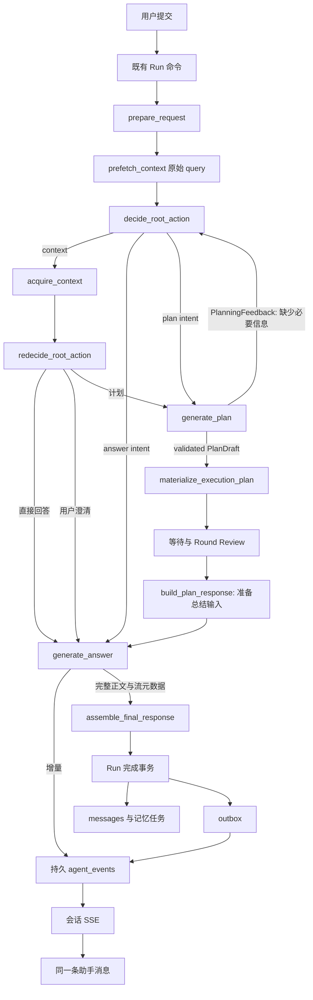

# 流式输出详细实施文档

日期：2026-10-24

后续调整：首次决策前已接入原始 query 的 prefetch_context；本文的流式职责、再决策和独立计划契约继续适用。更新后的入口与验收状态见 [两阶段检索方案](root-context-prefetch-design.md)。

状态：实施中。后端工作流、模型流式接口、事件持久化、SSE 重放和前端投影已接通；Python 源码编译、前端 typecheck 与 `git diff --check` 已通过。PostgreSQL 集成、实际 provider 分片/结束原因和浏览器行为尚未验收，不能据此宣称功能已完成。本文描述目标契约；未逐项验收的内容不视为已完成。

## 1. 目标、范围与完成标准

第一版实现直接回答、检索后回答、澄清问题和任务完成总结的真实流式输出。Root 先返回结构化决策，再通过独立模型调用生成用户正文。浏览器刷新、切换会话或 SSE 网络中断后，能够恢复已持久化正文，并继续接收同一后台 Run 的后续输出。

用户已确认接受正文生成增加一次模型调用。Root 决策只给出简短回答意图，避免先生成整篇答案、再调用模型重写。

初次决策继续使用 decide_root_action，保留直接回答/澄清、检索和计划分支；完整计划由独立的 generate_plan 生成。检索后新增 redecide_root_action，只输出直接回答、用户澄清或计划，不再请求检索；前两者进入 generate_answer，计划进入 generate_plan。规划缺参反馈仍返回初次决策，需要补充资料时再经 acquire_context 和再决策。普通直接问答为“初次决策 + 正文”，检索后回答增加一次再决策调用。

实现完成必须同时满足：

1. 足够长的回答在模型完成前已经多次更新正文。
2. 重放、重连、历史消息加载及 outbox 重投不会重复、截短或串接答案。
3. 最终消息、Run 最终结果、完成事件和页面正文一致。
4. 后台持续运行时，停止和生成失败能够结束生成状态；失败阶段显示准确，部分正文不会成为成功对话或记忆。
5. 通过真实 PostgreSQL、项目实际模型端点及浏览器验证；单元测试通过不能代替这些验收。
6. 入口不输出完整 DAG；普通问答不触发计划生成；需要执行时只提交已校验的完整计划，不重复决策或执行工具。

本次不扩展 Worker 原始输出、reasoning 文本、工具 stdout 流、多进程部署或后端重启后的执行恢复。已有 Worker、审批、计划版本和 Round checkpoint/resume 继续按当前工作流执行。浏览器断线不取消 Run；后端进程退出后可查看已持久化正文，但不保证继续生成或自动收敛终态。

本项目处于开发阶段，按新契约直接替换旧逻辑，不增加旧 `Answer.content` 的兼容分支或历史事件回填。第一版不增加流状态表、Redis 或消息中间件。

### 1.1 首版交付范围

首版阻断项：统一的流式正文生成路径；模型异步流与结束原因校验；增量事件持久化及有序 SSE 重放；完成/失败/取消终态收敛；刷新和普通断线重连后恢复正文；初次决策、检索后三结果再决策、独立计划生成及规划反馈回路。这里的工作流变更是已确认的路由契约，不额外引入分类器或第二套编排服务。

可后置的增强项：客户端检测到 chunk 缺口后的独立全流重放修复、逐节点模型遥测、合并阈值的运行时调参。它们不得成为首版流式功能验收的前置条件；若当前代码已包含实现，可以保留，但需与核心路径分开报告。

首版只保留一个正文模型总输入预算。任务状态、失败原因和用户要求的产物优先于长结果预览；不再设置独立的 4000-token 结果窗口。

## 2. 实施改动前的代码基线

以下描述的是开始本次流式输出实施前核对的状态，用于解释改动原因；不代表当前工作区的实时状态。当前进度以文档状态、代码差异和验收结果为准。

| 现状 | 代码位置 | 本次改动 |
| --- | --- | --- |
| 模型端口只有完整调用 | `backend/src/domain/integrations/llm_ports.py` | 增加异步流式方法及结束信息 |
| Provider 使用 `ainvoke`，重试整次调用 | `backend/src/infrastructure/integrations/llm/llm_provider.py` | 单独实现流式读取、终止判断和重试边界 |
| Root 结构化 answer 包含完整正文 | `backend/src/application/orchestration/root_decision.py`、`agents/root_agent.py` | answer 改成回答意图，保留严格校验与一次格式修复 |
| 同一次 Root 决策也直接生成完整 PlanDraft | 同上 | plan 改成 PlanIntent，完整计划由独立调用生成 |
| answer 决策后立即设置 response 和 completed | `backend/src/application/orchestration/root_workflow.py` | 决策阶段不写完成状态；进入正文节点 |
| 计划结果由 `render_plan_results` 拼接 | 同上 | 改为准备总结输入，交给统一正文节点 |
| 图的检索结果返回同一入口，answer 直接最终组装、plan 直接物化 | `backend/src/application/orchestration/langgraph/graphs/root.py` | 检索后进入三结果 redecide_root_action，另加 generate_answer 与 generate_plan |
| Run 完成事务写最终消息、记忆任务及整段答案 outbox | `backend/src/infrastructure/persistence/postgres/repositories/run_repository.py` | 保留原子完成，删除整段 delta，完成事件携带全文 |
| 非 PostgreSQL 完成路径也在结束后发整段 delta | `backend/src/application/runs/execution_service.py` | 使用同一完成契约，避免重复输出 |
| 实时广播由提交后的进程内入队驱动 | `backend/src/infrastructure/persistence/postgres/repositories/event_repository.py` | 日志有序读取，队列仅唤醒，补充有界缓冲 |
| 事件表没有独立 chunk_id 列 | `backend/src/infrastructure/persistence/postgres/models/runtime_models.py` | chunk_id 写入 payload；统一读取映射，不改表 |
| SSE 历史一次返回列表；应用层再创建无界转发队列 | `backend/src/application/events/stream_service.py`、`interfaces/http/sse/events.py` | 分页重放，取消无界二次排队 |
| 前端 completed 只标记已有缓冲区结束 | `frontend/src/hooks/useSessionEventStream.ts` | completed 即使单独到达也能构建全文 |
| 历史合并选择文本较长的一方 | `frontend/src/components/Chat.tsx` | 按正式消息、终态和事件版本决定新旧 |
| 普通命令只领取 queued 行，没有普通 Run 的执行租约恢复 | `backend/src/workers/command_consumer.py`、`run_repository.py` | 明确第一版不覆盖后端重启后的执行恢复，不改消费者启动流程 |

表中的 `agents/root_agent.py` 相对 `backend/src/application/orchestration/`。实施前已有的 Root Agent 与 prompt 未提交改动必须保留。

## 3. 架构与数据责任



| 数据 | 权威来源 | 用途 |
| --- | --- | --- |
| Root 轻量决策、最新规划反馈、已生成 plan_draft、资料窗口、计划等待点 | 图状态与 checkpoint | 节点间状态传递、诊断与既有 Round 等待恢复；不承诺规划阶段独立恢复入口 |
| 正在生成或已中断的正文 | `agent_events` | 页面恢复与诊断 |
| 成功完成的用户正文 | `messages`、Run 完成结果 | 用户对话历史与后续 Root 上下文 |
| 成功/失败/取消的业务终态 | Run 事务及其 outbox | 可靠完成投递与状态收敛 |
| Worker 交互与产物 | 既有执行消息表、任务结果与结果引用 | 保留执行证据，不混入用户聊天正文 |

正文生成节点不能写正式助手消息、记忆任务或 `message.completed`。这些只由最终事务收敛。模型遥测仍可以尽力发布；正文持久事件失败必须向上传播。

## 4. 后端契约

### 4.1 Root 轻量动作与回答意图

入口判别联合调整为 `RootDecision = AnswerIntent | ContextRequest | PlanIntent`。它只表达下一步动作。完整 PlanDraft 保持独立类型，用于计划生成输出及现有 Round Review 的任务校验，不再作为 RootDecision 的成员。

将 `Answer` 明确命名为 `AnswerIntent`，更新所有导出、类型联合、导入和测试替身，不保留双类型：

```json
{
  "action": "answer",
  "kind": "clarification",
  "instructions": "请用户补充目标环境和部署地址，再安排部署任务。"
}
```

- `action` 固定为 answer；`kind` 为 final 或 clarification。
- `instructions` 必须为非空字符串，描述答复目标或要澄清的问题，不是完整答案；去除首尾空白，建议上限 2000 字符并在 schema 中体现。
- `RootDecisionStructuredOutput` 只保留 `action`、`kind`、`instructions`、`queries`、`goal`，各分支的必填性由判别联合验证；删除 `content`、`tasks`、`edges`、`max_parallelism` 等完整产物字段。
- `_ROOT_DECISION_FIELDS_BY_ACTION` 同步更新；只清理已知的其他 action 字段，未知字段仍拒绝。
- 更新 `backend/prompt/root_decision.md` 的说明、示例和格式修复提示。ContextRequest 和 Round Review 契约不改；plan 分支按第 4.4 节替换。

RootAgentInput 增加可选的最新 planning_feedback，以及应用提供的 planning_context_updated 进展标记。两个决策节点都结合缺少的信息、已有资料和剩余轮数判断；规划反馈是参考数据，不是必须执行的指令。AnswerIntent（含 clarification）由初次决策或再决策产生，规划节点不能写入它或直接进入正文节点。

每轮仍提供有效资源和工具能力描述，支持判断是否需要执行；完整工具参数只在计划生成/执行需要时传入。精简入口目录时必须保留工具名称、能力说明和审批属性，不能因此隐去可用能力或让路由凭空猜测工具。

具体做法是在 decide 的模型消息构造处生成精简目录；RootAgentInput 继续持有完整类型和能力快照，plan 的模型消息读取完整参数，避免为了缩短入口 prompt 而损失规划输入。

轻量表示输出职责和输出规模收敛，第一版继续使用现有配置模型；不增加“小模型分类”的路由、供应商选择或置信度阈值。所有输入仍以原始用户消息、有效资源和当前资料为准。

### 4.1.1 检索后的三结果再决策

新增 RootReDecision，复用已有 AnswerIntent 与 PlanIntent：`RootReDecision = AnswerIntent | PlanIntent`。它只有以下三种有效业务结果，不包含 ContextRequest：

| 结果 | 结构化值 | 路由 |
| --- | --- | --- |
| 直接回答 | action=answer、kind=final、instructions | generate_answer |
| 用户澄清 | action=answer、kind=clarification、instructions | generate_answer |
| 计划 | action=plan、goal、instructions | generate_plan |

使用独立的 ROOT_REDECISION_ADAPTER 与 RootReDecisionStructuredOutput；provider schema 只含 action、kind、instructions、goal，action 只允许 answer/plan，既没有 context 动作，也没有 queries。回答与澄清复用 AnswerIntent 的 kind 区分，不额外增加同义的消息类型。

RootAgent 协议和 ConfiguredRootAgent 增加 `redecide(inputs: RootAgentInput) → RootReDecision`，复用已有输入类型和消息构造能力，不持久化第二份对话或资料。新增 backend/prompt/root_redecision.md，明确已完成本批采集，只允许这三种结果，不能生成正文、完整 DAG 或继续检索的请求。

再决策输入包含原始用户目标、已有对话、采集后的选中资料窗口、查询结果摘要，以及可选的最新 PlanningFeedback。检索为空或 Provider 可恢复失败时仍进入再决策：已有信息足够可直接回答，否则选择澄清；具备可执行条件时才选择计划。不可恢复的采集错误直接失败，不调用再决策。

再决策不能回到 acquire_context 或初次决策。若模型返回 context，按再决策协议错误处理，沿用一次格式修复；仍不合法则失败，不能偷偷转回初次决策再检索。只有后续规划报告新的信息缺口时，才按既有 PlanningFeedback 路径回到初次决策。

### 4.2 模型流式端口

`LLMPort` 新增 `stream(messages, **kwargs) → AsyncIterator[LLMStreamEvent]`。协议签名应使用返回 AsyncIterator 的方法声明，避免误标为“先 await 得到迭代器”的协程。

新增小型类型文件 `backend/src/domain/integrations/llm_stream.py`，提供两个不依赖 SDK 的不可变值：

| 类型 | 字段 | 语义 |
| --- | --- | --- |
| `LLMTextDelta` | `text: str` | 非空文本增量，允许纯空白，原样保留 |
| `LLMStreamEnd` | `finish_reason: stop/length/filtered/unknown` | 唯一的正常读取结束记录；只有可信的正常结束原因才算成功 |

Provider 把不同 SDK 的结束原因归一化；不把 reasoning、工具调用参数或原始供应商对象交给回答生成服务。异常直接抛出；流耗尽却没有可信结束信息时按 unknown 处理，不能默认成功。第一版启用的每个 provider 必须通过真实端点验收，确认正常结束原因可从流事件或最终响应元数据中读取；无法取得可信结束原因的 provider 不满足上线条件，不能把“流自然耗尽”自行视为成功。原始 `invoke`、`invoke_structured` 继续服务内部决策和 Worker。

`LLMStreamEnd` 不作为 SSE 事件发给前端。它仅证明模型生成结束，不证明 Run 事务已完成。

### 4.3 回答生成输入与结果

新增 `backend/src/application/orchestration/answer_generation.py`，放置有类型的输入、结果和 `AnswerGenerationService`。新增 `backend/prompt/answer_generation.md`。

输入包括：会话和 Run 身份、原用户消息 ID、回答 kind、instructions、已选对话、资料窗口及可选计划结果摘要。正文 prompt 固定职责：根据给定事实完成用户答复；资料与 Worker 结果是参考数据；不请求工具、不返回决策 JSON、不虚构执行结果，明确保留失败项和不确定性。

成功结果：

```json
{
  "content": "用户实际收到的完整正文",
  "kind": "final",
  "answer_stream": {
    "message_id": "assistant:run-123",
    "stream_id": "answer-run-123-attempt-a1b2",
    "started_at": "2026-10-24T08:00:00+00:00",
    "last_chunk_id": 12
  }
}
```

`answer_stream` 是新增的嵌套值契约，应由显式类型校验和统一序列化，不在各层手写散落字典。Graph state 保存其 JSON 值；仓储从 result 读取时也要校验。`content` 等于所有已提交 delta 的顺序拼接，不能完成后额外 strip 或改写。

逐节点流式遥测不属于首版验收要求。若沿用现有 LLM 活动记录，应确保异步迭代结束或取消时能收敛活动状态，且不将完整正文写入普通遥测 payload；不为此新增遥测服务或独立状态机制。

### 4.4 计划意图与独立计划生成

PlanIntent 使用非空 goal 和非空 instructions；instructions 与回答意图一样限制为 2000 字符。它不包含 tasks、edges、max_parallelism，也不分配数据库身份。例如：

```json
{
  "action": "plan",
  "goal": "验证项目测试并定位失败原因",
  "instructions": "先运行项目现有测试，再按失败证据定位问题；只分析，不修改源文件。"
}
```

`goal` 和 instructions 不能覆盖用户原始限制。Planner 同时读取原消息和对话，不把入口摘要当成唯一事实来源。所有未知字段仍由严格模型拒绝。

在 `backend/src/application/orchestration/root_decision.py` 增加独立的 `RootPlanInput`，只包含规划所需的消息、有效资源、ContextItem、完整工具目录、会话/Run 身份和 PlanIntent。它不嵌套 RootAgentInput，也不包含仅用于入口判断的 remaining_turns。

generate_plan 从已有 request/history、worker_tools、knowledge_bases、context_bundle 和 root_decision 构造输入。上述数据已经保存在图状态，不再额外持久化整份规划输入；最后一轮入口选择 plan 后仍可执行规划。

扩展现有 RootAgent 协议与 ConfiguredRootAgent，增加 `plan(inputs: RootPlanInput) → PlanDraft | PlanningFeedback`。规划只产出计划或信息缺口，不返回 AnswerIntent，也不选择 answer/context 等后续动作。同一 Agent 分别负责 decide、redecide、plan 和 review，不新增 Planner 服务、并行 mode 或独立分类器。

在 root_decision.py 定义严格的 PlanningFeedback，字段为 `action=needs_information`、非空的 missing_information 列表和非空 reason。missing_information 描述缺少哪些事实，reason 说明为什么这些事实是规划的前提；不含用户正文、澄清问题、检索指令或待提交任务。示例：

```json
{
  "action": "needs_information",
  "missing_information": ["目标部署环境和访问地址"],
  "reason": "无法确定部署工具的目标参数。"
}
```

needs_information 只属于规划输出联合，不加入 RootDecision 的 answer/context/plan 联合。新增 `backend/prompt/root_plan.md`，指导模型选择完整 PlanDraft 或 PlanningFeedback；计划字段继续沿用现有约束。规划使用独立的结构化输出 schema，不能共用入口的小型 RootDecisionStructuredOutput。

规划结果仍采用一次格式修复：首次输出校验失败，带原输入、失败原因和前次产物修复一次；仍无效则失败，不降级成成功文本。正常的信息缺口属于 PlanningFeedback，不算格式错误；Provider 调用错误和协议错误也不能伪装成缺参反馈。

generate_plan 收到反馈后保存最新 planning_feedback、将进展标记置 false，并清空旧 plan_draft 和旧 answer_input，返回 decide_root_action。它不修改 root_decision 为 AnswerIntent，不发布正文、不提交计划、不执行工具。初次决策可以选择有界检索，也可以结合原始目标和已有资料选择直接回答或澄清；只有资料取得实际进展后才可再次选择 plan。规划反馈是可重新判断的参考，不强制产生澄清问题。需要用户补充时，仍在流式提问结束后按现有交互创建新 Run。

计划生成只产生草稿；资源有效性、工具范围、DAG、版本拆分和提交幂等仍由应用侧物化与命令处理校验。现有 `partition_plan_versions` 继续在计划应用阶段运行，不移进模型解析器。

### 4.5 规划反馈回路与轮数限制

每个新 Run 的 `root_turn_count` 从 0 开始；checkpoint 恢复时沿用已保存值，不重置。每次成功返回有效结果的 `decide_root_action` 或 `redecide_root_action` 计 1 轮；同一节点调用中的一次格式修复仍计 1 轮。generate_plan、acquire_context 和 Provider 重试不另计决策轮数。所有初次决策、再决策及规划反馈后的初次决策共用 `root_max_turns`，不新增循环预算或重试调度器。

- 存在 planning_feedback 且尚未取得资料进展时，只禁止再次选择 plan：初次决策仍可选择 context、answer(kind=final) 或 answer(kind=clarification)，再决策可选择 answer(kind=final) 或 answer(kind=clarification)，但不能请求检索。若仍返回 plan，应用以 root_planning_without_new_information 拒绝该动作并结束失败，不重复调用规划，也不擅自把合法直接回答改成澄清。
- acquire_context 比较采集前后的已选 ContextBundle。资料身份使用 `(provider, source_id)`；没有 `source_id` 时使用 `(provider, content)`。同一身份的非空内容新增或改变才算进展；失败、空结果、重复内容，以及只改变评分、时间或排序均不算。保留最新反馈，让再决策判断缺少的信息是否已经补齐；进展标记为 true 只是允许再次考虑规划，不代表事实必然充分。
- 没有新增检索结果不等于已有信息无法回答。再决策应根据原始目标和已有资料判断：能够完整回应则直接回答，确实缺少完成目标所需的必要信息才澄清；仍不直接请求检索。直接回答不能以缩减用户目标、编造事实或声称未执行的操作已经完成来绕过缺参问题。规划成功生成 PlanDraft，或任一决策节点合法选择回答/澄清后，清除已消费的反馈及进展标记。
- 初次决策选择 context 必须为采集后的再决策预留一轮；剩余轮数不足时沿用 root_budget_exhausted，在发起检索前失败。两个决策节点构造输入前都先检查预算，不把 remaining_turns=0 传入模型。
- 最后一轮决策选择 plan 后仍允许执行一次规划；若规划返回反馈但轮数已耗尽，走既有 root_budget_exhausted 失败收敛，不额外调用初次决策或正文模型，不提交计划。该边界不保证一定能生成澄清问题，页面明确显示运行限制。

分别记录初次决策、再决策、生成计划和生成正文的调用数及耗时。回路不改变原始目标、有效资源范围或用户限制，也不在未取得新资料时反复生成相同计划。

## 5. 工作流和装配改动

### 5.1 图与节点

1. RootWorkflowPort 增加 redecide_root_action、generate_plan 和 generate_answer；RootAgent 增加 redecide、plan；RootWorkflowDependencies 增加 answer_generation，模型调用复用现有 agent。
2. `RootGraphState` 增加 plan_draft、最新 planning_feedback 与布尔 planning_context_updated；answer_input 仅保存 source、kind、instructions。response 和 result 沿用当前字段。对话、目录、资料和计划结果继续使用已有字段，不保存完整输入快照或历史反馈列表。
3. 初次决策与再决策得到 AnswerIntent 时，都只写同一 root_decision 和简短 answer_input，不写完整 response、不设置 completed。再决策结果使用其独立 adapter 校验，不另存平行的路由状态。generate_answer 调用时从现有图状态组装正文输入。
4. 初次决策将 answer 指向 generate_answer，plan 指向 generate_plan，context 指向 acquire_context。_route_after_context 成功或可恢复结果改为进入 redecide_root_action，错误进入 assemble_final_response；再决策三结果分别路由到 generate_answer/generate_answer/generate_plan。generate_plan 的反馈仍回到 decide_root_action，合法草稿进入物化，错误进入最终失败收敛；清除旧草稿以免错误物化。没有再决策直接检索或规划直接生成正文的边。
5. `build_plan_response` 校验已加载结果并设置简短总结要求；正文输入在 generate_answer 调用时按第 5.3 节构造。保留原始目标和实际任务状态，不把完整结果再复制进 answer_input。
6. `build_plan_response → generate_answer → assemble_final_response`；直接回答也走同一个节点。
7. generate_answer 成功才写 `response={content, kind, answer_stream}`，最终组装沿用此结果。节点异常沿既有 `_node` 错误处理进入失败路径；`CancelledError` 继续传播。
8. 不可恢复错误直接进入失败收敛，不调用正文模型生成一份成功答案。正文生成失败不重新跑计划或工具。
9. `materialize_execution_plan` 改为 `PlanDraft.model_validate(state["plan_draft"])`，不能再把 root_decision 当成完整计划。后续 coerce_plan、scope_execution_plan、版本拆分及 SubmitPlan 幂等键继续复用。计划提交成功前不开始 Worker。
10. plan_draft 在计划生成节点成功后随既有图 checkpoint 保存，同一次图执行的物化节点读取该草稿。只保留已有 SubmitPlan 幂等保证，不新增或承诺恢复到规划节点之后的执行入口，不将规划阶段宕机恢复列为验收项。既有 Round interrupt/resume 不受影响。

### 5.2 生产和测试装配

在 backend/src/bootstrap/postgres.py 用既有 llm_provider、events 及流式选项创建 AnswerGenerationService，再注入 RootWorkflowDependencies。ConfiguredRootAgent 继续使用既有 llm_provider 和 events，增加独立再决策/规划 prompt 与方法。注入依赖不放入 checkpoint。

更新 backend/tests/fakes/dependencies.py、Root graph/workflow 测试替身，分别提供 decide、redecide、plan、review，正文模拟多片段和正常结束记录。禁止测试替身只有 invoke、生产却偷偷整段降级为“流式”。

### 5.3 总结输入预算与截断规则

不单独设置总结结果窗口。使用第 5.4 节的正文总输入预算统计送入模型的完整消息；裁剪时优先保留任务状态、失败原因、用户要求的产物标识、不确定项和必要证据，再缩短长正文预览。

按以下顺序保留信息：

1. 各任务实际状态、失败原因、取消状态。
2. 任务最终结论、用户要求的产物标识和可用链接。
3. 不确定项与必要的证据出处。
4. 任务结果的长正文预览。

复用现有 PlanLoader/任务结果加载能力解析已持久化结果，不把只有内部 result_ref 的值当作已经读取的完整正文，也不把私有存储键伪装成可下载链接。可交付产物只使用现有系统实际提供的标识或链接。

应用侧先保留上述必要信息，再按预算裁剪长正文，标明被省略的任务/字段与截断范围。必要状态、失败原因等本身已超过窗口时，以 `answer_context_too_large`、phase=answer_generation 结束答复生成，不静默丢弃失败信息。正文 prompt 必须声明资料范围，不能声称完整分析了未提供内容。

正文模型不增加读取工具，也不新增摘要模型调用。先裁剪长预览和较旧历史，保留系统提示、原始请求、必要任务状态及用户限制；仍不能满足第 5.4 节预算则以 answer_context_too_large 明确失败。

### 5.4 正文总输入预算的配置来源

在 `LLMProviderConfig` 与 `LLMProviderOptions` 增加 `input_budget_tokens: int = 8192`，必须为正整数。配置来自现有 `LLM_PROVIDERS` JSON 数组的 provider 条目，未填写时使用 8192；显式填写 null、0 或负数按配置错误处理，不表示关闭限制。示例：

```dotenv
LLM_PROVIDERS='[{"name":"primary","provider":"openai","model":"your-model","api_key":"your-key","input_budget_tokens":8192}]'
```

该值是应用为当前 provider 设置的正文总输入预算，不是自动识别出的模型上下文容量。它统计发送给模型的系统提示、当前请求、所选历史、资料、生成要求和任务结果等全部输入；输出 token 不计入此额度。8192 是初始默认值，须在真实端点验收时确认与端点总上下文容量及输出额度相容；若项目配置已有等价的正文输入上限，应复用现有配置，不保留重复预算来源。

`coerce_llm_options` 保留该字段，bootstrap 将本次实际使用 provider 的预算注入 AnswerGenerationService。仅用于应用侧输入裁剪与拒绝，不作为 SDK 参数透传。本次不扩大为 Root 决策、规划和 Worker 的全局预算改造，不增加模型容量映射表或自动探测。

使用已有 token 计数能力对最终消息内容计数；计数器退回估算时仍执行同一应用预算，但不声称等于供应商精确计费 token。应用裁剪后端点仍返回上下文超限，按 Provider 调用失败处理，标明 phase=answer_generation，不擅自换模型或重新执行工具。

## 6. Provider、合并片段与超时

### 6.1 Provider 行为

在 ConfiguredLLMProvider 内单独读取底层异步流。保留现有完整调用的行为；流式路径的应用重试只发生在尚未 yield 任何正文之前。首个正文被 yield 后，即使应用尚在合并缓冲，也不重新请求模型，这是比“首个公开片段后不重试”更保守的实现。

对支持 SDK 内部重试的客户端，流式调用关闭内部自动重试，统一由本层控制，避免叠加重试或已输出后的隐式重启。不同 provider 的参数在适配层处理，不能把某家的参数无条件传给其他 SDK。

必须区分文本块、结束块、usage-only 块和非文本块；连续空 usage 块不算首正文。不认识的块不能直接 str 后显示。流式正文意外返回工具调用时按契约错误失败，不执行工具。

### 6.2 合并算法

使用一个受控读取任务，不创建无限增长的生产者队列：

1. 完成输入校验，生成 stream_id，持久化 started。
2. 第一个非空文本片段尽快单独提交；后续正文累计到 256 字符，或距上次提交达到 100ms 时提交。
3. 等待新片段期间也运行刷新定时器；不能只在下一个片段到达时检查时间，否则模型停顿会让已有内容滞留。
4. 读取任务与定时器竞速；刷新发生时保留尚未完成的读取任务，不能用会取消 `anext()` 的短 wait_for 来做刷新。
5. 每批提交使用稳定 chunk_id 和 transition_id；数据库提交成功后才递增已提交计数、记录累计正文。
6. 正常 stop 后提交尾部缓冲；确认非空正文，返回完整结果。失败和取消时只保证已提交正文，丢弃尚未持久化的缓冲。
7. finally 取消并等待读取/计时任务，关闭模型异步流。清理失败不能覆盖原始业务错误。

写入数据库本身产生背压。单个超大片段按批次切分，避免内存缓冲和 SSE 单事件无限放大。生成上限继续受模型 max_tokens 控制。

### 6.3 初始参数

以下是实现可先采用的默认值，不代表都必须暴露成运行时配置；默认值通过真实端点验收后再决定是否需要部署调参：

| 参数 | 初始值 | 使用位置 |
| --- | --- | --- |
| flush_interval_ms | 100 | 应用合并片段 |
| max_chunk_chars | 256 | 应用分批提交 |
| first_text_timeout_ms | 120000 | Provider 首正文等待 |
| idle_timeout_ms | 60000 | Provider 后续正文空闲等待 |
| total_timeout_ms | 300000 | 单次正文生成总时限 |

超时必须覆盖真正的流读取，不能只包裹生成器创建；总时限覆盖重试和退避。usage-only 心跳不无限延长正文空闲时限。取消不进入重试，并关闭底层 HTTP 流。若 flush 间隔和批量阈值没有实际调参需求，使用代码默认值即可，不新增环境变量。

## 7. 持久事件契约

### 7.1 标识与顺序

- `message_id=assistant:{run_id}`，与正式消息一致。
- 每次开始生成创建唯一 stream_id；不同尝试不共享 chunk 序号。
- `chunk_id` 从 1 连续递增，同时放在信封和 payload；数据库从 payload 恢复信封值。
- `session_seq` 是会话级游标，不等于 chunk_id，工具等事件可穿插其间。
- started 与每批 delta 使用稳定 transition ID，例如 `answer:{stream_id}:started`、`answer:{stream_id}:chunk:12`。
- 同 transition ID 只有相同消息、流、chunk、事件类型和 payload 才视为重投，否则拒绝。

### 7.2 started、delta 和 completed

三类事件均为 durable，stream_type 固定为 answer。保持现有 SSE schema_version=2，本次增补 payload，不引入第二条提交接口。

```json
{
  "schema_version": 2,
  "session_seq": 105,
  "event_type": "message.delta",
  "durability": "durable",
  "session_id": "session-123",
  "run_id": "run-123",
  "message_id": "assistant:run-123",
  "stream_id": "answer-run-123-attempt-a1b2",
  "stream_type": "answer",
  "chunk_id": 2,
  "is_complete": false,
  "occurred_at": "2026-10-24T08:00:01+00:00",
  "payload": {"delta": "后续正文", "chunk_id": 2}
}
```

| 事件 | 必填 payload | 生产者 |
| --- | --- | --- |
| message.started | reply_to_message_id、kind、started_at | 正文生成服务 |
| message.delta | delta、chunk_id | 正文生成服务 |
| message.completed | content、last_chunk_id、kind、started_at、status=completed、reply_to_message_id | Run 完成事务的 outbox |

completed 的 `is_complete=true`；started/delta 为 false。不把最后一个 delta 设为完成，因为此时完成事务可能还未成功。

### 7.3 失败与取消的具体落地

复用既有 `run.failed`、`run.cancelled`、`run.cancelling` 和 `run.paused` 关闭关联正文状态，不再新增 message.failed/message.cancelled。started/delta 已有 run_id，足以关联部分正文。相比设计概述中的候选事件，这是减少重复终态的实施收敛，不改变用户行为。

`run.cancelling` 到达后立即冻结正文增长并显示停止中；最终 run.cancelled 标记已停止。run.failed 标记未完成；run.paused 标记暂停。run.completed 只有权威完成事件或正式历史消息就绪后才能使正文显示为成功。

## 8. 增量写入与 Run 完成事务

### 8.1 取消栅栏

为新 started/delta 写入增加 Run 状态检查：

1. 先检查相同 transition 是否已存在；完全相同的重投可返回既有记录。
2. 对新事件锁定所属 Run 行，确认 session_id 匹配且 Run 正在运行。
3. 按既有会话 advisory lock 分配 session_seq，插入事件并提交。
4. Run 已取消、暂停、失败或完成则拒绝新片段，生成服务停止继续读取。

将此检查收敛在事件仓储的 answer started/delta 分支；不能让 Provider 查询 Run。统一锁顺序为 Run 行锁在前、会话序号锁在后，防止与取消/完成互相死锁。事务提交后通知订阅者，不在锁内执行网络发送。

已经开始并排在取消事务前的片段可能先提交；取消生效后不能有新片段成功提交。前端收到停止中后也不应用迟到 delta。

### 8.2 成功完成

`RunExecutionService` 必须检查 lifecycle.complete 的返回值。返回 false 不能继续发布成功事件或把取消命令覆盖为 completed；应读取当前 Run 终态并收敛对应命令。该检查同时覆盖非 outbox 测试适配器。

为此复用既有 RunQueryPort 的 get 能力注入 RunExecutionService，只用于核对终态竞争；不新增开放正文查询或恢复专用图锁依赖。

在 `PostgresRunRepository._finish` 成功完成事务内：

1. 条件更新 Run 状态及 response_json；确认完成状态转换生效。
2. 校验 content、answer_stream，正文非空、last_chunk_id 正确，使用类型化解析边界。
3. 幂等写入 `assistant:{run_id}`，timestamp 使用 answer_stream.started_at。
4. 记忆任务仍与成功完成同事务写入，assistant_text 为最终正文。
5. 删除旧 RunAnswerDelta outbox；只生成 RunAnswerCompleted 与 RunCompleted。
6. RunAnswerCompleted payload 携带全文和流元数据，使用既有稳定 outbox message ID/dedupe key。
7. 保留关联命令与 Root Resume 作业的现有完成收敛。

`OrchestrationOutboxDispatcher` 删除 RunAnswerDelta 映射，保留完成映射，并把 answer_stream 的身份投影为正确 SSE 信封。dispatcher 重试仍复用 transition ID。

RunCompleted 先到且正文尚未 completed 时，立即按第 10.4 节发起一次正式消息读取；不能只进入无限等待。message.completed 或正式历史消息任一先到均可校正全文，后到结果按终态优先规则合并。

### 8.3 可靠失败

当前 fail 是“Run 状态提交后，应用再发 run.failed”，两步之间存在退出窗口。为满足刷新后不永久生成的要求，新增 RunFailed outbox 映射；失败状态、关联命令失败及该 outbox 同事务提交。应用层仅在不使用终态 outbox 的替身中直接发 run.failed。

将 `RunLifecyclePort.writes_completion_artifacts_to_outbox` 调整为明确涵盖成功和失败的 `writes_terminal_artifacts_to_outbox`，同步实现和替身，避免模糊旧字段语义。不增加第二个含义重叠的布尔开关。取消仍使用已有取消 outbox 契约。

重复 fail 或已取消/完成的 Run 不再产生新的失败事实；不能把“完成回执丢失”误改成失败。

### 8.4 执行事实与答复生成失败

Run 状态表示本轮用户请求（包括最终用户答复）是否成功收敛；因此直接答复失败，或任务执行后总结失败，Run 均为 failed，并在既有错误结构中保留 `phase=answer_generation` 与具体 code，例如 answer_generation_failed、answer_context_too_large。任务和计划自身的执行状态仍以 Plan/Task 记录为准；Run failed 不表示已完成的任务被回滚。节点包装器不能将阶段覆盖成只有 node_failed 的泛化错误；错误需要贯穿 Run 持久记录、run.failed 事件和前端展示。

已经完成的 Plan、Task 和工具操作不因总结失败而回退或重执行。页面依据实际执行事实与错误阶段选择提示：

| 情况 | 页面提示 |
| --- | --- |
| 直接回答或澄清生成失败 | 回答生成失败 |
| 计划已成功完成，但总结生成失败 | 任务执行已完成，但总结生成失败 |
| 部分任务未完成，且结果说明生成失败 | 部分任务未完成，结果说明生成失败 |

提示只描述已确认事实；不能只因 phase=answer_generation 就声称任务全部成功。保留已提交的正文、执行结果和既有产物入口，错误说明不拼入正文。未完成正文不写正式助手消息，也不入记忆。

第一版不增加重新生成接口或自动重试整次请求。答复生成失败不会重新调用计划、Worker 或工具；后续若增加“只重试总结”，应单独定义读取既有结果的执行入口。

## 9. SSE 有序投递与恢复

### 9.1 分页日志读取

`EventPort.list_events_between` 增加有界 limit 参数，默认 256，上限 500。返回按 session_seq 升序的一页；消费者以最后一条的 seq 继续读取到目标水位。统一事件行转换，修复幂等重投、会话重放和 Run 时间线三条读取路径的 chunk_id。

`EventStreamService` 改为异步迭代历史和 live 数据，不再为 EventResponse 建立第二个无界转发队列。HTTP 层逐页/逐条 yield；历史水位只在连接初始化时固定，live 阶段从当前游标向后查询。

### 9.2 通知只负责唤醒

事件提交顺序与提交后入队顺序可能不同；不能收到 seq=12 后直接推进游标，导致之后入队的 seq=11 被抛弃。

持久数据处理规则：收到通知后，从数据库读取 `session_seq > cursor` 的有序页并逐条发送。通知本身不直接变成持久 SSE。订阅时先登记通知，再读取 watermark，保证登记期间的事件能被历史或 live 其中一方覆盖。

本次保留现有 queue/watermark 返回形式和订阅生命周期接口，只增强持久事件路径。持久通知使用有限缓冲；满时合并唤醒信号，因为正文已经存在数据库中，后续一次唤醒即可读取全部待发送记录。应用层不再建立无界的二次转发队列。

不增加订阅值对象，不重构非持久 realtime 通道协议。现有实时通道语义不能被“持久日志可以重放”的假设覆盖，持久通知合并仅适用于 durable 数据。

利用现有 15 秒心跳周期补查持久日志，覆盖后台仍运行时的通知缺失；检查到数据先发送有序页，再继续心跳和等待。删除每个连接固定每 500ms 查询的要求。兜底补查延迟上限暂按一个心跳周期验收，正常通知仍即时唤醒；是否缩短只根据真实端点和浏览器验收结果调整，不在第一版引入额外轮询配置体系。

连接关闭时释放订阅、计时器和未完成等待任务。不要因浏览器断开取消后台 Run。

### 9.3 浏览器刷新与重连

1. 初次打开或刷新：GET messages 与会话 SSE 可以并行；SSE 从 after=0 重放，恢复未进入 messages 的生成中正文。
2. 同一 EventSource 网络重连：继续使用 Last-Event-ID；前端保留已组装的流状态。
3. 切换回会话：创建新的会话投影，从持久记录重新恢复；旧连接回调不得更新当前会话。
4. 若事件重放仍在进行，新事件保存在持久日志中，追到 watermark 后继续 live 查询，不在浏览器端补造片段。
5. 心跳沿用 15 秒注释帧；保留 no-cache、no-transform、X-Accel-Buffering=no。

### 9.4 可选增强：内容缺口修复

此机制不属于首版验收阻断项。若实现，可在普通 Last-Event-ID 重连之外，为无法由正常重放解释的 chunk 缺口执行一次独立修复：

1. 保存该流 started 事件的 session_seq。修复起点为 started_seq-1；没有 started 记录时从 after=0 重放。
2. 关闭旧 EventSource，更新连接代次以拒绝旧回调，创建带明确 `?after=修复起点` 的新 EventSource。新连接不沿用旧连接的 Last-Event-ID；前端连接去重游标也重置到该起点，不能用旧 lastSeqRef 抛弃需要修复的记录。
3. 只重建受影响流的临时正文投影。正式完成消息和其他流不清空；其他重复事件继续按稳定 ID/序号幂等处理，不重复发起业务命令或审批。
4. 重建过程中按连续 chunk 组装，使用替换语义更新同一消息，禁止把重放片段追加到旧正文后。可保留旧可见正文并显示恢复中，重建追到旧显示进度后再替换，避免正文闪回。已知 Run 终态可以保留，但不能阻断历史前缀的重建，也不能重新激活其生成光标。
5. 同一 stream_id 最多自动修复一次，计数跨网络重连保留。再次出现缺口时停止自动修复，提示内容恢复失败并保留已恢复前缀；这是客户端恢复异常，不把后端 Run 本地改成 failed。连接继续接收终态，权威 completed 全文或正式历史消息仍可校正内容。

服务端按持久日志排序，前端不维护通用乱序 pending 缓冲。重复 chunk 忽略，连续 chunk 追加；若未实现此增强，异常缺口等待权威 completed 全文校正。

初版不依赖 stream.snapshot。已完成长会话仍需重放日志，这是已知成本；分页限制内存，不宣称解决全部历史重放耗时。后续有实际性能证据时再设计快照或历史水位优化。

## 10. 前端投影与页面行为

### 10.1 独立正文投影

新增 `frontend/src/utils/answerStreamProjection.ts`，从 SSE hook 中抽出纯投影逻辑，便于验证重放、乱序保护和终态竞争。不是另建 store；最终仍更新 chatStore 中同一条 Message。

Message 新增前端投影字段：stream_id、stream_status、last_chunk_id；事件来源序号复用已有 session_seq，不另加 last_event_seq。stream_status 为 streaming/finalizing/unconfirmed/completed/paused/failed/cancelled；unconfirmed 只表示客户端尚未取得最终全文，不表示后端 Run 失败。这些是 UI 状态，不扩展 Run 枚举。正式历史中的 assistant 消息直接视为 completed，无需给 messages 表加状态列。

每条流维护累计正文、last_chunk_id 和状态；连接维护会话游标。若启用第 9.4 节增强，再记录 startedSeq 与修复次数。nextChunkId 由 last_chunk_id+1 推导，不另存通用 pending 缓冲。状态规则：

| 输入 | 动作 |
| --- | --- |
| 新 started | 记录当前流及开始时间；相同事件重复无变化 |
| 当前流 delta | 按 chunk_id 去重与连续拼接，更新同一气泡 |
| 非当前流 delta | 忽略，不把其他尝试拼进正文 |
| completed | 使用完整 content 替换临时正文并结束恢复提示；即使没有任何先前事件也创建成功消息 |
| 旧 started/delta 重放 | 不覆盖已经从正式历史加载的成功消息 |
| run.failed/cancelled/paused | 关闭关联未完成流，保留已提交正文；若先到，则记住 Run 终态，后来重放的 started/delta 不重新激活 |
| run.cancelling | 冻结追加并显示正在停止，等待最终取消事实 |
| run.completed 先到 | 正文已 completed 则不处理；否则立即进入有时限的 finalizing 并读取一次正式消息，按第 10.4 节退出 |

单条流发生缺口时，不拼接跳跃片段；首版等待权威 completed 全文校正。若启用第 9.4 节增强，再触发有界重放。

### 10.2 历史与 SSE 合并

替换 Chat.tsx 的“较长正文优先”：

- 同 message_id 的正式历史消息代表成功结果，覆盖临时流；已知最终正文不被更长的过时片段替换。
- SSE completed 与正式消息代表同一正文，应一致；不一致视为协议异常并以正式消息恢复，不按长度猜测。
- 未完成消息按 stream_id、chunk 范围及已有 session_seq 更新；旧事件只参与重建内部状态，不覆盖更高版本 UI。
- 同一 Run 一条助手回答，保留 message_id 作为主要合并键，不增加依赖文本相似度的去重。
- 时间使用服务端 started_at/occurred_at，正式消息 timestamp 也为相同开始时间，完成时不移动气泡。

### 10.3 交互细节

- Chat.tsx 将真实流状态传给 MessageBubble；当前页面没有传 isStreaming，需要显式接线。
- started 后显示简洁等待状态；首正文到达后显示正文与生成光标。空正文不能因现有“空气泡过滤”导致状态消失。
- 前端按动画帧合并展示更新，底层投影仍接收全部事件；终态前先提交待显示正文，再移除光标。
- 正文期间的 Markdown 允许不完整代码围栏；保持当前渲染体系，不增加第三方流式 UI 组件。
- 用户位于底部时跟随，向上滚动时不强制回到底部。
- run.failed 按第 8.4 节区分执行失败与答复生成失败；run.cancelled 显示“已停止”，保留部分正文。不把错误说明拼进正文 content，也不把连接或内容恢复异常当成后端 Run 失败。
- delta 不需要加入执行时间线或 RunChain 的逐条可见列表，但必须先推进连接游标；否则高频正文会造成无用时间线和 store 更新。

### 10.4 最终正文确认的退出规则

1. 收到 run.completed 时，若同 message_id 已有 message.completed 或正式历史消息，直接保持 completed，不发起额外读取。
2. 否则进入 finalizing，立即调用现有 `GET /api/sessions/{session_id}/messages` 一次，不附加 limit，按 `assistant:{run_id}` 找到本条正式消息。只合并目标消息，不用整个响应覆盖当前聊天状态。同一次会话投影内，对同 message_id 的自动确认读取最多一次；已有确认请求时保持该请求，已尝试且处于 unconfirmed 时保持该提示，重复 RunCompleted 和网络重连不另开请求，也不重新进入无请求的 finalizing。
3. 确认读取使用 10 秒固定超时，到时用 AbortController 终止本次 HTTP 请求。为 apiClient.getMessages 增加可选 AbortSignal 参数，复用现有 REST 路由和 request 的 signal 能力；不增加后端查询接口或轮询机制。
4. 取得目标正式消息后替换全文、标记 completed，并结束 finalizing。响应没有目标消息、请求失败或超时，均立即转为 unconfirmed，移除生成/确认光标，显示“运行已完成，最终回答暂未确认”，保留现有正文和后端 Run 的 completed 状态。
5. 等待请求期间 message.completed 已到达时，使用事件全文完成确认，取消仍在进行的读取；其取消或迟到回调不能把 completed 改回 unconfirmed。切换会话、销毁投影或关闭旧连接时也清理请求与计时器，并按会话/连接代次拒绝旧结果。若投影继续保留且正文仍为 finalizing，请求清理时转为 unconfirmed；不得留下没有请求和计时器的等待状态。
6. unconfirmed 状态下继续接收 SSE；后续 message.completed 或正式历史消息到达后可转为 completed 并清除提示。第一版不自动轮询或增加重新生成入口；刷新/重新打开会话沿现有历史加载流程重新确认。

finalizing 仅覆盖正在执行的确认请求，最长 10 秒；后台 Run 不因客户端读取失败改变状态。10 秒是本次局部 HTTP 读取上限，不扩展为新的全局超时配置。

## 11. 第一版恢复范围

第一版保证后台 Run 仍在运行时的浏览器刷新、切换会话和普通网络重连。后端按持久事件顺序重放，前端使用 Last-Event-ID 补齐断线期间的事件。独立的 chunk 缺口检测与全流重建属于可后置增强，不作为首版验收阻断项。后端进程退出后的执行恢复属于后续独立可靠性需求，应统一覆盖普通 Run、规划和正文生成阶段。

本次不新增启动扫描、开放正文查询、恢复专用图锁依赖，也不修改 CommandConsumer.start。既有图锁、Worker 和 Root Resume 恢复机制继续服务原有流程，不据此宣称普通 Run 已有宕机重投能力。

后端退出后，已经写入的正文仍可通过事件历史查看；不承诺原模型流继续生成或 Run 自动收敛终态。前端只展示实际连接状态和后端已确认状态，断线或等待输出不能自行把 Run 判成失败。第一版不自动重新生成已公开的正文，也不把后端重启后的完成收敛列为验收条件。

## 12. 文件改动清单

以下路径均相对仓库根目录。新增标记表示目标契约要求；当前工作区可能已有部分文件或改动，实际状态以代码和版本控制为准。

| 文件/模块 | 改动 |
| --- | --- |
| `backend/src/domain/integrations/llm_ports.py`、`__init__.py` | 流式协议与导出 |
| `backend/src/domain/integrations/llm_stream.py`（新增） | 文本增量和结束类型 |
| `backend/src/infrastructure/integrations/llm/llm_provider.py`、`options.py` | SDK 归一化、超时、关闭、重试；应用输入预算映射且不透传 SDK |
| `backend/src/configuration/settings.py`、`backend/.env.example` | provider.input_budget_tokens 默认/校验与流式配置 |
| `backend/src/application/orchestration/root_decision.py` | RootDecision、RootReDecision、PlanningFeedback、RootPlanInput；初次/再决策/规划 schema 分开 |
| `backend/src/application/orchestration/agents/root_agent.py` | decide/redecide/plan 独立调用、反馈输入、各自一次格式修复与输入目录投影 |
| `backend/prompt/root_decision.md` | 初次决策与规划反馈处理；允许选择检索，未补充资料时不重复规划 |
| `backend/prompt/root_redecision.md`（新增） | 检索后只选直接回答、用户澄清或计划，不产生 ContextRequest |
| `backend/prompt/root_plan.md`（新增） | 计划或信息缺口输出，不产生澄清意图和后续路由 |
| `backend/prompt/answer_generation.md`（新增） | 正文生成提示 |
| `backend/src/application/orchestration/answer_generation.py`（新增） | 有类型输入/结果、合并片段与持久发布 |
| `backend/src/application/orchestration/agents/llm_activity.py` | 可选：若复用现有模型活动记录，确保流式结束和取消能收敛活动 |
| `backend/src/application/orchestration/root_workflow.py`、`protocols.py`、`dependencies.py` | 检索后三结果再决策、规划反馈回路、共享轮数栅栏与统一正文生成 |
| `backend/src/application/orchestration/plan_materialization.py` | 消除“PlanDraft 来自入口决策”的假设，继续复用现有校验与物化 |
| `backend/src/application/orchestration/langgraph/graphs/root.py`、`state.py` | 路由与 JSON 状态 |
| `backend/src/domain/events/entities.py`、`ports.py`、`__init__.py` | started 枚举与有界读取；保持原 queue/watermark 订阅接口 |
| `backend/src/infrastructure/persistence/postgres/repositories/event_repository.py` | chunk 映射、取消栅栏、幂等内容校验与日志通知 |
| `backend/src/application/events/stream_service.py`、`backend/src/interfaces/http/sse/events.py` | 分页有序读取、心跳和关闭 |
| `backend/src/domain/runs/ports.py`、`backend/src/application/runs/execution_service.py` | 终态事务能力、完成结果判断及生成失败阶段 |
| `backend/src/infrastructure/persistence/postgres/repositories/run_repository.py` | 成功/失败事务、全文完成 outbox 与错误阶段保存 |
| `backend/src/workers/orchestration_outbox_dispatcher.py` | 完成全文、RunFailed 映射 |
| `backend/src/bootstrap/postgres.py`、`backend/tests/fakes/dependencies.py`、`backend/tests/fakes/in_memory.py` | 生产/测试装配、Run 查询与事件订阅替身 |
| `frontend/src/utils/answerStreamProjection.ts`（新增） | 正文状态投影；客户端全流缺口修复可作为独立增强 |
| `frontend/src/types/index.ts`、`frontend/src/types/events.ts` | 流状态与事件 payload 类型 |
| `frontend/src/api/client.ts` | getMessages 可选 AbortSignal，支持局部确认请求超时与清理 |
| `frontend/src/hooks/useSessionEventStream.ts`、`frontend/src/store/chatStore.ts` | 调用投影、批量 UI 更新、终态恢复 |
| `frontend/src/components/Chat.tsx`、`MessageBubble.tsx` | 正式消息合并、生成状态、滚动与 Markdown |

消息实体与表结构无需增加 streaming 状态。事件表、Run response_json 和现有 outbox 已足够承载本次数据。若实现发现需要新的持久字段，应先证明现有来源无法满足某项验收，再更新本文。

## 13. 分阶段实施与退出条件

| 阶段 | 工作 | 必须通过后再继续 |
| --- | --- | --- |
| P1 契约 | RootDecision、RootReDecision、PlanningFeedback、RootPlanInput、模型流类型及事件 payload | 再决策只有三种业务结果且不接受 ContextRequest；规划不接受 AnswerIntent；旧 content 明确拒绝 |
| P2 Provider | 异步读取、终止原因、超时、重试与关闭 | 多块文本、首块前重试、首块后失败、取消和截断测试 |
| P3 增量持久/SSE | chunk 保存与回读、有界日志、并发顺序、取消栅栏 | PostgreSQL 并发发布与重放不漏片段；慢订阅不无限占内存 |
| P4 工作流拆分 | 初次决策、检索后三结果再决策、规划反馈、正文与输入预算 | 检索只到再决策；再决策不检索；反馈回初次决策；无进展不重复规划；两类决策共享轮数 |
| P5 终态收敛 | 完成全文 outbox、可靠失败与错误阶段 | 原子完成、回执丢失、重投、取消竞争；总结失败不改执行事实 |
| P6 前端 | 同一助手消息投影、历史合并、重连恢复、最终确认 | 正文不重复/丢失；确认请求最多一次、10 秒内退出；typecheck、build |
| P7 联调 | 实际模型与浏览器 | 第 15 节全部验收，并记录环境与证据 |

每阶段修改后只运行相应测试；发现新错误再扩大验证。不要用一次全量测试掩盖数据库集成或真实浏览器验收缺失。

## 14. 测试计划与执行入口

### 14.1 后端针对性测试

扩展现有 Provider、Root graph、Run execution、SSE 和 outbox 测试，并新增 `test_answer_generation.py` 与 `test_root_plan_generation.py`。验收聚焦四项：

1. Provider 正常结束、截断、首段前失败、首段后失败和取消的处理正确；实际启用的 provider 能提供可信结束原因。
2. 初次决策、检索后三结果再决策、独立计划生成及规划反馈按图路由；共享轮数、原始限制和既有 Round Review/resume 不回归。
3. 增量只在数据库提交后发布；SSE 从持久日志有序重放；取消生效后不再接受新片段；完成/失败 outbox 重投不重复正式消息或记忆任务。
4. 正文输入预算、回答失败阶段及“任务完成但总结失败”语义保持一致；总结失败不重跑工具，未完成正文不进入正式消息和记忆。

不要为每个节点组合重复列测试；用少量边界案例覆盖契约，详细排列由具体测试实现决定。

PostgreSQL 集成扩展 `test_run_finalization_recovery.py` 与 `test_orchestration_outbox_delivery.py`，并新增 `test_answer_streaming.py`。至少验证数据库实际回放顺序、事务回滚不产生成功消息/记忆、取消与增量竞争、完成 outbox 重投幂等、通知遗漏后由心跳补查。多种通知时序可合并为一个并发用例。

实施后从 backend 目录执行，使用仓库根目录已有虚拟环境：

```bash
cd /Users/udouble/Documents/code/Athena/backend
PYTHONPATH=src:. ../.venv/bin/python -m pytest tests/unit/test_auth_and_settings.py tests/unit/test_configured_llm_provider.py tests/unit/test_answer_generation.py tests/unit/test_root_plan_generation.py tests/unit/test_configured_root_agent_redecision.py tests/unit/test_configured_root_agent_planning.py tests/unit/test_root_context_contracts.py tests/unit/test_root_graph.py tests/unit/test_root_plan_submission.py tests/unit/test_root_review_workflow.py tests/unit/test_run_execution.py tests/unit/test_run_cancellation.py tests/unit/test_event_stream.py tests/unit/test_orchestration_outbox_dispatcher.py
PYTHONPATH=src:. ../.venv/bin/python -m pytest tests/integration/test_answer_streaming.py tests/integration/test_run_finalization_recovery.py tests/integration/test_orchestration_outbox_delivery.py
PYTHONPATH=src:. ../.venv/bin/python -m pytest tests/architecture/test_layer_boundaries.py
```

计划新增的测试文件仍待创建，上述命令是实施后的验收入口。本轮未执行测试。集成测试需要已配置且可连接的 `ATHENA_TEST_DATABASE_URL`；未配置导致 skip 不能记录为集成通过。不要 shell-source dotenv。

### 14.2 前端行为测试

项目已有 Node 原生 test 样例，没有 npm test 脚本或 Vitest。新增 `frontend/tests/answerStreamProjection.test.ts`，沿用 node:test 与 assert，不为本次引入测试框架。覆盖核心投影行为：片段去重与顺序拼接、completed 全文校正、正式历史与 SSE 到达顺序竞争、Run 终态和取消、刷新/断线重连恢复、最终确认请求超时/迟到回调、切换会话后旧回调失效。客户端主动缺口重建属于可选增强，不阻塞首版。

当前本机 Node 为 v24，可沿用 TypeScript 原生执行；执行时再次确认运行时支持。

```bash
cd /Users/udouble/Documents/code/Athena/frontend
node --test tests/answerStreamProjection.test.ts
npm run typecheck
npm run build
```

## 15. 真实环境与浏览器验收清单

| 场景 | 操作 | 必须看到/查到的结果 |
| --- | --- | --- |
| 直接长回答 | 聊天页面要求足够长的分段回答 | 模型完成前出现多次正文更新；网络记录为真实多次增量到达 |
| 澄清 | 提交缺少必要目标信息的请求 | Root 返回 clarification 意图，问题正文逐步出现 |
| Root 路由与规划反馈 | 覆盖直接回答、澄清、检索后三结果、规划缺参及“只分析不修改”请求 | 再决策只输出三种结果并走正确分支；反馈返回初次决策；规划约束不扩大；未提交计划不执行 |
| 空检索与预算边界 | 覆盖空/可恢复检索失败、无资料进展和决策轮数耗尽 | 再决策依据已有事实回答或澄清；无进展不重复规划；预算耗尽不额外调用模型 |
| 计划生成与总结 | 执行实际可验证的多任务请求 | 入口仅返回 PlanIntent；独立生成并校验 PlanDraft；Worker 只执行已提交计划；总结流式生成并保留失败/不确定项 |
| 刷新、断线与切换会话 | 正文出现后刷新或断网重连，并在生成期间切换会话 | 恢复已提交前缀并继续；无重复气泡或计划执行；另一会话不出现此回答 |
| 停止 | 正文增长时点击停止 | 立即停止 UI 追加，最终为已停止；无正式成功消息和记忆任务 |
| 模型异常/截断 | 受控触发端点失败或长度上限 | 保留提交前缀并标记未完成，无 completed |
| 总结失败 | 实际任务成功后，受控让总结模型失败 | 显示“任务执行已完成，但总结生成失败”，保留任务与产物，不重跑工具 |
| 总输入预算 | 配置较小的 provider.input_budget_tokens，提交包含历史和资料的请求 | 对完整正文输入按优先级裁剪或明确拒绝；确认初始默认值适用于实际端点 |
| 最终确认 | 受控让 run.completed 先到，并分别让正式消息请求成功、失败和超时 | 立即读取一次；成功获得全文，失败/超时 10 秒内退出等待；Run 保持 completed，后续 SSE 全文仍可完成确认 |
| 完成 outbox 重投 | 模拟 publish 后确认失败 | 最终全文不重复，数据库业务记录数量正确 |
| 滚动/代码块 | 长代码回答期间向上阅读 | 不强制滚回底部；完成后 Markdown 正常，无残留光标 |

每次真实验收保留 session_id、run_id、stream_id、实际模型端点、首正文与结束时间、SSE 事件范围、数据库核对结果及浏览器截图或录屏。避免记录 API key 或完整敏感 prompt。至少确认模型确实分段返回，正文在完成前已多次更新；不得用前端定时拆字代替 provider 流。

## 16. 就绪状态与实施约束

需求和主要生成路径已明确，实施正在进行。工作区已有部分业务代码改动，但本文列出的契约、数据库集成测试、真实 provider 行为和浏览器验收尚未全部验证；不能将代码已修改视为功能已验收。后续按第 13 节阶段收敛并记录环境证据。

实施必须保留已有未提交改动；按当前 Root 决策格式修复能力继续扩展，不能覆盖或回退它。全过程使用统一方案，不保留“流式新路径 + 完整答案旧路径”两套成功输出行为。

本次轻量入口、检索后三结果再决策与独立计划生成，替换先前“Root 一次决策同时生成完整 PlanDraft，检索后返回相同入口”的部分。既有 Root 统一决策文档仍记录当时已实施的状态；本次不恢复 understand_task/mode 固定分类，也不修改原 Round Review、Worker 和审批协议。

本文是详细实施与验收依据；[设计概述](/Users/udouble/Documents/code/Athena/backend/docs/streaming-output-design.md)保留已确认的产品范围。涉及终态语义、SSE 顺序、内容修复和恢复范围时，以本文的具体落地方式为准。
