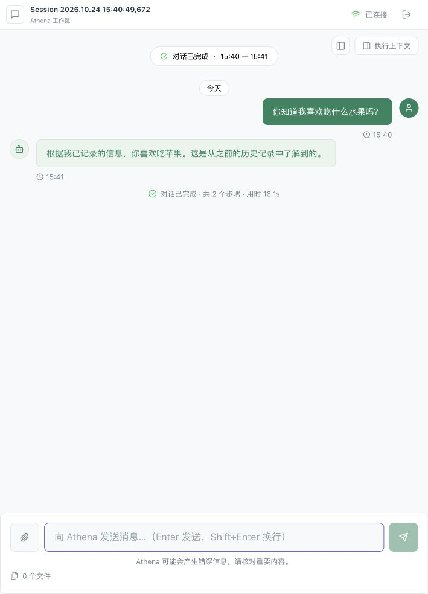

# Root 两阶段检索实施验收记录

日期：2026-10-24（Asia/Shanghai）。设计依据：[Root 首次决策前预检索方案](../root-context-prefetch-design.md)。

## 1. 实施结果

入口现在为 prepare_request → prefetch_context → decide_root_action。预检索直接使用原始问题，查询已装配的记忆和有就绪文档的知识库；默认每通道等待 3 秒，不占决策轮数。资料不足时由 LLM 改写 query，复用 acquire_context → redecide_root_action。查询结果区分空、失败、超时和跳过；阶段摘要进入决策、规划与正文生成，轨迹与事件保留阶段。

两阶段使用同一个资料窗口和访问确认逻辑；补充检索为空时保留原资料，旧窗口沿用的记忆不重复记访问。初始计划提交、独立正文、Round 等待和审批边界沿用当前工作树。

实测发现，查询超时摘要可能被模型错误理解为“本次记忆写入失败”。已补充决策和正文提示：读取状态不能用于推断异步写入结果；用户陈述事实时直接确认理解，不为验证陈述再次检索，不主动暴露内部诊断。

## 2. 自动化验证

| 验证 | 结果 |
| --- | --- |
| Root 图、预检索、通道契约、Agent、记忆召回、Review、Run 执行、计划提交定向回归 | 67 passed |
| 真实 PostgreSQL 两阶段轨迹/最终选择/访问计数，与既有 checkpoint 恢复 | 2 passed |
| unit + bootstrap + architecture 全范围 | 361 passed，5 failed，2 warnings |
| Python compileall 与 git diff --check | 通过 |

定向命令（工作目录 backend，使用仓库根 .venv）：

```bash
../.venv/bin/python -m pytest \
  tests/unit/test_root_graph.py \
  tests/unit/test_root_context_contracts.py \
  tests/unit/test_root_prefetch.py \
  tests/unit/test_configured_root_agent_planning.py \
  tests/unit/test_memory_context_recall.py \
  tests/unit/test_root_review_workflow.py \
  tests/unit/test_run_execution.py \
  tests/unit/test_root_plan_submission.py -q
```

集成测试使用项目配置设置 ATHENA_TEST_DATABASE_URL，不打印凭据；新增测试先创建独立 schema 的业务表，并断言 memories 实际属于该 schema。public 只用于解析 vector 和 chinese 类型。测试结束删除自身 schema。

初次集成验证遗漏了 create_all 的 checkfirst 行为，同名 public 表被误用，产生 4 条本次轨迹和 1 条测试记忆。已按实际生成的轨迹 ID、记忆创建时间/内容精确删除，随后增加 schema 所属断言并重新通过。该问题属于测试隔离修正，没有增加生产数据库兼容逻辑。

全范围剩余失败如下；未为通过这些旧测试而给生产代码增加兼容分支：

| 测试 | 实际失败 |
| --- | --- |
| test_memory_ingestion::test_completed_run_enqueues_memory_without_blocking_answer | 旧完成结果缺少 answer_stream 元数据：answer_stream_metadata_missing |
| test_phase8_http_workers::test_sse_heartbeat_and_untagged_event_paths | Events.replay 测试替身不接受 limit |
| test_run_request_preparation::test_load_history_excludes_current_message | Messages 测试替身没有 list_recent_conversation |
| test_target_postgres_runtime::test_target_runtime_repositories_cover_queue_events_approval_memory_and_retrieval | 仓储行替身缺少 session_id |
| test_layer_boundaries::test_domain_does_not_depend_on_outer_layers | domain 当前导入了边界测试禁止的依赖；该项在本轮实施前基线也失败 |

同时同步了与本次回归相关的旧夹具：访问统计由最终窗口确认而非 Provider 召回触发；结构化回答返回 instructions；计划物化读取 plan_draft。两个 warnings 是现有知识库路由重复 Operation ID。

## 3. 真实模型、数据库与浏览器

原 8000 后端中有 2 个 running Run，因此没有重启该服务。使用独立 PostgreSQL 验收数据库、8001 后端和代理到该后端的 5174 前端，模型使用项目实际配置 mimo-v2.6-flash。测试实例使用真实 Provider、embedding、pgvector、命令消费者和记忆处理，不使用固定返回苹果的 Provider 替身。

先在浏览器会话 A 发送“我喜欢吃苹果，请记住这个偏好。”。等待异步记忆处理后，通过数据库/API 确认有效记忆 `food_preference: 喜欢吃苹果`，来源为会话 A、source_kind=extraction。随后在无历史的新会话 B 发送“你知道我喜欢吃什么水果吗？”。

| 样例 | Run ID | 首次决策前结果 | 首次动作与最终结果 |
| --- | --- | --- | --- |
| 浏览器冷启动 | 2026.10.24.07.40.54.136 | memory 超时，约 3006.9ms | context；改写为“用户喜欢吃的水果、饮食偏好”后召回苹果，最终正确回答 |
| 热启动 1 | 2026.10.24.07.42.55.034 | memory 成功，约 200.8ms | answer/final；你喜欢吃苹果。 |
| 热启动 2 | 2026.10.24.07.42.55.032 | memory 成功，约 212.0ms | answer/final；知道，你喜欢吃苹果。 |
| 热启动 3 | 2026.10.24.07.42.55.036 | memory 成功，约 193.5ms | answer/final；喜欢吃苹果。 |
| 热启动 4 | 2026.10.24.07.42.55.030 | memory 成功，约 218.3ms | answer/final；你喜欢吃苹果。 |

这 5 个新会话的首次输入 history 均为空；热启动 checkpoint 在 root_turn_count=0 时已经包含苹果记忆，第一次决策均为 final，没有第二批检索。冷启动样例走完了真实超时 → 改写 → 再决策路径，没有向用户反问偏好。未把“喜欢”升级为“最喜欢”。

原始节点序列、查询摘要、资料和 Provider 轨迹保存在 [JSON 证据](root-context-prefetch-20261024.json)。截图是浏览器实际结果：



### 3.1 补充场景与未通过项

| 场景 | Run ID | 结果 |
| --- | --- | --- |
| 知识库问题“PF验收项目的代号是什么？” | 2026.10.24.07.48.08.588 | 预检索后首次 final，回答蓝鲸 |
| 缺少文件和收件人“把那个文件发给他。” | 2026.10.24.07.48.08.594 | 首次 clarification，询问文件、收件人、发送渠道 |
| 用户陈述“我喜欢吃苹果，请记住这个偏好。” | 2026.10.24.07.48.08.590 | 首次 final，简短确认，无检索超时诊断 |
| 未知蔬菜偏好 | 2026.10.24.07.48.08.592 | 未编造蔬菜，但附带复述苹果，不满足只使用相关事实的要求 |
| 收紧事实边界提示后再测未知蔬菜偏好 | 2026.10.24.07.56.25.510 | 仍附带苹果并声称没有蔬菜记载，相关性检查未通过 |
| 最终提示下再测水果原问题 | 2026.10.24.07.56.25.508 | 首次 final，正确回答苹果 |

知识库样例使用独立数据库中显式构造的 READY 文档和真实分块记录，走真实 KnowledgeContextProvider、数据库和模型；没有测试上传/解析/建图的整条 ingestion 链，不能将其称为知识库全链路验收。边界样例证据见 [边界 JSON](root-context-prefetch-boundaries-20261024.json)，最终提示复测见 [相关性复测 JSON](root-context-prefetch-relevance-20261024.json)。

未知类别问题的失败原因可以从 checkpoint 确认：模型把“召回了其他类别的偏好”当作足够信息，首次选择 final；instructions 要求提及不相关偏好，正文也沿用了它。补充“结果数大于零不代表相关”和“instructions 不能覆盖事实边界”等提示后仍可复现。本次没有增加关键词路由、答案字符串过滤或额外相关性模型来掩盖这个失败。结构性的两阶段流程已完成，P4 的回答相关性验收仍有此未通过项，不能宣称全部场景通过。

边界辅助脚本最初使用 150 秒等待上限，未知蔬菜样例当时尚未结束；后台后来正常完成。实际答案与节点证据已重新读取并保存，辅助脚本超时不等同于 Run 失败。

## 4. 验收边界

- 约 0.19–0.22 秒是热启动样例的采集时间，包含该批检索计算，不是首个正文或整个 Run 的耗时。冷启动 embedding 会超出 3 秒；本例定向采集约 9.98 秒后取得事实。
- 某次正文模型响应明显慢于其他样例，但其 checkpoint 已在首次决策中选择 final。不能将正文模型延迟归因于预检索，也没有为此改变 Provider 重试/流超时。
- 样例回答较短，仅出现 1 个正文 delta；本记录不据此宣称长文多片段流式能力已独立验收。
- 尚未对原用户 Run 做重放，也未进行旧入口与新入口在同一固定语料下的统计对比。5 次成功证明该固定样例通过，不保证所有问题或模型不会误路由。
- 通道故障、超时保留快通道、取消、资源范围、窗口去重/预算和无就绪知识库由自动化验证。冲突偏好的真实模型场景未完成专项验收。
- 原 8000 后端继续运行先前加载的代码；本次验证不等于已重启或更新该进程。应在原有运行结束后正常重启服务以加载代码。

## 5. 测试环境清理

停止本次独立后端与前端，并删除本次创建的验收数据库；原 PostgreSQL/Neo4j 容器、8000/5173 服务和已有任务保留。持久证据为本目录的 Markdown、JSON 和截图，不依赖临时数据库继续存在。

## 6. 提交前代码审查与修复

本节记录实施后追加的代码审查，保留上文初次验收数据作为历史证据。

审查确认并修复了以下缺陷，均先增加可复现失败的测试再修复：

1. 预检索命中后进入计划生成时，ContextItem 为 dataclass，逐条调用 model_dump 会抛出 AttributeError。现由 RootPlanInput 在序列化边界统一输出 JSON，测试包含非空资料和阶段摘要。
2. 短首片段没有立即提交，持续到达的小片段会反复重置等待期限。现首片段立即提交，后续按距上次成功提交的经过时间刷新，测试使用门闩与虚拟时钟验证，无需外部模型。
3. 取消底层读取时的清理异常可能覆盖原本的 answer_idle_timeout，导致阶段丢失。现清理只记录自身错误，保留原异常；测试验证原错误代码和 answer_generation 阶段。
4. LangChain model_copy(max_retries=0) 仍共享重试次数为 2 的原 SDK 客户端。现流式模型在构造真实 SDK 时指定 max_retries=0；测试核查同步/异步客户端均为 0，普通调用的客户端仍为 2。

同步修正了完成结果、SSE 分页、历史读取和检索行的过期测试夹具，没有为兼容这些夹具放宽生产契约。最终回答事务恢复测试使用真实 sessions/messages 表和 answer_stream 元数据，确认只有一条 message.completed，不在结束时重发整段 delta。

本轮检查结果：后端 unit/bootstrap/architecture **370 passed，1 failed**；剩余失败是 domain 引入 pydantic 的架构规则冲突，已核对当前 HEAD 同时包含该禁止规则与既有 trace_contracts 的 pydantic 导入。真实 PostgreSQL 检索轨迹、Root checkpoint 和最终回答事务恢复 **3 passed**。前端 typecheck 通过；Python 编译和 diff 格式检查通过。

本次提交包含两阶段检索所需的未提交 Root 决策、独立计划和流式回答依赖；不包含其余迁移脚本、旧文档和 schema 清理。第 3 节真实模型证据来自实施阶段，本轮没有据此声称重新验收了全部供应商或长文流。未知类别问题附带无关记忆的模型行为仍是已知限制，没有标为修复。

提交前另从暂存区导出独立快照，强制应用与测试替身从该快照导入，在不读取工作树 .env 的测试配置下再次执行完整后端回归，结果同样为 **370 passed，1 个相同的既有架构失败**。这确认暂存内容可独立运行，不依赖其它尚未提交的工作树修改。现有测试文件的重命名仍保留在工作树；暂存区只为原文件名同步两处必需的 stage 参数。
