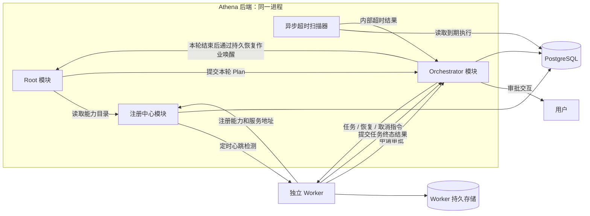

# Worker 注册中心、逐轮规划与 HTTP 通信方案

日期：2026-10-30

状态：S1 接口协议已定稿；整体目标方案尚未实施。“已明确”表示讨论中已确认的要求；“实施约定”表示本稿为落实要求选定的协议细节；S1 的运行参数默认值与约束见 [Worker HTTP 协议 v1](worker-protocol-v1.md)。

## 1. 讨论结论与设计边界

| 内容 | 状态 | 本稿处理 |
| --- | --- | --- |
| Worker 是独立运行的 Agent 服务 | 已明确 | 通过网络注册，由 Orchestrator 调度 |
| Root 与 Orchestrator 同进程、不同模块 | 已明确 | 同属 Athena 后端进程，通过应用接口协作，共用持久化基础设施 |
| Root 不直接调用 Worker | 已明确 | 只能通过 Orchestrator 提交 Plan；Worker 结果和审批进入 Orchestrator |
| Orchestrator 管理执行事实 | 已明确 | Root 根据事实决策，不直接修改任务执行状态 |
| Worker 对外能力只描述能做什么、不能做什么、输入参数定义、输出参数定义 | 已明确 | 工具、模型、环境实现留在 Worker 内部 |
| Root 可以多次生成 Plan，每次只生成一轮独立任务 | 已明确 | 一个 Run 顺序保存多个 Plan，轮内没有任务依赖 |
| 同一 Plan 内的任务允许并发 | 已明确 | Orchestrator 根据实例容量控制实际并发 |
| Worker 提供任务接收和任务恢复接口 | 已明确 | Orchestrator 使用短时 HTTP 请求主动下发指令 |
| 移除 Worker 长轮询领取任务的方式 | 已明确 | 待下发任务保存在服务端，由后台调度器主动发送 |
| Orchestrator 不提供通用事件接口，提供专用审批和任务结果接口 | 已明确 | Worker 申请审批并主动提交成功/失败结果 |
| 发送失败分类处理 | 已明确 | 网络等可恢复错误指数退避；参数错误反馈 Root 重新规划 |
| Worker 执行错误的重试判定 | 已明确 | 统一错误代码、原因和 `retryable` 提示；由 Orchestrator 按错误目录裁决，未知错误默认不自动重试 |
| Worker 注册时提供执行超时配置 | 已明确 | Orchestrator 持久保存截止时间，后台扫描超时并进入重试流程 |
| 执行超时起点 | 已明确 | 首次实际发送前持久开始计时，同一命令的网络重投不重置截止时间 |
| Worker 提供取消接口；取消后迟到结果不能更新任务状态 | 已明确 | 中心取消先落库，结果接收与取消原子互斥 |
| 审批支持单个或批量，沿用现有逻辑 | 已明确 | 暂停发起审批的 Worker；决定返回 Worker，由其决定后续处理 |
| 审批等待统一 120 秒 | 已明确 | 服务端统一设置并持久化过期时间 |
| 审批期间暂停执行计时 | 已明确 | 保存剩余执行时长，恢复后继续剩余时长，不重置完整超时额度 |
| 退避参数和重试上限配置化 | 已明确 | 传输重试和执行尝试分开计数、分别配置上限 |
| 首期不实现执行进度 | 已明确 | 移除进度上报、进度查询及相关调度器 |
| 执行资源隔离由 Worker 负责 | 已明确 | Athena 不增加工作区隔离或资源冲突调度机制 |
| 本轮全部任务终态后，Root 决定下一轮；失败结果一起交给 Root | 已明确 | 自动重试尚未结束的任务不算最终完成 |
| 执行时间由 Orchestrator 控制 | 已明确 | Root 不配置执行超时、不维护执行计时器 |
| Worker 提供心跳检测接口，注册中心定时探测 | 已明确 | 下线实例先移出可用 Worker 列表，停止新分配 |
| 数据库切换方式 | 已明确 | 允许删除 Athena 项目数据库并按新模型重建，不做旧数据迁移或兼容 |

本稿按最新的 HTTP 主动下发方向设计，首期不要求引入 MQ。身份、服务地址、执行超时和并发配置属于运行协议，不是额外的 Worker 能力描述。审批期间暂停执行计时，以及退避参数和重试上限配置化，均已确认；v1 默认值与约束见 [Worker HTTP 协议 v1](worker-protocol-v1.md)，部署可在约束内覆盖可配置项。

## 2. 当前代码与目标的差异

以下是当前工作树已核对的事实，不能视为目标功能已经存在。

| 当前实现 | 目标调整 | 已核对的代码 |
| --- | --- | --- |
| Root 决策和规划输入接收统一的 `worker_tools` | 接收 Worker 四项能力契约及系统引用标识 | [root_decision.py](../src/application/orchestration/root_decision.py)、[root_workflow.py](../src/application/orchestration/root_workflow.py) |
| 计划草稿有 `edges`、任务 `depends_on`、`allowed_tools` 和 `plan_version` | 新规划协议只描述本轮任务、能力引用和完整输入 | [root_decision.py](../src/application/orchestration/root_decision.py) |
| 计划 ID 固定从 Run 派生，任务作用域只包含 Run，任务类型固定为 `general` | Plan ID 每轮不同；任务身份包含 Plan，引用具体能力契约 | [plan_materialization.py](../src/application/orchestration/plan_materialization.py) |
| `agent_plans` 有 `one_plan_per_run` 唯一约束；提交逻辑拒绝已有 Plan 的 Run | 一个 Run 保存多个 Plan，同时最多有一个未结束的 Plan | [runtime_models.py](../src/infrastructure/persistence/postgres/models/runtime_models.py)、[orchestration_command_repository.py](../src/infrastructure/persistence/postgres/repositories/orchestration_command_repository.py) |
| 通过完整 DAG、PlanVersion 和固定 Round 推进；已有后续版本拆分机制 | Plan 本身就是一轮，后续任务等待实际结果再生成 | [rounds.py](../src/domain/orchestration/rounds.py)、[plan_versions.py](../src/application/orchestration/plan_versions.py) |
| 后端启动时构造本地 Worker Agent/Executor，Dispatcher 从 PostgreSQL 领取并直接调用它 | Dispatcher 选择远程实例、发送 HTTP 指令；Worker 通过专用结果接口提交终态 | [postgres.py](../src/bootstrap/postgres.py)、[worker_job_dispatcher.py](../src/workers/worker_job_dispatcher.py) |
| 已有中心租约、持久审批、Root 恢复作业、事务性 Outbox 和事件流 | 复用执行权与持久恢复思想，改造其对 Plan/Worker 的假设 | [lease_center.py](../src/infrastructure/persistence/postgres/repositories/lease_center.py)、[worker_approval.py](../src/application/orchestration/worker_approval.py)、[root_resume_dispatcher.py](../src/workers/root_resume_dispatcher.py) |
| Worker 审批超时配置当前默认 `86400` 秒 | 改为全局统一 `120` 秒，继续由服务端审批过期流程处理 | [settings.py](../src/configuration/settings.py)、[approval_expiry_worker.py](../src/workers/approval_expiry_worker.py) |
| 已有审批批次标识；Worker 审批写入路径当前逐条保存请求 | 复用审批记录与决定流程，明确批次成员和恢复条件后验证单项/批量闭环，不能只增加批次标识就视为完成 | [approval/entities.py](../src/domain/approval/entities.py)、[worker_job_repository.py](../src/infrastructure/persistence/postgres/repositories/worker_job_repository.py) |
| 编排快照 DTO 中只有一个 `plan`，前端按单 Plan 投影 | 展示 Run 下的多轮 Plan 及各轮任务 | [orchestration.py](../src/interfaces/http/dto/orchestration.py)、[orchestrationProjection.ts](../../frontend/src/utils/orchestrationProjection.ts) |

现有 `OrchestrationOutboxDispatcher` 主要把业务事实投递到 SSE 事件流，不是远程任务发送器。取消 Worker 事件接收接口不意味着取消系统内部事件和前端 SSE。

## 3. 整体架构与职责



### 3.1 部署方式

Root、Orchestrator 和注册中心作为不同模块运行在同一个 Athena 后端进程中，共用 PostgreSQL 和生命周期管理。Root 与 Orchestrator 通过应用接口调用，首期不拆独立服务，不在两者之间增加 HTTP 或 MQ。

指令发送器、心跳检测、超时扫描和 Root 恢复运行器是该进程内各自受管理的异步后台组件；由启动入口统一装配、启动和关闭。后台运行不要求独立部署，远程 Worker 仍然是独立 Agent 服务。

Root 提交 Plan 后持久暂停；Orchestrator 在本轮结束事务中创建持久恢复作业，Root 运行器再领取并恢复决策。不能在一个同步调用中等待整轮执行，也不能只用内存事件串联本轮完成与下一轮规划；进程重启后从持久记录恢复。

### 3.2 职责和模块边界

| 组件 | 职责 |
| --- | --- |
| Root | 理解目标和约束；读取能力契约；决定回答、获取资料或执行；生成本轮任务；审查历轮结果并决定下一轮 |
| 注册中心 | 保存契约、地址、超时配置和实例状态；定时检查心跳；维护可用 Worker 列表和能力目录 |
| Orchestrator | 校验 Plan；选择实例；管理容量、指令投递、错误分类、超时扫描、重试、审批和取消；接收结果并持久化；恢复 Root |
| Worker | 持久接收指令；内部执行和资源隔离；保存暂停点与结果；申请审批、处理返回决定；可靠提交成功/失败结果；实现取消和心跳接口 |

Root 选择能力，不选择具体实例。Orchestrator 是中心业务状态的唯一写入入口；超时扫描器调用其内部用例，不直接修改任务终态。Worker 不直接访问 Athena 数据库。Athena 不负责 Worker 内部工作区、文件或外部对象的并发隔离。

已确认的两个边界如下：

1. **调用边界**：Root 通过 Orchestrator 的应用端口提交 Plan，不持有远程 Worker 客户端，不直接发送任务、恢复或取消指令。Worker 的审批申请和结果提交由 HTTP Controller 转交 Orchestrator 用例处理，不直接回调 Root。
2. **状态边界**：Orchestrator 管理执行相关的 Run/Plan/Task/Execution 事实与状态转换。Root 读取结果、生成决策并提交命令，不直接调用仓储修改执行状态。Root 自身的模型上下文与 Checkpoint 仍由 Root 运行器管理。

Orchestrator 按确定性规则校验、调度、重试和收集结果，不再增加一个用于调度决策的模型 Agent。参数修正和新一轮任务规划由 Root 完成。

### 3.3 术语与身份

| 术语 | 本稿中的唯一含义 |
| --- | --- |
| Worker 能力契约 | 四项能力描述及系统分配的 `contract_id + revision`，不是运行进程 |
| Worker 实例 | 一个注册的远程服务，拥有地址、认证身份、超时和容量配置 |
| Task | 本轮要达成的一个逻辑目标；自动重试不创建新 Task |
| Execution | Task 的一次尝试，由 `execution_id + generation` 标识；执行重试创建新 Execution |
| command_id | 一条执行、恢复或取消指令的身份；同一指令的网络重投保持不变 |
| result_id | 一次执行结果提交的身份；同一结果重投保持内容和标识不变 |

“暂停发起审批的 Worker”在协议中定位到该实例上的当前 Execution，不暂停同类契约的其他实例或同一服务内的其他独立 Execution。审批恢复使用原 Execution 和代次，不能误作新的业务执行尝试。

## 4. Worker 能力契约与注册

### 4.1 对外能力仅保留四项

| 字段 | 含义 | 形式 |
| --- | --- | --- |
| `can_do` | 支持完成的任务和操作 | 非空自然语言说明列表 |
| `cannot_do` | 明确的能力边界 | 自然语言说明列表 |
| `input_schema` | 调用需要的参数及约束 | JSON Schema，包含字段说明 |
| `output_schema` | 成功执行应返回的业务数据 | JSON Schema，包含字段说明 |

以代码审查为例：

```json
{
  "can_do": ["审查提供的代码变更，给出问题位置和修改建议"],
  "cannot_do": ["不修改代码", "不运行测试", "不访问输入之外的仓库内容"],
  "input_schema": {
    "type": "object",
    "properties": {
      "diff": {"type": "string", "description": "待审查的代码变更"},
      "context": {"type": "string", "description": "相关代码和需求背景"}
    },
    "required": ["diff"],
    "additionalProperties": false
  },
  "output_schema": {
    "type": "object",
    "properties": {
      "summary": {"type": "string", "description": "审查结论及建议"}
    },
    "required": ["summary"],
    "additionalProperties": false
  }
}
```

Root 不再指定 Worker 内部的工具白名单。`cannot_do` 是能力说明，不能代替 Worker 自身必须执行的权限、审批和环境限制。契约说明也不能覆盖用户授权或 Root 系统规则。

### 4.2 能力和实例分开记录

系统为能力契约分配 `contract_id` 和不可变 `revision`。这些是引用元数据，不增加模型需要理解的能力维度。契约变更创建新版本，已提交任务仍引用原版本快照。

一个契约版本可以由多个等价实例提供。注册请求在四项契约之外携带 `base_url` 和正有限数值 `execution_timeout_seconds`；实例标识由服务端签发。并发上限由运行配置确定，不要求写进能力描述。

超时值是该实例处理一次任务的执行时限，由 Orchestrator 在分配时冻结到 Execution 中。修改注册配置不改变已经分配任务的时限；Root 不生成或覆盖此字段。

建议首期一个实例提供一份契约；已有相同契约时复用其引用。不得仅因实例声明了相同契约，就认为两个实例能够互相恢复私有 Checkpoint。

### 4.3 注册和发现流程

1. Worker 使用服务身份注册，提交四项能力信息、服务地址和执行超时。
2. 服务端校验 Schema、身份、地址、超时和接单配置，保存契约与实例关联。
3. 注册中心定时调用 Worker 的心跳检测接口；一旦判定下线，先将实例从可用 Worker 列表移除，停止新任务分配。历史契约、已有执行和结果不能一并删除。
4. Root 在首次决策、再决策和每轮规划时读取授权范围内的能力摘要；详细输入输出定义在规划时提供。
5. 提交 Plan 时再次校验契约是否仍获准使用，领取实例时校验版本是否匹配。

Root 可以看到某能力当前是否有可接单实例，不需要看到实例地址、心跳详情和内部负载。满载是调度等待；未提供对应能力是能力缺口，不能误报成用户缺少业务信息。

心跳仅检查实例健康，不承担任务进度查询或任务续租。下线不是立即重做任务的依据：已分配执行仍由结果回传或超时扫描裁决，避免一次探测失败就重复执行。重新加入可用列表的探测条件、检查周期和失败阈值为部署配置；派发事务必须再次确认实例仍可用。

## 5. 逐轮 Plan

### 5.1 运行关系

```text
Run（一次用户请求）
 ├─ Plan 1（第一轮，不可变）
 │   ├─ Task A → Execution
 │   └─ Task B → Execution
 ├─ Plan 2（根据第一轮实际结果生成）
 │   └─ Task C → Execution
 └─ 最终回答
```

Plan 本身表示一轮，不再给新规划协议叠加“完整 Plan → 多个 Round → 多个未来版本”。首期建议一次提交后不可变，修正任务或补救操作放在下一轮。

同一 Run 同时最多有一个未结束的 Plan；排队、执行、自动重试和等待审批均不算本轮结束。所有逻辑任务进入终态后，该 Plan 才关闭，并安排 Root 决策。Run 被用户停止后不再生成新 Plan。

### 5.2 任务约束

- Plan 至少有一个任务，任务在该 Plan 内有唯一引用。
- 任务之间没有 `edges`、`depends_on` 或本轮结果引用。
- 输入已经完整，提交时即可根据目标契约的 `input_schema` 校验。
- 输入可以包含已经存在且获授权的文件/结果引用，不得包含未来结果占位符。
- 输入尚需另一个任务产出时，该任务必须放到后续 Plan。
- 任务包含执行目标和本次验收要求；成功输出结构复用契约，不在每个任务内复制 Schema。
- 实际并发由系统、Run 配置和实例容量共同控制。模型不负责估计实例容量。
- 执行环境与共享资源如何隔离由 Worker 自行设计，Athena 不增加资源锁或工作区隔离调度。

本稿建议的模型输出示例：

```json
{
  "action": "plan",
  "goal": "分别审查两个已经取得的代码变更",
  "tasks": [
    {
      "task_ref": "review_auth",
      "contract_id": "code-review",
      "contract_revision": 1,
      "objective": "检查认证逻辑的潜在缺陷",
      "input": {"diff": "已经取得的认证模块差异"},
      "acceptance_criteria": "说明问题位置、触发条件和建议；无发现时明确说明"
    },
    {
      "task_ref": "review_query",
      "contract_id": "code-review",
      "contract_revision": 1,
      "objective": "检查查询逻辑的潜在缺陷",
      "input": {"diff": "已经取得的查询模块差异"},
      "acceptance_criteria": "说明问题位置、触发条件和建议；无发现时明确说明"
    }
  ]
}
```

`plan_id`、Run 内的 `plan_sequence` 和持久任务 ID 由服务端生成。这里的序号就是 Plan 的先后顺序，不另建 Round 身份。任务身份至少包含 Plan 作用域，避免每轮都使用同一个 `task_ref` 时发生冲突。

### 5.3 Root 循环

Root 接收原始目标、用户约束、已完成 Plan 摘要、可读取的结果引用和当前能力目录。保留现有按需资料检索能力。

Root 每轮决定直接回答、必要澄清/获取资料，或提交新 Plan。生成新 Plan 后持久暂停，不占着执行协程等待 Worker 完成。

本轮全部任务进入终态后，只生成一个持久 Root 恢复作业。恢复身份绑定 `run_id + plan_id + root_wait_generation`，重复提交结果或重复交付恢复作业不能生成重复 Plan。

Plan 结束只表示本轮收集完成，不表示全部成功；成功结果与最终失败原因一起交给 Root。参数错误进入不可重试失败，等待本轮其他任务结束后，由 Root 重新规划。超时先由 Orchestrator 执行自动重试，次数耗尽后才成为交给 Root 的最终失败。

保留最大轮数/执行次数等有界控制；全部执行时间、截止时间和审批计时由 Orchestrator 管理。Root 不额外配置执行超时，不启动时间控制循环；达到系统限制时根据中心结果收束回答。

### 5.4 状态转换与本轮完成条件

以下为目标模型的状态语义，不能直接沿用当前 DAG 的状态推进假设。Task 与 Execution 分开保存；一次尝试超时不等于逻辑任务最终失败。

| 触发 | 前置条件 | Task 及 Execution 变化 | 是否计入本轮终态 |
| --- | --- | --- | --- |
| 接受 Plan | Run 有效、没有其他未结束 Plan | Task 为 `pending`，等待分配 | 否 |
| 首次实际发送执行指令 | 已预留实例容量、当前尝试有效 | Execution 和 Task 为 `running`，持久开始/截止时间 | 否 |
| 收到执行接收回执 | 指令和代次匹配 | 只记录投递回执；`running` 表示中心已派发，不证明 Worker 内部已开始运行 | 否 |
| 接受审批申请 | 当前执行未到期、未取消且正在运行 | Task/Execution 为 `waiting_approval`，冻结剩余时长 | 否 |
| 用户决定或审批过期 | 当前暂停点仍有效 | 保存决定和恢复作业，仍等待恢复投递 | 否 |
| 首次实际发送恢复指令 | 决定已完整、实例有容量、暂停点有效 | 原 Task/Execution 回到 `running`，使用剩余时长设置新截止时间 | 否 |
| 可重试失败或超时 | 当前尝试有效、还有尝试额度 | 本次 Execution 结束，Task 为 `retry_pending`；下一尝试待分配 | 否 |
| 成功或最终不可重试失败 | 当前尝试有效 | Task 为 `completed` 或 `failed` | 是，仅一次 |
| 取消未结束任务 | Task 尚非终态 | Task 为 `cancelled`，使执行/恢复/重试指令失效 | 是，仅一次 |
| 重复回执、失效代次或取消后的结果 | 已有处理结果或已失效 | 返回原回执/忽略回执，不转换 Task | 否 |

每个 Execution 可有多个审批暂停点，但一个时刻只允许一个有效待审暂停点。新的执行尝试开始前，必须结束旧尝试的业务有效性。最终结果或取消事务使本轮计数达到任务总数时，原子关闭 Plan 并创建唯一 Root 恢复作业；Run 已停止时不唤醒 Root 生成新 Plan。

Task 的终态固定为 `completed`、`failed`、`cancelled`。Plan 的“本轮已收集完毕”不自动结束 Run；Root 决定最终回答时通过 Orchestrator 命令结束 Run。

## 6. HTTP 接口清单

路径为目标协议，不代表当前接口已经实现。S1 的规范协议见 [Worker HTTP 协议 v1](worker-protocol-v1.md)，请求/响应 JSON Schema 及机读样例见 [worker-protocol-v1.schema.json](worker-protocol-v1.schema.json) 和 [worker-protocol-v1.examples.json](worker-protocol-v1.examples.json)。如本方案中早期接口概览与 v1 协议补充稿有差异，以 v1 协议补充稿为准。

### 6.1 Worker 对外接口

| 方法和路径 | 作用 | 确定程度 |
| --- | --- | --- |
| `POST /worker-api/v1/tasks` | 接收执行指令 | 已确定需要此能力 |
| `POST /worker-api/v1/executions/{execution_id}/resume` | 接收指定暂停点的审批决策并恢复 | 已确定需要此能力 |
| `POST /worker-api/v1/executions/{execution_id}/cancel` | 停止指定执行并持久记录取消意图 | 已确定需要此能力 |
| `GET /worker-api/v1/health` | 由注册中心定时检查实例是否健康 | 已确定需要此能力；路径建议 |

首期不提供执行进度或任务状态查询接口，也不增加对应后台查询器。

### 6.2 Athena 服务端接口

| 方法和路径 | 作用 | 确定程度 |
| --- | --- | --- |
| `POST /api/worker-instances` | 注册契约和服务地址 | 注册需求已明确；路径建议 |
| `POST /api/worker-approvals` | Worker 请求审批 | 已确定需要此能力；路径建议 |
| `POST /api/worker-executions/{execution_id}/result` | Worker 提交成功/失败结果；已取消任务的迟到结果返回忽略回执 | 已确定需要此能力；路径建议 |
| `POST /api/worker-executions/{execution_id}/stop-confirmation` | Worker 独立确认取消/超时/替代命令对应的旧 Execution 已停止；只释放该尝试容量，不改 Task 状态 | S1 定稿路径与 DTO |

服务端不增加 Worker 通用事件或进度上报接口；审批和结果分别通过专用接口提交。本稿按“注册超时 + 中心扫描”收敛，首期建议不增加 Worker 续租接口；内部后台作业仍复用现有租约中心防止重复处理，不把作业租约当成远程任务执行时限。

现有面向用户的 `/api/approvals/{approval_id}/decision` 继续负责记录用户决定，与 Worker 申请审批接口分开。跨机器文件访问使用第 6.4 节冻结的授权 ResourceReference 与资源传输接口。

### 6.3 接口 DTO 覆盖范围

下面列出共享字段面向；具体字段、HTTP 状态、幂等规则、错误处置和运行参数已由 [Worker HTTP 协议 v1](worker-protocol-v1.md) 定稿，后续阶段直接复用。

| 接口 | 必须定义的请求和回执 |
| --- | --- |
| 注册 | 四项契约、地址、执行超时、实例身份恢复方式；返回实例和契约版本标识 |
| 执行 | 命令、Run/Plan/Task/Execution 身份、代次、输入、验收要求及认证凭据；返回持久接收回执 |
| 恢复 | 命令和执行身份、暂停点、完整单项/批次决定；返回持久接收回执 |
| 取消 | 命令和执行身份、取消代次；区分“取消已接收”和“实际已停止” |
| 心跳 | 实例身份与协议版本、是否可接单；不包含任务进度 |
| 审批申请 | 当前执行、暂停点、项目/批次身份及冻结参数；返回稳定审批身份和服务端过期时间 |
| 结果提交 | 结果身份、执行代次、成功输出或统一错误；返回处理结论和原因 |
| 停止确认 | 确认 ID、原取消命令 ID、执行代次及停止原因；回执明确容量释放和 Task 状态不变 |

Worker 执行错误和 HTTP 错误响应使用不同 DTO。错误目录、HTTP 状态映射和未知错误规则以 Worker HTTP 协议 v1 为准。

实施约定：执行与恢复持久接收后返回 `202`；重复且内容相同返回同一回执；同一幂等标识内容不同返回 `409`，参数不合法返回 `422`，临时过载返回 `429` 并可提供重试提示。取消接口始终以 `202` 只确认意图已保存；Worker 无论是否已停止，都另用稳定幂等的 StopConfirmation 回报停止事实。停止回执只清理匹配旧 Execution 容量，Task 状态不变。结果接口只接受 `completed/failed`，返回 `200` 并以 `disposition` 区分 `recorded`、`retry_scheduled`、`ignored`。

每个接口的幂等键作用域、请求摘要冲突规则、可重投条件和认证范围均已写入 v1 协议补充稿；后端和 Worker 必须消费同一份 Schema 与样例。

## 7. 任务下发、结果提交与并发控制

### 7.1 下发协议

指令包含 `command_id`、`run_id`、`plan_id`、`task_id`、`execution_id`、契约引用、目标、验收要求、完整输入和执行凭据。执行凭据绑定实例、执行代次和取消代次；超时由中心持久截止时间裁决。传输标识不代替调用身份认证。

1. Orchestrator 在短事务中检查 Run、Plan、可用列表和容量，创建执行代次、冻结注册超时并持久记录指令。
2. 事务提交后发送 HTTP；不持有数据库事务或连接等待远程请求。
3. Worker 校验身份、契约、输入、执行凭据和本地容量；按 `command_id` 去重。
4. Worker 将指令可靠保存后返回 `202` 和稳定接收回执，再由本地运行器异步执行。
5. Orchestrator 保存接收回执。它只证明指令被接收，不证明任务已开始或已完成。

结果或审批请求可能比上述接收回执更早到达中心。它们依据已持久分配的执行身份处理；迟到的 `202` 只能补记投递回执，不得把已暂停、重试、完成或取消的任务重新设为运行中。

Worker 重复收到同一命令和相同请求摘要时返回原回执；相同命令 ID 携带不同内容时返回冲突。服务端重启后从数据库恢复待投递指令。投递错误按第 9 节分类处理，不对所有非成功响应统一重试。

### 7.2 专用结果提交接口

Worker 完成本地执行后，先持久保存结果及待提交记录，再调用 `POST /api/worker-executions/{execution_id}/result`。下方 Body 遵循 v1 的 ResultSubmission；执行身份来自路径，服务身份通过 Authorization 提供，幂等键取 `result_id`。

```json
{
  "protocol_version": "1.0",
  "result_id": "e0000000-0000-4000-8000-000000000001",
  "generation": 1,
  "status": "completed",
  "output": {"summary": "发现一个需要修正的问题"}
}
```

该接口只接受 `completed`、`failed`，不接受 `cancelled`。迟到成功/失败结果可以返回 `ignored/task_cancelled`，但不能作为物理停止证明。服务端用路径中的 `execution_id`、body 中的 `generation` 和认证主体对应的实例记录核对执行归属；不信任请求自行声明的 Worker 归属。失败结构包含错误代码、原因和可重试提示，Orchestrator 根据自身分类策略裁决是否重试。物理停止通过独立 StopConfirmation 接口上报。

处理步骤如下：

1. 校验调用身份和请求基本结构，计算稳定请求摘要。
2. 若已有同一结果标识和相同摘要的持久回执，返回原处理回执，不重复执行状态转换；相同标识对应不同内容时返回冲突。回执只说明当次处理结果，不使后续取消状态倒退。
3. 在同一事务中核对取消标记、当前代次和截止时间。任务已经取消或上报来自失效代次时，返回“已忽略”回执，不更新任务状态、输出或本轮计数；到期但尚未被扫描的执行，也先按超时规则处理，不能因扫描延迟接收迟到成功。
4. 成功输出按契约校验，失败原因使用统一错误结构。成功输出不符合契约时，中心记录明确的协议失败，并在回执中说明实际记录为失败；不强迫失败数据符合成功 Schema。
5. 保存本次执行结果与稳定回执，按分类更新为重试待执行或逻辑任务终态。只有逻辑任务最终结束才增加本轮计数；最后一个任务结束时同时创建 Root 恢复作业。显式终态证明该次执行已停止，容量按对应 Execution 只释放一次；内部超时不证明远程已停止，适用第 9.4 节的收尾规则。
6. 事务提交后返回 `200` 和明确处理回执：`recorded`、`retry_scheduled` 或 `ignored`。Worker 获得回执后停止该次结果重试，并按保留策略清理本地数据。

Worker 只在获得持久化回执后，才将待提交记录标记为已交付。网络失败、服务端暂不可用或响应丢失时，使用相同 `result_id`、执行代次和内容退避重试。重启后继续投递尚未确认的结果。

回执丢失后的相同结果重试先命中原回执，不能因为该代次已经结束而拒绝幂等重放。重复结果不能重复释放容量、安排下一尝试、增加本轮计数或恢复 Root。`ignored` 也是已处理回执，Worker 不应无限重投已取消或过期的结果。

Orchestrator 以专用结果提交和内部超时结果推动任务状态，不能将指令接收的 `202` 当作任务完成。首期不通过状态或进度轮询获取结果。

原始大结果先通过受限资源访问方式复制或上传到 Athena 可长期访问的存储，再作为中心结果引用交给 Root。Worker 本地文件路径不能直接作为跨机器引用。结果保留期和清理协议在实施前确定，不能在中心尚未取得结果时清理。

### 7.3 并发控制

任务发送、结果重试、心跳检测和超时扫描均使用有界并发与分批处理。结果接收事务保持短小，文件和大型产物通过资源接口传输。

首期不实现执行进度。前端只展示中心已知的排队、执行、等待审批、重试和最终结果，不新增进度百分比、Worker 日志流或状态查询调度器。

容量按任务启动/完成速率、结果大小、心跳流量、扫描频率及重试突发实测，不预设通用阈值。Worker 内部资源冲突与隔离由其自身解决，Athena 不扩展这一职责。

## 8. 审批申请、暂停与恢复

### 8.1 单项与批量审批

审批允许单个或批量，复用现有审批记录、批次关联、参数冻结、幂等和决定交付流程，不另建一套审批系统。“沿用”不代表现有 Worker 通道已经具备完整批量能力：v1 协议已定义批次成员、每项决定及整体恢复条件；S6 验证完整批量链路。不能只存一个批次 ID 或在第一项已决时丢弃其他项目。

Worker 先持久保存暂停点和待审操作，再调用专用审批接口。请求关联实例、任务、执行代次、暂停点、审批/批次标识和冻结操作内容。

哪个 Worker 发起审批，就暂停哪个 Worker 的当前任务执行；本稿以发起请求的 `execution_id` 定位暂停对象，不暂停整个 Plan 或其他 Worker。具体暂停实现、Checkpoint 和内部并发管理由 Worker 负责。

Orchestrator 在事务中核对取消标记、当前执行代次、运行状态、执行截止时间和授权范围；只有尚未超时的执行可以进入审批等待。到期请求先按超时处理，不能用迟到审批暂停一个已经到期的尝试。有效请求保存审批与等待状态，再产生用户通知并返回稳定接收回执。相同审批重投只返回既有状态，不重复创建或延长过期时间；请求响应丢失时 Worker 保持暂停并重试同一申请。

### 8.2 全局 120 秒过期

所有审批统一等待 `120` 秒，由服务端首次持久接收时设置 `expires_at`，Worker 不自行改变。沿用现有审批过期后台流程，到期原子记录 `expired` 并安排恢复指令；批次中的项目按其持久过期时间和既有聚合规则处理。

当前 `worker_approval_timeout_seconds` 默认是 `86400` 秒，实施时需调整为全局 `120` 秒，并校验运行配置不会继续覆盖为旧值。用户决定与过期扫描竞争时，只能产生一个有效决定；过期后的迟到批准不生效。

审批等待暂停执行计时，由 Orchestrator 持久保存剩余执行时长；投递恢复指令时从剩余时长继续计时，不重新获得完整超时额度。审批本身始终受独立的 120 秒上限约束，不把人工等待误算为执行失败并重做任务。重复审批申请和重复恢复命令不得再次扣减或重置剩余时长。

实施约定：首次接受暂停时，以数据库时间计算 `remaining_seconds = deadline_at - now`，原子保存剩余值并停用该执行截止时间；剩余值非正则按超时处理。用户决定只创建恢复作业，尚不启动执行计时。首次实际发送该恢复命令前，原子设置 `deadline_at = now + remaining_seconds` 并恢复运行态；同一恢复命令的重投不再计算截止时间。恢复投递的总等待上限独立保存，防止断线期间永久停留在审批状态。

Worker 已可靠暂停后，可释放该 Execution 的运行槽位；恢复前再次原子预留容量。实例尚无容量或暂时下线时保持待恢复，不让冻结的旧截止时间被执行超时扫描器误判。

### 8.3 决定交付与 Worker 自主处理

用户或过期流程记录决定后，Orchestrator 持久创建恢复命令，包含命令标识、执行代次、暂停点、审批/批次决定和冻结参数摘要。恢复指令使用 HTTP 主动投递；临时传输错误退避重投同一命令。

审批的 `approved`、`denied`、`expired` 决定都交给 Worker。由 Worker 决定继续、选择其他合规方式或结束任务，并通过专用结果接口返回最终成功/失败；Orchestrator 不因为审批被拒绝或过期就直接将任务改成失败，也不替 Worker 规划内部执行步骤。

拒绝和过期不授予待审操作的执行权限。Worker 的自主处理仍需遵守既有审批约束和用户授权。

恢复前核对任务没有被取消、代次仍然有效，且暂停点与审批参数一致。重复恢复只处理一次；恢复先到、较早的申请响应后到时，不得把 Worker 退回旧暂停状态。

Worker 下线时不强行向其他实例恢复私有 Checkpoint。先保存决定，等待绑定实例恢复并重投；恢复投递超过 v1 服务端等待上限后进入明确失败处理。该等待上限独立于审批的 120 秒。

## 9. 失败分类、超时扫描与取消

### 9.1 传输重试与执行重试分开

| 情况 | Orchestrator 处理 | 是否交给 Root |
| --- | --- | --- |
| 网络连接失败、暂时不可达、请求超时或接收回执丢失 | 同一命令 ID 和执行身份指数退避重投；有可能已被接收时，耗尽传输次数只停止重发，仍等待结果或原执行截止时间 | 明确未接收且投递耗尽时最终反馈；不确定时由超时流程裁决 |
| 参数错误、输入不符合契约、明确的不可执行业务参数 | 不重发相同内容，记录不可重试失败及具体原因 | 本轮收集结束后由 Root 重新规划 |
| 身份无效、权限不足、协议不兼容 | 不盲目重试或要求模型修改凭据，记录配置故障 | 必要时告知无法执行，配置由运维处理 |
| Worker 执行中失败并回传错误 | 保存统一错误代码、原因和 `retryable` 提示，由中心错误目录裁决；未知错误默认不自动重试 | 最终不可重试或次数耗尽后反馈 |
| 已接收但没有回传结果，包括 Worker 宕机 | 等待持久执行截止时间，由超时扫描器产生内部超时结果，交给 Orchestrator 安排执行重试 | 超时重试耗尽后反馈 |
| 结果提交响应丢失 | Worker 重投同一结果，中心返回原回执 | 不产生额外 Root 决策 |

以业务错误代码和响应结构进行分类，HTTP 状态码只辅助判断。例如参数校验类错误不重试，过载通常可重试；不能把全部 4xx 或全部非 2xx 统一归类。服务端 5xx/网络异常也可能发生在指令已接收之后，所以重投必须保持原命令身份。

“传输重试耗尽”不能直接等同于“Worker 没有执行”。如果前一次请求是否接收不确定，直接结束 Task 并让 Root 再规划可能造成重复操作。该 Execution 保持有效直到结果、取消或截止时间裁决；只有明确未被接收的拒绝/投递失败才可提前结束本次分配。

指数退避采用 `min(max_delay, initial_delay × 2^retry_index)` 并加入抖动。初始间隔、最大间隔和传输重试上限通过配置提供；传输重试次数和执行尝试次数分别保存、分别设上限，不能无限重试。

执行失败协议统一使用错误代码、原因和 `retryable` 提示，由 Orchestrator 按中心错误目录最终裁决。Worker 的提示不能单独授权重试；未知错误或缺少可识别错误信息时默认不自动重试，作为最终失败交给 Root。参数错误、权限和配置错误不会因为 Worker 标记了 `retryable=true` 就自动重做。

执行重试沿用现有 `worker_max_attempts` 配置名，v1 默认总尝试数为 3；错误代码和中心裁决目录见 [Worker HTTP 协议 v1](worker-protocol-v1.md)。

### 9.2 执行截止时间

Worker 注册时提供 `execution_timeout_seconds`，Orchestrator 在每次分配时冻结该值，并负责所有执行计时，Root 不指定时限。

在首次实际发送命令前持久保存 `dispatch_started_at` 和 `deadline_at`，从这一时刻开始计时，覆盖可能已经被接收但 HTTP 回执丢失的执行。传输重试同一命令不重置该截止时间，防止不断重投让任务永不过期；尚未选到实例的排队等待使用独立调度等待上限。

自动重试是同一逻辑 Task 的新一次 Execution：生成新的 `execution_id`、递增代次并重新冻结时限。原任务输入和契约保持不变，不伪装成 HTTP 重投，也不让同一执行身份同时代表两次业务尝试。

逻辑任务在下一尝试期间保持非终态。只有最终成功、不可重试失败、重试耗尽或取消，才增加本轮终态计数。

本稿按注册超时、执行代次和持久截止时间管理远程执行，不要求 Worker 通过心跳延长单个任务。中心内部的投递、扫描、Root 恢复作业仍使用租约中心协调多进程并发。

### 9.3 异步超时扫描器

1. 在 Orchestrator 启动时启动可恢复的异步扫描循环，分批读取 `deadline_at <= 数据库当前时间` 且尚未完成的有效执行。
2. 排除已取消、已有终态、已失效代次和正在等待审批的执行；审批过期由独立的 120 秒规则处理。
3. 为候选构造稳定标识的内部 `task_timeout` 结果，调用 Orchestrator 的结果处理用例；不必向本机再发送一次 HTTP，也不绕过其事务直接更新任务。
4. 事务再次校验代次、取消标记、截止时间和状态，原子结束该尝试，并持久创建下一尝试/重试作业；超过次数上限时记录最终超时失败。
5. 下一尝试只从当前健康可用列表分配实例。已下线实例不接收新尝试；没有可用实例时有界排队。

扫描器重启后从数据库继续，多扫描器并发或重复扫描同一执行不能创建多个下一尝试。结果接口也检查截止时间，因此扫描调度延迟不会扩大执行有效窗口。

成功结果、超时结果和取消使用同一套事务比较条件裁决：只有当前有效且未被取消/结束的尝试能推进状态。旧 Worker 在下一尝试开始后回传的迟到结果返回忽略回执，不覆盖新尝试。

超时重试已确定由 Orchestrator 实施。Worker 必须以稳定逻辑任务/操作标识实现跨尝试幂等和资源隔离；中心的代次校验只防止旧结果改写状态，不能撤回已经发生的外部操作。Orchestrator 可对旧实例发送 `execution_timed_out`/`execution_superseded` 取消命令，但 Task 继续重试；Worker 停止旧尝试后通过 StopConfirmation 回报，中心仅幂等释放该旧代次容量。新尝试的正确性不能只依赖网络取消成功。

### 9.4 取消与迟到结果

Worker 提供独立取消接口。Orchestrator 接到有效逻辑取消请求后，在事务中先将逻辑任务置为不可逆的 `cancelled`，递增取消代次并使当前执行与待投递执行/恢复/重试指令失效，再持久安排取消命令。执行超时或新代次替代旧尝试也可以对该 execution_id 发送取消命令；这两种原因只停止旧 Execution，不取消仍在重试的逻辑 Task，cancellation_epoch 保持该 Task 当前值（可为 0）。

取消已落库后，即使 Worker 已在本地执行完成但尚未回传，后续成功/失败结果都不能更新该任务状态、覆盖输出、增加本轮计数或触发重试；结果接口返回 `ignored/task_cancelled`。ResultSubmission 不表示物理停止，也不包含 `cancelled` 变体。

Worker 对 CancelCommand 的 HTTP `202` 回执只证明取消意图被持久保存。Worker 实际停止后，使用独立的 StopConfirmation（包含 stop_confirmation_id、原 cancel_command_id、execution_id、generation、cancellation_epoch、reason 和 stopped_at）上报；该接口的幂等回执独立于原 CancelReceipt，因此原取消回执保持不变也不会阻塞容量清理。StopConfirmation 仅按旧 execution_id/generation 释放容量一次，并明确保证 Task 状态不变。超时重试期间 Task 可以处于 retry_pending 或新代次 running，旧代次停止确认不能取消它。

取消和正常终态并发时，在同一任务/执行行上原子裁决：取消先提交则迟到结果被忽略；正常最终结果先提交则取消不能把已完成任务倒退。已取消任务的超时扫描、迟到审批决定和恢复命令也必须无效。

中心标为取消不代表远程物理操作已经停止。Worker 的取消接口负责停止后续操作并做内部收尾；实际资源占用在确认停止或服务端清理策略满足后再释放，不能因逻辑取消就把仍繁忙实例当成空闲实例。

StopConfirmation 是所有取消原因的唯一远程停止确认。即使 Worker 停止后立即返回取消请求，Worker 仍须通过独立 StopConfirmation outbox 提交；CancelReceipt 永远只返回原始 `202`。中心按 execution_id + generation 比较并只清理旧槽位一次，不允许停止确认减少新代次容量或改写逻辑 Task。没有 StopConfirmation 时保留旧执行占用，重试优先分配其他有空闲容量的实例；无可用实例时有界排队。超时尝试采用相同收尾规则。

Run 级停止覆盖其全部未结束任务，并阻止 Root 创建下一轮 Plan；单个任务取消只结束该任务，其他 Worker 不被连带停止。

网络上取消可能先于执行或恢复指令到达 Worker。Worker 即使尚未收到该 Execution，也要持久保存取消标记，拒绝随后到达的同一执行代次；不能仅返回“执行不存在”后又接受迟到指令。

## 10. 数据与实现改造范围

### 10.1 数据结构

| 对象 | 最小调整 |
| --- | --- |
| Worker 契约 | 新增四项内容、系统契约标识和不可变版本 |
| Worker 实例 | 新增契约关联、地址、注册执行超时、服务身份、心跳检查与可用状态和容量配置；实时占用由中心执行记录计算或事务预留 |
| Plan | 一个 Run 多个 Plan；增加 Run 内轮次序号和规划幂等键；保存本轮目标与能力快照；为同 Run 未结束 Plan 设置唯一约束 |
| Task | 关联本轮 Plan、契约版本、完整输入和验收要求；新协议不再使用依赖和模型指定的工具列表 |
| Execution | 实例绑定、执行代次、冻结超时、开始/截止时间、审批剩余时长、取消代次、本次结果与稳定回执；增加到期未结束记录的扫描索引 |
| Worker Job/指令 | 尽量扩展现有持久 Job，保存执行/恢复/取消的命令标识、稳定内容、投递状态、回执与重试时间 |
| Root 恢复作业 | 按本轮 Plan 和等待代次幂等创建，阻止过期 Plan 恢复当前 Root |
| Worker 本地记录 | 持久收件去重、请求摘要、执行状态、审批暂停点、终态结果、结果待提交记录与操作幂等记录 |

不同时新建两套“任务消息表”和“任务投递表”。现有 Worker Job 能表达的持久投递信息优先原地扩展；SSE Outbox 继续负责用户事件。

新模型不需要独立的 Round 和 PlanVersion 业务层。直接调整 ORM 模型、外键和初始化逻辑，在空数据库中创建目标结构；不保留用于迁移旧 DAG 或兼容旧 PlanVersion/Round 的过渡代码。

### 10.2 已核对的代码落点

| 范围 | 改造内容 |
| --- | --- |
| `application/orchestration/root_decision.py`、`agents/root_agent.py`、`dependencies.py`、`root_workflow.py` | 能力目录输入、本轮任务契约、结果审查和多 Plan 循环 |
| `prompt/root_decision.md`、`root_redecision.md`、`root_plan.md` | 使用四项契约决策，不生成 DAG、未来任务或内部工具选择 |
| `domain/orchestration/entities.py`、`contracts.py`、`validation.py`、`rounds.py`、`dag.py` | Plan/Task/Execution 边界、无依赖约束、Plan 结束和恢复身份 |
| `application/orchestration/plan_materialization.py`、`plan_versions.py`、`command_handler.py` | 移除固定 Plan ID/仅 Run 作用域任务 ID/后续版本预生成；提交单轮不可变 Plan |
| `workers/worker_job_dispatcher.py`、`bootstrap/postgres.py` | 从本地 Graph 调用改为有界 HTTP 指令发送；结果通过专用接收用例提交 |
| `bootstrap/postgres.py`、`application/orchestration/dependencies.py`、`protocols.py` | 同进程装配 Root 与 Orchestrator；显式应用端口约束 Root 只能提交命令与读取事实，Worker 网络客户端只注入 Orchestrator |
| PostgreSQL models 与 orchestration/run/worker job/root resume repositories | 多 Plan 约束、原子容量预留、指令持久化、结果幂等、Run 停止和恢复 |
| `application/orchestration/worker_approval.py`、`interfaces/http/controllers/approval_controller.py` | 分离 Worker 申请和用户决定；恢复指令绑定持久暂停点和审批参数 |
| `interfaces/http/controllers`、`interfaces/http/dto` | 新增含超时的注册、专用审批/结果 DTO 与服务身份认证；编排快照改为多 Plan |
| `bootstrap/lifespan.py`、`workers/lifecycle.py` | 启停远程发送、心跳探测和超时扫描资源；Worker 侧恢复尚未确认的结果投递 |
| `configuration/settings.py`、`workers/approval_expiry_worker.py` | 审批等待统一 120 秒，复用既有过期与决定交付；区分传输退避和执行重试配置 |
| `frontend/src/utils/orchestrationProjection.ts` 及相关类型和视图 | 展示逐轮 Plan、各轮任务和审批；保留现有前端事件流 |

注册中心、HTTP Worker 客户端、超时扫描器和专用结果接收用例属于新增或改造模块；具体目录名在实施时按现有分层放置。网络客户端适配器不进入领域层，扫描器通过 Orchestrator 内部用例处理超时。

### 10.3 认证、资源和部署

当前 HTTP 认证以浏览器 Cookie 为主，远程 Worker 调用需要单独的服务身份验证；不能直接开放 Worker 路由或依赖注册 ID 作为凭据。Worker 接收端同样校验 Orchestrator 身份。跨不可信网络使用加密传输。

Orchestrator 必须能够访问注册的 Worker 地址。地址由部署策略允许和验证，避免任意注册把服务端变成对内部地址的请求代理。

Worker 持久存储、Checkpoint 和大产物存储必须在服务重启后保留。当前后端本地大结果目录不能自然满足跨机器访问，需补齐授权资源接口及存储策略。

### 10.4 数据库重建与切换

已明确允许删除 Athena 项目数据库并重建，不需要考虑旧数据迁移和兼容。历史 DAG、PlanVersion、Round 数据不做转换，不增加旧接口或历史模型的兼容分支。

当前启动路径调用 `Base.metadata.create_all`；按新模型在空数据库初始化即可，不依赖它修改既有约束。初始化必须覆盖多 Plan/Run 唯一约束、执行超时扫描索引、新外键、租约入队触发器和 Root 恢复作业身份。

后续实现切换时先停止旧后端及旧调度，再重建项目数据库、初始化目标结构并启动新版本。Worker 重新注册；旧数据库对应的执行结果和恢复请求不得被接纳为新执行。数据库重建是已获准的后续切换方式，本次设计文档更新不执行删除操作。

## 11. 实施顺序与阶段验收

阶段按下表依赖推进，不能因为采用同进程部署就同时替换所有模块。先固定协议和状态，再完成数据库与远程执行闭环，之后接入 Root；资源访问与认证是跨机器执行的前置条件，不放到收尾阶段才设计。

| 阶段 | 依赖 | 交付内容 | 进入下一阶段的条件 |
| --- | --- | --- | --- |
| S1：协议与状态定稿 | 无 | 已由 [Worker HTTP 协议 v1](worker-protocol-v1.md)、共享 JSON Schema、33 个正例、2 个反例、4 个跨请求场景和第 5.4 节状态/计时规则冻结 | 33 个正例启用 FormatChecker 后通过 Draft 2020-12 Schema；反例被拒绝；批次摘要和跨请求身份/状态/授权边界一致；无未定必填字段 |
| S2：领域与持久化底座 | S1 | 建立契约/实例表、多 Plan/Run、Task/Execution、持久指令、结果回执和 Root 恢复作业；移除 DAG/PlanVersion/Round 外键与依赖；完成空库初始化 | 真实 PostgreSQL 验证多 Plan 唯一约束、命令/结果幂等、逻辑终态计数和唯一恢复作业；用构造输入提交 Plan，不依赖 Root 模型或远程服务 |
| S3：注册与远程协议基础 | S2 | 接通双方服务身份、含超时的注册、定时心跳与可用列表；提供最小可运行的协议 Worker；落地持久收件、结果待提交、授权资源读写 | 后端与协议 Worker 在两个进程中注册成功；非法身份/输入明确拒绝；Worker 重启保留收件和待提交结果；下线不再接新任务；文件引用可跨进程访问 |
| S4：执行与结果最小闭环 | S3 | 有界 HTTP 指令发送、首次发送计时、中心结果接收、输出校验、容量预留和释放；永久错误/未知错误终结处理；把 HTTP 回执与业务结果分开 | 手工提交本轮 Plan，Worker 独立执行并回传；回执丢失/重复结果/结果早于 `202` 都不重复执行或倒退状态；本轮关闭并持久产生恢复作业，暂不调用真实 Root |
| S5：超时、重试与取消 | S4 | 错误分类、指数退避、独立传输/执行计数；异步超时扫描与新尝试；取消接口与迟到结果忽略；旧执行容量收尾 | 真实事务并发验证结果/超时/取消三方竞争；重启扫描不重复创建尝试；未知错误不自动重做；取消后任何迟到结果都不能改变 Task |
| S6：审批与恢复闭环 | S5 | 复用现有单项/批次审批，统一 120 秒过期；暂停/恢复计时与容量；恢复命令幂等、断线重投及失效决定拒绝 | 单项与批次都能完成；暂停期间不执行超时重试，恢复只使用剩余时长；迟到申请、重复恢复和取消后决定都不破坏状态；拒绝/过期由 Worker 自主处理 |
| S7：Root 逐轮闭环 | S4、S5、S6 | Root 首次决策和规划改读四项能力；接入 Orchestrator 应用端口、持久等待和多轮结果审查；移除预生成 DAG/未来版本路径 | 同一 Run 根据第一轮实际结果生成第二个 Plan，输入无未来引用；本轮部分失败仍能决策；进程重启只恢复一次；Root 不直接调用 Worker 或写执行状态 |
| S8：展示与完整验收 | S7 | 前端展示多轮 Plan、逻辑 Task 与尝试、审批及中心状态；对已完成链路做故障注入与目标负载验收 | 第 12 节场景通过；无进度查询功能回流；实测发送/完成速率、扫描积压、请求和数据库开销；可从空库完整启动 |

S3 的“协议 Worker”是本次远程集成的最小交付与验收对象，至少支持持久接收、结果提交、恢复、取消和心跳。它可以是独立启动的参考运行器，不要求实现所有专业业务能力；仅有内存 Mock 不足以验证跨进程重启和网络回执丢失。

每个阶段提交对应的领域/协议测试和数据库集成测试，不把全部验证留到 S8。S4 至 S6 可用确定性协议 Worker 验收；S7 才接入真实 Root 流程，避免同时调试模型规划与基础调度。

开发与测试使用目标空库；重建正式使用中的项目数据库仅在完整执行和故障恢复验收通过后按第 10.4 节切换。本次文档评审不执行数据库重建或业务代码改造。

## 12. 验收条件

| 场景 | 可观察结果 |
| --- | --- |
| 启动 Athena 后端 | 同一进程装配 Root、Orchestrator 与注册中心，各后台组件随应用启停，不要求额外的 Orchestrator 服务 |
| Root 生成 Plan | 只调用 Orchestrator 应用端口；不直接请求 Worker 或修改任务执行仓储 |
| Worker 回传结果或审批申请 | 由 Orchestrator 用例校验和落库，不能通过 HTTP Controller 直接恢复 Root 或绕过状态转换 |
| 本轮结束后进程立即重启 | 持久 Root 恢复作业仍可被领取，只恢复对应等待代次，不丢失下一轮决策 |
| 注册提供四项能力的远程 Worker | Root 读到四项契约及引用，不依赖其内部工具目录 |
| 契约或输入不合法 | 注册/提交被明确拒绝，没有创建可执行的无效任务 |
| 一个目标需要先分析再修改 | Root 只提交分析轮，结果收集后才创建修改轮；同一 Run 可查到两个不同 Plan |
| 计划含轮内依赖、未来结果引用或未来 Plan 任务 | 新契约校验拒绝；不会被静默改成 DAG 执行 |
| 同轮多个独立任务 | 允许并发，实例或 Run 并发上限始终有效；满载时排队 |
| 重复提交 Plan 或重复恢复 Root | 只生成一次本轮 Plan，持久任务 ID 不与历轮冲突 |
| 任务已接收但 HTTP 响应丢失 | 重试取得同一回执，只创建一个本地执行 |
| Worker 的结果或审批先到，执行 `202` 后到 | 正常处理当前有效执行；迟到回执只补投递记录，不倒退业务状态 |
| Worker/Orchestrator 任一方在接收或执行期间重启 | 从持久记录恢复，不丢失待投递指令、暂停点和已保存结果 |
| 不提供通用事件接收接口，首期没有进度功能 | 专用结果接口完成终态闭环，不新增进度上报、进度查询或对应调度器 |
| 结果提交成功但回执丢失，执行已结束 | 重试同一结果返回原回执，不重复安排重试、增加终态计数或恢复 Root |
| 同一结果标识提交不同内容或失效代次首次提交 | 内容冲突明确拒绝；失效代次返回忽略回执，不覆盖当前结果 |
| 发送时 Worker 返回参数错误 | 不指数退避重投同一参数；保存具体原因，交给 Root 重新规划 |
| 发送时网络失败、过载或响应丢失 | 按分类指数退避，同一指令始终使用相同身份，重投不重置执行截止时间 |
| 已可能接收的任务耗尽网络重投次数 | 只停止重发，继续等待结果或原截止时间，不提前结束 Task 让 Root 重新下发 |
| Worker 报告未知错误或仅标记 `retryable=true` | 未被中心错误目录识别为可重试时不自动重做，保存原因并最终交给 Root |
| 首次发送前后进程重启，或接收回执反复丢失 | 使用首次持久发送时间计算截止时间，重投和重启不能延长该次执行时限 |
| Worker 执行失败主动回传 | 保存本次错误，按可重试策略处理；最终失败才进入本轮终态统计 |
| Worker 宕机或一直没有回传 | 到注册时限后异步扫描生成内部超时结果，由 Orchestrator 安排下一尝试 |
| 超时扫描器重启、多实例重复扫描 | 从持久截止时间继续；同一超时只安排一个下一尝试 |
| 超时重试后旧 Worker 回传成功 | 返回忽略回执，不能覆盖新执行或提前结束逻辑任务 |
| Worker 成功输出不符合契约 | 中心记录明确的协议失败，不把无效输出当成功输入传给下一轮 |
| 单项/批量审批、请求重投或恢复先到 | 复用现有单项和批次语义；各项决定不丢失，参数冻结，重复投递不重复操作 |
| Worker 发起审批 | 只暂停该 Worker 的当前执行，其他 Worker 和同轮独立任务继续 |
| 审批首次接收到 120 秒仍未决定 | 统一记录过期并交付给 Worker，不直接把任务变为失败 |
| 审批等待并多次重投申请/恢复命令 | 等待不消耗执行时长；恢复继续持久剩余时长，重复消息不重复扣时或重置额度 |
| 执行到期后才首次收到审批申请 | 按超时处理，不进入审批等待，不冻结或延长已到期执行 |
| 审批已决定但实例暂不可用/无容量 | 保持待恢复，受恢复投递等待上限约束；首次实际发送恢复前才启动剩余执行计时 |
| 调整退避参数和重试上限 | 配置生效，传输重试和执行尝试分别遵守各自上限，不改变参数错误不可重试规则 |
| 审批通过、拒绝或过期 | 决定交给 Worker，由 Worker 决定后续行为并上报任务结果；拒绝/过期不授权待审操作 |
| 取消已落库后收到任意执行结果、审批或超时 | 任务一直保持取消；不覆盖输出、不重复计数、不恢复执行或重试 |
| 取消与成功结果并发 | 原子裁决；取消先提交则成功被忽略，正常终态先提交则不被取消倒退 |
| 超时重试旧 Worker 后来停止 | StopConfirmation 匹配旧 execution_id/generation，只释放旧槽位；新代次和逻辑 Task 状态不变；回执丢失后同 ID 重投返回原确认 |
| 逻辑取消与物理停止分离 | CancelReceipt 固定为 `202` 意图回执；StopConfirmation 独立幂等上报；迟到业务结果仍为 ignored，不能代替物理停止确认 |
| 同服务主体下错误实例响应健康检查 | HealthResponse 回显 worker_instance_key；与当前注册键不符按探测失败处理，不增加成功阈值计数或恢复可分配状态 |
| 取消指令先于原执行/恢复指令到达 | Worker 保存取消标记，拒绝随后到达的同代次执行，不能重新开始 |
| 注册中心检测到 Worker 下线 | 先移出可用列表并停止新分配；既有执行通过结果或持久超时裁决，不因心跳失败立即重做 |
| 本轮有任务失败或等待审批 | 失败任务进入本轮结果；等待审批不触发提前结束；全部终态后 Root 只恢复一次 |
| 大结果跨机器使用 | Root 和下一轮 Worker 可读取获授权的持久资源，不依赖另一台机器的本地路径 |
| 时间控制与资源职责 | Root 不指定执行时限；Orchestrator 控制计时，Worker 负责内部资源隔离，Athena 不新增资源冲突调度 |
| 高并发与重试突发 | 按目标完成速率、结果大小、心跳和扫描流量实测，记录延迟、请求量、数据库连接/锁等待和待投递积压；重试不突破实例容量 |
| 删除项目数据库并从空库初始化 | 新结构直接支持多 Plan，超时索引、触发器和恢复约束正确，不依赖任何旧数据迁移或兼容代码 |
| 重建后收到旧 Worker 的结果或恢复请求 | 不接纳为新执行，不创建历史任务或污染新 Run |
| 分阶段推进实现 | 每阶段满足第 11 节门槛再接入依赖阶段，Root 不先于远程执行、重试和审批闭环联调 |

测试应覆盖领域和契约校验、真实 PostgreSQL 事务并发、两个独立进程间的 HTTP 交互，以及故障注入；只使用内存假实现不能证明这条链路成立。

## 13. 实施准备度与接口定稿项

业务方向和架构选择已由本方案冻结。S1 接口协议已完成：独立 v1 规范页、共享 JSON Schema、错误目录、运行参数表和可校验样例均已交付；当前后端/Worker 运行时仍未实施，S2 起按该协议编码联调。

以下均在已有方向下细化，不重新讨论已确认的无进度、120 秒审批、取消终态、同进程部署和数据库重建。

| 定稿项 | 既有基线 | 完成阶段 |
| --- | --- | --- |
| 远程执行与作业租约 | 首期采用注册超时和中心截止时间，不增加 Worker 续租；内部作业继续使用租约中心 | S1 已定义身份、截止时间与作业边界；S2/S5 落实 |
| 执行/恢复/取消及结果协议 | v1 Schema 与 HTTP 补充稿定义字段、回执、摘要、幂等范围 | S1 完成 |
| 单项与批次审批 | 决定完整成员集、参数哈希、等待和恢复条件；不假定现有远程批量实现已完成 | S1 完成，S6 验证 |
| 实例恢复与等待上限 | 实例凭持久身份恢复；恢复绑定实例，不自动迁移私有 Checkpoint；等待有界 | S1 完成，S3/S6 实现 |
| 服务身份和资源访问 | 服务主体、授权范围、资源引用和跨进程传输契约 | S1 完成，S3 交付 |
| 运行参数 | 退避/重试、心跳、扫描、排队/恢复等待、审批和结果保留的名称、默认值与约束 | S1 完成，S3–S6 使用，S8 校准 |

文档评审已检查模块边界、状态和实施依赖。本文只修改设计文档与索引，未运行业务功能测试；第 12 节是后续实现的验收要求，不代表已通过。
