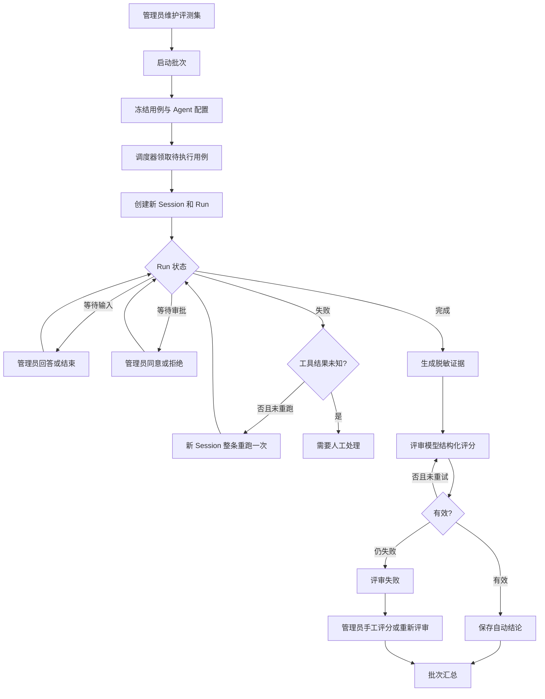

# Agent 整体任务评测系统设计

状态：核心产品规则已确认；数据模型、接口和执行身份为待整体审阅的实施建议。
核对日期：2026-11-11。

本文设计一个仅管理员可用的 Agent 整体任务评测系统。它复用现有 Session、Run、
模型配置、项目知识库和工具执行链路，不把单次评测结果直接写入普通用户会话。

相关设计：

- [Run 设计](run-design.md)
- [Session 设计](session-design.md)
- [LLM 设计](llm-design.md)
- [工具调用设计](tool-execution-design.md)
- [工具调用审批与并发批次设计](tool-approval-design.md)
- [知识检索本地 fixture 评估](knowledge-retrieval-evaluation.md)

现有的知识检索 fixture 评估只验证检索排序，不是本文设计的端到端 Agent 评测。

## 1. 目标与范围

### 1.1 已确认目标

- 首期评测 Agent 完成业务任务的整体表现，包括最终回答、工具选择和工具调用结果。
- 系统只允许管理员使用，前端入口和所有后端接口都执行管理员鉴权。
- 管理员维护可复用的评测集，每个评测集包含多条测试用例。
- 每次启动评测时冻结用例、标准和 Agent 配置的快照。
- 每条用例模拟一次用户任务；Agent 可以在一次 Run 内进行多步工具调用。
- 每条用例使用独立的新 Session，不读取普通用户会话或管理员个人记忆。
- 评测批次在后台执行，管理员关闭页面不会中断；支持断线和取消。
- 支持自动评分、人工复核、人工改判和重新评审。

### 1.2 用例范围

每条用例包含：

- 一段文本任务。
- 至少一条必要标准；全部满足才可通过。
- 零条或多条禁止行为；出现任意一条即不通过。
- 可选的参考答案，用于辅助评分，不要求逐字一致。

首期只支持文本输入和文本评判标准。项目知识库可以作为任务上下文，但不支持给
单条用例直接上传附件，也不支持图片、音频、视频等多模态输入。

### 1.3 首期不包含

- 仅比较模型回答质量、仅评测知识检索或仅评测某个工具的专项评测。
- 模拟用户连续追问的多轮评测。
- 给用例直接上传文件或多模态内容。
- 自动同意需要审批的工具调用。
- 自动生成用户澄清回答。
- 自动切换到其他 Agent 模型或评审模型。
- 跨评测批次复用模型调用结果、工具结果或评分结果。
- 多级审批、组织隔离或普通用户自助评测。

## 2. 已确认产品规则

### 2.1 评测集与快照

- 管理员可以创建、重命名、编辑和归档评测集。
- 评测集可以反复启动，每次生成独立批次。
- 批次启动时复制用例内容、评判标准和参考答案，形成不可变快照。
- 启动后编辑评测集只影响后续批次，不影响运行中或历史批次。
- 历史批次始终展示启动时的内容，不重新读取当前用例定义。

### 2.2 批次配置

管理员启动批次时选择：

- 被测 Agent 的模型配置版本。
- 评审模型配置版本。
- 一个当前管理员可用的项目，或不使用项目上下文。
- 批次并发数。

批次启动时冻结：

- 提示词版本。
- 上下文压缩策略版本。
- 工具目录和工具审批策略。
- 项目关联的知识库范围。
- 所有用例、必要标准、禁止行为和参考答案。

两个模型配置可以相同，也可以不同，但都必须显式选择并固定版本。评测入口不读取
或修改全局默认模型。

模型版本在批次中固定的是“配置身份”，不会绕过全局停用或凭据撤销。批次运行期间
如果管理员停用模型、删除项目或撤销工具来源，受影响的执行应安全失败并记录稳定
错误码，不能静默切换到新配置。

### 2.3 独立执行上下文

- 每次用例执行都创建新的临时 Session。
- 同一用例的重跑也创建新的 Session。
- 评测不读取管理员个人记忆，也不写入管理员个人记忆。
- 选定项目时，可以使用该项目冻结的知识库范围。
- 普通用户的会话列表、Run 列表、消息和工具轨迹不出现评测执行。
- 评测使用自己的管理员接口读取 Run、工具调用和评分结果。

### 2.4 后台执行与并发

- 启动批次立即返回批次编号，调度在后台继续。
- 页面关闭、网络断开或管理员退出登录不会中止已经启动的批次。
- 批次并发数默认 1，可在系统上限内调整，并在启动时冻结。
- 等待输入或等待审批的用例不占用执行名额。
- 调度器可以继续启动其他可执行用例。
- 管理员可以取消整个批次。
- 取消时停止尚未开始的用例，并向正在执行的 Run 请求取消。
- 已完成的执行和评分记录保留。

### 2.5 等待输入与工具审批

Agent 请求补充信息时：

- 用例进入“等待输入”，其他用例继续执行。
- 管理员可以回答问题后继续执行。
- 管理员也可以结束该用例，标记“信息不足”或“执行不完整”。
- 系统不自动生成用户回答，不把等待状态自动判为失败，也不设置自动超时。
- 被管理员回答过的用例标记为“有人工协助”。

工具需要审批时：

- 首期只支持“暂停等待管理员”。
- 用例进入“等待审批”，其他用例继续执行。
- 管理员可以逐条或批量同意、拒绝。
- 决策写入评测操作记录，用例标记为“有人工协助”。
- 首期不提供自动同意或自动拒绝。

### 2.6 中断与重跑

现有 Run Worker 在进程失联后不会原地续跑已经领取的 Run。评测层采用以下规则：

- 批次调度状态可以在服务重启后恢复。
- 没有未知工具结果时，被 `execution_interrupted` 中断的用例自动在新 Session 中整条重跑一次。
- 存在工具执行结果未知时，不自动重跑，用例进入“需要人工处理”。
- 重跑再次中断或失败时，该用例结束为执行失败，批次继续处理其他用例。
- 所有尝试记录保留，最终评分使用最后一次有效执行。

自动重跑的是整条用例，不重放中断 Run 的单个模型轮次或工具批次。

### 2.7 评分与判定

评审模型读取：

- 冻结的任务、必要标准、禁止行为和可选参考答案。
- Agent 的最终回答。
- 经过脱敏和有界截断的工具调用轨迹及结果。

评审模型输出结构化结果：

- 0–100 分。
- 通过、不通过或无法判定。
- 每条必要标准的结论和证据。
- 每条禁止行为的结论和证据。
- 简短理由。

通过规则：

- 所有必要标准都满足。
- 任意禁止行为都没有触发。
- 判定证据充分。

评分与通过状态分别记录。通过不等于必须达到某个分数；分数用于展示整体质量。

评审模型调用失败、超时或结构化结果无效时自动重试一次。仍失败时：

- 用例标记“评审失败”。
- Agent 的完整执行结果保留。
- 批次继续处理其他用例。
- 不切换到其他评审模型。
- 管理员可以手工评分或重新评审。

自动评分完成后立即产生结果，批次可以直接完成，不强制人工复核。管理员可以：

- 将用例标记为“已复核”。
- 修改通过状态、分数和理由。
- 发起重新评审。

自动结论和人工结论分别保存，不能覆盖自动结果。

### 2.8 批次汇总口径

批次展示：

- 总用例数。
- 通过数和不通过数。
- 无法判定、执行失败、评审失败和已取消数量。
- 通过率。
- 有效完成率。
- 有效结果的平均分。
- 有人工协助的数量和比例。

计算规则：

- 通过率 = 通过数 /（通过数 + 不通过数）。
- 有效完成率 = 已得到有效通过或不通过结论的用例数 / 批次全部用例数。
- 执行失败、评审失败、无法判定和已取消不进入通过率分母。
- 平均分只统计最终有效结论中具有有效分数的用例。
- 人工改判生效后使用人工结论；未改判时使用最新一次成功的自动结论。
- 可以切换“包含人工协助”和“排除人工协助”两种汇总视图。

### 2.9 管理员协作与可见性

- 所有管理员共享评测集、批次和结果。
- 所有管理员都可以维护评测集、启动或取消批次、处理等待项和人工改判。
- 记录创建人、最后修改人、操作人和操作时间。
- 普通用户不能访问评测页面、评测 API、底层 Run 或工具轨迹。
- 另一个管理员启动的批次，可以由当前管理员通过评测接口处理等待项；不需要共享浏览器 Cookie。

### 2.10 批次状态

| 状态 | 含义 |
| --- | --- |
| `queued` | 已创建，等待调度 |
| `running` | 有可执行用例正在处理 |
| `waiting_for_admin` | 没有可继续调度的用例，但仍有等待输入或审批的用例 |
| `cancelling` | 正在取消未完成用例 |
| `completed` | 所有用例都已进入终态，包括通过、失败、无法判定、执行失败、评审失败等 |
| `cancelled` | 批次已取消并完成收尾 |

用例失败不会产生单独的批次失败状态。即使全部用例失败，批次仍为 `completed`，
具体质量由汇总结果表达。

## 3. 核心流程



### 3.1 启动批次

1. 校验当前登录会话最终仍是管理员。
2. 校验评测集至少有一条有效用例。
3. 校验 Agent 模型和评审模型已启用且能力满足要求。
4. 校验项目属于批次创建人；未选择项目时使用空上下文。
5. 读取当前提示词、压缩策略、工具目录、审批策略和项目知识库关联。
6. 构造并验证类型化配置快照。
7. 在一个事务中创建批次、用例快照和批次执行身份。
8. 返回 `queued` 批次，由后台调度。

如果快照构造失败，不创建半成品批次。

### 3.2 调度用例

1. 调度器按批次创建时间和用例顺序领取待执行用例。
2. 领取使用数据库条件更新或行锁，防止多个 Worker 重复执行。
3. 创建新 Session，绑定冻结的项目。
4. 提交 Run，显式使用批次冻结的 Agent 模型、压缩策略、提示词和工具快照。
5. 记录 Session、Run 和本次尝试的关联。
6. 等待 Run 进入完成、失败、取消、等待输入或等待审批。
7. 等待状态释放执行名额，调度器可以启动其他用例。

### 3.3 处理人工协助

1. 评测 API 复核当前管理员身份。
2. 通过评测批次找到底层 Run 的原始 owner、Session 和等待项。
3. 使用评测专用接口调用现有 Run 输入回答或工具审批命令。
4. 保持批次执行身份，不把另一个管理员的浏览器登录会话写入 Run。
5. 写入操作者、操作类型、目标 Run/调用和幂等请求 ID。
6. 将用例标记为“有人工协助”。
7. 运行中的 Agent 继续执行。

普通 Run API 仍然按原 owner 隔离。管理员共享能力只通过评测服务开放，不能把普通
Run 的 owner 校验改成“任意管理员都可访问”。

### 3.4 评分

1. Run 完成后，从现有消息和工具调用记录生成有界证据。
2. 对敏感字段和明显秘密值做脱敏。
3. 评审模型生成符合 Pydantic Schema 的结构化结果。
4. 校验必要标准、禁止行为、通过状态、分数和证据完整性。
5. 失败时使用同一冻结评审模型重试一次。
6. 保存本次评审结果并更新用例终态。
7. 调度器重新计算批次汇总。

### 3.5 取消批次

1. 批次原子进入 `cancelling`，不再领取新用例。
2. 对 queued Run 直接取消。
3. 对 running Run 请求取消并等待 Worker 收敛。
4. 对等待输入或审批的 Run 直接取消。
5. 所有用例进入终态后，批次进入 `cancelled`。
6. 已完成评分和人工记录保留。

### 3.6 服务重启恢复

1. 评测 Worker 启动后先恢复 `queued`、`running`、`waiting_for_admin` 和 `cancelling` 批次。
2. 对 `queued` 用例重新进入调度。
3. 对已经有 Run 的用例重新读取 Run 状态，不创建重复 Run。
4. Run 因租约过期变成 `execution_interrupted` 时，按 2.6 节执行重跑规则。
5. 等待输入或审批的 Run 保持等待，管理员处理后再恢复。
6. 通过数据库幂等和状态条件收敛，重复扫描不会产生重复尝试或评分。

## 4. 数据模型建议

本节表名、字段名和枚举值是实施建议。具体迁移在实施时重新读取 Alembic head，并
遵守当前项目 `domain → app → adapter → api` 分层。

### 4.1 类型化 JSON

数据库中的评测标准、配置快照、逐条判定和汇总输入使用 PostgreSQL JSONB。应用层
必须通过明确、冻结、`extra="forbid"` 的 Pydantic 模型读写，不能直接传播无类型
字典：

- `EvaluationCriteria`：必要标准、禁止行为及其稳定 ID。
- `EvaluationConfigSnapshot`：提示词、压缩策略、工具快照、知识库范围和能力版本。
- `EvaluationJudgment`：通过状态、分数、摘要。
- `CriterionAssessment`：单条标准的满足/触发状态、证据和理由。

仓储层使用 `model_validate` 和 `model_dump(mode="json")` 明确转换，服务内部使用
模型属性。历史脏数据或空值的兼容处理必须有单独测试，不能靠 `hasattr` 或宽松
字典访问掩盖问题。

### 4.2 主要表

| 表 | 用途 |
| --- | --- |
| `evaluation_sets` | 评测集名称、说明、归档和操作者信息 |
| `evaluation_cases` | 当前可编辑的用例、标准、参考答案和顺序 |
| `evaluation_batches` | 批次状态、模型、项目、配置快照、并发和汇总 |
| `evaluation_batch_cases` | 启动时冻结的用例快照、当前状态、最终结论和人工协助标记 |
| `evaluation_attempts` | 每个用例的 Session、Run、重跑原因和执行结果 |
| `evaluation_assessments` | 自动评审、重新评审和人工复核的历史结论 |
| `evaluation_actions` | 管理员处理等待项、取消、重跑和改判的审计记录 |

不直接在 `runs` 表增加评测专用字段。通过 `evaluation_attempts.run_id` 建立一对一
关联，使普通 Run 和评测 Run 共用执行链路，但评测生命周期仍由评测模块拥有。

### 4.3 建议枚举

批次状态使用第 2.10 节的六个值。

用例生命周期建议：

```text
queued
running
waiting_for_input
waiting_for_approval
judging
needs_attention
completed
cancelled
```

用例终态结论建议：

```text
passed
failed
undetermined
execution_failed
judgement_failed
```

评审记录来源：

```text
auto
manual
```

用例生命周期和终态结论分开保存。`completed` 表示编排结束，最终是 passed 还是
execution_failed 由结论字段表达。

### 4.4 快照与历史

- `evaluation_batch_cases` 保存任务、标准和参考答案的完整副本。
- 配置快照保存提示词版本、压缩策略 ID、工具定义和审批标志、知识库 ID 列表。
- 模型使用不可变 `llm_model_profile_versions.id`。
- 每次重跑增加 `evaluation_attempts`，不覆盖旧尝试。
- 每次自动评审、重新评审和人工改判增加 `evaluation_assessments`。
- 最终展示使用最新有效人工结论；没有人工结论时使用最新成功自动结论。

### 4.5 事务边界

- 批次和全部用例快照在同一事务创建。
- 用例领取、Session/Run 关联和 attempt 创建需要幂等，防止重复调度。
- 工具审批和输入回答必须使用现有 Run 请求幂等账本。
- 评测审计记录使用相同请求 ID，重复提交返回已有结果。
- 完成评分和更新用例终态在同一事务提交。
- 批次汇总更新在批次行锁内重新计算，避免并发 Worker 覆盖计数。

## 5. 执行身份与权限建议

### 5.1 管理员 API 权限

所有评测接口挂载在 `/api/v1/admin/evaluations` 下，并使用：

- `AdminAuth` 做依赖层预检查。
- `verify_request_origin` 校验浏览器写请求。
- 服务层通过 `CurrentSessionReader.get_current_session_user` 再次读取当前角色。
- `Cache-Control: no-store` 避免浏览器或代理缓存结果和工具轨迹。

依赖层检查不能替代事务或服务层的最终授权。

### 5.2 后台执行身份

现有 Run 和 MCP 工具执行要求 `auth_session_id` 属于 Run owner。浏览器登录会话可能
过期，也会因为管理员退出而中断后台批次，因此不能把启动批次的浏览器 Cookie
会话直接用于长批次。

建议批次启动时为创建人建立服务端执行会话：

- 只保存现有 `auth_sessions` 支持的 token hash，不把原始凭据返回浏览器。
- 批次只保存服务端会话 ID。
- 该会话仅用于该批次的 Run、项目知识和 MCP 权限复核。
- 批次完成或取消后撤销。
- 创建人停用、项目删除或权限撤销后，后续执行安全失败。
- 评测工具目录排除 `memory_search`，保证不读取个人记忆。

该方案复用了现有 Session、Run 和 MCP 鉴权，但需要新增按 session ID 撤销服务端
会话的能力。若整体审阅后不接受服务端执行会话，应先解决长批次在管理员登出、
Cookie 轮换和服务重启后的执行权来源，再开始实现。

### 5.3 项目上下文

- 启动批次时只列出当前管理员自己可用的项目。
- 批次保存创建人、项目 owner 和项目 ID。
- 其他管理员可以通过评测 API 查看和处理该批次，但不能通过普通项目 API 越权访问。
- 项目被删除或知识库关联变化时，冻结范围不可用时安全失败。
- 知识库 ID 白名单必须由评测执行上下文强制，不能只依赖批次 JSON 展示。

## 6. 与现有代码的落点

当前工作树没有评测集、批次或评分实体。以下为只读核对结果。

| 现有位置 | 当前行为 | 评测系统所需变化 |
| --- | --- | --- |
| `backend/src/api/security.py` | 已有 `AdminAuth` 和最终复核约定 | 新增评测路由复用管理员依赖，不另造角色体系 |
| `backend/src/main.py`、`backend/src/bootstrap/api.py` | API 路由和依赖集中组装 | 注入评测管理、查询和人工操作服务 |
| `backend/src/domain/session/model/entity.py` | Session 绑定 owner 和可选项目 | 每条评测尝试创建新 Session |
| `backend/src/adapter/session/model/session.py` | 每个 Session 按 owner 可见 | 评测 Session 不出现在普通用户列表 |
| `backend/src/domain/run/model/entities.py` | Run 已有 queued/running/输入/审批/终态 | 通过 attempt 映射复用，不复制 Run 状态机 |
| `backend/src/adapter/run/repository/run.py` | 普通提交自动选择全局默认模型；每 Session 一个活跃 Run | 增加仅内部可用的显式模型、压缩策略和工具快照提交能力 |
| `backend/src/app/run/executor.py` | 已支持复用 `run.tool_snapshot` | 在创建评测 Run 时预置批次工具快照，避免首次执行读取新配置 |
| `backend/src/app/run/worker.py` | 轮询 queued Run，失租后把运行中 Run 安全失败 | 评测调度器读取失败原因并执行有界整条重跑 |
| `backend/src/domain/llm/model/profile.py` | 模型版本不可变，已声明流式、工具和并行工具能力 | 增加结构化输出能力，评审模型选择时校验 |
| `backend/src/adapter/llm/openai_chat_completions.py` | 当前 Run 适配器支持流式和普通文本，不提供结构化评审入口 | 增加 JSON Schema 结构化输出和一次重试的评测调用 |
| `backend/src/domain/tool/model/runtime.py` | 工具快照已包含 `requires_approval` | 批次冻结并复制到每个评测 Run |
| `backend/src/app/tool/runtime.py` | 记忆工具按部署开关加入；知识查询每次读取当前项目关联 | 评测快照排除记忆工具，并强制冻结知识库 ID 白名单 |
| `backend/src/app/tool/manager.py` | MCP 审批策略只允许管理员修改 | 评测复用冻结策略，不修改全局策略 |
| `backend/src/run_worker.py`、`backend/src/bootstrap/run_worker.py` | 独立进程组装并执行 Run | 新增评测 Worker 入口或同一 Worker 进程中的独立评测调度循环 |
| `frontend/src/app/AppRoutes.tsx`、`AppShell.tsx` | `/admin` 已受 `AdminRoute` 保护，管理导航集中在侧栏 | 新增“评测中心”导航和三个评测页面 |
| `frontend/src/features/admin/api.ts`、`hooks.ts` | 已有管理员 API、React Query 和身份边界处理 | 新增评测 API、查询键、轮询和写操作 |
| `backend/migrations/versions/20261115_0016_llm_profile_encrypted_keys.py` | 当前可见迁移链尾为 0016 | 实施时重新核对 head，再创建新迁移 |

### 6.1 后端模块建议

```text
backend/src/domain/evaluation/
backend/src/app/evaluation/
backend/src/adapter/evaluation/
backend/src/api/evaluation.py
backend/src/api/dto/evaluation.py
backend/src/api/converter/evaluation.py
backend/src/bootstrap/evaluation_worker.py
backend/src/evaluation_worker.py
```

- `domain/evaluation` 保存实体、枚举、错误和仓储/执行端口。
- `app/evaluation` 负责评测集规则、批次状态机、调度决策和评分规则。
- `adapter/evaluation` 保存 SQLAlchemy model、repository 和 converter。
- `api/evaluation.py` 只处理 HTTP 权限、输入和错误映射。
- 评测 Worker 使用数据库轮询，不新增消息队列或工作流引擎。

评测服务通过现有 `SessionService`、`RunService` 和 Run 查询端口执行 Agent 任务；
不应复制 Run 状态机，也不应让前端直接调用普通 Session/Run API 完成评测。

### 6.2 API 建议

以下端点均为实施建议：

```text
GET    /api/v1/admin/evaluations/sets
POST   /api/v1/admin/evaluations/sets
GET    /api/v1/admin/evaluations/sets/{set_id}
PATCH  /api/v1/admin/evaluations/sets/{set_id}
POST   /api/v1/admin/evaluations/sets/{set_id}/archive
POST   /api/v1/admin/evaluations/sets/{set_id}/cases
PATCH  /api/v1/admin/evaluations/sets/{set_id}/cases/{case_id}
DELETE /api/v1/admin/evaluations/sets/{set_id}/cases/{case_id}

GET    /api/v1/admin/evaluations/batches
POST   /api/v1/admin/evaluations/batches
GET    /api/v1/admin/evaluations/batches/{batch_id}
POST   /api/v1/admin/evaluations/batches/{batch_id}/cancel
GET    /api/v1/admin/evaluations/batches/{batch_id}/cases
GET    /api/v1/admin/evaluations/batches/{batch_id}/cases/{case_id}
POST   /api/v1/admin/evaluations/batches/{batch_id}/cases/{case_id}/input
POST   /api/v1/admin/evaluations/batches/{batch_id}/cases/{case_id}/approval
POST   /api/v1/admin/evaluations/batches/{batch_id}/cases/{case_id}/review
POST   /api/v1/admin/evaluations/batches/{batch_id}/cases/{case_id}/rejudge
```

所有写请求使用请求 ID 或等价幂等键。列表使用游标或明确分页，工具轨迹按需加载，
不在批次列表返回大段证据。

### 6.3 前端页面建议

新增管理导航“评测中心”，路由：

```text
/admin/evaluations
/admin/evaluations/sets/:setId
/admin/evaluations/batches/new
/admin/evaluations/batches/:batchId
```

页面职责：

- 评测中心：评测集和最近批次列表，展示待处理数量。
- 评测集编辑：用例、必要标准、禁止行为、参考答案和排序。
- 启动批次：选择评测集、Agent 模型、评审模型、项目、并发数，展示冻结摘要。
- 批次详情：总体状态、汇总、用例列表、等待项、取消和人工复核入口。
- 用例详情：任务、标准、最终回答、脱敏工具轨迹、自动结论和人工结论。

运行中的批次使用有界轮询更新进度，首期不要求新增评测 SSE。页面失去焦点或断线
不会影响后台执行。

## 7. 验收条件

### 7.1 权限与隔离

- 普通用户访问任意评测路由或 API 都得到管理员禁止结果。
- 普通用户的 Session、Run、消息和工具列表中不出现评测执行。
- 两个管理员可以查看同一评测集和批次，并分别处理等待项。
- 每次人工操作都记录当前操作者。
- 评测 Run 不暴露 `memory_search`，不读取或写入管理员个人记忆。

### 7.2 快照与配置

- 修改评测集后，历史批次仍显示旧任务和旧标准。
- 修改全局工具审批策略、项目知识库或压缩策略后，已启动批次继续使用启动快照。
- 模型停用或依赖被删除时安全失败，不切换模型。
- 每条用例和每次重跑都使用新的 Session。
- 批次显式选择的 Agent 模型和评审模型生效，不读取全局默认模型。

### 7.3 执行与恢复

- 页面关闭后批次继续执行。
- 默认并发为 1；提高并发后同时在执行的用例不超过配置值。
- 等待输入或审批的用例不占用执行名额。
- 取消批次后不再启动新用例，活跃 Run 被请求取消，已完成结果保留。
- 服务重启后，queued 用例继续调度，已有 Run 不被重复创建。
- 无未知工具结果的中断用例只自动重跑一次。
- 有未知工具结果的用例进入需要人工处理，不自动重跑。

### 7.4 人工协助

- Agent 请求输入时，其他用例继续执行，批次在无其他可执行任务时进入 `waiting_for_admin`。
- 管理员回答后，同一 Run 继续执行，用例标记有人工协助。
- 工具审批支持同意和拒绝，决策进入评测审计记录。
- 首期不存在自动同意或自动拒绝。

### 7.5 评分与汇总

- 所有必要标准满足且无禁止行为时通过。
- 任意禁止行为触发时不通过。
- 证据不足时无法判定，不默认通过。
- 评审失败自动重试一次，仍失败时批次继续。
- 自动结论和人工结论分别保留。
- 通过率、有效完成率、平均分和各类失败数符合第 2.8 节口径。
- 包含和排除人工协助的汇总均可验证。

### 7.6 输入边界

- 空任务、空白标准、超长输入和非法标准结构被拒绝。
- 不支持单用例附件、多模态内容或自动追问。
- 工具证据有大小上限，敏感字段脱敏。
- 所有管理员写接口校验同源请求，不缓存敏感响应。

## 8. 分阶段实施建议

### S1：领域模型、持久化与迁移

- 新增评测实体、类型化 JSON、PostgreSQL model、repository 和 Alembic 迁移。
- 覆盖快照往返、约束、历史读取和幂等。

### S2：评测集与批次 API

- 新增管理员评测集、用例、批次创建、列表和详情接口。
- 完成最终管理员复核、输入校验、项目选择和启动快照。

### S3：调度与 Run 集成

- 新增评测 Worker。
- 实现用例领取、Session/Run 创建、并发名额、等待项、取消、重启恢复和中断重跑。
- 增加显式模型、压缩策略和工具快照的内部提交路径。

### S4：评审与人工复核

- 增加评审模型结构化输出能力。
- 实现证据脱敏、自动重试、判定校验、人工改判、重新评审和汇总。

### S5：前端管理页面

- 增加评测导航、评测集编辑、批次启动、进度和结果页面。
- 覆盖管理员守卫、轮询、等待项处理和人工复核。

### S6：恢复、并发与端到端验证

- 执行 PostgreSQL 并发与迁移测试。
- 覆盖多 Worker 不重复领取、审批竞争、取消竞争和服务重启恢复。
- 使用可控测试模型验证通过、不通过、无法判定和评审失败。
- 使用真实配置进行受限的端到端验收。

## 9. 待整体确认的实施细节

产品规则已经可以支撑实现，但以下实施细节仍需在编码前随整体方案一起确认：

1. 是否接受“批次创建人的服务端执行会话”作为后台执行身份，以及批次终态时撤销。
2. 模型配置是否新增 `supports_structured_output` 能力字段；评审模型选择时是否强制要求该能力。
3. 冻结知识库范围在 Run/工具快照中的具体表示，以及项目知识库被删除时的稳定错误码。
4. “未知工具结果”用例进入需要人工处理后，管理员可执行的动作是否只包含“结束为执行失败”和“确认后重跑”。
5. 评测集归档、已完成批次保留和最终数据清理策略。当前方案默认历史批次不因评测集归档而删除。
6. 批次并发上限、文本长度、证据大小和轮询间隔的具体配置值。
7. 评测 Worker 是新增独立进程，还是与现有 Run Worker 进程共同启动独立调度循环。

在这些问题确认前，不应开始代码实施。实施必须遵守仓库的多 Agent 工作流：
Root 完成方案确认后交给 Implementer，随后由独立 Reviewer 审查实际 Diff，Root
最终验收。
