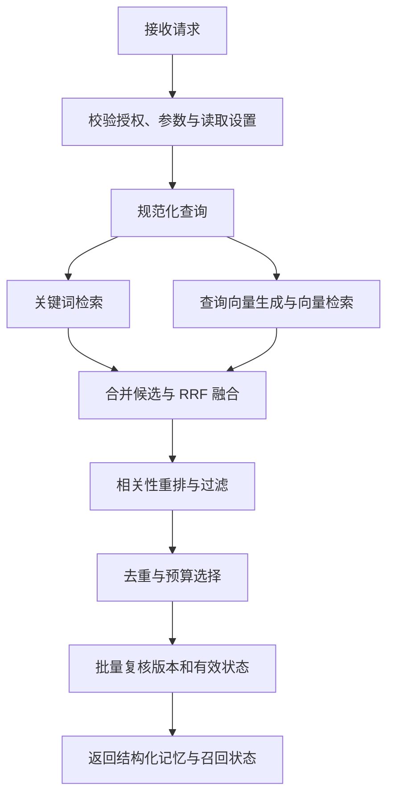

# 记忆功能设计（产品决策与模块解耦边界）

历史核心设计。当前生命周期以 [记忆全生命周期设计](memory-lifecycle-design.md) 为准；
其中人工候选确认、自动提取接入与删除规则已由新方案更新。

本文件描述已确认的产品决策和模块边界，不代表代码已实现或授权实施。
本次修订只修改设计文档；已有实施草稿需在后续明确授权后重新核对。

## 1. 目标与边界

让 Athena 在新会话中记住用户的稳定偏好、明确事实和项目约定，并允许用户
查看、纠正和删除。每条记忆必须能解释“记了什么、属于哪里、来自哪里”。

| 数据 | 职责 | 示例 |
| --- | --- | --- |
| 会话消息 | 保留原始对话 | 用户完整描述一次需求 |
| 长期记忆 | 跨会话复用精炼信息 | 用户偏好中文；某项目使用 PostgreSQL |
| 会话摘要 | 在同一会话中压缩历史 | 当前任务进展、未完成事项 |
| 知识库 | 保存可检索的资料 | 产品手册、上传文档 |
| 执行状态 | 恢复正在执行的任务 | 工具是否已执行、等待哪项审批 |

本轮只设计长期记忆。会话摘要、知识库、任务恢复分别设计；不从记忆推断任务
执行状态，也不把全部消息、工具输出或文件全文自动复制成长期记忆。

## 2. 用户行为

- “记住，我希望你用中文回答”：保存个人记忆，明确反馈保存结果。
- “这个项目统一使用 Python 3.12”：可提取项目记忆候选，经用户确认后保存。
- “刚才的 Python 版本改为 3.13”：定位已有项目记忆，显示修订后的内容。
- “忘记我的语言偏好”：匹配明确时删除；匹配多条时先展示待选项。
- 在记忆管理页直接新增、编辑、删除，无须经过模型。
- 可分别关闭记忆读取和自动提取；关闭不会删除已有记忆。

自然语言中的明确保存、纠正和删除，仍需由后续 Run 的结构化意图处理接入。
引用、假设、转述和外部工具内容不能作为用户授权，例如阅读一篇含“记住”
字样的文章不应触发保存。无法明确目标内容或范围时请求澄清。

## 3. 范围与权限

首版只有两个范围：

| 范围 | 可使用的位置 | 适合内容 |
| --- | --- | --- |
| personal | 当前用户的所有会话 | 语言、格式偏好、用户明确提供的稳定事实 |
| project | 当前用户绑定该项目的会话 | 项目技术选择、业务规则、已确认决策 |

没有项目绑定的 Session 只读取个人记忆；绑定项目的 Session 可读取个人记忆
和本项目记忆。禁止读取其他项目或其他用户的记忆。项目内信息不得自动提升为
个人记忆；用户显式改变范围时，按一次有权限校验的修改处理。

### 3.1 同一应用内的模块解耦

记忆是 Athena v2 模块化单体内的业务模块，随现有后端一起部署、启动和升级，
共用现有数据库、连接池、迁移链、配置体系和应用生命周期。不要求独立进程、
独立数据库或独立运行入口，也不以能够抽成独立服务作为验收目标。

解耦重点是：add/recall 不依赖其他模块的业务实体、ORM、私有函数或 Run 执行
状态；跨模块协作可以使用稳定的公共应用接口。共享认证上下文、基础类型及
基础设施允许复用，不为了“完全零依赖”再造一套配置、鉴权或资源管理。
事务与外键按实际数据一致性需求设计，不以禁止所有共享作为原则；本版记忆
写入仍只操作记忆表，不把聊天/项目状态塞入召回算法。

- 调用方负责认证、项目权限、Session 绑定解析、消息读取、候选提取和上下文装配。
- 核心只接收可信访问上下文、正文和通用来源引用，负责保存、召回、修订及删除。
- personal/project 是产品侧语义；核心使用不透明的 `namespace_id` 和 `scope_key`。
  调用方将用户映射为 namespace，将个人/项目映射为不同 scope；核心不解析其中的项目 ID。
- 服务端协调层构造可信上下文：namespace、允许读取的 scopes、允许写入的 scopes。
  核心对每次读写检查该上下文，不接受模型或客户端自行声明的授权范围。
- 来源是通用引用，由调用方验证后提交；读取原始来源时仍由调用方解析并检查权限。
  记忆模块不提供绕过来源权限的浏览能力。
- 自动提取及自然语言意图属于集成流程，通过内部新增接口提交候选或明确保存项。

## 4. 写入规则

### 4.1 明确保存与自动提取

读取默认启用，自动提取默认开启。开启自动提取后：

1. 在一轮最终 assistant 消息完成后，分析本轮已完成的 conversation 消息。
2. 提取可跨会话复用的候选，关联具体来源消息。
3. 候选进入待确认区，不进入召回；用户确认后才成为有效记忆。

用户明确要求记住或在管理页填写的内容可直接保存。未开启自动提取不影响
用户主动保存。保存失败时不得声称“已记住”。首版不回扫历史会话。

调用方提取时使用 conversation_messages，不读取 execution_messages；核心不读取这两种消息表。用户事实必须
来自用户消息，assistant 的猜测、承诺和未经用户认可的结论不作为事实。
项目决定需要用户明确确认；自动提取默认不保存凭据、身份号码、健康等敏感信息。
密码、token 和私钥即便被要求记住，也引导到专门的凭据存储。

### 4.2 内容与冲突

一条记忆表达一个可独立修改的事实或偏好，保留限定条件。例如“本项目的
集成测试可以创建和删除临时 schema”，不能压缩成“可以删除数据库”。

- 同范围、规范化文本完全相同：复用已有记录，可追加来源。
- 语义近似：提示可能重复，不凭模型相似判断静默覆盖。
- 明确纠正：更新目标记忆，增加版本号。
- 可能冲突但纠正意图不明确：保留待确认候选，展示冲突项。
- 两条有效记忆冲突且不能确定适用条件：不同时作为确定事实注入，交用户确认。

当前用户明确指示优先于历史记忆；项目内具体约定优先于适用于同一事项的
一般个人偏好。记忆不能授予工具权限、免除审批或覆盖系统规则。

### 4.3 首版一致性规则

新增携带调用方生成的 request_id，memories 对 (namespace_id, request_id) 建立
唯一约束，并保存 request_hash；同请求重试返回原记录，不同内容复用ID报冲突。
删除后保留无正文墓碑及请求标识，避免重试重建。不新增通用操作流水表。

修改、确认和删除使用 expected_version，条件更新失败返回版本冲突。正文与
向量同步原子更新，使用一个 version 即可；删除或并发修改后不自动转为新增。
不预先设计清除代次、scope关闭状态、来源禁用或后台任务恢复协议。自动提取
接入时再根据真实并发流程补齐，届时单独验收，当前不承诺拦截尚不存在的任务。

## 5. 混合召回设计

首版召回包含关键词检索、向量检索、RRF 融合、相关性重排、预算控制及最终
状态复核。核心通过 recall 独立验收，不依赖 Run；调用方负责查询构造与结果装配。
以下候选数、预算、权重是待评测初值，模型沿用第 5.10 节参考选择，阈值仍需校准。



### 5.1 调用契约

RecallRequest：

- access_context：可信 namespace 和允许读取的 scopes，由服务端构造。
- scopes：本次范围，必须全部获得授权；空列表返回空，越权返回
  ScopeNotAllowed，不泄露范围是否存在。
- query：去除首尾空白后 1–2000 字符；不合法返回 InvalidRecallRequest。
- limit：默认 8，范围 1–50。
- token_budget：默认 1200，范围 1–8000；正文、范围及来源引用按稳定格式计数，
  TokenCounter 可注入，其版本记录在结果中。调用方另预留上下文包装预算。
- scope_priority：仅排列本次授权范围，在相关性相同时使用；其余范围按键排序。

调用方可在每轮开始或子任务开始时调用。指代不明时，调用方结合对话构造完整
查询；核心不读取聊天，不调用 LLM 改写查询，不新增模型可见记忆工具。
通用偏好并不保证在任意问题下召回；每轮固定加载偏好属于另行设计的能力。

RecallResult：

- status：ok / degraded / disabled / unavailable。
- hits：memory_id、version、scope_key、content、sources、matched_channels、
  fusion_score、relevance_score（重排成功时，否则为空）。
- used_tokens、truncated、retrieval_version、token_counter_version。
- degradation_reasons：通道或重排失败的稳定原因码。
- error_code：整体不可用时的稳定错误码，不返回连接信息和原始异常。

ok + 空 hits 表示正常无命中；degraded + 空 hits 表示降级检索未找到可接纳结果。
评分表示相关性，不代表事实正确性或概率。truncated 表示相关候选因条数或预算
被排除；候选池本身的截断在执行指标中记录，不混为数据库错误。

### 5.2 入口检查与统一过滤

先校验请求和授权，读取开关关闭返回 disabled。请求范围为空时
正常返回空，不扩大范围。一次请求使用统一 UTC 时间和检索配置快照。

两个通道的搜索条件均包含：namespace 匹配、scope 属于授权查询范围、
status=active、未删除、未过期。必须在通道取 Top-K 前落实过滤，不能在全库
取候选后才过滤租户或范围。pending 不参与任何通道召回。

### 5.3 关键词检索

1. 查询和正文采用 Unicode NFKC、英文 casefold、空白整理。
2. 中文分词，保留英文专名、数字和版本号；不删除否定及权限限定词。
3. 通过 PostgreSQL 全文检索索引生成候选，按词项相关性排序，完整短语命中
   可额外加分；不要求全部查询词同时出现。
4. 在授权和有效状态范围内取前 40 条，记录 memory_id、version、通道分数
   和通道名次；同分按 ID 保持稳定顺序。

全文索引是正文的派生字段，与正文在同一事务更新。中文分词及索引采用第 5.10 节方案，
短语加分及最低接纳阈值需通过真实中文样例定稿，不再采用双字子串作为最终方案。
关键词通道用于专有名词、版本号及明确文字匹配；零命中不视为通道故障。

### 5.4 向量检索

1. 使用当前 embedding_profile 生成查询向量；该 profile 定义模型、维度、
   预处理版本及距离度量。查询与正文必须采用同一 profile。
2. 在 memories 表中搜索 embedding 非空、profile 匹配的记录，同时应用统一过滤。
3. 按配置的向量距离排序，取前 40 条，记录距离、名次及version。

一条记忆一个向量，不切片。写入时同步生成，详见第 6 节。先采用 PostgreSQL + pgvector 精确搜索建立正确性
基线；只有数据量和延迟需要时才增加近似索引，并单独验证过滤后的召回率。
索引选择不能改变授权规则或用全库 Top-K 后过滤替代范围内搜索。
查询 Embedding 调用与关键词搜索并行，采用独立超时，共享本次总截止时间。
具体超时在部署配置中确定，不能无界等待或无限重试。

### 5.5 候选合并与 RRF 融合

按 memory_id 合并两个通道的候选。只接受相同version，版本不同的候选通过
事实表复核后丢弃旧版本；不能把旧正文的分数赋给新正文。

使用基于名次的 RRF：

```text
fusion_score = w_keyword / (k + rank_keyword)
             + w_vector  / (k + rank_vector)
```

名次从 1 开始，未命中某通道则该项为 0。初始关键词权重 0.25、向量权重 0.75、k=60，融合
后保留前 50 条进入重排；同分按 scope_priority、更新时间降序和 ID 排序。
不直接相加关键词分数与向量相似度，也不要求两个通道都命中。

### 5.6 相关性重排

通过核心自己的 RerankerPort，将 query 与至多 50 条候选正文交给专用相关性
重排器。只发送已授权且通过有效性检查的内容，不携带来源原文或凭据。
模型服务及其数据处理配置属于部署选型；核心不依赖 Run 或其他领域模型类型。

按重排分数降序，并剔除低于接纳阈值的条目。阈值随重排模型版本配置，由中文
评测确定，不能将任意固定数值解释为普遍相关标准。相同相关性时才使用范围
优先顺序、更新时间和 ID。分数不替代事实核实或冲突解决。

不通过重排猜测哪条冲突记忆为真；冲突优先在写入/确认阶段解决，已知冲突
不能同时作为确定事实注入，调用方根据返回范围和来源请求澄清。

### 5.7 去重、预算与交付复核

- 同 ID 合并；同范围规范化正文相同的候选可合并来源并保留最新记录。
  不同范围保留适用条件，不按语义相似直接删除不同事实或版本。
- 按排序依次放入完整条目，超过剩余预算则跳过并继续检查后续条目。不截断
  正文以免丢失否定或条件。最终计数包含合并后的来源引用，不能无限加载来源。
- 没有完整条目能放入时返回空 hits，并置 truncated=true；不以无关内容补齐。
- 返回前批量复核版本、active 状态、过期、删除和读取开关。
  复核过期使用复核时的当前时间。修改后的候选丢弃，不使用旧正文或旧评分。
- 首版允许因并发变化少返回，不循环补召回；读取关闭返回 disabled，复核
  失败则不交付未经验证的候选。最终复核时刻为结果可见性边界。

调用方将结果标为历史资料，当前用户指示优先；来源访问由调用方验证。已经
交付或发送给模型的内容无法撤回，后续模型调用前重新召回，不长期缓存旧结果。
首版不缓存召回结果。指标记录各通道耗时、候选数、所选 ID/版本、预算、模型
与算法版本及降级原因，默认不记录查询或正文。

### 5.8 失败与降级

| 情况 | 处理 |
| --- | --- |
| 两通道及重排均成功 | ok，正常融合、过滤与返回 |
| 查询 Embedding 或向量搜索失败 | 使用关键词结果，degraded |
| 关键词搜索失败 | 使用向量结果，degraded |
| 重排失败 | 回退融合顺序，degraded |
| 两个检索通道均失败 | unavailable，不返回候选 |
| 最终权限/状态复核失败 | unavailable，不返回未经验证内容 |
| 正常零命中 | ok + 空 hits |

单通道降级后仍可重排。重排失败时，RRF 分数不能充当相关性阈值；必须使用
随各通道模型/配置版本评测过的最低接纳规则筛选，再按融合名次返回。规则未
配置时返回空的 degraded 结果。已启动的外部调用不得因超时无界重试，结束时
取消并回收未完成任务，不因某一通道失败主动取消仍有机会完成的另一通道。

### 5.9 验收与待选型项

- 核心用例使用替身端口即可单测，不依赖先执行项目/会话/Run流程；集成测试沿用应用迁移。
- 专名、版本号由关键词通道命中；中文同义改写可由向量通道命中。
- 单通道命中仍能入选，两通道共同命中按 RRF 融合；固定评分的样例排序稳定。
- 零相关问题返回空，不拿 Top-K 当相关；scope 优先级不能压过相关性。
- 越权报错，空范围不扩大；pending、删除、过期均不返回。
- 条数及 token 不超限，完整条目放不下不截断；并发修订不返回旧正文。
- 查询向量与正文模型或版本不匹配时不检索；写入成功后关键词与向量均可使用，向量失败时整笔写入回滚。
- 各通道及重排分别注入故障，验证状态、降级结果和最终复核失败时拒绝交付。
- 固定中文集评估 Recall@K、排序质量、无关误召回、隔离、P95 延迟及预算，
  用于确定候选数、阈值和权重；不以某个通道“有结果”代替端到端效果验收。

### 5.10 参考 Athena 收敛技术选择

以下依据 Athena 源码的默认配置和实现，不读取或复制 .env 中的部署凭据：

| 项目 | v2 采用的方案 | Athena 参考位置 |
| --- | --- | --- |
| 中文全文检索 | zhparser + chinese 配置，OR 词项查询，ts_rank_cd 排序，GIN 索引 | infrastructure/persistence/postgres/engine.py；repositories/memory_repository.py |
| Embedding | sentence_transformers，BAAI/bge-m3，1024 维，默认 CPU | configuration/settings.py；infrastructure/integrations/llm/embedding_provider.py |
| 向量距离 | pgvector cosine_distance；通道相似度定义为 1-distance | infrastructure/integrations/pgvector/indexers.py |
| 重排 | BAAI/bge-reranker-v2-m3，经独立 RerankerPort 接入，本地有界推理 | infrastructure/integrations/reranking/cross_encoder.py |
| RRF | k=60；初始关键词权重 0.25、向量权重 0.75 | configuration/settings.py |
| 向量通道最低接纳值 | cosine 相似度 0.70 作为初始值，进入融合前过滤 | application/memory/retrieval_service.py |
| 总检索截止时间 | 60 秒作为可配置初值，各通道独立超时不得超过剩余总预算 | configuration/settings.py |

每通道 40 条、融合重排 50 条、返回 8 条/1200 tokens 沿用本设计初值，不照搬
Athena 的候选及上下文配额；需通过 v2 中文样例评估调整。
Athena 的 file_rerank_min_score=0.5 用于文件链路，不能直接视为记忆重排的
标准阈值；记忆的重排阈值及关键词降级最低接纳规则仍需校准。
TokenCounter 及写入/推理具体超时也需要在实施方案中定稿。

Athena 的 commit_fact_revision 接收事务外已生成的 embedding，再原子提交事实
及向量；v2 采用相同原子写入边界：事务外同步生成，事务内校验并写入。参考既有技术选择，
不引入 Athena 的项目、Session、租约或 Run 依赖。

待校准项属于配置和验收：中文分词行为（否定词、英文及版本号）、重排接纳
阈值、TokenCounter、写入与通道超时、规模对应的索引策略。首版不包含查询
改写 Agent、图检索、多模型并存或新旧模型无中断切换。

## 6. 首版数据模型

先保留三张表，不为未来流程提前增加状态表。与现有应用共用数据库和迁移。

### memories

```text
id, namespace_id, scope_key
content                    1–2000字符，墓碑为空
status                     pending / active
origin                     manual / explicit / extracted
version                    并发修改版本
search_document            正文派生全文字段
embedding                  vector(1024)，与正文一起写入
embedding_profile_id       模型/预处理配置标识
request_id, request_hash   新增去重，不保存正文副本
expires_at
created_at, updated_at, deleted_time
```

仅使用一个version，不再保存content_version或embedding_content_version。
因为正文与向量同步原子更新，不存在异步索引追赶的版本问题。非正文修改只
更新version，不重算向量。索引先建范围列表索引、全文GIN及新增请求唯一约束，
向量先用精确搜索，不预建近似索引。

### memory_sources

```text
memory_id, source_kind, source_ref
```

保留独立来源表只为支持一条记忆多个来源及来源追溯。引用只指向记忆自有表，
不复制原文；原始来源的查看权限由调用方校验。手工记忆可以没有来源。
同一记忆内来源去重，正文修改时替换或清除已不适用的来源。

### memory_settings

```text
namespace_id
read_enabled               默认true
auto_extract_enabled      默认true
```

设置缺失时使用默认值，不用该表构建通用租户锁或清除代次机制。如果应用已
提供合适的用户设置存储，可复用，不为记忆重复建设置体系。

### 同步生成与原子写入

1. 读取当前记录和version，校验输入、范围及新增request_id后释放连接。
2. 在事务外同步生成向量并校验维度、有限数和非零；失败不写入。
3. 在写事务中复核目标version、删除状态和设置，处理新增请求唯一键竞争。
4. 正文、向量、全文字段和来源一起提交；修改冲突返回错误，不覆盖或重建。

pending也同步生成向量，确认时可复用。模型应用启动预热，推理期间不持有
事务和行锁。删除事务清空正文、向量、全文及来源，仅保留无正文墓碑。提交
响应不确定时以同一request_id查询，不直接断言未写入。

使用固定Embedding配置，模型变更按实际需要安排维护，不预建多模型版本
切换、异步索引、任务队列或自动重建框架。

## 7. 删除与集成边界

- 删除记忆或拒绝候选：清空内容及向量，保留墓碑；该记录的新增重试不恢复正文。
- 删除聊天保留已确认记忆，来源不能绕过聊天权限；未确认候选可由调用方清理。
- 删除项目清除项目记忆的产品规则保留，具体接入随项目删除用例实施，不引入
  scope关闭表、删除工作流状态机或通用协调进度表。
- 当前先提供按范围删除的管理方法；HTTP及删除联动接入时，利用同一应用的
  公共接口和必要事务保证一致性。接入前不能声称已满足并发项目删除验收。

不支持后台任务的恢复与清除竞争保证，相关机制等自动提取实际接入时设计。
记忆删除不等于删除聊天或备份；日志默认不复制查询与记忆正文。

## 8. 接口与模块

### 8.1 对内应用接口

以下是服务调用契约，不是模型工具或 HTTP 接口：

```text
recall(request: RecallRequest) -> RecallResult
remember/correct/forget(ControlCommand) -> ControlReceiptResult
```

| 契约 | 字段与行为 |
| --- | --- |
| RecallRequest | 可信访问上下文、选定 scopes、query、limit、token_budget、scope 优先顺序 |
| RecallResult | hits（ID、正文、版本、scope、来源、相关度），以及 ok/degraded/disabled/unavailable 状态（完整字段见第 5 节） |
| ControlCommand | 固定 Run/tool call、直接用户证据、目标版本和事务外已准备向量 |
| ControlReceiptResult | operation、memory_id、superseded_memory_id、generation；不返回正文 |

recall 只搜索请求中已授权的 scopes，不允许扩大访问范围；非法或越权 scope 返回
明确领域错误。正常无命中为 ok + 空 hits，不能与检索失败混淆。
同步写入口只接受当前 Run 中唯一匹配的直接用户证据；参数、业务变更和幂等回执在
同一事务提交。异步提取使用独立批次决策并复用同一写入核心与来源写入路径。
参数无效、未授权、版本冲突、幂等冲突、存储不可用采用明确领域错误。

核心提供edit/confirm/delete/list/settings及按范围删除的管理方法，使用同一
范围授权规则。首版不提供close_scope、invalidate_source或任务协调接口。
调用方负责将结果装配进模型上下文，核心不依赖Run状态。

### 8.2 用户侧 HTTP 适配

以下接口属于外部集成层，负责 Cookie/Origin、项目权限和范围映射，不属于核心：

```text
GET    /api/v1/memories                 按范围、状态分页，默认 active
POST   /api/v1/memories                 手工新增
GET    /api/v1/memories/{id}
PATCH  /api/v1/memories/{id}             修改正文、范围或过期时间，携带版本
POST   /api/v1/memories/{id}/confirm     确认候选，携带版本
DELETE /api/v1/memories/{id}             忘记或拒绝候选，携带版本
POST   /api/v1/memories/clear            清除全部，显式确认范围
GET    /api/v1/memory-settings
PATCH  /api/v1/memory-settings
```

跨 owner 或不可见资源统一返回 404；写接口沿用 Cookie 认证及 Origin 校验。
不接受 owner_id。公开响应不返回 owner、检索内部评分或执行消息。

核心模块沿用现有结构：domain/memory/{model,ports.py}、app/memory、
adapter/memory/{model,converter,repository}、api/memories.py、API DTO 和
converter。HTTP 适配与跨领域协调放在核心之外；提取器不属于核心。
核心单测使用不透明范围、来源引用和替身端口；数据库集成测试沿用现有应用测试基础设施。

## 9. 实施顺序与验收

| 阶段 | 交付 | 依赖 |
| --- | --- | --- |
| M1 | 记忆核心、混合 recall、同步控制、管理、来源、摘要幂等及并发控制 | PostgreSQL/pgvector、分词、Embedding、Reranker |
| M1 集成 | 认证/范围映射、HTTP、来源解析和删除协调 | 现有认证/项目/Session/消息及核心公开接口 |
| M2 | 明确保存意图、逐轮检索注入、来源解释 | Run、模型调用及上下文装配 |
| M3 | 自动提取候选、确认界面、实际需要的任务执行规则 | M2、后台任务机制及前端 |
| M4 | 扩充离线评测与规模优化，不作为首版向量召回的前置延期阶段 | 实际检索样例及运行指标 |

M1 API 可以独立验收，但不能据此声称 Agent 已能记住或使用记忆。

验收至少覆盖：

1. 用户 A 无法查看、修改、确认、删除或召回用户 B 的记忆。
2. 未绑定 Session 只召回个人记忆；项目 A 不召回项目 B 的内容。
3. pending、过期、已删除及已删除项目的记忆不进入上下文。
4. 明确保存、重复请求和自然语言纠正产生可解释且不重复的结果。
5. 并发修改返回版本冲突；目标删除后不能由该记录的并发修改恢复。
6. 原文的条件、否定和权限范围不被提取过程放大；工具结果不触发授权。
7. 来源 Session 删除后无来源泄漏，按已确认策略保留或删除记忆。
8. 关闭读取不注入记忆；关闭自动提取后不接受新的自动提取保存请求。
9. 检索故障不阻断普通回答；保存故障不反馈成功。
10. 用中文偏好、项目决定、纠正、同义改写和无相关问题组成固定样例，分别
    评估召回、误召回、范围隔离和提取准确性。

## 10. 已确认决策

1. 首版产品范围为 personal + project，不增加 Agent 私有记忆；核心使用不透明范围键。
2. 明确保存直接生效；自动提取默认开启，候选仍需用户确认后才参与召回。
3. 删除聊天保留已确认记忆；删除项目清除项目记忆，由外部协调层完成联动。
4. 记忆模块在代码职责上解耦，通过公共接口协作，对内暴露 recall 和 add；随现有后端一起部署。
5. 首版采用关键词与向量混合召回、RRF 融合及相关性重排；向量与正文共用 memories。
6. 向量在事务外同步生成，正文、对应向量及关联记录在同一事务中原子写入；
   提交前重新校验版本和有效性，生成失败不写入，事务失败整体回滚。

新增验收要求：add/recall 不导入其他业务模块内部实现，能够使用替身端口进行单测；
不要求独立启动、独立建库或单独部署。集成测试另行验证权限映射、来源访问及实际接入后的删除一致性。默认设置在正文、接口和测试中均为自动提取开启。

设计确认不等于实施授权。代码修改继续保持停止，后续实施需用户明确要求。
