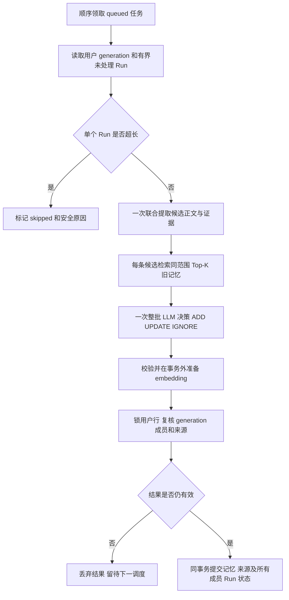

# 记忆生命周期设计

日期：2026-11-15。状态：检索与批量决策方案已实施；测试及独立复审记录见验收报告。
实施安排见[实施方案](memory-lifecycle-implementation-plan.md)，实际证据见[验收报告](memory-lifecycle-e2e-report.md)。

## 1. 范围与取舍

面向低并发、单个 Memory Worker 进程。后台顺序处理用户任务，每次联合提取一批同用户、
同项目来源范围内尚未处理的 Run。API 与普通 Run Worker 仍可独立运行。

直接读取 PostgreSQL 中的记忆正文与必要元数据；不维护摘要、Markdown 快照、对象存储或管理页，不新增
importance 或模型使用归因。只保留用户状态行锁、一个 generation、单条记忆 version 和同步控制回执。

删除 scope revision CAS、多重变更代次、时间删除屏障、任务租约/心跳/fencing、Run 分片清单
与逐片回执、竞争后的三次重新决策。首版不支持多个 Memory Worker 实例。

## 2. 五张表

| 表 | 职责 |
| --- | --- |
| memories | 正文、kind、加载策略、有效状态、单条版本、向量和证据时间 |
| memory_sources | 直接用户证据、来源消息与真实证据时间 |
| memory_settings | 用户设置、generation；作为用户写事务锁行 |
| memory_scope_state | personal/project 范围启用状态和维护进度 |
| memory_jobs | 普通后台任务、同步 control 回执和扫描进度，使用类型化 JSON |

后台任务状态为 queued/running/done/failed；control 只作为提交回执，不进入后台领取。
不保存 worker 归属、租约或固定分片计划。Run 保存整 Run 的 pending/completed/skipped/failed、
完成时间与安全错误码。固定上下文只保存条目 ID、版本、scope 和初始化标志，不保存正文或分片。

## 3. Run 读取

首次只选择当前用户 personal 与当前项目 active、未到期的 always 条目。未绑定项目只读 personal。
选择按长期保护、constraint/decision/preference/fact、证据时间和 ID 稳定排序。

- personal 默认 1000 tokens、project 默认 2000 tokens，每范围最多 200 条候选。
- 包装也计预算，整条放不下就跳过，不截断、不生成摘要。on_demand 通过 memory_search 获取。
- 固定选择包含“已初始化但为空”；恢复同一 Run 不扩选。
- 每次请求模型前复核固定引用及历史搜索结果的版本、有效性、权限和读取设置。失效正文移除，保留工具协议配对。
- 读取故障为空，不恢复旧正文。含记忆的失败请求不能直接复用旧正文自动重试。
- 记忆是不可信历史数据，不授予权限；当前用户指令优先，项目具体约定优先于个人一般偏好。

## 4. 同步控制

remember/correct/forget 沿用工具审批，只接受当前 Run 的直接用户证据。意图、事实、立场、
条件和期限必须由同一来源消息支持；引用、工具输出及模型猜测不构成授权。
敏感检测覆盖正文、证据及其他可持久化文本。不再要求事实键、基数、极性或适用条件结构。

remember 直接保存明确授权的正文，不隐式调用模型查重或事实组决策；correct 必须给出旧记忆 ID 和版本。
模型可先用 memory_search 查找目标，该工具同时返回 ID 和版本。forget 继续显式执行，不由后台决策生成。
remember/correct 的工具参数版本随本次不兼容变更升级；冻结旧参数协议的 Run 明确拒绝调用，
不静默按新协议执行，不为旧事实字段保留兼容分支。其他未改协议的工具继续使用原版本。

事务外核验证据、决策和准备 embedding。事务内锁用户状态行，重查同一 Run/tool call 的幂等回执，
有回执则校验规范参数的 SHA-256 摘要后直接返回；否则复核权限、目标版本和来源，提交记忆、来源、generation 递增和回执。
只有提交成功才反馈完成。响应丢失先查询回执，无法确认则返回未知结果。

忘记清空正文、向量、来源和分类，保留无正文墓碑。整范围清除必须有明确意图。
历史聊天正文不随记忆删除撤回。

generation 只能挡住在途旧结果，不能独自阻止下一批重新选取旧证据。因此忘记、纠正、关闭提取
和来源失效等操作，还需在同一事务中保守跳过已有相关未处理 Run，包括扫描尚未标记的旧终态输入。尚未终态的旧 Run 随后结束
不得覆盖失效标记，旧输入重试也不能重新激活它。可能跳过部分无关旧证据是首版接受的取舍，
不再引入时间屏障或逐事实删除追踪。

## 5. 联合提取与恢复

单 Worker 一次处理一个任务。模型与 embedding 调用期间不持数据库行锁。
批次限制 Run 数和输入预算，不混合不同项目来源。单 Run 超长则 skipped 并记录原因，不分片或截断证据。
无有效候选也结束这些 Run 的处理。

提交锁用户行后检查 generation、成员仍未处理、来源可见、项目有效和设置允许。
generation 变化则整体丢弃，不在当前任务内重新请求模型；仍有效的未处理 Run 留待下一次调度。
后台成功提交也更新 generation，保持所有记忆写入遵守同一协调规则。

整批记忆、来源和 Run 标记同事务提交。响应丢失后以成员 Run 已处理状态去重，不重复应用。
崩溃未提交由事务回滚；Worker 启动把普通 running 任务恢复为 queued，重新读取未处理 Run。
control 不恢复为后台任务。不保存持久化候选计划，不需要分片回放和租约接管。

供应商故障记录安全错误，不阻塞聊天；失败任务不在紧密循环中无限重试。
新 Run 唤醒与定期扫描补偿遗漏，扫描任务保留启用边界和普通游标。首次启用只处理启用边界后的 Run，不全历史回扫。

## 6. 检索与一次批量决策

正常流程是两次模型调用：先提取一次，再整批决策一次。没有有效候选时无需第二次调用。
不按每条候选追加语义评审，不递归调用模型解决冲突。

提取只返回正文、来源消息 ID、原文证据、个人/项目范围、kind、load_policy 建议及可选到期时间。
服务端为候选分配索引。删除 subject_key、fact_key、fact_value、cardinality、polarity、claim_intent、
applicability、固定别名映射、事实组查询及 fact_resolution.py；条件和否定由正文完整表达。

每条候选在同用户、同写入范围内做向量与全文检索，默认 Top-K 为 5，融合去重。
检索提供候选，不直接决定替代关系。旧记忆携带 ID、版本、正文和必要状态，整批输入统一去重，
同时保留每条候选对应的可选目标白名单。检索数量及总输入预算有界，未实际提供给模型的条目不可被修改。

批量模型接收新候选、按时间排列的用户原话和检索结果，每条候选只返回一次 ADD、UPDATE 或 IGNORE：

| 决策 | 行为 |
| --- | --- |
| ADD | 新增一条，已有可同时成立的记忆保留 |
| UPDATE | 指定该候选检索白名单中的旧 ID；可输出合并后的正文，保留来源及替代关系 |
| IGNORE | 不写入，不因检索命中刷新证据时间；成员 Run 仍结束提取 |

代码校验决策完整性、长度与敏感信息、目标白名单、scope、目标版本和 generation。
目标版本来自服务端检索快照，不由模型指定；同批重复更新同一目标或捏造 ID 均拒绝，不进行半批提交。
UPDATE 沿用新条目替代旧条目的关系，旧来源保持可追溯。模型不能生成忘记命令或扩大权限。

提示词明确：喜欢苹果后喜欢香蕉应 ADD 并存；最喜欢苹果后明确改为香蕉才 UPDATE；
同批表达先选最终状态再提交，引用、工具内容、一次性要求和猜测不沉淀。否定、时间及条件不能丢失。
中文回复规则和长期项目约束可为 always，普通话题偏好默认 on_demand，“记住”不自动升级。
两次调用都附真实 Pydantic JSON Schema，服务端不另造一套语义状态机。
提取和决策默认各允许 4000 输出 tokens；决策预算可通过
`ATHENA_MEMORY_DECISION_OUTPUT_TOKENS` 调整，正常路径仍只有两次调用，不自动追加语义重试。

Top-K 可能漏召回，模型也可能判断错误。因此不能承诺完整消重；不确定时保守 ADD 或 IGNORE，
不强行覆盖未召回条目。后续改善召回或提示词，不重新引入事实键对齐和二次裁决框架。

## 7. 归档与删除协调

归档按最近直接用户证据时间，检索命中不延寿；到期优先于长期保护，每日任务无新聊天也执行。
新证据可激活归档条目，旧证据不能恢复 superseded 或已删除条目。
Session 删除使未处理来源失效，保留已确认记忆；项目删除禁用 scope、跳过相关 Run 并安排正文清理。
来源失效与 generation 更新在协调事务内完成，旧后台结果无法提交。
其他领域沿用其必要事务规则，不删除普通 Run 执行租约。

## 8. 迁移与部署

增量迁移保留记忆正文、来源、单条版本、control 回执和 Run 固定上下文；0027 删除废弃事实身份列及索引。
旧结构列若保存了正文之外的实际限定，先将限定作为普通文本保留；只对变更正文的行更新版本、hash 和全文索引，
清除失配的旧向量，后续可通过全文召回或新证据 UPDATE。墓碑不补正文。迁移前停止旧应用/Worker，迁移后再启动。
历史提取任务结果 JSON 随新统计字段投影，避免旧字段触发严格模型校验失败；历史 control 回执及其摘要、
密钥版本保持不变，不把已提交操作当成未执行而自动重建。冻结旧工具协议的调用由工具版本门明确拒绝。
旧未完成后台计划重新排队，不保留废弃协议兼容层。
默认开关保持关闭，只启动一个 Memory Worker。配置保留轮询、批次、模型输出、上下文和归档参数。
数据库原子性、恢复行为和模型语义分别验证；报告明确真实 embedding 与独立进程启动的验证范围。
